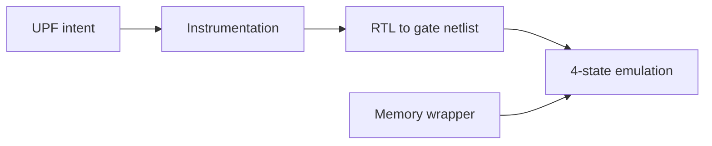

<!-- generated by yt-paper; edits will be overwritten -->
[DVCon](../dvcon/index.md) › [US](../dvcon/us.md) › [2024](../dvcon/by-year.md#2024) › [Emulation](../dvcon/by-topic.md#emulation)

# Complexities & Challenges of UPF Corruption Model in Low Power Emulation

<figure class="rep-fig" markdown>
{ loading=lazy }
<figcaption>Figure 6. Memory corruption results at power down without memory wrapper — from the original paper (Progyna Khondkar et al.)</figcaption>
</figure>

[:material-open-in-new: Original paper](https://dvcon-proceedings.org/wp-content/uploads/1161.pdf){ .md-button .md-button--primary target=_blank }

| | |
|---|---|
| Authors | Progyna Khondkar (Cadence Design Systems), Brad Budlong (Cadence Design Systems) |
| Venue | DVCon US 2024 |
| Topic | Emulation |
| Type | PAPER |
| ID | `ref-20261018-fbca` |

## Summary

**The paper analyzes why UPF power-down corruption (X-propagation) is hard to reproduce on 2-state hardware emulators, compares simulator and emulator behavior via experiments, and presents Cadence's 4-state emulation approach with an automatic memory wrapper for memory corruption.**

**이 논문은 2-state 하드웨어 에뮬레이터에서 UPF 전원 차단 corruption(X 전파)을 재현하기 어려운 이유를 분석하고, 시뮬레이터와 에뮬레이터의 동작을 실험으로 비교하며, 메모리 corruption을 위한 자동 메모리 wrapper를 포함한 Cadence의 4-state 에뮬레이션 접근법을 제시한다.**

## Key Insights

- Emulators are inherently 2-state, so UPF corruption to X is either unavailable or must be faked with 0/1/random/inverted values, which only affects debug visualization, not actual X behavior.

- 에뮬레이터는 본질적으로 2-state이므로 UPF corruption-to-X는 사용할 수 없거나 0/1/random/inverted 값으로 흉내 내야 하며, 이는 실제 X 동작이 아니라 디버그 시각화에만 영향을 준다.

- Emulation synthesizes RTL to gate netlists, so X-pessimism/optimism follows CAT-like hardware semantics and may diverge from SV LRM simulation; equivalent RTL can behave differently in simulation but identically in emulation if it maps to the same gates.

- 에뮬레이션은 RTL을 gate netlist로 합성하므로 X pessimism/optimism이 하드웨어에 가까운 CAT 유사 의미를 따르며, 이로 인해 SV LRM 시뮬레이션과 달라질 수 있다. 동등한 RTL이라도 같은 gate로 매핑되면 에뮬레이션에서는 동일하게 동작한다.

- In the paper's comparison tables, 4-state emulation matched simulator corruption for latches, FFs and regs, with one exception: an X-to-0 deposition at time 0 after swap-in occurred only on emulation.

- 논문 비교표에서 4-state 에뮬레이션은 latch, FF, reg의 corruption에서 시뮬레이터와 일치했으며, 예외는 swap-in 후 time 0에서 에뮬레이션에서만 발생한 X-to-0 deposition이다.

- Without a memory wrapper, memory contents were not corrupted at power-down (dump showed 00001111 while the output showed X); with the automatic wrapper, the dump showed xxxxxxxx, matching simulation, at no runtime cost.

- wrapper가 없을 때 메모리는 전원 차단 시 corruption되지 않았다(출력은 X, 덤프는 00001111). 자동 wrapper를 적용하면 덤프가 xxxxxxxx로 나타나 시뮬레이션과 일치했고 런타임 비용은 없었다.

- Capacity and clock-frequency impact of the 4-state corruption model versus 2-state is left as future work; no quantitative performance or capacity figures are reported.

- 4-state corruption 모델의 용량 및 클록 주파수 영향은 향후 과제로 남겨졌으며, 논문은 정량적 성능이나 용량 수치를 제시하지 않는다.

## Detailed Summary

### Background and Problem

- UPF (IEEE 1801) power-down corruption requires X propagation for accurate low-power verification, but simulators are too slow for multi-pass power sequencing on multi-billion-gate SoCs.

- UPF(IEEE 1801)의 전원 차단 corruption을 정확히 검증하려면 X 전파가 필요하지만, 시뮬레이터는 수십억 게이트 SoC에서 다중 패스 전원 시퀀스를 실행하기에 너무 느리다.

- Emulators run fast and scale to ~10 BG, yet their silicon is 2-state (0/1), so X corruption, initialization and propagation must be faked.

- 에뮬레이터는 빠르고 약 10 BG까지 확장되지만 실리콘 기반 2-state(0/1)이므로 X corruption, 초기화, 전파를 흉내 내야 한다.

- The paper argues that 4-state emulation is needed and that X pessimism/optimism differences between RTL simulation and gate-level emulation complicate congruency.

- 논문은 4-state 에뮬레이션이 필요하며, RTL 시뮬레이션과 gate-level 에뮬레이션 사이의 X pessimism/optimism 차이가 일치성을 어렵게 만든다고 주장한다.

### Architecture and Methodology

- Corruption follows the UPF/LRM rules: sequential elements and drivers inside a powered-down domain are corrupted, and values are restored on power-up.

- Corruption은 UPF/LRM 규칙을 따른다. 전원이 차단된 도메인 내부의 순차 소자와 드라이버는 corruption되며, 전원 복구 시 값이 복원된다.

- Simulators offer three X modes: LRM (default), CAT (optimistic, hardware-like), and FOX (pessimistic). The paper argues emulation can only mirror CAT.

- 시뮬레이터는 세 가지 X 모드를 제공한다: LRM(기본), CAT(낙관적, 하드웨어와 유사), FOX(비관적). 논문은 에뮬레이션이 CAT만 따를 수 있다고 주장한다.

- Experiments (Table 2, Table 3) compare simulator, 2-state emulator and 4-state emulator across latches, FFs, regs, memories and power-state transitions.

- 실험(Table 2, Table 3)은 latch, FF, reg, 메모리, 전원 상태 전이에 대해 시뮬레이터, 2-state 에뮬레이터, 4-state 에뮬레이터를 비교한다.

- For memories and FIFOs, the proposed automatic memory wrapper models X on address/control signals and corrupts contents without runtime overhead.

- 메모리와 FIFO의 경우, 제안된 자동 메모리 wrapper가 주소/제어 신호의 X를 모델링하고 런타임 오버헤드 없이 내용을 corruption한다.

### Results and Conclusions

- 4-state emulation corrupts latches, FFs and regs to X, matching simulator behavior, except for an X-to-0 deposition at time 0 after swap-in.

- 4-state 에뮬레이션은 latch, FF, reg를 X로 corruption하여 시뮬레이터 동작과 일치했으며, 예외는 swap-in 후 time 0의 X-to-0 deposition이다.

- Without the wrapper, a 00001111 write stayed uncorrupted in the memory dump; with the wrapper, the dump showed xxxxxxxx, matching simulation.

- Wrapper가 없을 때 00001111 쓰기 값은 메모리 덤프에서 corruption되지 않았고, wrapper 적용 시 덤프는 xxxxxxxx로 나타나 시뮬레이션과 일치했다.

- The paper is qualitative and does not quantify capacity or frequency cost of 4-state corruption; this is deferred to future work.

- 논문은 정성적이며 4-state corruption의 용량 및 주파수 비용을 정량화하지 않고 향후 과제로 남겼다.

## Videos

<iframe src="https://www.youtube-nocookie.com/embed/1jqlMFmjzEY" title="[DVCON2024] Complexities & Challenges of UPF Corruption Model in Low Power Emulation" loading="lazy" allow="accelerometer; clipboard-write; encrypted-media; gyroscope; picture-in-picture; web-share" referrerpolicy="strict-origin-when-cross-origin" allowfullscreen></iframe>

**[DVCON2024] Complexities & Challenges of UPF Corruption Model in Low Power Emulation** — [Watch on YouTube](https://www.youtube.com/watch?v=1jqlMFmjzEY) · [Video page](../videos/1jqlMFmjzEY.md)
