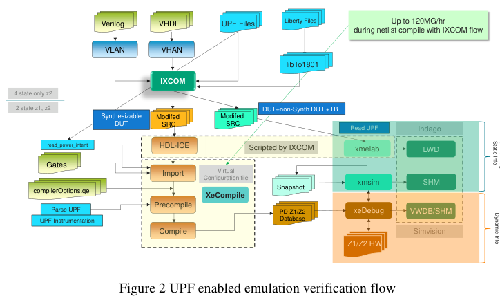
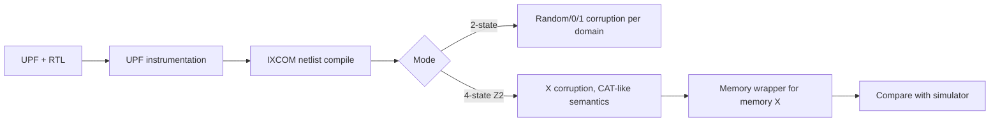

<!-- generated by yt-paper; edits will be overwritten -->
[DVCon](../dvcon/index.md) › [US](../dvcon/us.md) › [2024](../dvcon/by-year.md#2024) › [Emulation](../dvcon/by-topic.md#emulation)

# Complexities & Challenges of UPF Corruption Model in Low Power Emulation

<figure class="rep-fig" markdown>
{ loading=lazy }
<figcaption>Figure 2 UPF enabled emulation verification flow — from the original paper (Progyna Khondkar et al.)</figcaption>
</figure>

[:material-open-in-new: Original paper](https://dvcon-proceedings.org/wp-content/uploads/1161.pdf){ .md-button .md-button--primary target=_blank }

| | |
|---|---|
| Authors | Progyna Khondkar (Cadence), Brad Budlong (Cadence) |
| Venue | DVCon US 2024 |
| Topic | Emulation |
| Type | PAPER |
| ID | `ref-20261018-fbca` |

## Summary

**The paper explains why 2-state hardware emulators cannot natively model UPF power-down corruption to X, shows empirically that a 4-state emulation corruption model matches simulator behavior for registers, latches, and ports, and introduces an automatic memory wrapper so memory contents are actually corrupted during power-down.**

**이 논문은 2-state 하드웨어 에뮬레이터가 UPF 전원 차단 시 X 오염(corruption)을 기본적으로 모델링할 수 없는 이유를 설명하고, 4-state 에뮬레이션 오염 모델이 레지스터, 래치, 포트에서 시뮬레이터 동작과 일치함을 실험으로 보이며, 전원 차단 중 메모리 내용이 실제로 오염되도록 자동 메모리 래퍼를 제안한다.**

## Key Insights

- Emulators run accelerated simulation up to about 4 MHz on designs up to about 10 BG, while 8-10 BG SoCs consume 60-70% of verification effort; multi-pass power sequencing is practical mainly on emulation, which makes 4-state emulation valuable for realistic UPF workloads.

- 에뮬레이터는 최대 약 10 BG 설계에서 최대 약 4 MHz로 가속 시뮬레이션을 수행하며, 8-10 BG SoC는 검증 工数의 60-70%를 소모한다. 다단계 전원 시퀀싱은 주로 에뮬레이션에서 실용적이므로, 현실적인 UPF 워크로드에서는 4-state 에뮬레이션이 가치가 크다.

- In 2-state emulation, corruption is limited to user-selected {high | low | random | inverted} values per power domain (create_power_domain -power_down_states/-power_up_states). Any X shown in the debugger is only a visual tag, not real X propagation or initialization.

- 2-state 에뮬레이션의 오염은 전원 도메인별로 사용자가 선택한 {high | low | random | inverted} 값으로 제한된다(create_power_domain -power_down_states/-power_up_states). 디버거에 X로 표시되더라도 이는 시각적 태그일 뿐 실제 X 전파나 초기화가 아니다.

- Table 2/3 experiments report that the 4-state emulator corrupts latches, FFs, and regs to X, matching the simulator. The only mismatch is an X-to-0 deposition at time 0 after swap-in, which the emulator performs but the simulator does not until reset.

- Table 2/3 실험에서 4-state 에뮬레이터는 래치, FF, reg를 X로 오염시키며 시뮬레이터와 일치한다. 유일한 차이는 swap-in 직후 time 0에서의 X-to-0 deposition으로, 에뮬레이터에서는 발생하지만 시뮬레이터에서는 reset 전까지 발생하지 않는다.

- Emulation synthesizes RTL into a gate netlist and adopts only a CAT-like (optimistic) X semantics, so X-pessimism/optimism differences versus LRM simulation are expected; two RTL implementations that synthesize to the same gates behave the same in emulation.

- 에뮬레이션은 RTL을 게이트 넷리스트로 합성하고 CAT 유사(낙관적) X 의미론만 채택한다. 따라서 LRM 시뮬레이션과의 X 비관/낙관 차이는 예상되는 현상이며, 동일한 게이트로 합성되는 두 RTL 구현은 에뮬레이션에서 동일하게 동작한다.

- Without the automatic memory wrapper, a power-down memory dump shows 0:ff/00001111 (not corrupted) even though 'out' is X; with the wrapper the dump shows 0:ff/xxxxxxxx, matching simulation. The authors claim no runtime cost, but the paper gives no quantitative capacity or performance overhead data (left as future work).

- 자동 메모리 래퍼가 없으면 출력은 X인데도 전원 차단 시 메모리 덤프가 0:ff/00001111로 나타나 실제로 오염되지 않는다. 래퍼를 적용하면 덤프가 0:ff/xxxxxxxx로 나와 시뮬레이션과 일치한다. 저자들은 런타임 비용이 없다고 주장하지만, 논문은 용량 또는 성능 오버헤드의 정량 데이터를 제시하지 않으며 이는 향후 과제로 남긴다.

## Detailed Summary

### Background and Problem

- UPF (IEEE 1801) describes power intent and drives low-power simulation, where power-down domains must be corrupted to X, X must propagate from OFF to ON domains, and X-state initialization after power-up must be checked.

- UPF(IEEE 1801)는 전력 인텐트를 기술하며 저전력 시뮬레이션을 구동한다. 이 시뮬레이션에서는 전원 차단 도메인을 X로 오염시키고, X가 OFF 도메인에서 ON 도메인으로 전파되어야 하며, 전원 복구 후 X 상태 초기화를 검사해야 한다.

- Event-driven simulators hit capacity and speed limits on SoCs of 8-10 BG with multi-pass power sequencing. Emulators (cycle-based, up to about 4 MHz, up to about 10 BG) are the practical platform for realistic power workloads.

- 이벤트 기반 시뮬레이터는 다단계 전원 시퀀싱을 수행하는 8-10 BG SoC에서 용량과 속도 한계에 부딪힌다. 에뮬레이터(사이클 기반, 최대 약 4 MHz, 최대 약 10 BG)가 현실적인 전력 워크로드를 위한 실용적 플랫폼이다.

- Emulator hardware is 2-state (0/1). Corruption to X, X initialization, and X propagation therefore cannot be modeled directly. Faking them with 0/1 values hides the X-pessimism/optimism behavior that matters for power verification.

- 에뮬레이터 하드웨어는 2-state(0/1)이다. 따라서 X로의 오염, X 초기화, X 전파를 직접 모델링할 수 없다. 0/1 값으로 흉내 내면 전력 검증에 중요한 X 비관/낙관 동작이 가려진다.

- The paper's scope is the corruption model: how 4-state semantics (SV `logic`/`reg` vs. 2-state `bit`/`int`) map onto emulation hardware, and where simulator and emulator results diverge.

- 본 논문의 범위는 오염 모델이다. 즉 4-state 의미론(SV `logic`/`reg` 대 2-state `bit`/`int`)이 에뮬레이션 하드웨어에 어떻게 대응되는지, 그리고 시뮬레이터와 에뮬레이터 결과가 어디서 달라지는지를 다룬다.

### Architecture and Methodology

- **Flow:** UPF is parsed and instrumented into the design (read_power_intent, supply network, isolation, retention, corruption). The netlist is compiled with the IXCOM flow onto Z1/Z2 hardware. The 2-state flow is available on Z1 and Z2, and 4-state is available on Z2 only (Figure 2).

- **흐름:** UPF를 파싱하여 설계에 계측한다(read_power_intent, 공급망, 아이솔레이션, 리텐션, 오염). 넷리스트는 IXCOM 흐름으로 Z1/Z2 하드웨어에 컴파일된다. 2-state 흐름은 Z1과 Z2에서, 4-state 흐름은 Z2에서만 가능하다(Figure 2).

- **Corruption semantics:** when a driver is powered down, its outputs and all sequential elements are corrupted. Process activity stops until power returns. On restore, continuous assignments are re-evaluated, and sequential elements are re-evaluated at the next clock.

- **오염 의미론:** 드라이버가 전원 차단되면 출력과 모든 순차 소자가 오염된다. 전원이 복구되기 전까지 프로세스 활동은 멈춘다. 복구 시 연속 할당이 재평가되고, 순차 소자는 다음 클록에서 재평가된다.

- **2-state vs 4-state:** 2-state signals initialize to 0 and 4-state signals initialize to X. Automatic 4-to-2 conversion turns X/Z into 0.

- **2-state 대 4-state:** 2-state 신호는 0으로, 4-state 신호는 X로 초기화된다. 4-state에서 2-state로의 자동 변환은 X/Z를 0으로 바꾼다.

- **Simulator vs emulator x-handling:** simulators have three modes: LRM (default), CAT (optimistic, similar to hardware), and FOX (pessimistic forwarding). Emulation can only mimic CAT, because RTL is synthesized to gates.

- **시뮬레이터 대 에뮬레이터의 X 처리:** 시뮬레이터는 세 가지 모드를 가진다. LRM(기본), CAT(낙관적, 하드웨어와 유사), FOX(비관적 전파)이다. 에뮬레이션은 RTL을 게이트로 합성하므로 CAT만 모방할 수 있다.

- **Experiments:** Table 2 compares simulator, 2-state emulator, and 4-state emulator for power-domain objects (ports, latches, FFs/regs, memories). Table 3 compares run-time states (ON/OFF transitions, async reset, ISO clamp, RET save/restore, time-0 after swap-in).

- **실험:** Table 2는 전원 도메인 객체(포트, 래치, FF/reg, 메모리)에 대해 시뮬레이터, 2-state 에뮬레이터, 4-state 에뮬레이터를 비교한다. Table 3은 실행 시점 상태(ON/OFF 전이, 비동기 리셋, ISO 클램프, RET 저장/복구, swap-in 직후 time 0)를 비교한다.

- **Memory wrapper:** emulation cannot cheaply model X in memory contents. Random loads and external update logic were considered and rejected as slow or resource-heavy. The 4-state flow adds an automatic memory wrapper in hardware. It also models X on address and control signals, which non-bit-blasted memories otherwise treat as 0.

- **메모리 래퍼:** 에뮬레이션에서는 메모리 내용의 X를 저비용으로 모델링하기 어렵다. 임의 값 로딩과 외부 갱신 로직은 느리거나 자원을 많이 쓰므로 기각되었다. 4-state 흐름은 하드웨어에 자동 메모리 래퍼를 추가한다. 또한 bit-blast되지 않은 메모리가 0으로 해석하는 주소 및 제어 신호의 X도 모델링한다.

### Results and Conclusions

- **Register and latch behavior:** the 4-state emulator matches the simulator for latches, FFs, regs, and power-domain outputs (Figure 4 vs Figure 5). The 2-state emulator shows 0 during power OFF and random values after power ON (Figure 3). Only the 4-state flow reproduces the X waveform seen in simulation.

- **레지스터 및 래치 동작:** 4-state 에뮬레이터는 래치, FF, reg, 전원 도메인 출력에서 시뮬레이터와 일치한다(Figure 4 대 Figure 5). 2-state 에뮬레이터는 전원 OFF 동안 0을 보이고 ON 후 random 값을 보인다(Figure 3). 4-state 흐름만이 시뮬레이션에서 보이는 X 파형을 재현한다.

- **Mismatch:** Table 3 row 1 shows an X-to-0 deposition at time 0 after swap-in in emulation. Simulation keeps X until reset.

- **불일치:** Table 3의 1행은 에뮬레이션에서 swap-in 직후 time 0의 X-to-0 deposition을 보여준다. 시뮬레이션은 reset 전까지 X를 유지한다.

- **Memory corruption:** without the wrapper, the output is X but the memory dump still holds 00001111, so memory is not corrupted (Figure 6). With the wrapper, the dump is xxxxxxxx, matching simulation (Figure 7).

- **메모리 오염:** 래퍼가 없으면 출력은 X이지만 메모리 덤프에는 00001111이 남아 있어 메모리가 오염되지 않는다(Figure 6). 래퍼가 있으면 덤프가 xxxxxxxx가 되어 시뮬레이션과 일치한다(Figure 7).

- **Limitations:** the empirical evidence is qualitative tables and waveform screenshots. No capacity or clock-frequency overhead is measured. The authors state that quantifying the 4-state vs 2-state capacity and performance impact is future work.

- **한계:** 실증 근거는 정성적 표와 파형 캡처이다. 용량이나 클록 주파수 오버헤드는 측정되지 않았다. 저자들은 4-state 대 2-state의 용량 및 성능 영향 정량화를 향후 과제로 명시한다.

- **Conclusion:** the 4-state emulation corruption model, with a memory wrapper, is presented as the path to simulation/emulation congruent UPF verification. The paper is positioned as a reference for the complexity of this problem.

- **결론:** 메모리 래퍼를 포함한 4-state 에뮬레이션 오염 모델은 시뮬레이션과 에뮬레이션이 일치하는 UPF 검증으로 가는 경로로 제시된다. 본 논문은 이 문제의 복잡성을 정리한 참고 자료로 위치한다.

## Videos

<iframe src="https://www.youtube-nocookie.com/embed/1jqlMFmjzEY" title="[DVCON2024] Complexities & Challenges of UPF Corruption Model in Low Power Emulation" loading="lazy" allow="accelerometer; clipboard-write; encrypted-media; gyroscope; picture-in-picture; web-share" referrerpolicy="strict-origin-when-cross-origin" allowfullscreen></iframe>

**[DVCON2024] Complexities & Challenges of UPF Corruption Model in Low Power Emulation** — [Watch on YouTube](https://www.youtube.com/watch?v=1jqlMFmjzEY) · [Video page](../videos/1jqlMFmjzEY.md)
