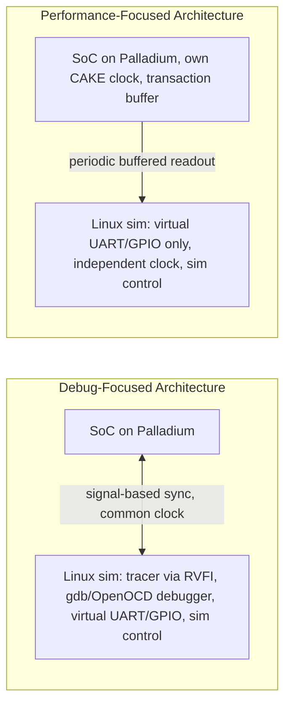

<!-- generated by yt-paper; edits will be overwritten -->
[DVCon](../dvcon/index.md) › [Japan](../dvcon/japan.md) › [2023](../dvcon/by-year.md#2023) › [Emulation](../dvcon/by-topic.md#emulation)

# Architectures to Tradeoff Performance vs. Debug for Software Development on Emulation Platform

[:material-open-in-new: Original paper](https://dvcon-proceedings.org/wp-content/uploads/TS1D-Architecture-to-tradeoff-Performance-vs-Debug-for-SW-Development-on-Emulation-Platform-paper.pdf){ .md-button .md-button--primary target=_blank }

| | |
|---|---|
| Authors | Loganath Ramachandran, Ph.D. (Verikwest Systems Inc, USA), Ragavender Swamisai (Belmont Computing, USA), Prof Makoto Ikeda, Ph.D. (University of Tokyo, Japan) |
| Venue | DVCon Japan 2023 |
| Topic | Emulation |
| Type | PAPER |
| ID | `ref-20261018-fd31` |

## Summary

**The paper proposes two switchable emulation testbench architectures for SoC software development on Palladium: a debug-focused mode (DFA) with cycle-accurate lock-step tracing and debugger support, and a performance-focused mode (PFA) with asynchronous clocking and transaction-based sync, both sharing the same RTL.**

**이 논문은 Palladium 상에서 SoC 소프트웨어 개발을 위해, 동일한 RTL을 공유하면서 전환 가능한 두 가지 에뮬레이션 테스트벤치 구조를 제안합니다. 하나는 cycle-accurate lock-step 트레이싱과 디버거를 지원하는 디버그 중심 모드(DFA)이고, 다른 하나는 비동기 클록과 transaction 기반 sync를 사용하는 성능 중심 모드(PFA)입니다.**

## Key Insights

- Emulation performance drops sharply when debug is enabled: the paper cites several MHz peak for emulation versus 10-100 kHz when debugging, and its measured DFA run reached 26.92 kHz against 2236.76 kHz for PFA.

- 디버그를 켜면 에뮬레이션 성능이 크게 떨어집니다. 논문은 에뮬레이션 peak가 수 MHz이지만 디버그 시 10-100 kHz로 떨어진다고 제시하며, 실측에서 DFA는 26.92 kHz, PFA는 2236.76 kHz를 기록했습니다.

- Lock-step, cycle-accurate sync between the simulator-hosted testbench and the emulated DUT (needed for tracer and gdb/OpenOCD debugger) is the main performance bottleneck; DFA used 900,700 tbsyncs on CoreMark versus 29 for PFA.

- 시뮬레이터에서 구동되는 테스트벤치와 에뮬레이트된 DUT 사이의 lock-step, cycle-accurate sync(트레이서와 gdb/OpenOCD 디버거에 필요)가 주요 성능 병목입니다. CoreMark 실행 시 DFA는 900,700 tbsync, PFA는 29 tbsync를 사용했습니다.

- Keeping the same synthesized RTL in both modes means a bug found in one mode is reproducible in the other and synthesis effort is shared; PFA adds only extra instantiated components (e.g., clock generator, transaction buffer).

- 두 모드가 동일한 합성 RTL을 사용하므로 한 모드에서 발견된 버그를 다른 모드에서 재현할 수 있고 합성 작업을 공유합니다. PFA는 클록 생성기, transaction buffer 등 추가 컴포넌트만 더 인스턴스화합니다.

- PFA decouples the emulator clock from the host testbench by using a native CAKE clock generator (clkgen.qel, clk_i at 1 MHz) and a transaction buffer for UART/GPIO outputs polled periodically, raising HW busy to 86.82% versus 1.04% for DFA.

- PFA는 CAKE 기반 네이티브 클록 생성기(clkgen.qel, clk_i 1 MHz)와 UART/GPIO 출력을 주기적으로 읽어 가는 transaction buffer를 사용해 에뮬레이터 클록을 호스트 테스트벤치와 분리합니다. 이로 인해 HW busy는 DFA의 1.04%에서 86.82%로 높아졌습니다.

- The paper reports close to a 100x speedup of PFA over DFA on CoreMark; from the table, 2236.76/26.92 is about 83x, and the stated 300% higher tbsync count for DFA does not match the 900,700 vs 29 table values, so these figures should be checked against the original data.

- 논문은 CoreMark에서 PFA가 DFA 대비 거의 100배 빠르다고 보고하지만, 표에서 2236.76/26.92는 약 83배입니다. 또한 DFA의 tbsync가 300% 많다는 서술은 표의 900,700 대 29 값과 맞지 않으므로 원본 데이터로 확인이 필요합니다.

## Detailed Summary

### Background and Problem

- SoC software (boot code, security parameters, drivers, applications) must be developed before silicon is available, so early development is needed to avoid months of post-tapeout delay.

- SoC 소프트웨어(부트 코드, 보안 파라미터, 드라이버, 애플리케이션)는 실리콘이 나오기 전에 개발해야 하며, 그렇지 않으면 tapeout 이후 수개월의 지연이 생깁니다.

- The paper compares candidate platforms: RTL simulation (cycle-accurate and fully visible but kHz speed), ISS such as Spike (fast but has no SoC context), virtual prototypes (fast but miss RTL bugs), emulation with signal-based or transaction-based acceleration, ICE mode (highest speed, limited debug, needs Speedbridge adapters for peripherals), and hybrid emulation with C-based CPU models (improved boot speed, sync cost remains).

- 논문은 후보 플랫폼을 비교합니다. RTL 시뮬레이션(cycle-accurate이며 신호 가시성이 높지만 kHz 속도), Spike 같은 ISS(빠르지만 SoC 맥락이 없음), virtual prototype(빠르지만 RTL 버그를 놓침), 신호 기반 또는 transaction 기반 가속을 쓰는 에뮬레이션, ICE 모드(가장 빠르지만 디버그가 제한적이고 주변장치용 Speedbridge 어댑터 필요), C 기반 CPU 모델을 쓰는 hybrid 에뮬레이션(부트 속도 개선, sync 비용은 잔존)을 다룹니다.

- Core tension: debugging needs the DUT and testbench to run in lock-step on a single clock, which lowers performance. High performance needs the DUT to run independently and sync rarely.

- 핵심 긴장 관계: 디버그를 위해서는 DUT와 테스트벤치가 단일 클록으로 lock-step 동작해야 하며, 이는 성능을 떨어뜨립니다. 고성능을 위해서는 DUT가 독립적으로 동작하고 sync를 드물게 해야 합니다.

- Goal: one switchable setup that runs the same software in both a high-performance mode and a debug mode, without maintaining two separate verification environments.

- 목표: 별도의 두 검증 환경을 유지하지 않고, 동일한 소프트웨어를 고성능 모드와 디버그 모드 모두에서 실행할 수 있는 전환 가능한 구성을 만드는 것입니다.

### Architecture and Methodology

Both architectures use the same RTL, and the target is the Athos SoC: an Ibex RISC-V core with TileLink main and peripheral buses, UART, GPIO, and other lowRisc-derived peripherals, implemented on Cadence Palladium. Software is written in C across the HAL, runtime library, boot code, test harness, and user code. The build is handled by ProtoForge, and the RISC-V GNU toolchain is used.

두 구조는 동일한 RTL을 사용하며 대상은 Cadence Palladium에 구현된 Athos SoC입니다. 이 SoC는 Ibex RISC-V 코어, TileLink 메인 및 주변장치 버스, UART, GPIO 및 기타 lowRisc 기반 주변장치로 구성됩니다. 소프트웨어는 HAL, 런타임 라이브러리, 부트 코드, 테스트 하네스, 사용자 코드까지 모두 C로 작성되었습니다. 빌드는 ProtoForge로 처리되며 RISC-V GNU 툴체인을 사용합니다.

- **DFA (debug-focused):** The tracer taps the Ibex RVFI interface, and retired instructions are written to tracer.log. A debugger interface connects to gdb, and OpenOCD is used for debug access. Peripheral processing is done by virtual components on the simulator side. Waveform dumps (e.g., SimVision) are possible. The testbench and DUT run cycle-accurately on a single shared clock, and software-based drivers and monitors are used.

- **DFA(디버그 중심):** 트레이서는 Ibex RVFI 인터페이스에 연결되며, retire된 명령은 tracer.log에 기록됩니다. 디버거 인터페이스는 gdb에 연결되고 디버그 접근에는 OpenOCD를 사용합니다. 주변장치 처리는 시뮬레이터 측의 virtual 컴포넌트가 담당합니다. 파형 덤프(예: SimVision)도 가능합니다. 테스트벤치와 DUT는 단일 공유 클록으로 cycle-accurate하게 동작하며, 소프트웨어 기반 드라이버와 모니터를 사용합니다.

- **PFA (performance-focused):** The clock is generated natively on the emulator from a qel file (clk_i at 1 MHz, CAKE technology). A transaction buffer captures all UART and GPIO outputs, and the simulator retrieves them periodically and stores them in logs. The testbench contains only virtual GPIO/UART components, driven by an unsynchronized clock. Hardware transactors are used, and no tracer or debugger is included.

- **PFA(성능 중심):** 클록은 qel 파일(CAKE 기술, clk_i 1 MHz)을 통해 에뮬레이터에서 네이티브로 생성됩니다. Transaction buffer가 UART와 GPIO의 모든 출력을 캡처하며, 시뮬레이터는 이를 주기적으로 가져와 로그에 저장합니다. 테스트벤치에는 동기화되지 않은 클록으로 구동되는 virtual GPIO/UART 컴포넌트만 포함됩니다. Hardware transactor를 사용하며 트레이서와 디버거는 포함하지 않습니다.

- **Shared elements:** Both modes use the same synthesized DUT and the same control engine, which loads boot code, forces signals, and detects end of test. Virtual peripherals convert SoC output into terminal prints or files, which makes failures easier to diagnose.

- **공유 요소:** 두 모드 모두 동일하게 합성된 DUT와 부트 코드 로딩, 신호 강제, 테스트 종료 감지를 수행하는 제어 엔진을 사용합니다. Virtual 주변장치는 SoC 출력을 터미널 출력이나 파일로 변환하여 실패 원인 파악을 쉽게 합니다.

- The paper notes that virtual peripherals reduce performance but broaden the usable scope of the emulator.

- 논문은 virtual 주변장치가 성능을 낮추지만 에뮬레이터의 활용 범위를 넓힌다고 언급합니다.

### Results and Conclusions

Measured on the CoreMark benchmark running on Palladium:

CoreMark 벤치마크를 Palladium에서 실행한 결과는 다음과 같습니다.

| Architecture | DUT speed | #Tbsyncs | HW Busy % |
|---|---|---|---|
| DFA | 26.92 kHz | 900700 | 1.04% |
| PFA (with dumping enabled) | 2236.76 kHz | 29 | 86.82 |

| 구조 | DUT 속도 | #Tbsyncs | HW Busy % |
|---|---|---|---|
| DFA | 26.92 kHz | 900700 | 1.04% |
| PFA (dumping 활성화) | 2236.76 kHz | 29 | 86.82 |

- The paper reports close to a 100x performance gap between PFA and DFA. The table ratio is about 83x (2236.76 / 26.92).

- 논문은 PFA와 DFA 사이에 거의 100배의 성능 차이가 있다고 보고합니다. 표의 비율은 약 83배입니다(2236.76 / 26.92).

- The text says DFA had 300% more tbsyncs. The table values imply a much larger difference, so this figure is inconsistent.

- 본문은 DFA의 tbsync가 300% 더 많다고 서술하지만, 표의 값은 훨씬 큰 차이를 의미하므로 이 수치는 일관되지 않습니다.

- Recommended usage: PFA for nightly regressions and DFA for debugging failures. The two modes can be switched without changing the software flow.

- 권장 사용처: 야간 회귀에는 PFA, 실패 디버그에는 DFA를 사용합니다. 두 모드는 소프트웨어 흐름을 바꾸지 않고 전환할 수 있습니다.

- The paper is a short industrial report. It gives a single benchmark and a single SoC, and it does not provide a broader multi-workload evaluation.

- 본 논문은 짧은 산업 보고서이며, 단일 벤치마크와 단일 SoC에 대한 평가만 제시하고 여러 워크로드에 대한 광범위한 평가는 포함하지 않습니다.</detailed_summary_ko>

<parameter name="one_line_summary_ko">이 논문은 Palladium 상에서 SoC 소프트웨어 개발을 위해, 동일한 RTL을 공유하면서 전환 가능한 두 가지 에뮬레이션 테스트벤치 구조를 제안합니다. 하나는 cycle-accurate lock-step 트레이싱과 디버거를 지원하는 디버그 중심 모드(DFA)이고, 다른 하나는 비동기 클록과 transaction 기반 sync를 사용하는 성능 중심 모드(PFA)입니다.

## Videos

<iframe src="https://www.youtube-nocookie.com/embed/Ge6veMYhti4" title="[DVCON2023_JPN]Architectures to Tradeoff Performance vs Debug Software Development on Emulation  " loading="lazy" allow="accelerometer; clipboard-write; encrypted-media; gyroscope; picture-in-picture; web-share" referrerpolicy="strict-origin-when-cross-origin" allowfullscreen></iframe>

**[DVCON2023_JPN]Architectures to Tradeoff Performance vs Debug Software Development on Emulation  ** — [Watch on YouTube](https://www.youtube.com/watch?v=Ge6veMYhti4) · [Video page](../videos/Ge6veMYhti4.md)
