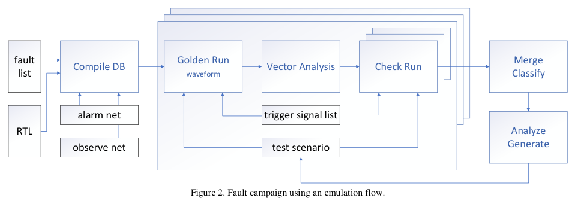
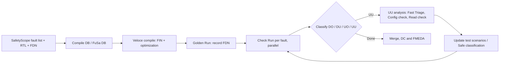

<!-- generated by yt-paper; edits will be overwritten -->
[DVCon](../dvcon/index.md) › [US](../dvcon/us.md) › [2024](../dvcon/by-year.md#2024) › [Verification](../dvcon/by-topic.md#verification)

# Functional Safety Workflow of Internal IP (NPU) Within Large Automotive IC Through Analysis and Emulation Usage for SW-based Safety Mechanisms

<figure class="rep-fig" markdown>
{ loading=lazy }
<figcaption>Figure 2. Fault campaign using an emulation flow. — from the original paper (Andrey Likhopoy et al.)</figcaption>
</figure>

[:material-open-in-new: Original paper](https://dvcon-proceedings.org/wp-content/uploads/1040.pdf){ .md-button .md-button--primary target=_blank }

| | |
|---|---|
| Authors | Andrey Likhopoy (Samsung Electronics), Sangkyu Park (Samsung Electronics), Hyeonuk Noh (Samsung Electronics), Wonil Cho (Samsung Electronics), Inhwan Kim (Siemens EDA), Robert Serphillips (Siemens EDA), Chanjin Kim (Siemens EDA), Justin Lee (Siemens EDA), James Kim (Siemens EDA), Sougata Bhattacharjee (Samsung Semiconductor India Research), Gulshan Kumar Sharma (Samsung Semiconductor India Research), Akshaya Kumar Jain (Samsung Semiconductor India Research) |
| Venue | DVCon US 2024 |
| Topic | Verification |
| Type | PAPER |
| ID | `ref-20261018-fef8` |

## Summary

**The paper presents an ISO 26262 functional-safety fault campaign for an automotive NPU's SW-based safety mechanisms, run on Siemens Veloce emulation with runtime pruning and UU-case analysis, reaching the ASIL B diagnostic coverage target (91.21% with margin).**

**이 논문은 자동차 NPU의 SW 기반 안전 메커니즘에 대해 Siemens Veloce 에뮬레이션으로 수행한 ISO 26262 기능 안전 fault campaign을 제시하며, 런타임 가지치기와 UU 케이스 분석을 통해 ASIL B 진단 커버리지 목표(마진 포함 91.21%)를 달성했다.**

## Key Insights

- Pre-injection and runtime pruning drive FC turnaround: FIN count is 2N for N fault nets (SA0/SA1), then dead logic, memories with no read ports, and FIN=FDN faults are optimized out; state save/restore before the trigger, parallel Check Runs, and early termination on DO cases cut runtime.

- 사전 주입 및 런타임 가지치기가 FC 소요 시간을 줄인다. FIN 개수는 N개의 fault net에 대해 2N(SA0/SA1)이며, 이후 dead logic, 읽기 포트가 없는 메모리, FIN=FDN fault를 최적화로 제거한다. 트리거 이전 상태 save/restore, Check Run 병렬 실행, DO 케이스의 early termination으로 런타임을 줄인다.

- UU analysis and test-scenario iteration are the main DC levers: PU0 DO share rose from 36.70% to 90.26% over 5 iterations and PU2 from 38.29% to 81.96% over 8 iterations.

- UU 분석과 test scenario 반복이 DC를 끌어올리는 핵심 수단이다. PU0의 DO 비율은 5회 반복에서 36.70%에서 90.26%로, PU2는 8회 반복에서 38.29%에서 81.96%로 상승했다.

- Test scenarios for FC should mirror functional-verification scenarios rather than SW scenarios, since SW does not exercise all IP features; useful patterns include MSB-only/all-ones data, one LUT active at a time, mixed-sign MAC outputs, and 0/all-1 register write-read checks.

- FC용 test scenario는 SW 시나리오가 아니라 기능 검증 시나리오를 기반으로 해야 한다. SW 시나리오는 IP 기능을 모두 활용하지 않기 때문이다. 유용한 패턴으로는 MSB만 1인 데이터와 all-1 데이터, 한 번에 하나의 LUT만 활성화, 부호가 섞인 MAC 출력, 레지스터에 0과 all-1을 쓰고 읽기 등이 있다.

- Safe-fault classification relies on formal COI analysis plus expert judgement (spec-out, debug, clock-gating, invalid-range, performance faults); these must be justified per fault because they directly raise the reported DC.

- Safe fault 분류는 형식 검증 기반 COI 분석과 전문가 판단(spec-out, debug, clock-gating, invalid-range, performance fault)에 의존한다. 이 분류는 보고되는 DC를 직접 높이므로 fault별 근거가 필요하다.

- Final results: SM3 self-test reaches 91.49% total DC (target 91.21%), and SM1/SM2 CPU reaches 61.13% (target 60%); however, the MEM block's final DC of 83.92% is below its 90% expected value, which the paper does not discuss.

- 최종 결과로 SM3 self-test는 전체 DC 91.49%(목표 91.21%), SM1/SM2 CPU는 61.13%(목표 60%)를 달성했다. 다만 MEM 블록의 최종 DC 83.92%는 기대값 90%에 미치지 못하며, 논문에서는 이를 다루지 않는다.

## Detailed Summary

### Background and Problem

- Under ISO 26262, hazards are rated by ASIL (S, E, C). For ASIL B, SPFM must be at least 90%. Diagnostic coverage (DC) is the fraction of failures detected by a safety mechanism (SM).

- ISO 26262에서는 위험을 ASIL(S, E, C)로 등급화하며, ASIL B의 경우 SPFM이 90% 이상이어야 한다. 진단 커버리지(DC)는 안전 메커니즘(SM)이 검출한 고장의 비율이다.

- The fault campaign (FC) is limited by fault-injection runtime and data management over the campaign.

- fault campaign(FC)은 fault injection 런타임과 캠페인 전반의 데이터 관리에 의해 제약을 받는다.

- The target is an NPU IP (PU0, PU1, PU2, MEM, CTRL) inside an automotive SoC that performs safe video sensing. Faults are reported to the Safety Island FMU.

- 대상은 자동차 SoC 내부의 NPU IP(PU0, PU1, PU2, MEM, CTRL)로, 안전한 비디오 센싱을 수행한다. 고장 정보는 Safety Island의 FMU로 보고된다.

- Memory SMs (parity/ECC, SM9–SM13) were verified by simulation. This paper covers the SW-based SMs (SM1/SM2 CPU ECC/STL, SM3 self-test) using emulation.

- 메모리 SM(parity/ECC, SM9–SM13)은 시뮬레이션으로 검증되었다. 본 논문은 에뮬레이션을 사용해 SW 기반 SM(SM1/SM2 CPU ECC/STL, SM3 self-test)을 다룬다.

- Targets: DC of 90% plus a 1.21% margin, so at least 91.21%. Expected DC per block was allocated from FIT-rate distribution. SM3 covers all blocks; SM1/SM2 cover the CPU at 60%.

- 목표: 90%에 1.21% 마진을 더한 DC, 즉 최소 91.21%. 블록별 기대 DC는 FIT rate 분포를 기준으로 배분했다. SM3는 모든 블록을 커버하며, SM1/SM2는 CPU를 60% 목표로 커버한다.

### Architecture and Methodology

Flow: SafetyScope fault list, RTL, and fault detection nets (FDN) feed Compile DB, which stores the fault list in the FuSa DB. Veloce compilation produces the fault injection nets (FIN). Veloce Fault App runs injection, and results return to the FuSa DB for ASIL/FMEDA metrics.

흐름: SafetyScope fault list, RTL, fault detection net(FDN)이 Compile DB에 입력되고, Compile DB는 fault list를 FuSa DB에 저장한다. Veloce 컴파일은 fault injection net(FIN)을 생성한다. Veloce Fault App이 주입을 수행하고, 결과는 ASIL/FMEDA 지표 산출을 위해 FuSa DB로 되돌아간다.

- Permanent faults only (SA0/SA1). Fault count is 2N for N nets.

- 영구 고장(SA0/SA1)만 고려한다. fault 개수는 net당 2개씩이므로 2N이다.

- Pre-injection pruning: Deadlogic (no fanout reader), memory with no read ports, and FinAndFdn faults. Vector Analysis removes constant nodes.

- 주입 전 가지치기: Deadlogic(fanout reader 없음), 읽기 포트가 없는 메모리, FinAndFdn fault. Vector Analysis는 상수 노드를 제거한다.

- Golden Run records FDN values. Each Check Run is compared against the reference. Outcomes are DO, DU, UO, UU. The DUT state before the trigger is saved and restored to skip initialization. Early termination applies once the alarm and observe nets resolve.

- Golden Run은 FDN 값을 기록한다. 각 Check Run은 이 기준값과 비교된다. 결과는 DO, DU, UO, UU로 분류된다. 트리거 이전의 DUT 상태를 저장하고 복원하여 초기화 시간을 생략한다. alarm 및 observe net이 결정되면 early termination을 적용한다.

- DC accounting: the numerator is DU + DO + compile-optimized items (dead logic, no port in memory, FIN=FDN) + COI + Safe. The denominator is the fault list minus the compile-optimized FIN=FDN items.

- DC 계산: 분자는 DU + DO + 컴파일 최적화 항목(dead logic, 메모리 읽기 포트 없음, FIN=FDN) + COI + Safe의 합이다. 분모는 전체 fault list에서 컴파일 최적화된 FIN=FDN 항목을 뺀 값이다.

- Test-scenario guidelines: model the CPU-driven flow (WDT, CMNS, CRC compare, alarm_pass/fail/hang). Use functional-verification scenarios as the base, since they cover more IP features. Use intermediate values instead of extremes so a single-bit change is not saturated. Activate one LUT at a time. Create MAC outputs with mixed sign. For registers, write and read back 0 and all-1.

- test scenario 가이드라인: CPU 주도 흐름(WDT, CMNS, CRC 비교, alarm_pass/fail/hang)을 모델링한다. 더 많은 IP 기능을 커버하는 기능 검증 시나리오를 기반으로 한다. 극단값 대신 중간값을 사용해 1비트 변화가 포화되지 않도록 한다. LUT는 한 번에 하나만 활성화한다. MAC 출력은 부호가 섞이도록 만든다. 레지스터는 0과 all-1을 쓰고 읽어 검사한다.

- UU debugging: Fast Triage compares Golden and Check waveforms along the FIN-to-alarm/observe path. Configuration check uses Codelink to verify ECC/parity/WDT enables against synchronized SW and waveform. Read-transition check confirms whether memory reads occur (enable and address).

- UU 디버깅: Fast Triage는 FIN에서 alarm/observe 경로까지 Golden과 Check 파형을 비교한다. Configuration check는 Codelink로 SW 및 동기화된 파형을 함께 보며 ECC/parity/WDT 활성화 여부를 확인한다. Read-transition check는 enable과 address로 메모리 읽기 발생 여부를 확인한다.

- Safe classification: formal COI analysis for faults outside the cone of influence. Expert judgement covers spec-out, debug, clock-gating (power), invalid-range (configuration), and performance faults.

- Safe 분류: COI 밖의 고장은 형식 검증 기반 COI 분석으로 처리한다. 전문가 판단은 spec-out, debug, clock-gating(전력), invalid-range(설정), performance 고장을 대상으로 한다.

### Results and Conclusions

- PU2 needed 8 iterations. PU0 went from 36.70% DO after the first iteration to 90.26% after the fifth.

- PU2는 8회 반복이 필요했다. PU0는 첫 반복의 DO 36.70%에서 다섯 번째 반복에서 90.26%로 상승했다.

- SM3 final DC (expected in parentheses): PU0 96.44 (96), PU1 96.44 (96), MEM 83.92 (90), PU2 86.43 (80), CTRL 63.38 (60), PERI 81.82 (80). Total 91.49% (expected 91.41%).

- SM3 최종 DC(괄호 안은 기대값): PU0 96.44(96), PU1 96.44(96), MEM 83.92(90), PU2 86.43(80), CTRL 63.38(60), PERI 81.82(80). 전체 91.49%(기대값 91.41%).

- The MEM block's final DC is below its 90% expected value. The paper does not discuss this gap.

- MEM 블록의 최종 DC는 기대값 90%에 미치지 못한다. 논문은 이 차이를 다루지 않는다.

- SM1/SM2 (CPU): memory 89.63% (expected 90), logic 60.98% (60). Total 61.13% (expected 60.31%). ARM provided limited test scenarios, so further UU analysis is planned as future work.

- SM1/SM2(CPU): 메모리 89.63%(기대값 90), 로직 60.98%(60). 전체 61.13%(기대값 60.31%). ARM이 제공한 시나리오가 제한적이어서 추가 UU 분석은 향후 과제로 남겼다.

- The final SM3 suite has 30 optimized test scenarios. The paper states that the 91.21% ASIL B target was achieved with SW-based SMs using emulation. Runtime optimization of the scenarios is left for future work.

- 최종 SM3 스위트는 최적화된 30개의 test scenario로 구성된다. 논문은 에뮬레이션 기반 SW 안전 메커니즘으로 ASIL B 목표인 91.21%를 달성했다고 밝힌다. 시나리오 런타임 최적화는 향후 과제다.

## Videos

<iframe src="https://www.youtube-nocookie.com/embed/ZOCbWSYhnJM" title="[DVCON2024]Functional Safety Workflow Internal IP (NPU) Large Automotive IC Analysis Emulation Usage" loading="lazy" allow="accelerometer; clipboard-write; encrypted-media; gyroscope; picture-in-picture; web-share" referrerpolicy="strict-origin-when-cross-origin" allowfullscreen></iframe>

**[DVCON2024]Functional Safety Workflow Internal IP (NPU) Large Automotive IC Analysis Emulation Usage** · 📝 [Previous reading (2024-07-30)](https://youtu.be/l5LVIft6xNs) — [Watch on YouTube](https://www.youtube.com/watch?v=ZOCbWSYhnJM) · [Video page](../videos/ZOCbWSYhnJM.md)
