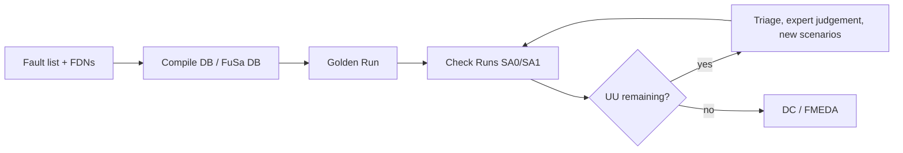

<!-- generated by yt-paper; edits will be overwritten -->
[DVCon](../dvcon/index.md) › [US](../dvcon/us.md) › [2024](../dvcon/by-year.md#2024) › [Verification](../dvcon/by-topic.md#verification)

# Functional Safety Workflow of Internal IP (NPU) Within Large Automotive IC Through Analysis and Emulation Usage for SW-based Safety Mechanisms

<figure class="rep-fig" markdown>
{ loading=lazy }
<figcaption>Figure 2. Fault campaign using an emulation flow. — from the original paper (Andrey Likhopoy et al.)</figcaption>
</figure>

[:material-open-in-new: Original paper](https://dvcon-proceedings.org/wp-content/uploads/1040.pdf){ .md-button .md-button--primary target=_blank }

| | |
|---|---|
| Authors | Andrey Likhopoy (Samsung Electronics), Sangkyu Park (Samsung Electronics), Hyeonuk Noh (Samsung Electronics), Wonil Cho (Samsung Electronics), Inhwan Kim (Siemens EDA), Robert Serphillips (Siemens EDA), Chanjin Kim (Siemens EDA), Justin Lee (Siemens EDA), James Kim (Siemens EDA), Sougata Bhattacharjee (Samsung Semiconductor India Research), Gulshan Kumar Sharma (Samsung Semiconductor India Research), Akshaya Kumar Jain (Samsung Semiconductor India Research) |
| Venue | DVCon US 2024 |
| Topic | Verification |
| Type | PAPER |
| ID | `ref-20261018-fef8` |

## Summary

**A Samsung/Siemens EDA case study that runs an emulation-based (Veloce) fault campaign on SW-based safety mechanisms of an automotive NPU, using UU-triage and runtime optimizations to reach the ASIL B diagnostic coverage target, with SM3 final DC at 91.49%.**

**Samsung과 Siemens EDA의 사례 연구로, 자동차 NPU의 SW 기반 안전 메커니즘에 대해 에뮬레이션(Veloce) 기반 fault campaign을 수행하고 UU 트리아지 및 런타임 최적화를 적용하여 ASIL B 진단 커버리지 목표를 달성했으며, SM3의 최종 DC는 91.49%이다.**

## Key Insights

- The emulation-based fault campaign on SM3 (self-test) reached a final DC of 91.49% against the 91.21% ASIL B target (1.21% margin on 90%), using a final suite of 30 optimized test scenarios.

- SM3(자가 테스트)에 대한 에뮬레이션 기반 fault campaign은 ASIL B 목표 91.21%(90%에 1.21% 마진)에 대해 최종 DC 91.49%를 달성했으며, 최적화된 테스트 시나리오 30개로 구성된 최종 세트를 사용했다.

- Pre-injection pruning (Deadlogic, memory with no read ports, FIN=FDN) and early termination on DO cases cut the Check Run count; the raw fault list is 2N because SA0 and SA1 are both injected, and only permanent faults are covered.

- 주입 전 가지치기(Deadlogic, 읽기 포트 없는 메모리, FIN=FDN)와 DO 케이스에 대한 조기 종료로 Check Run 수를 줄였다. SA0과 SA1을 모두 주입하므로 원시 fault list는 2N이며, 영구 고장(permanent fault)만 다룬다.

- UU analysis is the main DC lever: PU0 DO rose from 36.70% to 90.26% over five iterations, and PU2 DO from 38.29% to 81.96% over eight, driven by Fast Triage waveform diffs, formal COI, and expert-judged safe faults.

- UU 분석이 DC 향상의 핵심 수단이다. PU0의 DO는 5회 반복에 걸쳐 36.70%에서 90.26%로, PU2의 DO는 8회 반복에 걸쳐 38.29%에서 81.96%로 상승했으며, 이는 Fast Triage 파형 비교, 형식 검증 기반 COI, 전문가 판단에 의한 safe fault 분류에 따른 결과이다.

- Test-scenario heuristics such as intermediate values over extremes, bypassing non-target LUTs, zero-crossing MAC outputs, and 0/all-1 register sweeps improve single-bit fault observability.

- 비대상 LUT 우회, 0/all-1 레지스터 스윕 등 극단값 대신 중간값을 사용하고 MAC 출력에 부호 전환을 주는 테스트 시나리오 기법은 단일 비트 고장의 관측성을 높인다.

- Block-level margins are uneven: MEM ended at 83.92% against a 90% expected DC and CPU logic at 60.98% depends on ARM-provided STL, so the total pass relies on FIT-weighted averaging and deferred UU analysis.

- 블록별 마진은 불균일하다. MEM은 예상 DC 90%에 못 미치는 83.92%로 종료되었고, CPU logic은 60.98%이며 ARM 제공 STL에 의존한다. 따라서 전체 통과 여부는 FIT 가중 평균과 보류된 UU 분석에 좌우된다.

## Detailed Summary

### Background and Problem

- ISO 26262 ASIL B requires SPFM ≥90%; the NPU goal was DC ≥90% plus a 1.21% error margin, i.e. ≥91.21%.

- ISO 26262 ASIL B는 SPFM ≥90%를 요구하며, 이 NPU의 목표는 1.21% 오차 마진을 포함한 DC ≥91.21%였다.

- Memory SMs (parity/ECC, SM9–SM13) were already covered by simulation, while logic-side SW-based SMs (CPU STL, self-test SM3, WDT) needed a faster fault campaign for a large design.

- 메모리 SM(parity/ECC, SM9–SM13)은 이미 시뮬레이션으로 검증되었으나, 로직 측 SW 기반 SM(CPU STL, self-test SM3, WDT)은 대규모 설계에 맞는 더 빠른 fault campaign이 필요했다.

- Test scenarios must reach high DC yet stay short enough to double as field tests.

- 테스트 시나리오는 높은 DC를 달성해야 하면서도 현장 테스트로 재사용할 수 있을 만큼 짧아야 한다.

### Architecture and Methodology

- Siemens closed-loop flow: SafetyScope fault list and fault detection nets (FDNs) feed Compile DB and the single FuSa DB, then Veloce runs the Golden Run and parallel Check Runs with SA0/SA1 injection.

- Siemens 폐루프 흐름: SafetyScope의 fault list와 fault detection net(FDN)을 Compile DB와 단일 FuSa DB로 연결하고, Veloce에서 Golden Run과 SA0/SA1 주입 병렬 Check Run을 수행한다.

- Outcomes are classified DO, DU, UO, UU. Runtime cuts include pruning optimized nets, saving and restoring the initial state before trigger, and early termination on DO.

- 결과는 DO, DU, UO, UU로 분류된다. 런타임 절감 기법으로는 최적화된 net 제거, trigger 이전 초기 상태 저장 및 복원, DO 시 조기 종료가 있다.

- UU triage uses Fast Triage waveform diffs, Codelink configuration checks (ECC, parity, WDT), read-transition checks, formal COI, and expert judgement (spec-out, debug, power, configuration, performance faults).

- UU 트리아지는 Fast Triage 파형 차이 비교, Codelink 설정 점검(ECC, parity, WDT), read-transition 점검, 형식 검증 기반 COI, 전문가 판단(spec-out, debug, power, configuration, performance 고장)을 사용한다.

### Results and Conclusions

- SM3 final DC is 91.49% (expected 91.41%) across PU0, PU1, MEM, PU2, CTRL, and PERI; CTRL reached 63.38% versus 60% expected, but MEM reached 83.92% versus 90% expected.

- SM3 최종 DC는 91.49%(예상 91.41%)이며, PU0, PU1, MEM, PU2, CTRL, PERI에 걸쳐 산출되었다. CTRL은 예상 60%에 대해 63.38%를 달성했으나, MEM은 예상 90%에 대해 83.92%에 그쳤다.

- CPU SM1/SM2 final DC is 61.13% (CPU memory 89.63%, CPU logic 60.98%); remaining UU cases are deferred because ARM provides a limited scenario set.

- CPU SM1/SM2의 최종 DC는 61.13%이다(CPU memory 89.63%, CPU logic 60.98%). ARM이 제공하는 시나리오 수가 제한적이므로 잔존 UU 케이스는 추후 과제로 남겼다.

- The paper reports no emulation runtime figures, and the iteration gains are shown only as DO percentages.

- 논문은 에뮬레이션 런타임 수치를 보고하지 않으며, 반복별 개선 효과는 DO 비율로만 제시된다.

## Videos

<iframe src="https://www.youtube-nocookie.com/embed/ZOCbWSYhnJM" title="[DVCON2024]Functional Safety Workflow Internal IP (NPU) Large Automotive IC Analysis Emulation Usage" loading="lazy" allow="accelerometer; clipboard-write; encrypted-media; gyroscope; picture-in-picture; web-share" referrerpolicy="strict-origin-when-cross-origin" allowfullscreen></iframe>

**[DVCON2024]Functional Safety Workflow Internal IP (NPU) Large Automotive IC Analysis Emulation Usage** · 📝 [Previous reading (2024-07-30)](https://youtu.be/l5LVIft6xNs) — [Watch on YouTube](https://www.youtube.com/watch?v=ZOCbWSYhnJM) · [Video page](../videos/ZOCbWSYhnJM.md)
