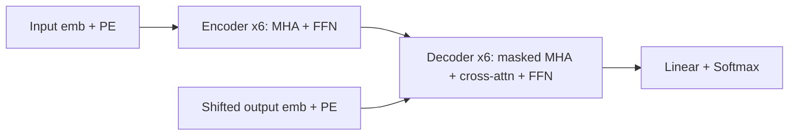

<!-- generated by yt-paper; edits will be overwritten -->
[arXiv](../arxiv/index.md) › [2017](../arxiv/by-year.md#2017) › [Architecture](../arxiv/by-topic.md#architecture)

# Attention Is All You Need

<figure class="rep-fig" markdown>
{ loading=lazy }
<figcaption>Figure 1: The Transformer - model architecture. — from the original paper (Ashish Vaswani et al.)</figcaption>
</figure>

[:material-open-in-new: Original paper](https://arxiv.org/abs/1706.03762){ .md-button .md-button--primary target=_blank }

| | |
|---|---|
| Authors | Ashish Vaswani (Google Brain), Noam Shazeer (Google Brain), Niki Parmar (Google Research), Jakob Uszkoreit (Google Research), Llion Jones (Google Research), Aidan N. Gomez (University of Toronto), Łukasz Kaiser (Google Brain), Illia Polosukhin (Google Research) |
| Venue | arXiv 2017 |
| Topic | Architecture |
| Type | ARXIV |
| ID | `ref-20261019-32b9` |

## Summary

**Proposes the Transformer, a sequence transduction model built entirely on multi-head self-attention with no recurrence or convolution, reaching 28.4 BLEU on WMT 2014 EN-DE and 41.8 BLEU on EN-FR while training far more cheaply and in parallel.**

**RNN과 합성곱을 모두 제거하고 multi-head self-attention만으로 구성한 Transformer를 제안하며, WMT 2014 EN-DE에서 28.4 BLEU, EN-FR에서 41.8 BLEU를 달성하면서 학습 비용은 크게 낮추고 병렬화는 높였습니다.**

## Key Insights

- Removing recurrence makes the whole sequence computable in parallel: a self-attention layer links any two positions in O(1) sequential operations, versus O(n) for recurrent layers.

- 재귀 구조를 제거하면 시퀀스 전체를 병렬로 계산할 수 있으며, self-attention 계층은 임의의 두 위치를 O(1) 순차 연산으로 연결하는 반면 순환 계층은 O(n)이 필요합니다.

- The big Transformer reaches 28.4 BLEU on EN-DE (more than 2 BLEU above prior results including ensembles) and 41.8 BLEU on EN-FR as a single model, trained for 3.5 days on 8 P100 GPUs.

- big Transformer는 EN-DE에서 28.4 BLEU(앙상블 포함 기존 결과보다 2 BLEU 이상 높음), EN-FR에서 단일 모델 41.8 BLEU를 기록했으며, 8×P100 GPU에서 3.5일간 학습했습니다.

- The base model (27.3 EN-DE, 38.1 EN-FR) costs about 3.3e18 training FLOPs, a small fraction of the competing models in Table 2, and trains in about 12 hours on 8 P100 GPUs.

- base 모델(EN-DE 27.3, EN-FR 38.1)은 약 3.3e18 학습 FLOPs가 들며, Table 2의 경쟁 모델들에 비해 극히 일부 비용이고 8×P100에서 약 12시간 학습됩니다.

- Dividing dot products by √d_k is needed to keep softmax gradients from vanishing at large d_k; ablations show single-head attention is 0.9 BLEU worse and reducing d_k hurts quality.

- 내적을 √d_k로 나누는 것은 d_k가 클 때 softmax 기울기가 사라지는 것을 막기 위해 필요하며, ablation에서 단일 head는 0.9 BLEU 낮고 d_k를 줄이면 품질이 떨어집니다.

- Learned positional embeddings give nearly identical results to sinusoidal encodings (25.7 vs 25.8 BLEU on the base model), so the choice of encoding matters little for in-distribution lengths.

- 학습 가능한 위치 임베딩은 sinusoidal 인코딩과 거의 동일한 결과를 내므로(base 모델 25.7 vs 25.8 BLEU), 학습 길이 범위 내에서는 위치 인코딩 선택의 영향이 작습니다.

## Detailed Summary

### Background and Problem

- RNN/LSTM/GRU encoder-decoder models with attention are sequential in position, which blocks parallelism within a sentence and makes long training runs costly.

- RNN/LSTM/GRU 기반 encoder-decoder 모델과 attention은 위치 순서대로 순차 계산하므로, 문장 내부 병렬화가 막히고 긴 학습 시간이 필요합니다.

- Convolutional seq2seq models (ConvS2S, ByteNet) still need O(n) or O(log n) operations to connect distant positions.

- 합성곱 기반 seq2seq(ConvS2S, ByteNet)도 먼 위치를 연결하는 데 O(n) 또는 O(log n) 연산이 필요합니다.

- Goal: drop recurrence and convolution entirely and rely on attention for global dependencies.

- 목표: 재귀와 합성곱을 완전히 제거하고, 전역 의존성을 attention만으로 모델링하는 것입니다.

### Architecture and Methodology

- Encoder and decoder are each 6 identical layers with $d_{model}=512$, post-LN residual sub-layers, and FFN width $d_{ff}=2048$.

- Encoder와 decoder는 각각 $d_{model}=512$, post-LN 잔차 sub-layer를 가진 동일한 6개 계층으로 구성되며, FFN 폭은 $d_{ff}=2048$입니다.

- Scaled dot-product attention is $\mathrm{Attention}(Q,K,V)=\mathrm{softmax}(QK^T/\sqrt{d_k})V$. It uses 8 heads with $d_k=d_v=64$. The decoder masks future positions to $-\infty$.

- Scaled dot-product attention은 $\mathrm{Attention}(Q,K,V)=\mathrm{softmax}(QK^T/\sqrt{d_k})V$이며, $d_k=d_v=64$인 8개 head를 사용합니다. Decoder는 미래 위치를 $-\infty$로 마스킹합니다.

- Positional encoding is sinusoidal: $PE_{(pos,2i)}=\sin(pos/10000^{2i/d_{model}})$.

- 위치 인코딩은 sinusoidal이며, $PE_{(pos,2i)}=\sin(pos/10000^{2i/d_{model}})$입니다.

- Training uses Adam ($\beta_1=0.9$, $\beta_2=0.98$), 4000 warmup steps, label smoothing 0.1, and dropout 0.1. WMT14 EN-DE has about 4.5M pairs with a 37K BPE vocabulary; EN-FR has 36M pairs with a 32K word-piece vocabulary.

- 학습은 Adam($\beta_1=0.9$, $\beta_2=0.98$), warmup 4000 step, label smoothing 0.1, dropout 0.1을 사용합니다. WMT14 EN-DE는 약 450만 쌍과 37K BPE 어휘, EN-FR은 3,600만 쌍과 32K word-piece 어휘를 사용합니다.

### Results and Conclusions

- EN-DE: the big model scores 28.4 BLEU, and the base model scores 27.3 BLEU, both above prior single models and ensembles at lower training cost.

- EN-DE: big 모델은 28.4 BLEU, base 모델은 27.3 BLEU를 기록했으며, 둘 다 기존 단일 모델과 앙상블보다 낮은 학습 비용으로 앞섰습니다.

- EN-FR: the big model scores 41.8 BLEU in Table 2, though the text cites 41.0; this is a single-model result.

- EN-FR: big 모델은 Table 2에서 41.8 BLEU이며, 본문에는 41.0으로 표기되어 있습니다. 단일 모델 결과입니다.

- Ablations: single-head attention is 0.9 BLEU worse, and smaller $d_k$ hurts. Learned and sinusoidal position embeddings are nearly identical.

- Ablation: 단일 head는 0.9 BLEU 낮고, $d_k$를 줄이면 품질이 떨어집니다. 학습형 위치 임베딩과 sinusoidal 인코딩은 거의 동일합니다.

- Constituency parsing (WSJ 23 F1) reaches 91.3 with WSJ-only training and 92.7 semi-supervised, with little task tuning.

- Constituency parsing(WSJ 23 F1)은 WSJ만 학습 시 91.3, semi-supervised 시 92.7을 기록했으며, 작업별 튜닝은 거의 없었습니다.

- The authors list future work on restricted local attention for long inputs, non-text modalities, and less sequential generation.

- 저자들은 긴 입력을 위한 제한적 지역 attention, 텍스트 외 modality, 덜 순차적인 생성을 향후 과제로 제시합니다.

## Videos

<iframe src="https://www.youtube-nocookie.com/embed/MG5ukgqkl8w" title="RT Attention Is All You Need" loading="lazy" allow="accelerometer; clipboard-write; encrypted-media; gyroscope; picture-in-picture; web-share" referrerpolicy="strict-origin-when-cross-origin" allowfullscreen></iframe>

**RT Attention Is All You Need** — [Watch on YouTube](https://www.youtube.com/watch?v=MG5ukgqkl8w) · [Video page](../videos/MG5ukgqkl8w.md)
