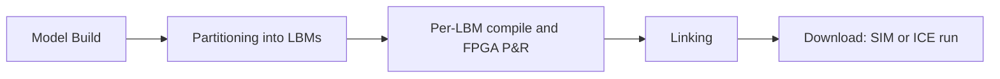

<!-- generated by yt-paper; edits will be overwritten -->
[Others](../others/index.md) › [DAC](../others/dac.md) › [1996](../others/by-year.md#1996) › [Emulation](../others/by-topic.md#emulation)

# Hardware Emulation for Functional Verification of K5

<figure class="rep-fig" markdown>
{ loading=lazy }
<figcaption>Fig. 2. K5 Emulation Hardware — from the original paper (Gopi Ganapathy et al.)</figcaption>
</figure>

[:material-open-in-new: Original paper](https://dl.acm.org/doi/10.1145/240518.240578){ .md-button .md-button--primary target=_blank }

| | |
|---|---|
| Authors | Gopi Ganapathy (AMD), Ram Narayan (AMD), Glenn Jorden (AMD), Denzil Fernandez (AMD), Ming Wang (Quickturn Design Systems), Jim Nishimura (Quickturn Design Systems) |
| Venue | Others DAC 1996 |
| Topic | Emulation |
| Type | PAPER |
| ID | `ref-20261025-2ad0` |

## Summary

**AMD's account of using Quickturn MARS/Saturn FPGA-based hardware emulation to functionally verify the K5 superscalar x86 CPU, covering partitioning, SIM/ICE modes, and the bring-up cycle that let real x86 OS and application software run before first silicon.**

**AMD가 Quickturn MARS/Saturn FPGA 기반 하드웨어 에뮬레이션을 사용해 K5 슈퍼스칼라 x86 CPU를 기능 검증한 경험을 정리한 논문으로, 파티셔닝, SIM/ICE 모드, 브링업 사이클을 다루며 최초 실리콘 이전에 실제 x86 OS 및 응용 소프트웨어를 실행할 수 있었던 과정을 보여준다.**

## Key Insights

- Gate-level simulation of K5 runs in the low 100 Hz range, while the emulator runs the model in the high 100 kHz range (paper claims 3-6 orders of magnitude), which made booting Windows and launching applications practical.

- K5의 게이트 레벨 시뮬레이션은 낮은 100 Hz 대역에서 동작하는 반면, 에뮬레이터는 높은 100 kHz 대역으로 모델을 실행하며(논문은 3~6자릿수 향상을 주장), 이로 인해 Windows 부팅과 응용 프로그램 실행이 현실적으로 가능해졌다.

- Partitioning the design into 25 LBMs under pin limits was the dominant bring-up cost; tristate wired-OR structures were converted to n-input OR gates with a tristate output, and the register file/reorder buffer was split along write-port boundaries with duplicated storage bits.

- 설계를 핀 제약 하에서 25개의 LBM으로 파티셔닝하는 것이 브링업의 가장 큰 비용이었으며, tristate wired-OR 구조는 tristate 출력을 가진 n-입력 OR 게이트로 변환되었고, 레지스터 파일/재정렬 버퍼는 쓰기 포트 경계를 기준으로 나누고 저장 비트를 중복시켰다.

- Delay-dependent logic (self-timed structures) was replaced with functional equivalents and kept consistent with the transistor-level design via gate-switch equivalence checking, which required dedicated model-build resources.

- 지연 의존 로직(self-timed 구조)은 기능적으로 동등한 로직으로 대체되었고, gate-switch 등가성 검사로 트랜지스터 레벨 설계와의 일관성을 유지했으며, 이를 위해 전담 모델 빌드 리소스가 필요했다.

- A buffering scheme for in-circuit emulation lets the design switch between SIM and ICE modes without remapping, avoiding two separate emulation views; incremental edits take minutes for a single LBM but hours to a day for multi-LBM changes.

- In-circuit emulation을 위한 버퍼링 방식은 재매핑 없이 SIM과 ICE 모드 사이를 전환하게 해 두 개의 별도 에뮬레이션 뷰를 피하며, 증분 수정은 단일 LBM의 경우 몇 분, 다중 LBM 변경의 경우 수 시간에서 하루가 걸린다.

- The paper reports that the emulator ran Windows 3.1/NT/95, OS/2, and Linux workloads and found and fixed key bugs before first silicon, but gives no quantitative bug counts or final emulation speed.

- 논문은 에뮬레이터에서 Windows 3.1/NT/95, OS/2, Linux 워크로드를 실행했고 최초 실리콘 이전에 주요 버그를 찾아 수정했다고 보고하지만, 버그 개수나 최종 에뮬레이션 속도의 정량적 수치는 제시하지 않는다.

## Detailed Summary

### Background and Problem

- K5 is AMD's ~4M-transistor, four-issue superscalar x86 CPU; x86 compatibility must be proven before tapeout, and gate-level simulation in the low 100 Hz range cannot boot Windows or launch applications in practical time.

- K5는 AMD의 약 4M 트랜지스터, 4-issue 슈퍼스칼라 x86 CPU이며, tapeout 이전에 x86 호환성을 입증해야 한다. 낮은 100 Hz 대역의 게이트 레벨 시뮬레이션으로는 Windows 부팅이나 응용 프로그램 실행이 현실적인 시간 안에 불가능하다.

- The full-custom, latch-based design has no direct FPGA primitive mapping: switch-level circuits, self-timed structures, and wired-OR tristate buses must be re-modeled for the emulator.

- Full-custom, latch 기반 설계는 FPGA 기본 요소로 직접 매핑되지 않는다. Switch-level 회로, self-timed 구조, wired-OR tristate 버스를 에뮬레이터용으로 다시 모델링해야 한다.

### Architecture and Methodology

- Quickturn MARS (IP2500, five chassis, up to 2.5M gates) and later Saturn (single chassis, 11 LBMs) map the gate-level emulation view onto Xilinx FPGAs; memory arrays are mapped via CMM black boxes.

- Quickturn MARS(IP2500, 5개 chassis, 최대 2.5M 게이트)와 이후의 Saturn(단일 chassis, 11개 LBM)은 게이트 레벨 에뮬레이션 뷰를 Xilinx FPGA에 매핑한다. 메모리 배열은 CMM black box로 매핑된다.

- The design was partitioned into 25 LBMs under pin limits, with tristate wired-OR converted to n-input OR gates and the register file/ROB split along write ports.

- 설계는 핀 제약 하에서 25개의 LBM으로 파티셔닝되었으며, tristate wired-OR은 n-입력 OR 게이트로 변환되고 레지스터 파일/ROB는 쓰기 포트 경계를 기준으로 분할되었다.

- SIM mode runs x86 test suites from external memory with DebugWare scan readback; ICE mode connects the pins to a real PC through a buffering scheme that switches modes without remapping.

- SIM 모드는 외부 메모리에서 x86 테스트 스위트를 실행하고 DebugWare scan readback을 사용한다. ICE 모드는 buffering scheme을 통해 실제 PC에 핀을 연결하며, 재매핑 없이 모드를 전환한다.

### Results and Conclusions

- The emulator ran Windows 3.1, Windows NT, Windows 95, OS/2, and Linux with applications, and key bugs were found and fixed before first silicon.

- 에뮬레이터에서 Windows 3.1, Windows NT, Windows 95, OS/2, Linux 및 응용 프로그램을 실행했으며, 최초 실리콘 이전에 주요 버그를 찾아 수정했다.

- The paper states the emulator was instrumental in achieving functional first silicon, but gives no quantitative bug counts or final emulation speed.

- 논문은 에뮬레이터가 기능적으로 동작하는 최초 실리콘 확보에 기여했다고 밝히지만, 버그 개수나 최종 에뮬레이션 속도의 정량적 수치는 제시하지 않는다.

- Costs noted: high startup effort, a dedicated team, and time-to-debug measured in hours rather than minutes.

- 비용 측면: 초기 투입 노력이 크고, 전담 팀이 필요하며, 디버그 착수까지 걸리는 시간이 시뮬레이션의 분 단위가 아닌 시간 단위다.

## Videos

<iframe src="https://www.youtube-nocookie.com/embed/-DBP8FH8lYQ" title="Hardware emulation for functional verification of K5" loading="lazy" allow="accelerometer; clipboard-write; encrypted-media; gyroscope; picture-in-picture; web-share" referrerpolicy="strict-origin-when-cross-origin" allowfullscreen></iframe>

**Hardware emulation for functional verification of K5** — [Watch on YouTube](https://www.youtube.com/watch?v=-DBP8FH8lYQ) · [Video page](../videos/-DBP8FH8lYQ.md)
