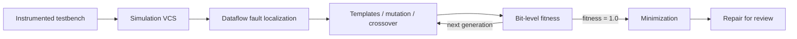

<!-- generated by yt-paper; edits will be overwritten -->
[Others](../others/index.md) › [ASPLOS](../others/asplos.md) › [2022](../others/by-year.md#2022) › [EDA](../others/by-topic.md#eda)

# CirFix: Automatically Repairing Defects in Hardware Design Code

<figure class="rep-fig" markdown>
{ loading=lazy }
<figcaption>Figure 2: A comparison between the simulation result and the expected behavior information for the faulty 4-bit counter in the motivating example. — from the original paper (Hammad Ahmad et al.)</figcaption>
</figure>

[:material-open-in-new: Original paper](https://dl.acm.org/doi/10.1145/3503222.3507763){ .md-button .md-button--primary target=_blank }

| | |
|---|---|
| Authors | Hammad Ahmad (University of Michigan, Ann Arbor), Yu Huang (University of Michigan, Ann Arbor), Westley Weimer (University of Michigan, Ann Arbor) |
| Venue | Others ASPLOS 2022 |
| Topic | EDA |
| Type | PAPER |
| ID | `ref-20261025-3d91` |

## Summary

**CirFix is a genetic-programming framework that automatically repairs Verilog design defects by combining dataflow-based fault localization over wire/register assignments with a bit-level fitness function computed from instrumented testbench outputs, repairing 16 of 32 benchmark defects correctly and 21 plausibly.**

**CirFix는 배선/레지스터 할당에 대한 dataflow 기반 fault localization과 계측된 testbench 출력으로부터 계산한 bit-level fitness 함수를 결합해 Verilog 설계 결함을 자동 수정하는 genetic programming 프레임워크이며, 32개 벤치마크 결함 중 16개를 정확히, 21개를 그럴듯하게(plausible) 수정했다.**

## Key Insights

- Spectrum-based fault localization from software APR does not fit parallel HDL; CirFix instead runs a context-insensitive fixed-point analysis over assignments and conditionals and returns an equally-ranked implicated set.

- 소프트웨어 APR의 spectrum-based fault localization은 병렬 구조의 HDL에 맞지 않으며, CirFix는 대신 할당문과 조건문에 대한 context-insensitive fixed-point 분석을 수행하고 동일 순위의 혐의 집합을 반환한다.

- Instrumenting existing testbenches to log output wires at each clock edge enables a bit-level fitness (e.g., the buggy 4-bit counter scores 0.58 vs. 1.0 for a correct repair), so repair works without formal specifications.

- 기존 testbench에 출력 wire를 클록 에지마다 기록하도록 계측하면 bit-level fitness를 얻을 수 있다(예: 결함이 있는 4-bit counter는 0.58, 올바른 수정은 1.0). 따라서 형식 명세 없이도 수정이 가능하다.

- On 32 expert-transplanted defects across 11 Verilog projects, CirFix produced plausible repairs for 21 and correct repairs for 16, which the authors describe as comparable to successful software APR.

- 전문가가 이식한 11개 Verilog 프로젝트의 32개 결함에 대해 CirFix는 21개의 plausible 수정과 16개의 correct 수정을 생성했으며, 저자들은 이를 성공적인 소프트웨어 APR과 비슷한 수준이라고 설명한다.

- Restricting insert/replace operators by statement type and syntactic parent cuts non-compiling mutants from 35% to 10%, a key enabler for GP-based search on Verilog.

- 삽입/대체 연산자를 문장 타입과 문법적 부모 타입으로 제한하여 컴파일되지 않는 mutant 비율을 35%에서 10%로 줄였으며, 이는 Verilog에 대한 GP 기반 탐색을 가능하게 한 핵심 요소이다.

- Testbench instrumentation was done manually in under 10 lines and at most 5 minutes per testbench, with no circuit-specific knowledge beyond output names and clock period.

- Testbench 계측은 수동으로 수행되었으며 testbench당 10줄 미만, 최대 5분이 걸렸고 출력 이름과 클록 주기 외에 회로별 지식은 필요하지 않았다.

## Detailed Summary

### Background and Problem

- Verilog designs execute in parallel and are validated by testbenches that often report only final or pass/fail results, so software spectrum-based fault localization and test-based fitness do not transfer directly.

- Verilog 설계는 병렬로 동작하며, 대개 최종 결과나 pass/fail만 보고하는 testbench로 검증된다. 따라서 소프트웨어의 spectrum-based fault localization과 테스트 기반 fitness는 그대로 적용하기 어렵다.

- Prior HDL approaches either produce many false positives, require formal specifications that do not scale, or do not handle behavioral-level descriptions.

- 기존 HDL 접근법은 오탐이 많거나, 확장성이 낮은 형식 명세를 요구하거나, 행위 수준(behavioral) 기술을 다루지 못한다.

- Goal: repair real, industry-style defects using existing testbenches, with candidate fixes reviewed by developers before synthesis.

- 목표: 기존 testbench만으로 산업 현장형 결함을 수정하고, 후보 수정안을 합성 전에 개발자가 검토할 수 있도록 제시하는 것이다.

### Architecture and Methodology

- Testbench is instrumented to log output wires/registers each clock; mismatches against expected output seed fault localization.

- Testbench를 계측하여 매 클록마다 출력 wire/레지스터를 기록하고, 기대 출력과의 불일치로 fault localization을 시작한다.

- Dataflow fixed-point analysis (Impl-Data, Impl-Ctrl, Add-Child) implicates assignments and conditionals; localization is repeated every generation.

- Dataflow fixed-point 분석(Impl-Data, Impl-Ctrl, Add-Child)이 할당문과 조건문을 혐의 대상으로 지정하며, 세대마다 localization을 반복한다.

- Fitness: +1 per matching bit, −1 per mismatch, penalty $\varphi$ for $x$/$z$, normalized to [0,1]; 1.0 denotes a testbench-adequate (plausible) repair.

- Fitness: 일치하는 bit마다 +1, 불일치마다 −1, $x$/$z$에는 페널티 $\varphi$를 적용하고 [0,1]로 정규화한다. 1.0은 testbench를 통과하는(plausible) 수정을 뜻한다.

- Genetic programming with 9 repair templates (conditionals, sensitivity lists, blocking/non-blocking, numeric), replace/insert/delete mutation, single-point crossover, tournament selection, elitism, and delta-debugging based minimization.

- Genetic programming을 사용하며, repair template 9종(조건문, sensitivity list, blocking/non-blocking, 수치), replace/insert/delete mutation, single-point crossover, tournament selection, elitism, delta-debugging 기반 minimization을 포함한다.

### Results and Conclusions

- Benchmark of 32 expert-transplanted defects across 11 projects (decoder to reed_solomon_decoder and sdram_controller): plausible repairs for 21/32, correct for 16/32.

- 11개 프로젝트에 걸친 전문가 이식 결함 32개 벤치마크(decoder부터 reed_solomon_decoder, sdram_controller까지): plausible 수정 21/32, correct 수정 16/32.

- Motivating 4-bit counter: buggy fitness 0.58 (mismatch in 17 of 26 cycles); a correct overflow fix yields 1.0.

- 동기 예제인 4-bit counter: 결함 버전의 fitness는 0.58(26 cycle 중 17 cycle 불일치), 올바른 overflow 수정은 1.0이다.

- Fix localization reduces non-compiling mutants from 35% to 10%.

- Fix localization으로 컴파일되지 않는 mutant 비율을 35%에서 10%로 줄였다.

- The authors position these rates as comparable to successful software APR; the excerpt is truncated before the full evaluation (RQ results) is presented.

- 저자들은 이 수치를 성공적인 소프트웨어 APR과 비슷한 수준이라고 평가한다. 다만 본문이 잘려 있어 전체 평가 결과(RQ)는 확인할 수 없다.

## Videos

<iframe src="https://www.youtube-nocookie.com/embed/TgM8rl0ounU" title="CirFix Automatically Repairing Defects in Hardware Design" loading="lazy" allow="accelerometer; clipboard-write; encrypted-media; gyroscope; picture-in-picture; web-share" referrerpolicy="strict-origin-when-cross-origin" allowfullscreen></iframe>

**CirFix Automatically Repairing Defects in Hardware Design** — [Watch on YouTube](https://www.youtube.com/watch?v=TgM8rl0ounU) · [Video page](../videos/TgM8rl0ounU.md)
