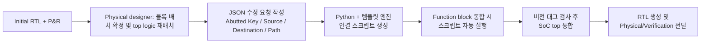

<!-- generated by yt-paper; edits will be overwritten -->

# Automated RTL Update for Abutted Design

[:material-open-in-new: 원문 보기](https://dvcon-proceedings.org/wp-content/uploads/automated-rtl-update-for-abutted-design_paper.pdf){ .md-button .md-button--primary target=_blank }

> 모바일 AP SoC에서 abutted floorplan에 따른 대량의 RTL 수정을 IP-XACT 기반 메타데이터와 JSON 요청 포맷, Python 자동화 스크립트로 오류 없이 빠르게 반영하는 방법론을 제안한 논문이다.

| 항목 | 내용 |
|---|---|
| 저자/출처 | Wonkyung Lee, Ayoung Kwon, Soyeong Kwon, Youngsik Kim, Seonil Brian Choi (Samsung Electronics Co., Ltd.); 힌트 기준 출처: 김우주/WOO JOO KIM |
| 유형 | PAPER |
| 카테고리 | EDA |
| ID | `ref-20261018-2fe4` |

## 핵심 인사이트

- Abutted floorplan은 top-level routing 영역을 줄여 칩 면적을 절감하지만, P&R 이후 top-level 로직을 블록으로 재배치하면서 feed-thru 연결, 로직 이동, register slice 추가 등 RTL 수정이 대량으로 발생한다.
- IP-XACT를 메타데이터로 활용해 Verilog를 직접 수정하지 않고 스크립트로 인스턴스 추가와 포트 연결을 생성하는 구조는, 반복적으로 바뀌는 P&R 결과를 수용하는 데 핵심적이다.
- physical designer의 수정 요청을 source/destination/path 형태의 JSON 메타데이터로 정의하고 이를 Python 템플릿 엔진으로 연결 스크립트에 변환하는 흐름이 자동화의 중심이다.
- 여러 function block에 동시에 적용되는 수정의 버전 불일치를 막기 위해 모든 연결에 고유 버전 태그를 부여하고 블록 전달 시 검증하는 장치가 포함된다.
- 논문은 포트 연결 수가 2~7배 증가했음에도 수 천 초 내에 자동 생성되었다고 보고하지만, 구체적인 검증 방법은 RTL 기능 검증 후 equivalence check로 연결 일관성을 확인하는 수준으로 제시되어 정량적 세부 정보는 제한적이다.

## 상세 요약

### 배경 및 문제 정의

SoC 칩 면적은 제조 원가와 직결되며, 이를 줄이기 위한 방법 중 하나가 **abutted floorplan**이다. Abutted floorplan은 칩 top-level routing 영역을 없애 면적을 줄이지만, 블록 배치가 확정된 뒤 physical designer가 요청하는 RTL 수정을 많은 block integration engineer가 동시에 처리해야 한다. 문서에 따르면 이러한 수정은 다음을 포함한다.

- feed-thru 연결 (여러 function block을 통과하는 연결)
- SoC top 로직의 function block 내부로의 이동
- 테스트 모드 제어 IP의 이동 (테스트 모드 약 50개, function block 약 30개 규모)
- 블록 간 데이터 통신을 위한 register slice 추가
- 패드에서 들어오는 test signal용 flip-flop의 분리 및 재배치

수정은 late stage에 요청되고, P&R이 바뀔 때마다 반복되며, 양이 많아 수동 처리 시 human error와 TAT 증가가 불가피하다. 따라서 자동화가 필수라는 것이 논문의 문제 정의다.

### 핵심 아키텍처 및 방법론

**1) IP-XACT 기반 메타데이터 통합 플로우**

Verilog를 직접 수정하기 어려우므로 IP-XACT(IEEE 1685)를 메타데이터로 사용한다. 문서에서 사용된 IP-XACT 요소는 bus definition, abstraction definition, component, design이다. 연결은 두 종류로 나뉜다.

- **Interface connection**: 표준 버스 인터페이스 기반 연결 (전체 포트 연결의 약 50%)
- **Ad-hoc connection**: 포트 대 포트 연결, inter-IP 연결 및 상수(0/1) 연결. 수 만 건 규모이므로 자동화가 필수다.

System-level IP(클럭/전원 관리, test mode, testmux, interrupt 등)의 수정은 전용 에디터로 작성된 사양을 기반으로 스크립트를 생성해 처리한다. 예시로 testmux 통합은 사양 → 스크립트(RTL 생성, IP 인스턴스화, 포트 연결) → 각 function block에서 실행 → 메타데이터 갱신 → RTL 재생성 순서로 진행된다.

**2) Abutted design 수정 자동화 흐름**

- **JSON 메타데이터 포맷**: 각 수정 항목은 Abutted Key(test control IP명, register slice용 데이터 통신 IP명, pad test signal 연결 IP명 중 하나), Source(경로 시작점), Destination(끝점), Path(경유 블록 목록)로 정의된다. 예시로 Block C → Block E 직접 연결이 Block H를 경유하도록 변경되는 경우를 JSON으로 기술한다.
- **구현**: 모든 자동화는 Python으로 구현되었으며, JSON 파싱 라이브러리와 템플릿 엔진으로 통합 스크립트를 생성한다.
- **버전 매칭**: 여러 블록에 동시에 적용하기 위해 모든 abutted 연결에 고유 버전 태그를 붙이고, function block을 SoC top으로 전달할 때 버전 불일치를 검사한다.

### 실험 결과 및 결론

**정량 결과 (문서 보고 기준)**

| 항목 | 변화 |
|---|---|
| Test mode control IP 관련 포트 연결 | 2배 |
| 블록 간 데이터 통신 포트 연결 | 약 7.3배 |
| Pad test signal 포트 연결 | 약 6.9배 |

- 데이터 통신에는 bus interface가 사용되며, bus interface 연결 하나가 80개의 포트 연결을 대표한다.
- 포트 연결이 최소 2~7배 증가했지만, 모든 신규 연결은 수 천 초 이내에 자동 생성되었다고 보고된다.
- 검증은 abutted 정보 없이 원본 RTL에서 기능 검증을 수행한 뒤, 연결 측면에서 원본과 abutted RTL 간의 일관성을 equivalence check로 확인하는 방식이다. 이는 abutted 정보가 physical 구현 이후에 전달되어 기능 변경이 없다는 전제에 기반한다.

**결론**

논문은 abutted design에 따른 대규모 RTL 수정을 IP-XACT 메타데이터와 JSON 기반 요청, Python 스크립트 자동화로 처리하여, 사람 실수 없이 TAT 증가 없이 반영할 수 있음을 주장한다. 다만 실험은 단일 모바일 AP SoC 프로젝트 적용 사례 중심이며, 자동화 도구의 성능 비교 대상이나 수동 방식 대비 정량적 시간 절감 수치는 본문에 명시되지 않았다.

## 관련 영상

<iframe src="https://www.youtube-nocookie.com/embed/49BqlsA06io" title="[DVCon2020] Automated RTL Update for Abutted Design" loading="lazy" allow="accelerometer; clipboard-write; encrypted-media; gyroscope; picture-in-picture; web-share" referrerpolicy="strict-origin-when-cross-origin" allowfullscreen></iframe>

**[DVCon2020] Automated RTL Update for Abutted Design** — [YouTube에서 보기](https://www.youtube.com/watch?v=49BqlsA06io) · [영상 페이지](../../videos/49BqlsA06io.md)
