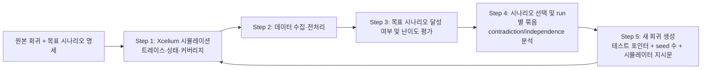

<!-- generated by yt-paper; edits will be overwritten -->

# Functional Coverage Closure in SoC Interconnect Verification with Iterative Machine Learning

[:material-open-in-new: 원문 보기](https://dvcon-proceedings.org/wp-content/uploads/1096.pdf){ .md-button .md-button--primary target=_blank }

> SimAI가 기존 constrained random 회귀의 시뮬레이션 트레이스를 학습해 목표 시나리오를 겨냥한 새 회귀(시뮬레이터 지시문 포함)를 반복 생성함으로써, SoC 인터커넥트의 커버리지 클로저에 필요한 CPU 시간을 4.92x·18.20x 줄인 방법.

| 항목 | 내용 |
|---|---|
| 저자/출처 | Jihye Kwon, Sukwon Ha, Youngsik Kim, Seonil Brian Choi, Daeseo Cha, Space Kim, Kunhyuk Kang, John Pierce, Amit Metodi, Saurabh Sharma, Heedo Jung, Yosinori Watanabe (Samsung Electronics Co., Ltd. / Cadence Design Systems) — 발표 학회 정보는 문서에 명시되지 않음 |
| 유형 | PAPER |
| 카테고리 | EDA |
| ID | `ref-20261018-7a35` |

## 핵심 인사이트

- 기존 방식의 병목은 같은 회귀를 반복하는 것에서 오는 diminishing marginal return이다. 실험에서 Category 1은 24회 반복(41,158 CPU hours)으로 96.27%에 도달했고, 마지막 4회(7,408 CPU hours)는 1.43%pt만 추가했다.
- SimAI는 시나리오 간 contradiction(같은 변수의 서로 다른 값 범위 요구)과 independence(서로 다른 변수 사용)를 분석해, 독립적인 시나리오는 한 시뮬레이션 run에 묶고 충돌하는 시나리오는 별도 run으로 분리한다. 이것이 run 수와 CPU 시간 절감의 핵심 메커니즘으로 보인다.
- 미관측 값으로 randomize되어야 하는 시나리오가 더 어렵다고 판단하는 난이도 평가를 사용하며, 이 평가 기준은 본문에서 정량적 모델로 제시되지 않았다.
- 접근의 효과는 target specification의 완전성과 정확성에 의존한다. 명세에 빠진 시나리오가 있으면 모든 명세 시나리오를 만족해도 특정 커버리지 bin을 못 칠 수 있으며, 명세 자동 도출은 future work로 남아 있다.
- 보고된 수치는 단일 모바일 AP 프로젝트의 두 coverage 카테고리에 대한 결과이며, 반복 실험 분산이나 다른 설계로의 일반화 결과는 제시되지 않았다. 또한 Category 1의 CPU 시간 절감은 4.92x로 명시되어 있으나 AI 회귀 자체의 run당 평균 시간은 증가했다.

## 상세 요약

### 배경 및 문제 정의

SoC 인터커넥트는 수백 개의 master/slave IP를 여러 프로토콜로 연결하며, 기능 커버리지 모델은 수십만 개 규모의 데이터 경로·속성 조합을 포함합니다. 기존 검증 방식은 UVM 기반 testbench에서 constrained random 회귀(regression)를 반복 실행하여 커버리지를 높이고, 잘 안 맞는 bin에 대해서는 테스트나 시뮬레이션 설정을 수작업으로 수정하는 방식입니다. 문제는 다음과 같습니다.

- 랜덤 반복은 커버리지가 높아질수록 수익이 급격히 떨어진다(diminishing marginal return).
- 특정 bin을 맞히려면 특정 randomization 조합이 필요하지만, 모든 bin마다 directed test를 작성하는 것은 현실적으로 불가능하다.
- 남은 bin을 분석하고 테스트를 수정하는 과정에 엔지니어 시간이 크게 소요된다.

### 핵심 아키텍처 및 방법론

논문은 Cadence SimAI를 이용한 반복 기계학습 흐름을 제안합니다. 시뮬레이터는 Cadence Xcelium을 사용합니다. 흐름은 다음과 같이 정리할 수 있습니다.

주요 설계 요소는 다음과 같습니다.

- **목표 명세(target specification)**: 커버리지 bin을 맞히는 데 필요한 시뮬레이션 설정과 랜덤 변수 값 조합을 시나리오 목록으로 기술합니다.
- **만족 판정**: 시나리오의 변수 값 범위 조합이 해당 run에서 한 번이라도 발생하면 그 시나리오는 만족된 것으로 봅니다.
- **난이도 평가**: 관측되지 않은 값으로 randomize되어야 하는 시나리오를 더 어려운 것으로 판단합니다.
- **시나리오 관계 분석**: 같은 랜덤 변수를 서로 다른 값 범위로 요구하는 시나리오는 contradictory로 분류해 별도 run에 배치합니다. 서로 다른 변수를 쓰는 시나리오는 independent로 분류해 한 run에 함께 배치할 수 있습니다.
- **새 회귀 구성**: 원본 테스트 파일을 가리키는 포인터, 테스트별 seed 수, 그리고 run마다 특정 시나리오가 발생하도록 Xcelium을 유도하는 지시문으로 구성됩니다.

이 과정을 모든 목표 시나리오가 처리될 때까지 반복합니다. 한 run에 많은 시나리오를 넣으면 run 시간이 길어지지만, 논문은 이 오버헤드가 전체 절감 효과에 비해 작다고 보고합니다.

**검증 환경**: 모바일 application processor의 SoC 인터커넥트(Cache Coherent Interconnect, NoC, AXI, AHB bus matrix, bridge 포함)를 대상으로 했습니다. master는 수백 개, slave는 약 1,000개 가까이 연결되며, active VIP로 master/slave를 대체하고 System Verification Scoreboard VIP로 end-to-end 정합성을 검사합니다.

**대상 커버리지**: 두 카테고리가 사례로 사용되었습니다.
- Category 1: 주소·데이터·방향 등 제어 신호를 reachability matrix 기준으로 확인. 500여 개 cover item, 약 120,000 bin.
- Category 2: master에서 target으로 전달되는 QoS 값의 유효 값 전체를 검증. 496개 cover item, 5,850 bin.

### 실험 결과 및 결론

**Category 1 (약 120,000 bin)**

| 항목 | 기존 방식 (원본 회귀 24회 반복) | 제안 방식 (SimAI 2회 추가 회귀) |
|---|---|---|
| 달성 커버리지 | 96.27% | 100.00% |
| 시뮬레이션 run 수 | 6,576 | 772 (원본 274 포함) |
| CPU 시간 | 41,158 CPU hours | 8,362 CPU hours |

- 원본 회귀 1회 실행은 274 run, 1,744 CPU hours로 26.74%를 달성했습니다.
- 기존 방식의 마지막 4회 반복(1,096 run, 7,408 CPU hours)은 1.43%pt만 추가했습니다.
- SimAI 첫 회귀는 233 run, 약 4,600 CPU hours로 추가 72.85%를 달성해 99.59%에 도달했습니다. 두 번째 회귀는 265 run, 2,022 CPU hours로 남은 bin을 모두 채웠습니다.
- 보고된 CPU 시간 절감은 4.92x이며, 커버리지는 3.73%pt 증가했습니다.
- 논문은 기존 방식에서 남은 4,478개 bin을 위해 필요한 테스트 수정 등 엔지니어 작업 시간이 추가로 든다고 설명하며, 이 인적 비용 절감은 정량화되지 않았습니다.

**Category 2 (5,850 bin)**

| 항목 | 기존 방식 | 제안 방식 |
|---|---|---|
| 달성 커버리지 | 79.91% | 100.00% |
| 시뮬레이션 run 수 | 6,576 | 329 |
| CPU 시간 | 41,158 CPU hours | 2,261 CPU hours |

- SimAI 첫 회귀(48 run, 451 CPU hours)가 추가 90.19%를 달성했습니다.
- 두 번째 회귀(7 run, 67 CPU hours)가 남은 bin을 모두 채웠습니다.
- 보고된 절감은 18.20x이며, 커버리지는 20.09%pt 증가했습니다.
- 기존 방식에서는 남은 1,175개 bin을 수작업으로 분석해야 한다고 언급됩니다.

**결론 및 한계**

- 논문은 두 카테고리 모두에서 100% 커버리지 클로저를 달성했다고 보고합니다. 전체 CPU 시간과 엔지니어 작업을 줄이는 효과가 있다고 주장합니다.
- 효과는 target specification의 완전성과 정확성에 달려 있습니다. 명세가 불완전하면 bin을 못 맞힐 수 있습니다.
- 명세를 자동으로 도출하는 것은 향후 과제입니다.
- 실험은 단일 프로젝트 기준이며, 여러 번 반복한 통계적 분산이나 다른 설계로의 일반화는 본문에 나와 있지 않습니다. 보고된 수치는 저자들의 실험 결과로 해석해야 합니다.
- 본문은 Category 1의 첫 번째 AI 회귀 run당 평균 시간이 증가했다고 밝힙니다. 따라서 절감은 run 수 감소와 반복 횟수 감소에서 주로 나오는 것으로 보입니다.
- 최종 결과 요약에서 Category 1의 CPU 절감 비율은 4.92x입니다. 원문 본문에서 4.92x는 41,158 / 8,362 계산과 일치합니다.

## 관련 영상

<iframe src="https://www.youtube-nocookie.com/embed/l-LeCVSpfaw" title="[DVCON2025]Functional Coverage Closure in SoC Interconnect Verification Iterative Machine Learning" loading="lazy" allow="accelerometer; clipboard-write; encrypted-media; gyroscope; picture-in-picture; web-share" referrerpolicy="strict-origin-when-cross-origin" allowfullscreen></iframe>

**[DVCON2025]Functional Coverage Closure in SoC Interconnect Verification Iterative Machine Learning** — [YouTube에서 보기](https://www.youtube.com/watch?v=l-LeCVSpfaw) · [영상 페이지](../../videos/l-LeCVSpfaw.md)
