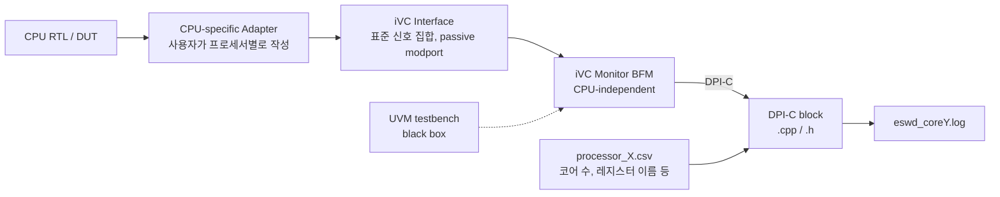

<!-- generated by yt-paper; edits will be overwritten -->

# Generic Core-Monitor for Hardware/Software Co-Debugging targeting Emulation Platform

[:material-open-in-new: 원문 보기](https://dvcon-proceedings.org/wp-content/uploads/74436.pdf){ .md-button .md-button--primary target=_blank }

> CPU별 adapter 한 계층만 새로 작성하고 나머지(iVC 인터페이스, BFM, DPI-C)는 재사용하는 CPU trace 생성 구조를 제안하고, ZeBu 에뮬레이션에서 IFX 프로세서 trace 생성과 런타임 오버헤드를 측정한 논문.

| 항목 | 내용 |
|---|---|
| 저자/출처 | Shreya Morgansgate, Johannes Grinschgl, Djones Lettnin (Infineon Technologies AG, München, Germany) / DVCon Europe (힌트 기준, 본문에는 학회명 미표기) |
| 유형 | PAPER |
| 카테고리 | Emulation |
| ID | `ref-20261018-0efa` |

## 핵심 인사이트

- 재사용성의 핵심은 CPU 종속 로직을 adapter 하나로 격리한 점이다. iVC 인터페이스 이하(BFM, DPI-C)는 CPU와 무관하게 유지되며, 사용자는 프로세서마다 adapter만 작성하면 된다. 논문 사례에서 IFX adapter 최소 코드는 약 290라인이다.
- 에뮬레이션과 시뮬레이션을 동일 구조로 지원하기 위해 testbench를 hdl_top(합성 가능, 에뮬레이터 구동)과 hvl_top(UVM, 시뮬레이터 구동)으로 나눴다. 두 영역은 SystemVerilog virtual interface 기반 트랜잭션 수준으로 통신한다.
- DPI-C는 ZeBu에서 HW→Host 방향 호출만 사용하도록 선택되었다. 논문은 이 단방향 경로가 런타임 효율을 높인다고 설명한다. 다만 이 효과를 정량적으로 분리해 보여주지는 않는다.
- Table 4 기준으로 trace 기록(eswd 옵션)의 비용이 지배적이다. Testcase 1은 eswd 없이 160.3s, 있으면 3197.3s로 약 20배 증가한다. 기존 방식 대비 Core-Monitor의 차이는 무 eswd 기준 약 33%, eswd 기준 약 12%다(계산값).
- 검증 범위는 제한적이다. 에뮬레이션 평가는 단일 IFX 프로젝트 1개와 테스트케이스 2개에 한정되며, 분산이나 표준편차 없이 10회 평균만 제시된다. OpenRISC/RISC-V 시뮬레이션 테스트는 언급만 있고 결과 데이터가 없다. 따라서 'generic' 주장은 설계 의도로 읽는 편이 안전하다.

## 상세 요약

### 배경 및 문제 정의

현대 SoC는 다수의 프로세서 코어, 주변장치, 계층형 NoC로 구성되며, HW/SW co-debugging이 개발 기간을 크게 좌우한다. 대규모 설계에서는 시뮬레이션 속도가 병목이 되어 에뮬레이션 기반 co-debugging으로 이동하는 추세다. 그러나 다음과 같은 문제가 있다.

- **프로세서별 중복 구현**: OpenRISC, RISC-V 등에서 CPU state trace를 생성하려면 프로세서마다 Verilog/SystemVerilog 모듈을 새로 작성해야 한다. 멀티코어 SoC에서는 같은 코드가 반복되어 공수와 시간이 늘어난다.
- **시뮬레이션과 에뮬레이션 간 재사용 불가**: 시뮬레이션 환경에서 쓰던 trace 구조를 에뮬레이터로 옮기기 어렵다. 논문은 두 환경을 모두 지원하는 공통 플랫폼이 없다고 지적한다.
- **벤더 종속 기술**: ARM Tarmac trace와 CoreSight 기반 기법은 효과적이지만 ARM 코어에 한정되어 재사용이 어렵다.

논문은 이를 해결하기 위해 시뮬레이션과 에뮬레이션 모두에서 쓸 수 있는 표준형 trace 생성 구조인 Core-Monitor를 제안한다. 목표는 processor state tracer 작성 공수 감소, co-debugging 시간 단축, 설계 기간 단축이다.

### 핵심 아키텍처 및 방법론

구조는 CPU 종속 부분과 독립 부분으로 나뉜다.

- **Adapter (CPU 종속)**: 프로세서 신호를 받아 초기 처리를 수행하고 iVC 인터페이스에 기록한다. 신호 캡처 조건(어느 사이클에 PC, 명령어, 메모리 접근을 잡을지)이 CPU 구현마다 다르므로 timed HDL 모듈로 구현한다. 같은 코어 설계를 쓰는 멀티코어라면 인스턴스만 여러 번 만들면 된다.
- **iVC Interface (CPU 독립)**: 공통 신호를 정의한다. 클럭과 리셋(`cpu_clk`, `cpu_reset_n`), PC 추적(`cpu_pc`, `cpu_instruction`, `cpu_pc_valid`), 레지스터 추적(`reg_data`), 메모리 추적(`cpu_mem_addr`, `cpu_mem_data`, `cpu_mem_size`, `cpu_mem_ack`, `cpu_mem_str_enable`), 코어 식별자(`cpu_id`, `cpu_num`)를 포함한다. PC와 레지스터 개수는 파라미터로 오버라이드할 수 있다.
- **iVC Monitor BFM (CPU 독립)**: iVC 신호를 수집하고 DPI-C 함수를 호출해 trace 파일에 기록한다.
- **DPI-C block (CPU 독립)**: 코어별 trace 파일을 생성하고 신호를 기록한다. 레지스터 이름, 코어 수 같은 설정은 CSV 설정 파일로 받는다. 논문 Table 3은 코어 3개, 레지스터 5개 예시를 보여준다.

**hdl_top / hvl_top 분할**: 합성 대상 컴포넌트(adapter, iVC, BFM)는 `hdl_top`에 두어 에뮬레이터에서 실행하고, UVM 테스트벤치 등 untimed 컴포넌트는 `hvl_top`에 두어 시뮬레이터에서 실행한다. 두 영역은 트랜잭션 수준으로 통신하며, co-emulation 설정 [17]을 따른다.

**절차**: 상위 모듈에서 n코어 프로세서를 n번 인스턴스화하고, 최상위에서 iVC 인스턴스를 프로세서 모드에 맞게 설정해 연결한다. 논문은 이 구조를 시뮬레이션과 에뮬레이션 사이에 변경 없이 쓸 수 있다고 주장한다.

### 실험 결과 및 결론

**구현 검증**
- Core-Monitor는 시뮬레이션에서 OpenRISC와 RISC-V로 테스트되었다고 언급된다. 다만 해당 결과 데이터는 본문에 없다.
- 에뮬레이션에서는 Synopsys ZeBu를 사용해 Infineon의 IFX 프로세서를 대상으로 구현했다. IFX는 9개 코어 중 5개가 활성이며 adapter를 5번 인스턴스화했다.
- ZeBu 빌드는 약 5시간이 걸린다. 생성된 trace는 Indago로 전달되어 디버그 DB를 만들고, 소스 코드, 어셈블리, waveform을 PC와 C 함수 기준으로 동기화해 HW/SW 동시 디버깅에 쓴다.

**성능 평가 (Table 4, 10회 평균, 단위 초)**

| 테스트케이스 | 옵션 | Core-Monitor | 기존 방식 |
|---|---|---|---|
| Testcase 1 | eswd 사용 | 3197.3 | 3635.9 |
| Testcase 1 | eswd 미사용 | 160.3 | 239.8 |
| Testcase 2 | eswd 사용 | 889.2 | 921.3 |
| Testcase 2 | eswd 미사용 | 34.4 | 52.7 |

위 수치에서 Core-Monitor는 기존 방식보다 빠르다. 계산해 보면 Testcase 1 기준 eswd 사용 시 약 12%, 미사용 시 약 33% 짧다. Testcase 2 기준으로는 eswd 사용 시 약 3.5%, 미사용 시 약 35% 짧다(모두 본문 수치로 계산한 값). 논문은 이를 "slightly faster"로 표현하지만, 미사용 구간의 차이는 상당히 크다. 또한 eswd 사용 시 trace 기록 데이터량 때문에 런타임이 크게 늘어나는 것이 확인된다.

**결론과 한계**
- 제안 방식은 프로세서마다 adapter만 작성하면 되므로 재사용성이 높다고 주장한다.
- 시뮬레이션과 에뮬레이션 사이 코드 변경이 필요 없다고 주장한다.
- 다만 평가 범위가 단일 산업 프로젝트(IFX, ZeBu), 2개 테스트케이스로 제한된다. 표준편차나 통계 분석이 없고, 다른 에뮬레이터나 다른 CPU의 에뮬레이션 결과도 없다. 또한 adapter 구현 공수를 정량적으로 기존 방식과 비교하지 않는다. 따라서 "generic"과 "reusable for all kinds of processors"라는 주장은 설계 방향으로 이해하고, 실제 적용 범위는 추가 검증이 필요하다.
- 향후 과제로는 C 함수와 SV 모듈에서 사용자 설정을 파싱하는 더 범용적인 방식을 제시한다.

## 관련 영상

<iframe src="https://www.youtube-nocookie.com/embed/jfiiPcLzO3s" title="[DVCON2022_EUROPE] Generic Core-Monitor for Hardware/Software Co-Debugging targeting Emulation" loading="lazy" allow="accelerometer; clipboard-write; encrypted-media; gyroscope; picture-in-picture; web-share" referrerpolicy="strict-origin-when-cross-origin" allowfullscreen></iframe>

**[DVCON2022_EUROPE] Generic Core-Monitor for Hardware/Software Co-Debugging targeting Emulation** — [YouTube에서 보기](https://www.youtube.com/watch?v=jfiiPcLzO3s) · [영상 페이지](../../videos/jfiiPcLzO3s.md)
