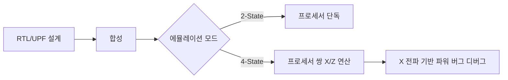

<!-- generated by yt-paper; edits will be overwritten -->

# Innovative 4-State Logic Emulation for Power-aware Verification

[:material-open-in-new: 원문 보기](https://dvcon-proceedings.org/wp-content/uploads/1024-1.pdf){ .md-button .md-button--primary target=_blank }

> Palladium Z2 기반 4-State(0/1/X/Z) 에뮬레이션을 모바일 AP SoC의 UPF 저전력 검증에 적용해, X 전파 기반 파워 인텐트 버그 디버깅을 가능하게 하고 시뮬레이션 대비 30~115배 빠른 실행 속도를 보고한 사례 논문.

| 항목 | 내용 |
|---|---|
| 저자/출처 | Kyoungmin Park, Brad Budlong, Hyundon Kim, Danny Yi, Jaehunn Lee, Chulmin Kim, Jaemin Choi, Kijung Yoo, Gibs Lee, Youngsik Kim, Yogesh Goel, Seonil Brian Choi (Samsung Electronics / Cadence Design Systems, Inc.) |
| 유형 | PAPER |
| 카테고리 | Emulation |
| ID | `ref-20261018-1917` |

## 핵심 인사이트

- 2-State 에뮬레이션은 power down 후의 X가 0/1로 치환되어 isolation 누락 같은 파워 버그를 놓치게 만들며, 이것이 저전력 검증에서 에뮬레이션 활용을 제한해 왔던 핵심 원인이다.
- 4-State 에뮬레이션은 Palladium Z2의 프로세서 쌍(pair) 구조로 구현되며, 2-State 대비 자원이 최소 2배 필요하다. 실측으로는 4-State 자원 비용이 약 2.3배, UPF 포함 시 약 3.2배로 보고되었다.
- 실무 도입 시 가장 큰 장애물은 엔진 자체보다 모델링 문제다. 합성 가능한 PHY 모델의 파워 기능 구현, PAD의 Z 처리(assign 구문 재작성), pull-up/down, 미초기화 메모리 프리로딩이 필요하다.
- Dynamic RTL 같은 런타임 디버그 기능은 4-State에서 지원되지 않아 디버그 로직을 정적 RTL로 옮겨야 한다. 이는 기존 에뮬레이션 디버그 워크플로에 영향을 준다.
- 논문의 성능 수치(30~115배)와 자원 수치는 최적화 이전의 초기 데이터이며, 컴파일/성능 프로파일링은 아직 수행되지 않았다고 명시되어 있다. 파형 덤프 시간은 향후 과제로 남아 있어 수치를 일반화할 때 주의가 필요하다.

## 상세 요약

### 배경 및 문제 정의

저전력(UPF 기반) 검증은 일반 로직 검증보다 실행 시간이 길어, 에뮬레이션으로 턴어라운드를 줄이려는 수요가 있다. 그러나 기존 에뮬레이터는 2-State('0','1')만 지원하여 'X'와 'Z'를 표현하지 못한다. 시뮬레이션에서는 power down 후 X가 전파되면서 isolation cell 누락이나 enable 신호 오동작을 드러내지만, 2-State 에뮬레이션에서는 0/1 값이 전파되어 이런 파워 인텐트 버그가 가려진다. 이 때문에 엔지니어들은 에뮬레이션을 power sequence 점검 정도로만 쓰고, full low-power 검증은 시뮬레이션에 의존해 왔다. SoC 크기와 전원 도메인 수가 늘어나면서 시뮬레이션만으로는 한계가 있다는 것이 논문의 출발점이다.

### 핵심 아키텍처 및 방법론

저자들은 Palladium Z2에서 네이티브 3-state('0','1','X') 연산을 구현하고, 컴파일러 변환을 추가해 'Z'까지 지원하는 4-State 에뮬레이션을 구성했다. 하드웨어 측면에서 프로세서가 단독으로 2-State 연산을 하거나 두 개가 쌍을 이뤄 4-State 연산을 수행하므로, 자원은 최소 2배가 필요하다. 사용 흐름(컴파일, 런타임)은 2-State와 동일하게 유지된다.

TABLE I은 X의 발생 원인을 시뮬레이션과 4-State 에뮬레이션에서 비교한다. 지원 항목은 power down, X 전파, 미초기화 신호/메모리, RTL 주입, TCL force, 시뮬레이터-에뮬레이터 경계 포트, DPI 인자, multi-driven net, undriven net이다. 타이밍 위반은 zero-delay 모델이므로 해당되지 않는다. X 전파 모델은 LRM, CAT, FOX 중 에뮬레이터 매핑 기반의 localized CAT 모델을 사용한다.

실제 모바일 AP 평가에서 도출된 도입 요구사항은 다음과 같다.
1. 합성 가능한 파워 인식 PHY 모델: 시뮬레이션용 PHY는 대부분 합성 불가능하므로 전원 핀을 포함해 UPF 수준까지 구현해야 한다. DRAM PHY의 경우 시스템 파워게이팅 후 wake-up에서 retention 처리 부재로 DRAM 접근이 실패한 사례가 있다.
2. PAD MUX: 2-State에서 동작하던 `assign PAD = (unknown === 1'bx) ? 1'bx : PAD_i;` 형태는 4-State에서 문제가 될 수 있으며, `PAD_i === 1'bz` 분기를 추가해야 한다.
3. Dynamic RTL 제거: 4-State에서는 미지원이므로 디버그 모니터를 정적 RTL로 옮겨야 한다.
4. pull-up/pull-down 처리 (Z 상태 net).
5. 테스트벤치와 에뮬레이션 모델 양쪽의 undriven net 초기화.
6. SRAM/ROM 코드 프리로딩: 미초기화 메모리 접근 시 X가 전파되어 디버깅이 어려워지므로 사전 로딩이 필요하다.

### 실험 결과 및 결론

성능 측면에서 Design A는 컴파일 시간이 시뮬레이터 대비 16% 많지만 런타임은 약 115배 빠르다. Design B는 더 크고 시나리오가 길어 컴파일 격차는 더 크고 런타임 이득은 작았는데, 저자들은 이를 에뮬레이터 자원과 드라이버 클록 주파수 같은 물리적 요인으로 추정한다. 전체적으로 30~115배 가속과 컴파일 1.16~1.7배 시간이 보고되었다. 대부분의 전원 시나리오가 하루~이틀 걸리는 점을 감안하면 턴어라운드 개선이 크다고 주장한다.

정확도 측면에서 두 가지 사례가 소개된다. 첫째, 항상 전원이 켜져 있어야 하는 ROM이 power down 후 X를 출력했는데, 원인은 liberty cell의 PG 핀 정보 누락으로 잘못된 전원 net에 연결된 것이었다. 둘째, 손상된 전원 도메인에서 power switch 제어 신호가 X가 되었는데, UPF의 `set_port_attributes -driver_supply/-receiver_supply` 해석 문제였다. 두 현상 모두 2-State 에뮬레이션에서는 발생하지 않았다.

자원 분석(TABLE II, 2-State w/o UPF 기준 상대값)은 다음과 같다.
- Emulation capacity: 2-State 1.4x, 4-State 2.3x (w/o UPF); 4-State w/ UPF 3.2x (2-State w/ UPF 대비 2.3x)
- Compile time: 2-State w/ UPF 1.5x, 4-State w/o UPF 1.5x, 4-State w/ UPF 2.1x
- Performance: 2-State w/ UPF 0.75x, 4-State w/o UPF 0.9x, 4-State w/ UPF 0.59x

저자들은 이 수치가 최적화 이전의 초기 데이터이며, 검증 대상 블록만 4-State로 하고 나머지는 2-State로 두는 하이브리드 방식이 유효할 수 있다고 제안한다. 파형 덤프 및 변환 시간은 아직 측정하지 않은 향후 과제이다.

결론적으로 4-State 에뮬레이션은 X 원인 추적과 파워 인텐트 버그 식별에 유용하며, 지원되는 X 소스는 4-State 시뮬레이션과 거의 동등하다고 주장한다. 다만 성능과 컴파일 프로파일링, 디버그 편의 기능은 아직 완성되지 않았다. 참고로 본 문서는 본문이 일부 잘리지 않았고 전체 구성이 확인되지만, 성능 수치는 특정 두 설계에 한정된 보고이므로 일반화에는 주의가 필요하다.

## 관련 영상

<iframe src="https://www.youtube-nocookie.com/embed/WiuAknk2_SU" title="[DVCON2024] Innovative 4-State Logic Emulation for Power-aware Verification" loading="lazy" allow="accelerometer; clipboard-write; encrypted-media; gyroscope; picture-in-picture; web-share" referrerpolicy="strict-origin-when-cross-origin" allowfullscreen></iframe>

**[DVCON2024] Innovative 4-State Logic Emulation for Power-aware Verification** — [YouTube에서 보기](https://www.youtube.com/watch?v=WiuAknk2_SU) · [영상 페이지](../../videos/WiuAknk2_SU.md)
