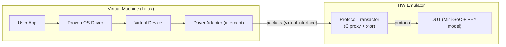
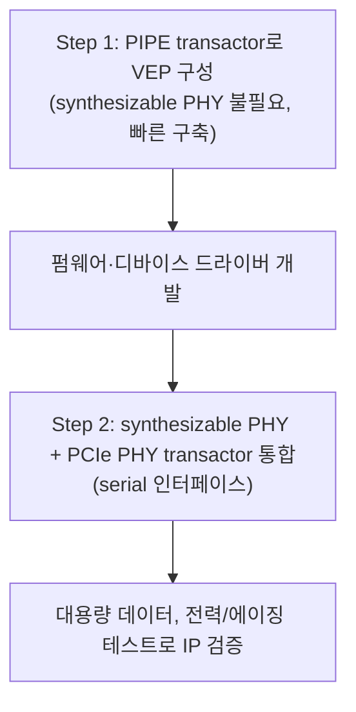

<!-- generated by yt-paper; edits will be overwritten -->

# High-Speed Interface IP Validation based on Virtual Emulation Platform

[:material-open-in-new: 원문 보기](https://dvcon-proceedings.org/wp-content/uploads/high-speed-interface-ip-validation-based-on-virtual-emulation-platform.pdf){ .md-button .md-button--primary target=_blank }

> FPGA+MPW 기반 HSI IP 검증의 가시성·구축 공수·TAT 문제를, 가상 머신(OS 드라이버)과 하드웨어 에뮬레이터를 virtual interface로 연결하는 VEP로 해결하고 PCIe Gen3 IP에서 TAT 33.3% 단축, 커버리지 19.7%p 향상(68.1%→87.8%)을 보고한 사례 연구.

| 항목 | 내용 |
|---|---|
| 저자/출처 | Jaehun Lee, DaeSeo Cha, Sungwook Moon (Samsung Electronics Co., Ltd.). 본문에 학회명은 명시되어 있지 않음. 제공된 힌트의 저자명(Laura Hyslop)은 본문과 일치하지 않음. |
| 유형 | PAPER |
| 카테고리 | Emulation |
| ID | `ref-20261018-2072` |

## 핵심 인사이트

- VEP의 핵심은 software adapter(driver adapter + protocol transactor, C proxy/xtor)로, 실제 OS 드라이버가 가상 디바이스로 보낸 트랜잭션을 가로채 하드웨어 에뮬레이터의 DUT로 전달하는 구조다. 이 덕분에 MPW 테스트 칩 없이도 OS 수준 시나리오를 pre-silicon에서 실행할 수 있다.
- 속도 문제 해결을 위해 PCIe Gen3의 serial interface(8GHz) 대신 PIPE interface(250MHz, 32bit 데이터 폭)를 쓰면 이벤트 캡처량이 크게 줄어든다. 본문은 link-up 시나리오의 시뮬레이션 시간이 31.35배 단축되었다고 보고한다.
- PIPE는 빠른 SW 개발용, serial+synthesizable PHY는 최종 IP 검증용으로 나누는 mixed interface 방법론을 제시한다. 대신 두 개의 에뮬레이션 환경을 유지해야 하므로 엔지니어링 공수가 늘어난다는 트레이드오프가 있다.
- 디버그 측면에서 SW 엔지니어는 TLP 로그와 virtual JTAG를, HW 엔지니어는 타임스탬프가 있는 CSV 트랜잭션 로그를 사용해 파형 위치를 찾는다. 에뮬레이터 환경은 timeout 제약 없이 DUT를 정지시킬 수 있어 디버그에 유리하다.
- 한계도 명확하다. 등화(equalization)나 lane margining 같은 아날로그 특성은 검증할 수 없어 87.8% 커버리지에서 나머지는 FPGA+MPW 플랫폼으로 보완해야 한다. 또한 결과는 단일 PCIe Gen3 IP 사례에 기반하므로 일반화에는 추가 검증이 필요하다.

## 상세 요약

### 배경 및 문제 정의

HSI(High Speed Interface) IP는 세대가 바뀔수록 복잡도와 속도가 빠르게 증가하고 있어, 주어진 일정 안에 기능 검증을 끝내기가 점점 어려워지고 있다. 기존에는 FPGA 기반 검증이 널리 쓰였으나, 저자들은 다음 문제를 지적한다.

- **가시성(visibility) 부족**: FPGA 플랫폼은 내부 신호 관찰이 제한적이다.
- **구현 공수**: 설계 전체를 FPGA에 구현해야 한다.
- **긴 TAT(Turn Around Time)**: physical layer의 아날로그 회로를 담은 MPW 테스트 칩이 필요하며, 제작에 약 10주가 걸린다. 이 칩이 나와야 실제 기능 검증과 SW 개발을 병행할 수 있다.
- **속도 한계**: FPGA는 PCIe Gen3의 실제 속도를 구현하기 어렵다. 시뮬레이션은 속도 때문에 긴 시나리오(대용량 데이터, 전력/에이징 테스트)를 다루기 어렵다.

본 논문은 이 문제를 해결하기 위해 **Virtual Emulation Platform(VEP)**을 제안한다.

### 핵심 아키텍처 및 방법론

**1) Virtual Emulation 개념과 software adapter**

하드웨어 에뮬레이터와 가상 머신(Linux OS)을 virtual interface로 연결한다. 가상 머신의 애플리케이션이 실제 검증된 OS 드라이버를 통해 가상 디바이스에 트랜잭션을 보내면, driver adapter가 이를 가로채 패킷으로 변환하고, 에뮬레이터 쪽의 protocol transactor(C proxy와 interface transactor(xtor))가 이를 프로토콜 신호로 DUT에 전달한다.

**2) 기존 플랫폼 대비 구조 변화**

기존 플랫폼은 FPGA의 mini-SoC(ARM CPU, interconnect, 메모리, UART)와 MPW 칩의 PHY를 PCS/PMA 인터페이스로 연결했다. VEP는 MPW 칩 대신 **synthesizable PHY 모델**(PMA 포함)을 사용하고, 가상 측과 통신하는 **protocol transactor**를 하드웨어 쪽에 추가한다. 다만 synthesizable PHY는 등화, lane margining 같은 아날로그 기능을 다루지 못한다.

VEP의 이점으로 세 가지가 제시된다.
1. MPW 칩이 필요 없어 pre-silicon 단계에서 SW를 조기에 개발하고, 실제 디바이스 드라이버로 SW의 견고성을 높일 수 있다.
2. OS 위에서 애플리케이션을 실행해 기능 검증을 강화하며, 에뮬레이터로 시뮬레이션 속도를 높인다.
3. IOmeter 같은 실제 벤치마크로 성능을 측정할 수 있고, PCIe Base Spec Rev 3.0의 8.0GT/s 유효 대역폭 준수 여부를 확인할 수 있다.

**3) PIPE 인터페이스를 이용한 가속 (Mixed Interface 방법론)**

에뮬레이션 런타임은 클럭당 이벤트를 캡처하므로 고속 인터페이스는 성능을 떨어뜨린다. 저자들은 PCIe Gen3에서 serial 인터페이스 클럭을 8GHz, PIPE 인터페이스 클럭을 250MHz(32bit 데이터 폭)로 제시하고, 이를 근거로 serial이 PIPE보다 32배 많은 데이터를 캡처한다고 설명한다. 이에 따라 다음 2단계 흐름을 제안한다.

이 방식은 두 개의 에뮬레이션 환경(PIPE용, PHY transactor용)을 유지해야 하므로 엔지니어링 공수가 더 든다.

**4) 디버그 방법론**

- **SW 디버그**: 소켓 서버 측 로그로 TLP(type, address, length, data/header)를 확인하고, virtual JTAG로 소프트웨어 디버거를 에뮬레이터에 연결한다.
- **HW 디버그**: 서버와 클라이언트 양쪽에서 CSV 형식으로 트랜잭션(configuration, read/write, address/data, timestamp)을 기록한다. 타임스탬프로 파형상의 관심 지점을 찾아 덤프한다.
- 시뮬레이터처럼 timeout 제약이 없는 static 환경이어서 SW 엔지니어가 원하는 시점에 DUT를 정지시킬 수 있다.

### 실험 결과 및 결론

**성능 비교 (Table 1)**: PCIe Gen3 link-up 시나리오에서 PIPE 인터페이스는 serial 대비 시뮬레이션 시간을 **31.35배** 줄였다고 보고되며, wall clock 시간은 예상보다 더 빨랐다고 한다. 4096 burst 트랜잭션을 가진 VM 시나리오에서는 단축 비율이 link-up보다 작았는데, 병목이 하드웨어가 아닌 VM의 OS 로딩이기 때문이라고 설명한다. (Table 1의 세부 수치는 본문 텍스트에 포함되지 않아 확인할 수 없다.)

**커버리지 및 TAT (Table 2, Figure 9)**:
- 기존 플랫폼은 검증 대상 공간의 **68.1%**만 커버했으며, 나머지는 시뮬레이션으로 보완했다.
- VEP는 **87.8%**까지 커버해 커버리지가 **19.7%p** 향상되었다고 보고된다.
- 적용 흐름은 다음과 같다. 초기에는 시뮬레이션과 시뮬레이션 가속으로 sanity check를 하고, 이후 **6주** 동안 VEP로 조기 SW 개발과 검증을 수행했다. 마지막으로 아날로그 특성 검증을 위해 FPGA+MPW 플랫폼에서 나머지 기능을 확인했다.
- 이 흐름으로 **TAT 33.3% 단축**을 달성했다고 밝힌다.

**결론 및 한계**:
- 저자들은 VEP가 설계 이슈를 조기에 찾고, 유연성·정적 디버그 환경·조기 접근성을 제공한다고 결론짓는다. 실리콘 ECO 이후 HW/SW 원인을 구분하기 어려운 문제도 pre-silicon에서 다룰 수 있다고 주장한다.
- 아날로그 특성(등화, lane margining)은 VEP로 검증할 수 없으므로, 본 기법은 기능 검증 보완 수단으로 위치한다. 아날로그 모델링을 에뮬레이션 환경에 도입하면 커버리지를 거의 100%까지 올릴 수 있으나, 이는 EDA 벤더와의 협업이 필요한 향후 과제로 남겨 둔다.
- 결과는 단일 PCIe Gen3 IP 사례에 기반하며, 실험 조건의 세부 사항(사용 에뮬레이터, 측정 방법 등)은 본문에서 충분히 확인되지 않는다.
- 저자들도 이 방법이 HSI IP 검증에서 아직 초기 단계라고 밝힌다.

## 관련 영상

<iframe src="https://www.youtube-nocookie.com/embed/BO2BW7FTKBg" title="[DVCon2019] High-Speed Interface IP Validation based on Virtual Emulation Platform" loading="lazy" allow="accelerometer; clipboard-write; encrypted-media; gyroscope; picture-in-picture; web-share" referrerpolicy="strict-origin-when-cross-origin" allowfullscreen></iframe>

**[DVCon2019] High-Speed Interface IP Validation based on Virtual Emulation Platform** — [YouTube에서 보기](https://www.youtube.com/watch?v=BO2BW7FTKBg) · [영상 페이지](../../videos/BO2BW7FTKBg.md)
