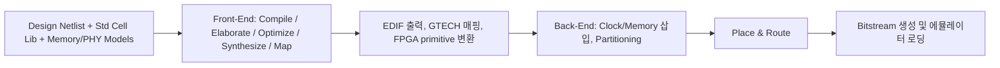

<!-- generated by yt-paper; edits will be overwritten -->

# Netlist Enabled Emulation Platform for Accelerated Gate Level Verification

[:material-open-in-new: 원문 보기](https://dvcon-proceedings.org/wp-content/uploads/1B1_DVCon_India_2023_Final_Paper_6285.pdf){ .md-button .md-button--primary target=_blank }

> SoC 전체 게이트 레벨 netlist를 Synopsys ZeBu 에뮬레이터에 올려 SCANDUMP, SAIF 기반 전력 추정, 부팅 검증을 GLS 대비 수십 배(문서 주장 70~90X) 빠르게 수행하는 방법론을 제시한 논문.

| 항목 | 내용 |
|---|---|
| 저자/출처 | Samhith Kumar Pottem, Vasudeva Reddy Ambati, Rahul S S, Sarang Kalbande, Garima Srivastava, Hyundon Kim (Samsung Semiconductor India Research, SSIR) |
| 유형 | PAPER |
| 카테고리 | Emulation |
| ID | `ref-20261018-22ca` |

## 핵심 인사이트

- GLS는 시나리오 하나에 수 주가 걸리는 반면, GLE는 실제 하드웨어 위에서 MHz 대 구동 클럭으로 동작해 장시간 시나리오를 분 단위로 검증할 수 있다는 것이 핵심 동기다.
- Gate-level 컴파일 시간 증가에 대한 해법으로 multi-core/multi-thread 병렬 컴파일을 쓰고, scan 삽입으로 떨어지는 driver clock 주파수는 테스트 신호에 D flip-flop을 추가해 최고속 설계 클럭으로 샘플링하여 타이밍 경로를 끊는 방식으로 완화한다.
- 현재 에뮬레이션 환경은 full SDF 타이밍을 지원하지 않아 모든 지연이 무시되므로 zero-delay 또는 unit-delay netlist로만 검증한다는 한계가 명시되어 있다. 타이밍 검증 목적이라면 이 점을 반드시 고려해야 한다.
- Standard cell library, 합성 가능한 메모리/PHY 모델, R2N(RTL-to-Netlist) 매핑 리포트가 GLE 컴파일 실패 및 결과 불일치를 막는 전제 조건으로 제시된다.
- 성능 수치(70~90X, SCANDUMP 54분, 부팅 12분 등)는 Exynos 플래그십 SoC 기준의 단일 사례이며, 비교 표의 GLS 시간 일부가 'UNREALISTIC'으로 표기되어 있어 정량적 일반화에는 주의가 필요하다.

## 상세 요약

### 배경 및 문제 정의

SoC 복잡도가 증가하면서 검증 시간과 tape-out 이후 re-spin 비용이 커지고 있다. RTL 시뮬레이션은 빠르고 디버그가 쉽지만 지연(delay)이나 스위칭 액티비티(전력 추정)를 정확히 반영하지 못한다. GLS(Gate Level Simulation)는 이를 보완하지만 시뮬레이션 속도가 Hz 대에 머물러 한 시나리오에 수 주가 걸린다. 논문은 이 문제를 해결하기 위해 SoC 전체 netlist를 하드웨어 에뮬레이터(Synopsys ZeBu)에 통합하는 GLE(Gate Level Emulation) 방법론을 제안한다.

관련 연구로는 Intel India의 Das 등(ITC India 2021)이 DFT(MBIST, ATPG) 검증용 vector-mode GLE를 제시했으나, 약 50M 게이트 규모의 소형 SoC와 DFT 기능에 한정되었다고 논문은 지적한다.

### 핵심 아키텍처 및 방법론

**전제 조건**
- Standard cell library: 누락 시 front-end 파싱 단계에서 컴파일이 실패한다.
- Gate-level 메모리 및 DDR PHY I/O 모델: 합성 가능하고 에뮬레이션 컴파일러와 호환되어야 하며, scan 로직을 포함해야 한다.
- R2N(RTL-to-Netlist) 매핑 리포트: 신호 극성과 연결 관계를 담으며, 시나리오 검증에 필수다.

**구현 흐름 (Netlist Database Generation Flow)**

- Front-End는 netlist를 EDIF로 elaboration/synthesis하고 게이트 최적화 후 FPGA primitive로 변환한다.
- Back-End는 clock domain 분석과 동기화 로직 삽입, 메모리 매핑, 여러 FPGA 모듈로의 partitioning을 수행한다.
- 최종 bitstream을 하드웨어에 로드하고 테스트벤치 및 외부 디버거와 통신을 설정한다.

**컴파일 시간 가속**
Gate-level 설계는 netlist 크기와 세밀도 때문에 컴파일 시간이 길다. 논문은 multi-core, multi-thread 병렬 처리로 workload를 분산해 완화한다고 설명한다.

**런타임 가속**
Scan cell 삽입은 회로 복잡도 증가, 임계 경로 증가, 추가 clock domain으로 인해 driver clock 주파수를 떨어뜨린다. 해법으로 여러 블록의 테스트 신호에 D flip-flop을 추가하여 가장 빠른 설계 클럭으로 샘플링한다. 이를 통해 타이밍 경로가 분할되어 컴파일 시간과 성능이 개선된다고 주장한다.

**적용 시나리오**
1. **SCANDUMP**: Camera, CPU, USB 등 각 블록의 DFT 회로를 TOP JTAG를 통해 외부 디버거에서 scan 데이터를 캡처한다. SoC hang 상황의 원인 분석에 쓰인다.
2. **SAIF 기반 전력 추정**: 신호별 toggle count를 기록해 전력 최적화 의사결정에 활용한다.
3. **부팅 검증**: Power-On Reset 후 CPU가 reset vector에서 명령을 fetch하고, bootloader가 레지스터, 메모리 컨트롤러, 캐시를 초기화하는지 확인한다.

### 실험 결과 및 결론

**결과 (Exynos 플래그십 SoC 기준)**
- SoC SCANDUMP 캡처: 54분
- Multimedia 블록의 정확한 스위칭 액티비티 캡처: 42분
- 프로세서 부팅 시퀀스 완료: 12분

**GLS 대비 비교 (Table II)**

| 시나리오 | GLS (시간) | GLE (시간) |
|---|---|---|
| Scenario 1 (SCANDUMP) | UNREALISTIC | 0.9 |
| Scenario 2 (SAIF) | UNREALISTIC | 2.2 |
| Scenario 3 (부팅) | 12 | 0.25 |

초록은 검증 시간이 70~90X 향상되었다고 주장하지만, 표에서 GLS 시간은 두 시나리오에서 현실적으로 수행 불가 수준으로만 표기되어 있어 배수를 직접 계산할 수 있는 수치는 부팅 시나리오(12시간 대 0.25시간, 약 48X) 하나뿐이다. 따라서 70~90X 주장의 근거는 본문에서 충분히 드러나지 않는다.

**한계 및 향후 과제**
- 에뮬레이션 환경은 full SDF 타이밍을 지원하지 않는다. 모든 지연이 컴파일러에서 무시되므로 zero-delay 또는 unit-delay netlist로 검증한다.
- 향후 과제로 ZeBu empower 테스트벤치에서 glitch를 기반으로 prime power를 정밀 캡처하는 방법과, UPF(Unified Power Format) 연동을 통한 전력 시나리오 검증을 제시한다.

**결론**
SoC 전체 netlist를 에뮬레이터 컴파일 DB로 구성하고 실제 하드웨어에 매핑하는 흐름을 제시했다. SCANDUMP, 전력 추정, 부팅 검증을 GLS의 수일 단위에서 수 분~수 시간 단위로 단축했다. 다만 평가 대상이 단일 SoC 사례이고 정량 비교가 제한적이므로, 일반화된 성능 주장은 추가 검증이 필요하다.

## 관련 영상

<iframe src="https://www.youtube-nocookie.com/embed/oCvKZyb7hQ0" title="[DVCON2023_INDIA] Netlist Enabled Emulation Platform for Accelerated Gate Level Verification" loading="lazy" allow="accelerometer; clipboard-write; encrypted-media; gyroscope; picture-in-picture; web-share" referrerpolicy="strict-origin-when-cross-origin" allowfullscreen></iframe>

**[DVCON2023_INDIA] Netlist Enabled Emulation Platform for Accelerated Gate Level Verification** — [YouTube에서 보기](https://www.youtube.com/watch?v=oCvKZyb7hQ0) · [영상 페이지](../../videos/oCvKZyb7hQ0.md)
