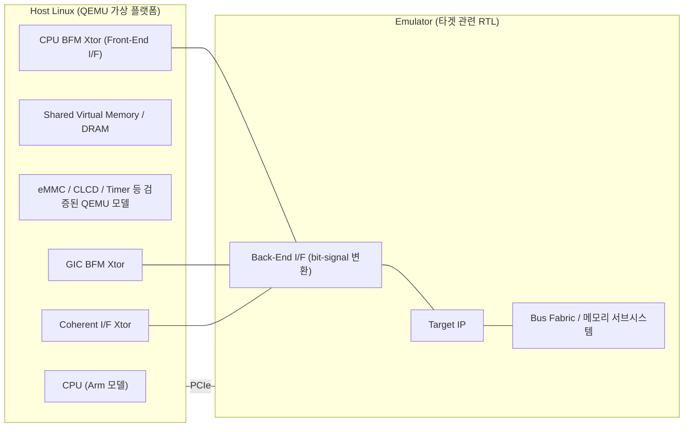

<!-- generated by yt-paper; edits will be overwritten -->

# OS-aware IP Development Methodology

[:material-open-in-new: 원문 보기](https://dvcon-proceedings.org/wp-content/uploads/os-aware-ip-development-methodology.pdf){ .md-button .md-button--primary target=_blank }

> 검증 완료된 IP는 QEMU 가상 플랫폼에, 검증 대상 IP와 메모리 서브시스템만 RTL 에뮬레이터에 배치해 Android 부팅을 10분 내에 끝내고, RTL이 실리콘 전에 SW 드라이버/펌웨어를 조기 검증하는 방법론.

| 항목 | 내용 |
|---|---|
| 저자/출처 | Hyunjae Woo, Woojoo Kim, Youngsik Kim, Seonil Brian Choi (Samsung Electronics Co., LTD.). 학회/venue는 문서에 명시되지 않음. 참고문헌 [5]는 DVCon 2017 발표 논문을 가리킴. |
| 유형 | PAPER |
| 카테고리 | Emulation |
| ID | `ref-20261018-24f2` |

## 핵심 인사이트

- 기존 Hybrid emulation이 전체 SoC를 가정해 MTO 몇 달 전에야 세팅되던 한계를, 검증 대상 IP만 RTL로 두고 나머지를 QEMU 라이브러리 모델로 대체해 IP 개발 초기 단계로 당긴 것이 핵심 기여다. 다른 IP의 미성숙으로 인한 kernel panic 같은 부수 오류를 격리할 수 있다는 점이 IP 엔지니어에게 실질적 가치다.
- 에뮬레이터-호스트 통신은 PCIe 대역폭보다 지연(latency)이 병목이며, DPI 호출 동안 에뮬레이터 클럭이 멈춘다. 따라서 트랜잭션 횟수를 줄이는 것(예: 4B 대신 64B 단위 접근)이 성능 설계의 핵심이다. 다만 문서의 '4GB를 4B씩 1G회 읽으면 7시간 이상' 수치는 1G×7µs≈2시간으로 계산이 맞지 않아 그대로 인용하기 어렵다.
- 메모리 coherence는 'CPU BFM 동작 후 DRAM 준비', 'GIC BFM 인터럽트 시점에 동기화'라는 프로토콜 가정에 의존한다. 타겟 IP 동작이 이 가정을 벗어나면 Timer나 instruction counter 기반 동기화가 필요하며, 이는 정합성 버그 위험이 남아 있음을 의미한다.
- IP 기능 모델을 가상 플랫폼 쪽에 두고 RTL이 준비되면 교체하는 구조라 SW 개발자가 RTL 완성 전에 작업을 시작할 수 있다. 같은 환경에서 GPU 등 후보 IP의 PPAB 평가에도 재사용 가능하다고 제시한다.

## 상세 요약

### 배경 및 문제 정의

SoC 규모와 복잡도가 커지면서 HW/SW co-verification에서만 드러나는 버그가 늘었다. 기존 흐름에서는 이런 검증이 전체 SoC 에뮬레이션이나 실리콘 단계에 몰려 있어, 발견된 문제가 ECO, SW workaround, re-spin으로 이어져 일정을 지연시킨다.

문서가 정리한 기존 방식의 한계는 다음과 같다.

- **시뮬레이션**: 수억 게이트 규모에서는 수십 KHz까지 떨어진다. 문서는 실리콘 대비 약 10^6배 느리다고 설명하며, 이는 장시간 SW 검증에 사용하기 어렵다는 근거로 든다.
- **Pure emulation**: 수백 KHz~수 MHz 수준이지만, Linux/Android 부팅에 10시간 이상 걸린다고 기술한다.
- **Hybrid SoC emulation**: CPU와 메모리를 ARM Fast Model(FA 모델)과 TLM LT 모델로 가상화해 Android 부팅을 pure emulation 대비 약 15배 빠르게 한다. 그러나 전체 SoC 플랫폼 구축이 필요해 MTO 몇 달 전에야 준비되고, 다른 IP의 성숙도 문제로 타겟 IP 검증이 방해받는다.

이 논문은 IP 설계·검증 관점에서 이러한 의존성을 제거하고, 가능한 한 빨리 SW/HW co-design과 co-verification을 가능하게 하는 것을 목표로 한다.

### 핵심 아키텍처 및 방법론

Host Linux에서 QEMU 기반 가상 플랫폼을 실행하고, 타겟 IP와 관련 RTL만 에뮬레이터에 올린다. 두 측은 PCIe로 연결된다.

주요 구성 요소는 다음과 같다.

1. **역할 분리**: 부팅, 벤치마크 설치·로딩 등 대부분의 작업은 QEMU에서 수행한다. 타겟 IP는 RTL로 실행한다. 문서에 따르면 이 분리로 Hybrid 대비 IP 초기화 시간을 약 5배 줄였다.
2. **Transactor**: Front-End I/F(호스트 측 트랜잭션 처리)와 Back-End I/F(PCIe 상의 트랜잭션을 bit-level 신호로 변환)로 구성된다. 본 논문에서는 CPU BFM, GIC BFM, Coherent Memory Interface의 3종을 사용한다. 카메라나 센서 등 추가 IP가 필요하면 AVIP 같은 벤더 transactor 라이브러리를 쓸 수 있다고 한다.
3. **메모리 coherence**: 에뮬레이터 측에 cache, buffer 또는 LPDDR4 모델 같은 메모리를 두어 호스트 접근으로 인한 클럭 정지를 줄인다. 동기화는 다음 가정에 기반한다. 타겟 IP가 DRAM에서 읽을 때는 CPU가 데이터를 준비한 뒤 CPU BFM으로 IP를 제어한다. CPU가 DRAM을 읽어야 할 때는 타겟 IP가 수정했다고 가정하고, GIC BFM으로 인터럽트를 올린다. 이 가정이 맞지 않으면 Timer나 instruction counter가 CPU 명령 수를 세어 설정값에 도달했을 때 동기화한다.
4. **확장 용도**: 모바일 AP에 들어갈 후보 IP(예: GPU의 shader core 수, L2 cache 크기 등 구성별)를 PPAB(Performance, Power, Area, Bandwidth) 관점에서 같은 환경으로 평가하는 데 쓸 수 있다. RTL을 교체하고 벤더 드라이버를 올리면 된다고 한다.
5. **검증 사례**: GPU IP 검증에 적용했다. 메모리 서브시스템과 버스는 실제 SoC와 같게 구성하고, 메모리 transactor는 같은 hashing 방정식을 지원한다.

### 실험 결과 및 결론

적용 사례는 GFX Benchmark 3.1.0 Manhattan 1080p(3000ms fixed step)이다. Android Marshmallow 부팅에 10분, adb로 APK 로딩에 8분(본문 다른 곳에는 7분), 벤치마크 실행에 45분이 걸렸다고 보고한다.

Table 1 요약 (단위: 분)

| 항목 | Simulation | Pure Emulation | Hybrid SoC | Proposed |
|---|---|---|---|---|
| Kernel boot-up (prompt) | 125,867* | 96 | 2 | 1 |
| Android home screen | 741,517* | 661 | 47 | 9 |
| Total | 867,384* | 757 | 49 | 10 |

\* 추정값(Estimated). 시뮬레이션 수치는 실측이 아니다.

Proposed는 Hybrid 대비 약 5배, Pure emulation 대비 약 75배 빠르다고 주장한다. 타겟 RTL만 에뮬레이터에 올리므로 에뮬레이터 용량을 적게 쓰고 컴파일도 빠르다고 한다.

결론적으로 이 방법론으로 RTL bug와 firmware/driver 간 SW bug를 전체 SoC RTL 통합 이전에 OS 상에서 발견했으며, 이로 인한 디버깅 설계 시간 낭비를 줄였다고 밝힌다. 향후 과제로는 Android 상의 전력 분석 흐름을 추가하는 것을 제시한다.

**검토 시 주의점**: 문서 내부에 APK 로딩 시간 불일치(8분 vs 7분), 4GB 읽기 시간 계산 불일치가 있다. 시뮬레이션 수치는 추정값이며, 실험은 GPU IP 한 사례 중심이다. 따라서 정량 수치는 방향성 근거로 보는 것이 적절하다.

## 관련 영상

<iframe src="https://www.youtube-nocookie.com/embed/MmJHpC0lEYI" title="[DVCON2019] OS-aware IP Development Methodology" loading="lazy" allow="accelerometer; clipboard-write; encrypted-media; gyroscope; picture-in-picture; web-share" referrerpolicy="strict-origin-when-cross-origin" allowfullscreen></iframe>

**[DVCON2019] OS-aware IP Development Methodology** — [YouTube에서 보기](https://www.youtube.com/watch?v=MmJHpC0lEYI) · [영상 페이지](../../videos/MmJHpC0lEYI.md)
