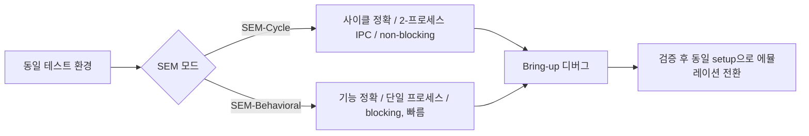

<!-- generated by yt-paper; edits will be overwritten -->

# Simulated Emulation: Enabling Multiple Iterations in a Day During Early-Stage Emulation Bring-up

[:material-open-in-new: 원문 보기](https://dvcon-proceedings.org/wp-content/uploads/5B2-DVCon_India_2024_Final_Paper_6678.pdf){ .md-button .md-button--primary target=_blank }

> FPGA 에뮬레이션의 긴 컴파일 시간을 피하기 위해, 동일한 테스트 환경을 쓰면서 시뮬레이터로 에뮬레이션 동작을 근사하는 SEM 방법론(SEM-Cycle / SEM-Behavioral 두 모드)을 제시한다.

| 항목 | 내용 |
|---|---|
| 저자/출처 | Shalini Maheshwari, Ashok Kumar Bhatt (Synopsys Inc, 학회/출처 표기는 원문에 명시되지 않음) |
| 유형 | PAPER |
| 카테고리 | Emulation |
| ID | `ref-20261018-3821` |

## 핵심 인사이트

- 에뮬레이터를 '시뮬레이션 실행파일이 하드웨어를 대신하는 특수 케이스'로 보는 관점이라, 사용자 입장에서는 테스트벤치와 컴파일 흐름을 거의 바꾸지 않고 에뮬레이션 대비 빠른 반복 검증이 가능하다.
- SEM-Cycle은 controlled clock까지 포함한 사이클 정확도를 맞추지만 두 프로세스(IPC 동기화) 구조라 성능 비용이 있고, SEM-Behavioral은 단일 프로세스 DPI 직결로 빠르지만 controlled clock과 non-blocking 실행을 지원하지 않는다. 목적에 따라 모드를 고르는 트레이드오프다.
- 주 용도는 RTL 연결성, power-on reset, clock 생성 등 bring-up 초기 기본 이슈를 처음 수백만 사이클 안에서 정리하는 것이며, 전체 에뮬레이션 테스트를 대체하지 않는다.
- 시뮬레이션의 파형 덤프 및 디버그 기능을 활용할 수 있다는 점이 bring-up 디버깅 효율을 높이는 핵심 이점으로 제시된다. 다만 TAT 개선 수치는 설계 크기와 activity에 따라 달라진다고만 되어 있고 구체적 수치는 본문에서 확인되지 않는다.
- 2-state(에뮬레이션과 동일)와 4-state(시뮬레이션 동작) 검증을 선택할 수 있다는 점은 X-propagation 관련 이슈 분리에 유용할 수 있다. 다만 본문은 이 활용을 개념적으로만 설명한다.

## 상세 요약

### 배경 및 문제 정의

FPGA 기반 에뮬레이션은 netlist 생성, 파티셔닝, FPGA 비트스트림 컴파일에 긴 시간이 소요되며, 작은 설계에서도 마찬가지다. 설계나 테스트 환경이 자주 바뀌는 bring-up 초기에는 실제 실행 사이클은 거의 없이 재컴파일만 반복되고, 하드웨어 구조적 제약 때문에 디버그에도 추가 재컴파일이 필요하다. 그 결과 하루에 한 번의 반복(iteration)만 가능한 경우가 많고, 모델이 안정되기까지 며칠에서 몇 주가 걸릴 수 있다.

SEM(Simulated Emulation)은 이 문제를 해결하기 위해 제안된 방법론이다. 에뮬레이션과 동일한 테스트 환경을 그대로 받아 설계를 시뮬레이션용으로 컴파일하고, 에뮬레이션 동작을 근사적으로 재현한다. 목표는 전체 에뮬레이션 테스트가 아니라 처음 수백만 사이클(first few million cycles)만 실행해 RTL drop을 정리하고 RTL 연결성, reset 생성, clock 연결 및 생성 등을 빠르게 검증하는 것이다.

### 핵심 아키텍처 및 방법론

SEM은 에뮬레이터의 특수한 경우로 볼 수 있다. 에뮬레이션에서는 RTL이 하드웨어에서 돌고 테스트벤치가 Linux 호스트에서 돌지만, SEM에서는 RTL이 시뮬레이션으로 돌고 시뮬레이션 실행파일이 하드웨어를 대신한다. 컴파일 흐름과 테스트벤치 흐름은 사용자 입장에서 변화가 없도록 설계되었다.

에뮬레이션 개념을 시뮬레이션에서 재현하기 위해 다음 요소를 다룬다.

- **Uncontrolled clock**: 에뮬레이터는 매핑된 하드웨어의 layout과 timing에 따라 uncontrolled clock을 만들고, 사용자 clock은 이를 기준으로 생성된다. SEM은 uncontrolled clock을 모델링하고 그 기준으로 사용자 clock을 생성해 clock 간 기능적 비율을 재현한다.
- **Controlled (user) clock**: 펌웨어가 다른 controlled clock과의 특정 관계를 가진 clock을 생성하도록 허용한다. SEM은 이를 인스턴스화해 실행 가능한 시뮬레이션 모델로 제공한다.
- **Timed clock**: 하드웨어에는 시간 개념이 없지만, 에뮬레이션의 delay clock 지원은 시뮬레이션에서 에뮬레이션으로의 이전을 쉽게 하고 시뮬레이션과 에뮬레이션의 시간 기준 기능 비교를 가능하게 한다. SEM은 네이티브 시뮬레이션 시간을 쓰고 펌웨어 primitive에 대한 시뮬레이션 모델을 만든다.
- **Xtor**: 하드웨어(설계)와 소프트웨어(테스트벤치) 사이의 통신을 data transfer가 아닌 의미 있는 transaction으로 표현한다. DPI Xtor에서는 DPI 호출로 인터페이스를 정의하고, 컴파일러가 이를 펌웨어 primitive와 synthesizable 코드로 변환한다. SEM은 이 컴파일러 instrumentation을 활용해 동일한 behavioral 변환을 적용할 수 있다.

SEM은 두 가지 모드를 제공한다.

| 항목 | SEM-Cycle | SEM-Behavioral |
|---|---|---|
| 목표 | 에뮬레이터와 controlled clock 기준 사이클 정확도 일치 | 기능적 동작 일치 (사이클 정확도 비목표) |
| 클럭 모델 | Uncontrolled clock 모델링, 두 clocking 메커니즘 지원 | Timed clock 모드 |
| Xtor 처리 | behavioral 컴파일러로 DPI Xtor 컴파일, custom Xtor 시뮬레이션 지원 | 시뮬레이터의 네이티브 DPI로 시뮬레이션 |
| 프로세스 구조 | 시뮬레이터와 테스트벤치가 별도 프로세스, IPC 동기화 | 단일 프로세스, 테스트벤치와 링크 |
| 실행 방식 | non-blocking 실행 가능 (설계와 테스트벤치 동시 실행) | blocking 실행만 가능 |
| 성능 | 사이클 정확도 대가로 성능 저하 | 동기화가 없어 빠름 |
| 제약 | - | controlled clock 미지원 |

### 실험 결과 및 결론

본문은 주요 활용 사례로 다음 네 가지를 제시한다.

1. **Transactor validation**: Transactor 단위 테스트를 SEM에서 빠르게 실행해 개발 중 turnaround를 줄인다. 일반적으로 시뮬레이션과 에뮬레이션은 사용자 인터페이스가 달라 테스트벤치 변경이 필요하지만, SEM은 에뮬레이션과 동일한 테스트벤치를 그대로 사용할 수 있다.
2. **Gate-level simulation**: 백엔드 netlist를 SEM으로 시뮬레이션해, RTL-to-netlist 번역 문제를 FPGA 매핑 및 고비용 에뮬레이션 이전에 검출하는 것을 목표로 하는 진행 중인 사내 프로젝트다.
3. **2-state / 4-state 시뮬레이션**: 에뮬레이션은 본질적으로 2-state이고 시뮬레이션은 4-state를 따른다. SEM은 에뮬레이션과 맞추기 위해 2-state로, 시뮬레이션 동작과 맞추기 위해 4-state로 검증할 수 있다.
4. **Regression / Backout analysis / Race 검출 / Dynamic SW-HW swap** (Future Ideas): 단위 테스트나 사용자 regression에 SEM을 쓰고, sign-off나 야간 실행만 에뮬레이션에 맡기는 방향, netlist 합성 회귀 분석, 시뮬레이션 race와 sim-emu mismatch 검출, 수백 사이클은 시뮬레이션에서 돌리고 이후 에뮬레이션으로 전환하는 동적 swap 등이 향후 과제로 언급된다.

정량 결과에 대해 본문은 TAT 이득이 설계 크기와 activity에 따라 달라진다고만 서술하며(Fig. 2에 TAT gain 그림이 있으나 본문 텍스트에 구체적 수치는 없음), 구체적인 성능 수치는 제시되지 않는다. 시뮬레이션 런타임은 에뮬레이션보다 훨씬 느리므로 짧은 테스트 사이클에만 권장된다.

결론적으로 SEM은 에뮬레이션을 대체하기 위한 방법이 아니라, 시뮬레이션의 빠른 컴파일과 디버그 능력을 에뮬레이션 환경에 끌어들여 shift-left 관점에서 bring-up 기간과 에뮬레이션 자원 사용을 줄이는 도구로 위치한다. 시뮬레이션이 에뮬레이션 동작을 완전히 재현하기는 어렵다는 한계도 명시되어 있다.

## 관련 영상

<iframe src="https://www.youtube-nocookie.com/embed/8P9cEMiLWCY" title="[DVCON2024_INDIA]Simulated Emulation: Enabling Multiple Iterations During Early-Stage Emulation" loading="lazy" allow="accelerometer; clipboard-write; encrypted-media; gyroscope; picture-in-picture; web-share" referrerpolicy="strict-origin-when-cross-origin" allowfullscreen></iframe>

**[DVCON2024_INDIA]Simulated Emulation: Enabling Multiple Iterations During Early-Stage Emulation** — [YouTube에서 보기](https://www.youtube.com/watch?v=8P9cEMiLWCY) · [영상 페이지](../../videos/8P9cEMiLWCY.md)
