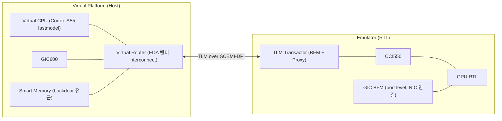

<!-- generated by yt-paper; edits will be overwritten -->

# Hybrid Emulation: Accelerating Software driven verification and debug

[:material-open-in-new: 원문 보기](https://dvcon-proceedings.org/wp-content/uploads/Hybrid-Emulation-Accelerating-Software-driven-Verification-and-Debug-1.pdf){ .md-button .md-button--primary target=_blank }

> Arm GPU 검증에서 RTL CPU를 fastmodel 가상 플랫폼으로 대체하고 GPU 등 나머지 서브시스템만 에뮬레이터에서 돌리는 Hybrid 방식을 도입해, FPGA(Juno) 대비 디버그 가시성을 확보하고 Linux 부팅 기준 약 45배 런타임 개선을 보고한 사례.

| 항목 | 내용 |
|---|---|
| 저자/출처 | Issac P Zacharia, Jitendra Aggarwal (Arm Ltd). 원문에 발표 학회/출처 정보는 없음 |
| 유형 | PAPER |
| 카테고리 | Emulation |
| ID | `ref-20261018-6683` |

## 핵심 인사이트

- Hybrid 구성의 핵심은 CPU를 RTL에서 fastmodel(또는 Virtual CPU)로 옮겨 부팅과 SW 실행 속도를 확보하고, GPU 등 검증 대상 블록만 RTL로 에뮬레이터에 남겨 full design visibility를 얻는 것입니다.
- Smart memory를 VP와 RTL이 공유하고 CPU가 TLM 채널 없이 backdoor로 접근하게 한 설계가 경계 통신을 줄이는 핵심 장치입니다. 문서도 VP-에뮬레이터 간 빈번한 트랜잭션은 런타임 성능을 떨어뜨린다고 명시합니다.
- 비결정적인 가상 CPU 동작을 재현하기 위해 Hybrid Capture Replay로 VP 입력을 design clock 기준으로 기록하고 재실행하는 기능이 디버그 재현성을 보장하는 수단으로 제시됩니다.
- FPGA 프로토타이핑의 문제였던 낮은 가시성과 trace 추출 어려움을 해결했지만, 저자들은 cycle-accurate 검증을 대체하지 않는다고 명확히 선을 긋습니다. 용도는 SW 개발·드라이버·OS 검증과 RTL 전 조기 SW 검증으로 한정됩니다.

## 상세 요약

### 배경 및 문제 정의

- 설계가 커지면서 전체 SoC를 에뮬레이터에 올리기 어려워졌고, OS 부팅과 실제 SW 애플리케이션 검증이 특히 어려워졌습니다.
- Arm GPU의 HW/SW 검증은 물리적으로 GPU를 매핑한 FPGA 기반 Juno 플랫폼에서 주로 수행되었습니다. 런타임 처리량은 높았지만 설계 가시성이 낮고 trace 추출이 어려워 디버그 시간이 길어졌습니다.
- 문서가 제시한 주요 문제는 다음과 같습니다.
  1. 낮은 가시성과 trace 추출 어려움으로 인한 디버그 시간 증가
  2. 실제 OS 앱 이슈를 unit-level 시뮬레이션에서 재현하려면 stimulus 생성에 수 주가 걸릴 수 있음
  3. GPU HW/SW live 디버그의 어려움
  4. 플랫폼·툴 간 이슈 재현성 부족

### 핵심 아키텍처 및 방법론

Hybrid 플랫폼은 Arm Cortex-A55 CPU RTL과 GIC600을 fastmodel 기반 가상 플랫폼으로 대체하고, GPU 등 SoC 서브블록은 에뮬레이터에서 RTL로 실행하는 구조입니다.

주요 구성 요소와 동작은 다음과 같습니다.

- **TLM 트랜스택터 브리지**: RTL 포트는 BFM에, 소프트웨어 트랜잭션은 Proxy 측에 연결하는 얇은 계층입니다. EDA 툴체인의 내장 모델이 SCEMI-DPI를 통해 TLM 채널로 데이터를 주고받습니다.
- **Smart Memory**: VP와 RTL이 공유하는 메모리로, CPU가 TLM 채널을 거치지 않고 backdoor로 접근합니다. GPU는 RTL 채널로 접근합니다. 이로써 CPU의 메모리 접근이 RTL 경계를 넘지 않습니다.
- **GIC 배치**: GIC600은 VP로 옮기고, RTL 쪽에는 NIC와 port level로 연결되는 GIC BFM만 둡니다.
- **Virtual Router**: 가상 쪽 마스터·슬레이브 수, 폭, 주소 공간 등을 설정할 수 있는 EDA 벤더 전용 interconnect입니다. 가상 라우터는 CCI550을 통해 RTL의 주변장치에 접근합니다.
- **동기화**: VP와 에뮬레이터 사이의 상태 동기화가 필요할 때는 에뮬레이터 clock pause를 사용해 CPU 아키텍처 상태와 캐시 데이터를 전달합니다.
- **성능 권장사항**: 트랜잭션 크기를 최대화하고 고트래픽 트랜스택터 사용을 최소화하라고 권장합니다.

검증 흐름으로는 Linux 부팅과 베어메탈 테스트(GPU 레지스터·Smart Memory 접근)로 통합을 확인한 뒤, Android 10, Debian Buster 11 부팅과 그래픽 테스트로 확장했습니다.

**디버그 기능**: Detailed Logging, TLM 시각화, CPU 레지스터·메모리 맵 뷰어, Smart Memory 디버그 툴을 제공합니다. 가상 CPU는 RTL처럼 클록 사이클을 소모하지 않고 0 simulation time에서 비동기적으로 실행되므로 실행마다 동작이 달라질 수 있습니다. 이를 해결하기 위해 **Hybrid Capture Replay**가 VP의 입력을 design clock에 맞춰 기록하고 이후 세션에서 재생합니다. 서브시스템의 나머지 부분은 RTL 모니터, 파형, 메모리 덤프 등 기존 방식으로 디버그합니다.

### 실험 결과 및 결론

문서에 제시된 Hybrid 런타임 결과는 다음과 같습니다(Table I).

| 테스트 | 런타임 |
|---|---|
| Linux Boot | 62 sec |
| Android 10 | 2640 sec |
| Debian Buster 11 | 185 sec |

- Linux 부팅 벤치마크에서 기존 full RTL 에뮬레이션 대비 **45X** 런타임 개선을 보고합니다. 다만 기준(baseline) 절대 런타임은 문서에 제시되어 있지 않습니다.
- Android 10에서 그래픽 테스트가 동작하는 장면을 보여 줍니다(Figure 3).
- FPGA 플랫폼에서 발생한 HW/SW 이슈를 Hybrid 모델에서 같은 테스트로 재현할 수 있었고, 이전 프로젝트보다 더 이른 검증 단계에서 SW·HW 버그를 수정할 수 있었다고 설명합니다. 정량적 버그 수 등은 제시되지 않습니다.
- 플랫폼 업그레이드 측면에서도, 새 CPU 서브시스템이나 구성 변경 시 보드 준비를 기다리지 않고 SW 워크로드를 실행할 수 있다는 이점을 언급합니다.

**결론 및 한계**: 저자들은 Hybrid 방식이 FPGA 기반 SW 개발의 가시성 문제를 해결하는 효과적인 대안이라고 결론짓습니다. 그러나 cycle-accurate 검증이 필요한 영역을 대체하지는 않으며, 향후에는 최신 CPU와 미출시 CPU로 확장하고, 에뮬레이터 크기 제약 때문에 어려운 서버·엔터프라이즈 인프라 영역에 적용하는 계획을 밝힙니다.

**문서의 범위 참고**: 본문이 짧은 기술 소개 논문이어서 상세 구현 수치(트랜잭션 처리량, 메모리 대역폭, 에뮬레이터 자원 사용량 등)는 포함되어 있지 않습니다. 참고문헌은 Juno 개발 보드 페이지 한 건뿐입니다.

## 관련 영상

<iframe src="https://www.youtube-nocookie.com/embed/LPCzFr2vPZc" title="[DVCON2022]Hybrid Emulation: Accelerating Software Driven Verification and Debug" loading="lazy" allow="accelerometer; clipboard-write; encrypted-media; gyroscope; picture-in-picture; web-share" referrerpolicy="strict-origin-when-cross-origin" allowfullscreen></iframe>

**[DVCON2022]Hybrid Emulation: Accelerating Software Driven Verification and Debug** — [YouTube에서 보기](https://www.youtube.com/watch?v=LPCzFr2vPZc) · [영상 페이지](../../videos/LPCzFr2vPZc.md)
