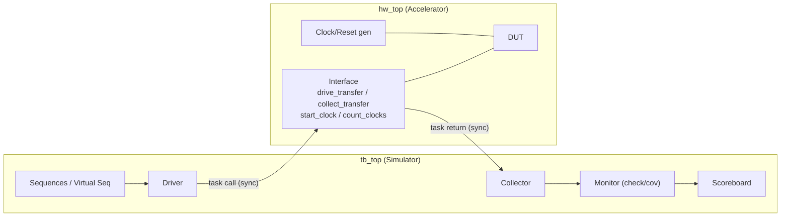

<!-- generated by yt-paper; edits will be overwritten -->

# UVM Testbench Considerations for Acceleration

[:material-open-in-new: 원문 보기](https://dvcon-proceedings.org/wp-content/uploads/uvm-testbench-considerations-for-acceleration.pdf){ .md-button .md-button--primary target=_blank }

> 기존 UVM 테스트벤치를 하드웨어 가속(emulation/acceleration)에서도 재사용하기 위해 TB/DUT 파티셔닝, collector/monitor 분리, 합성 가능한 driver·collector 태스크, 타이밍 제거, 랜덤화 최소화 등 설계 가이드라인을 정리한 논문.

| 항목 | 내용 |
|---|---|
| 저자/출처 | Kathleen A Meade (Cadence Design Systems, Inc.) / IEEE (원문에 학회명은 명시되지 않음) |
| 유형 | PAPER |
| 카테고리 | Emulation |
| ID | `ref-20261018-8282` |

## 핵심 인사이트

- 가속 적합성은 먼저 프로파일링으로 판단해야 한다. DUT 시간 비중이 작고 TB 시간이 크면 가속 이득이 제한되며, 예시에서 DUT 60%·동기화 15% 조건의 이론적 상한은 약 3.2X에 그쳤고 DUT 비중을 85%, 동기화를 10%로 올리면 약 15.4X로 개선됐다.
- SW/HW 동기화 횟수 자체가 성능을 좌우한다. 시그널 단위 가속은 약 5~20X, 트랜잭션 기반 가속(TB 일부를 HW로 이동, task 호출 기반)은 약 30~300X 범위로 보고되어 인터페이스를 트랜잭션 수준으로 올리는 것이 핵심 레버다.
- TB를 hw_top(DUT, 클럭/리셋 생성기, 인터페이스)과 tb_top(UVM 패키지, config_db 설정, run_test 호출)으로 분리하고, DUT 접근은 driver와 collector로만 제한하면 동기화 지점을 체계적으로 줄일 수 있다.
- 시퀀스 내부의 #delay, 클럭 참조, DUT 신호 대기(wait)는 동기화를 유발하므로 클럭/리셋 UVC의 delay·timeout 시퀀스와 내부 타이머로 대체해야 한다. 이 방식은 시뮬레이션과 가속 양쪽에서 동일하게 동작한다.
- 드라이버/콜렉터 태스크를 합성 가능하게 작성하고 인터페이스 내부로 옮기면 가속에 유리하지만, UVM factory로 해당 태스크를 override할 수 없게 되는 trade-off가 있다. 논문은 이 override 요구가 드물다고 판단한다.

## 상세 요약

### 배경 및 문제 정의

UVM은 블록/시스템 수준 검증 환경의 사실상 표준이 되었고, 검증 컴포넌트를 세대 간에 재사용하는 흐름이 확산되고 있다. 긴 시뮬레이션 시간을 줄이기 위해 하드웨어 가속(hardware acceleration)을 도입하려는 수요가 커지고 있으며, 이상적으로는 **하나의 UVM 테스트벤치를 시뮬레이션과 가속 모두에서 실행**하여 개발 스트림을 단일화하는 것이 목표다. 본 논문은 기존 UVM 환경을 가속용으로 이식할 때 필요한 변경 사항과, 처음부터 가속을 고려해 TB를 설계하는 권고안을 다룬다.

성능 요인은 다음 세 가지로 정의된다.

1. **UVM TB 런타임**: 시뮬레이터에서 실행되는 시간 (랜덤화, 자극 생성, 참조 모델 비교, 커버리지 샘플링 포함). 빌드/설정 시간은 한 번만 발생하므로 긴 시뮬레이션에서는 무시 가능하다.
2. **SW/HW 동기화**: TB와 DUT 간 신호·트랜잭션 교환마다 발생하는 지연과 데이터 이동 비용.
3. **DUT 런타임**: 가속 하드웨어에서 실행되는 설계 부분. 단, HW 측으로 옮기는 코드는 합성 가능해야 한다.

가속 이득 추정식은 다음과 같이 제시된다.

$$HW\_TIME = DUT + DUT \times SYNC, \quad Speedup = \frac{100}{100 - HW\_TIME}$$

- 예시 1: TB 25%, DUT 60%, 동기화 15% → HW_TIME = 69%, 이론 상한 약 3.2X (가속 비권장)
- 예시 2: DUT 85%, 동기화 10% → HW_TIME = 93.5%, 약 15.4X

### 핵심 아키텍처 및 방법론

논문이 제시하는 주요 기법은 다음과 같다.

- **TB/DUT 파티셔닝**: `hw_top`에 DUT 인스턴스, 클럭 생성기, TB-DUT 인터페이스, 선택적 합성 가능 메모리를 배치하고, `tb_top`은 UVM 패키지·UVC 패키지 import, `uvm_config_db`로 virtual interface 설정, `run_test()` 호출만 담당하도록 단순화한다.
- **Collector/Monitor 분리**: 기존 monitor를 신호 수준의 저수준 **collector**(프로토콜에 따라 트랜잭션 재조립)와 트랜잭션 수준의 **monitor**(체킹·커버리지)로 나눈다. 둘 사이는 UVM TLM 포트로 연결한다. 두 컴포넌트 모두 수동(passive)이다.
- **DUT 접근 제한**: DUT와의 상호작용은 driver와 collector로만 허용한다. 시퀀스에서 신호 대기나 reset 대기를 직접 하면 동기화가 발생하므로, 클럭/리셋 에이전트와 인터럽트 에이전트를 추가해 이런 접근을 대체한다.
- **합성 가능한 driver/collector 태스크**: `drive_transfer`, `collect_transfer` 태스크를 합성 가능하게 작성해 인터페이스 쪽(hw_top)으로 옮긴다. 인터페이스 내부에 두면 시뮬레이션과 가속 모두에서 사용할 수 있으나, UVM factory override가 불가능해진다.
- **클럭/리셋 재사용 에이전트**: `clk_reset_item`(clk_period, reset_delay, cycle_count, wait_count, run_clk 등 제어 필드)을 시퀀스로 전달하면, driver가 인터페이스의 `start_clock`, `count_clocks` 태스크를 호출한다. 클럭 생성 모듈은 HW 측에 두고, 인터페이스가 제어 신호를 전달하는 구조다.
- **타임아웃 처리**: 클래스 측에서 클럭을 참조해 타임아웃을 체크하면 잦은 동기화가 발생하므로, 클럭/리셋 UVC 내부에 타이머와 이를 구동하는 시퀀스를 둔다. 타이머는 동시 타임아웃 요청을 처리할 수 있고, 타임아웃 미도달 시 에러를 내는 옵션도 있다.
- **시퀀스의 타이밍 제거**: `@(posedge clk)`, `#delay`, DUT 신호 대기 대신 delay 시퀀스(시뮬레이션에서는 인터페이스, 가속에서는 HW 측에서 실행)를 사용한다. 가상 시퀀스 예제(Fig. 12→13)에서 리셋 해제 후 30 클럭 대기 코드를 `clock_and_reset_delay_seq`로 치환한다.
- **랜덤화 최소화**: 제약은 가능한 한 단순하게 하고, 랜덤이 필요 없는 가속 실행에서는 `randomize()`를 호출하지 않는 시퀀스를 사용한다.

### 실험 결과 및 결론

본 논문은 정량적 벤치마크 실험보다는 **설계 권고와 개념적 성능 추정**을 중심으로 한다. 보고된 수치는 다음과 같다.

- 시그널 기반 가속(TB는 시뮬레이터, DUT만 HW로 이동): **약 5X ~ 20X** (TB 및 DUT 구현에 따라 상이)
- 트랜잭션 기반 가속(TB 일부도 HW로 이동, task 호출 기반): **약 30X ~ 300X**
- 앞서 제시한 식을 이용한 DUT 비중·동기화 비율별 이론 상한 (3.2X 및 15.4X)

결론적으로 저자는 초기에 가속 이식이 쉬운 구조(파티셔닝, collector/monitor 분리, 타이밍 제거, 합성 가능한 드라이버/콜렉터)로 UVM 환경을 설계하면, 시뮬레이션 성능에는 부정적 영향 없이 가속을 성능 옵션으로 쉽게 붙일 수 있다고 주장한다. 단, 트랜잭션 기반 가속에서 HW로 옮기는 TB 부분은 반드시 합성 가능해야 한다는 제약이 있다. 원문에는 Fig. 1~13의 그림과 일부 코드 세부가 텍스트로만 남아 있어, 정확한 구조 도식은 원문 그림을 참조해야 한다.

## 관련 영상

<iframe src="https://www.youtube-nocookie.com/embed/2Z9lPq8l_h4" title="[DVCON2014]UVM Testbench Considerations for Acceleration" loading="lazy" allow="accelerometer; clipboard-write; encrypted-media; gyroscope; picture-in-picture; web-share" referrerpolicy="strict-origin-when-cross-origin" allowfullscreen></iframe>

**[DVCON2014]UVM Testbench Considerations for Acceleration** — [YouTube에서 보기](https://www.youtube.com/watch?v=2Z9lPq8l_h4) · [영상 페이지](../../videos/2Z9lPq8l_h4.md)
