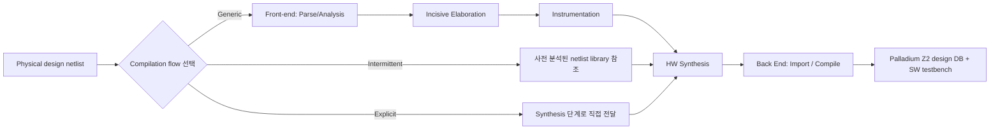

<!-- generated by yt-paper; edits will be overwritten -->

# Expedited Gate Level Verification: Unleashing the Potential of Netlist Integrated Emulation Platforms

[:material-open-in-new: 원문 보기](https://dvcon-proceedings.org/wp-content/uploads/5B1-DVCon_India_2024_Final_Paper_3974.pdf){ .md-button .md-button--primary target=_blank }

> Gate-level netlist를 ASIC 기반 에뮬레이터(Palladium Z2)에 직접 올려 GLS 대비 약 50~60배 빠른 실행과 약 60% 높은 검증 커버리지를 목표로 한 Gate Level Emulation(GLE) 플랫폼과 컴파일·런타임 최적화 기법을 제시한 논문.

| 항목 | 내용 |
|---|---|
| 저자/출처 | Samhith Kumar Pottem, Vasudeva Reddy Ambati, Rahul S S, Sarang Kalbande, Garima Srivastava (Samsung Semiconductor India Research), Hyundon Kim (Samsung Electronics). 발표 학회명은 원문에 명시되지 않음 (Cadence Palladium Z2 기반 구현) |
| 유형 | PAPER |
| 카테고리 | Emulation |
| ID | `ref-20261018-8aac` |

## 핵심 인사이트

- Explicit Netlist Flow는 이미 합성된 netlist를 Front-end와 Incisive compiler 단계에서 제외하고 Synthesis로 바로 넘겨 컴파일 시간을 크게 줄인다. 원문 Table II 기준 총 컴파일 시간이 RTL 42:36에서 Explicit 04:57로 감소한다. 다만 전체 netlist, 정확한 cell library 호환성, 명시적 netlist 객체 참조 등 사전 준비 요건이 필요하다.
- Oversampling ratio는 속도와 용량/정확성 사이의 트레이드오프 파라미터다. 값을 줄이면 속도는 오르지만 capacity 비용이 증가하고 asynchronous loop가 있는 설계에서는 기능이 깨질 수 있어 설계별 검증이 필수다. Table III에서 x1 샘플링 시 Full Net 800KHz, Stubbed 1400KHz로 나타난다.
- Hybrid(선택 IP만 netlist, 나머지 RTL) 및 Stub(검증 대상 외 블록 제외) 방식은 불필요한 netlist 회로를 제거해 런타임 성능을 높이는 실용적 전략이다. 단, 검증 대상 블록이 독립적으로 동작해야 stub이 유효하다.
- 성능 수치 해석에 주의가 필요하다. 초록/결론은 실행 시간 55X(또는 50~60X), 커버리지 60%, 컴파일 약 7배, 속도 약 6배를 주장하지만 Table IV의 KHz 단위(GLS 0.6KHz vs ASIC 1100KHz)와 텍스트 주장이 직접 대응되지 않고, 워크로드 정의와 측정 조건도 충분히 제시되지 않았다.
- 한계로 zero-delay/unit-delay netlist만 지원하며 SDF 타이밍 어노테이션은 다루지 못한다. 또한 UPF 기반 4-state 저전력 검증 통합과 timing을 시뮬레이터가 담당하는 hot-swap 방식은 향후 과제로 남아 있다. 저전력/타이밍 중심 GLS 시나리오에는 현재 적용이 제한적이다.

## 상세 요약

### 배경 및 문제 정의

SoC 설계 검증은 주로 RTL 시뮬레이션으로 수행되지만, 이 방식은 물리 구현(physical implementation) 특성과 switching activity를 충분히 반영하지 못한다. 이 때문에 동적 전력 분석 등에는 Gate Level Simulation(GLS)이 필요하지만, GLS는 시뮬레이션 특성상 매우 느려 테스트 케이스 하나가 여러 날 걸리기도 한다. 논문은 이 문제를 해결하기 위해 netlist를 하드웨어 에뮬레이터에서 실행하는 Gate Level Emulation(GLE)을 제안한다.

저자들은 이전 연구(DVCon India 2023, FPGA 기반 GLE)에서 시나리오당 검증 시간은 줄였지만, FPGA 기반에서는 긴 컴파일 시간과 낮은 런타임 성능이 문제였다고 설명한다. 또한 DFT 중심의 vector-mode GLE 선행 연구[2]는 약 50M 게이트 규모 이하, DFT 기능에만 국한되었다고 지적한다.

### 핵심 아키텍처 및 방법론

전체 흐름은 다음과 같이 요약할 수 있다.

**1) 구현 전제 조건**: HDL의 합성 가능성, cell library/IP/메모리 모델/PLL의 호환성, 라이선스, 자원 계획, 검증 환경 구성을 사전에 확인해야 한다.

**2) 컴파일 흐름**: Front-end(incremental import, parse), Analysis/Abstraction/Normalization, 분산 합성(distributed synthesis, 모듈 단위 동적 할당), back-end pre-compile(불필요 작업 제거, 병렬 처리), 최종 flatten netlist에서 design DB 생성 순으로 진행된다. 시뮬레이터와 에뮬레이터 간 swap 기능으로 SW testbench를 실행 중에 전환할 수 있다.

**3) 컴파일 최적화**
- **Intermittent flow**: netlist를 미리 분석해 논리 라이브러리로 구성하고, elaboration 단계에서 참조한다. 원문 Table II에서 Elaboration 시간이 14:25로 RTL(09:50:30)보다 길어 이 방식의 추가 오버헤드가 드러난다. 전체 시간은 20:01이다.
- **Explicit netlist flow**: 이미 합성된 netlist는 Front-end와 Incisive compiler 단계를 건너뛰고 Synthesis로 바로 전달한다. 이를 위해 netlist 객체 참조를 명시적으로 정의해야 하고, 완전한 netlist가 필요하며, RTL 형태 cell library는 합성으로 gate-level cell로 변환해야 한다. 이 방식은 하위 호환성을 위해 제공된다.

**4) 런타임 성능 최적화**
- **Oversampling**: 기본 모드에서는 각 net이 에뮬레이터 클록 2사이클마다 최소 한 번 갱신된다. Oversampling ratio(에뮬레이터 사이클 / 가장 빠른 설계 클록 사이클)를 0.5, 1 등으로 낮추면 속도가 올라가지만, capacity 비용 증가와 asynchronous loop 기능 문제가 발생할 수 있다.
- **Hybrid**: 검증 대상 IP의 netlist만 넣고 나머지는 RTL로 유지한다.
- **Stub**: 검증 대상과 독립적인 블록을 제외한다.

Table III 기준 실행 속도(KHz)는 다음과 같다.

| 샘플링 모드 | Full Net | Hybrid | Stubbed |
|---|---|---|---|
| x1 (oversampling) | 800 | 1000 | 1400 |
| x2 (without) | 400 | 600 | 800 |

**5) 적용 시나리오**: zero-delay/unit-delay GLS 시나리오 전반, Dynamic Power Analysis(SAIF 기반 switching activity), DFT scan data validation(실패 응답과 기대 응답 비교를 통한 디버깅)을 대상으로 한다.

**6) 플랫폼**: Cadence Palladium Z2 (ASIC 기반 에뮬레이터)에 구현되었다. Table I에서 FPGA 대비 ASIC 컴파일 시간(18h vs 24h)은 짧지만, 원문은 "clock frequency가 FPGA가 약간 높다"고 서술하는 반면 표의 수치는 FPGA 2000KHz, ASIC 600KHz로 표시되어 본문과 표가 일치하지 않는다.

### 실험 결과 및 결론

**컴파일 시간 및 실행 속도 (Table IV, 두 SoC: SoC1 약 1B gates, SoC2 약 2B gates)**

| 항목 | 설계 유형 | SoC1 GLS | SoC1 ASIC | SoC2 GLS | SoC2 ASIC |
|---|---|---|---|---|---|
| 컴파일 시간(h) Full Net | | 18 | 12 | 34 | 18 |
| 컴파일 시간(h) 최적화 적용 | | 15 | 8 | 25 | 13 |
| 실행 속도(KHz) Full Net | | 0.6 | 1100 | 0.45 | 780 |
| 실행 속도(KHz) 최적화 적용 | | 0.9 | 1400 | 0.7 | 1050 |

Table IV의 열 구분이 표 자체로는 명확하지 않으므로 해석에 주의가 필요하다. 해석 가능한 범위에서 보면 최적화 적용 시 컴파일 시간이 SoC1에서 약 12h→8h, SoC2에서 약 18h→13h로 줄어든다.

**검증 효과**: 초록과 결론은 GLS 대비 실행 시간 약 55배(결론에서는 50~60배), 테스트 시나리오 커버리지 약 60% 향상을 주장한다. 논문은 GLS가 RTL sign-off부터 Metal Tape-Out까지 짧은 기간에 진행되어 커버리지가 약 10%에 그친다고 설명하며, 이는 tape-out 후 버그가 SoC re-spin 비용으로 이어질 수 있다는 논리로 이어진다.

**결론 및 한계**: 결론에서 컴파일 시간은 약 7배, 운영 속도는 약 6배 개선되었다고 요약한다. 다만 이 수치들이 Table II 및 Table IV에서 어떻게 계산되었는지 원문에서 명확히 대응되지 않으며, 벤치마크 시나리오의 구체적인 정의와 측정 조건도 제시되지 않았다. 또한 timing/SDF 주석은 지원되지 않고(hot-swap 방식은 연구 중), UPF 기반 4-state 저전력 검증 통합 역시 개발 중이다. BIST 시나리오도 검증 가능하다고 언급하나 구체적 결과는 없다.

**엔지니어 관점 정리**: 이 논문은 GLE를 실무 흐름(컴파일 플로우 선택, oversampling, hybrid/stub 분할)으로 정리한 사례로서 가치가 있다. 다만 수치 해석과 재현 가능성 측면에서는 원 데이터와 벤치마크 정의를 함께 확인할 필요가 있다.

## 관련 영상

<iframe src="https://www.youtube-nocookie.com/embed/r5PnSgBREok" title="[DVCON2024_INDIA]Expedited Gate Level Verification:the Potential of Netlist Integrated Emulation" loading="lazy" allow="accelerometer; clipboard-write; encrypted-media; gyroscope; picture-in-picture; web-share" referrerpolicy="strict-origin-when-cross-origin" allowfullscreen></iframe>

**[DVCON2024_INDIA]Expedited Gate Level Verification:the Potential of Netlist Integrated Emulation** — [YouTube에서 보기](https://www.youtube.com/watch?v=r5PnSgBREok) · [영상 페이지](../../videos/r5PnSgBREok.md)
