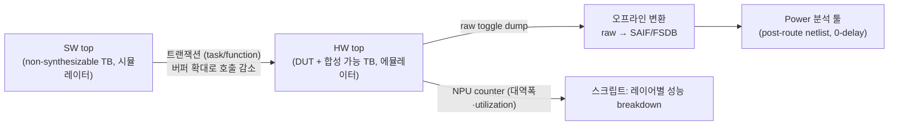

<!-- generated by yt-paper; edits will be overwritten -->

# Emulation based Power and Performance Workloads on ML NPUs

[:material-open-in-new: 원문 보기](https://dvcon-proceedings.org/wp-content/uploads/Emulation-based-Power-and-Performance-Workloads-on-ML-NPUs.pdf){ .md-button .md-button--primary target=_blank }

> Arm ML NPU의 average/peak power 및 performance 워크로드를 시뮬레이션에서 에뮬레이션으로 옮기고 HW-SW 통신을 최적화해, 테스트 수행 시간을 560~860배(표 기준) 단축한 사례 보고서.

| 항목 | 내용 |
|---|---|
| 저자/출처 | Pragati Mishra, Ritu Suresh, Issac P Zacharia, Jitendra Aggarwal (Arm Ltd). 문서에 학회명·발표 출처는 명시되어 있지 않음 |
| 유형 | PAPER |
| 카테고리 | Emulation |
| ID | `ref-20261018-9438` |

## 핵심 인사이트

- 긴 시뮬레이션 시간이 병목이었던 NPU 워크로드를 에뮬레이션으로 옮기면서, 수 주~한 달 걸리던 테스트가 수백~수천 초 단위로 줄었다. 파워 커버리지를 여러 번 반복하는 것이 실질적으로 가능해진 점이 핵심 이득이다.
- Power 측정은 emulator에서 raw toggle을 덤프하고, 에뮬레이터를 점유하지 않도록 오프라인으로 SAIF로 변환하는 흐름을 택했다. 덤프 자체를 에뮬레이션 밖에서 처리하는 구조가 장시간 실행의 활용도를 높인다.
- HW-SW co-emulation에서 병목은 testbench의 불필요한 SW 호출이었다. 트랜잭션 버퍼 크기를 늘리고 메모리 read/write 호출을 정리하는 것만으로 추가로 2~2.5배 개선을 얻었다. 이는 에뮬레이션 성능 튜닝의 우선순위 기준이 된다.
- Power 측정은 RTL이 아닌 post-route netlist 기준으로 수행했다. RTL 기반 측정은 실리콘 대비 15~20% 편차가 있다고 보고되었다. 다만 SDF 기반 timing-annotated power는 에뮬레이션에서 지원되지 않는다는 한계가 있다.
- 시뮬레이션과 에뮬레이션 간 toggle 불일치가 컴파일러 최적화 때문에 발생했고, 해당 스위치 조정과 에뮬레이터 로직 최적화 엔진 OFF로 해결했다. 포팅 후에는 toggle 일치 검증을 별도로 해야 한다.

## 상세 요약

### 배경 및 문제 정의

- 현대 SoC는 규모와 복잡도가 커졌고, 저전력 요구도 함께 높아졌다. 따라서 설계 초기 단계부터 power 수치를 제한 내에서 관리해야 한다.
- Average power는 SAIF 등으로 캡처한 toggle activity를 기반으로 계산하며, 배터리 수명 판단에 쓰인다. Peak power는 수십억 사이클 규모의 실행에서 hot spot을 찾아 좁힌 뒤 상세 분석한다.
- 시뮬레이터는 수십만 사이클 수준에 머물러 정확한 power 분석에 불충분하다. 에뮬레이터는 MHz 대 속도로 수억~수십억 사이클을 돌릴 수 있어, 실제 워크로드 기반 power 분석과 corner case 탐색에 유리하다.
- 저자들의 Arm NPU 사례에서는 시뮬레이션 기반 성능·전력 워크로드가 수 주에서 한 달까지 걸려 병목이 되었다. 이에 설계를 에뮬레이션 플랫폼으로 이전하기로 했다.

### 핵심 아키텍처 및 방법론

**1. Testbench 분할 (HW/SW co-emulation)**
- 기존 시뮬레이션 top을 Hardware top과 Software top의 이중 계층으로 나눴다.
- Accellera co-emulation 방법론을 따라 DUT와 합성 가능한 TB 모듈은 HW top(에뮬레이터)으로, 나머지 non-synthesizable 모듈은 SW top(시뮬레이터)으로 옮겼다.
- HW-SW 통신은 SystemVerilog task/function 기반 트랜잭션 방식을 사용했다. SW 쪽 호출마다 HW 쪽 대응 task/function이 있고, 계층적 참조로 연결된다.

**2. Performance 측정**
- RTL에 NPU counter를 추가해 파이프라인 각 계층의 대역폭을 계산했다.
- 카운터 데이터를 덤프하고 스크립트로 신경망 실행의 레이어별 bandwidth 및 하드웨어 utilization 지표를 얻었다.

**3. Power 측정 흐름**
- 에뮬레이터는 raw toggle 데이터를 출력하므로, 이를 SAIF/FSDB로 바꾸는 중간 단계가 필요하다.
- 대형 설계의 waveform/SAIF 덤프는 시간이 오래 걸리고 에뮬레이터를 오래 점유하므로, 실행 중에는 raw 데이터만 저장하고 변환은 에뮬레이터와 무관하게 오프라인으로 수행했다.
- 변환 스크립트는 에뮬레이터별로 만들었으며, hierarchy·출력 파일 정보 등을 입력받는다.
- 측정은 post-route netlist 기준 0-delay로 수행했다. 측정 구간에서 가능한 한 많은 자원이 toggle하도록 테스트를 설계해, 실제로는 드물 worst-case 시나리오를 만들었다.
- 이 SAIF를 power 툴에 넣어 평균 전력을 계산했다.

**4. 주요 과제와 해결**
- 시뮬레이션→에뮬레이션 포팅 시 HDL/HVL 경계 설정이 어려웠다. Accellera 표준 co-emulation을 적용하고 에뮬레이터 디버그 기능으로 회귀 테스트와 경계 디버그를 수행했다.
- 컴파일러 최적화 때문에 시뮬레이션과 에뮬레이션 사이에 mismatch가 생겼다. 합성 시 적절한 컴파일러 스위치를 추가해 해결했다.
- Power 벤치마크에서는 toggle 불일치를 검증하고 에뮬레이터 로직 최적화 엔진을 끄는 방식을 택했다.
- 수십억 사이클의 performance 벤치마크는 에뮬레이터를 며칠씩 점유한다. 하드웨어 안정성은 EDA 벤더 측이 담당한다.
- Raw toggle 데이터를 power 툴로 직접 스트리밍하는 Online streaming mode는 작업 중이라고 기술되어 있다.

**5. 한계**
- SDF 기반 annotated power는 에뮬레이션에서 불가능하다. SDF는 합성 불가능한 timing 구조라 에뮬레이터가 지원하지 않는다.
- RTL 기반 power는 실리콘 대비 15~20% 편차가 있어, 평균 전력은 post-route netlist로 계산했다.
- 에뮬레이션 합성을 위해 모든 RTL/TB 메모리를 합성 가능한 모델로 바꿔야 한다.

### 실험 결과 및 결론

본문 Table 1 기준 결과는 다음과 같다. 마지막 열 "Overall Gain"은 시뮬레이션 시간을 최적화된 에뮬레이션 시간으로 나눈 값으로 계산하면 표의 값과 일치한다.

| 테스트 | 시뮬레이션 (s) | 에뮬레이션 (s) | 최적화 후 에뮬레이션 (s) | 전체 이득 |
|---|---|---|---|---|
| Test 1 | 233352 | 692 | 385 | 600x |
| Test 2 | 344232 | 1264 | 493 | 700x |
| Test 3 | 257075 | 1036 | 458 | 560x |
| Test 4 | 374534 | 1020.08 | 488 | 760x |
| Test 5 | 381338 | 900 | 441 | 860x |

- 에뮬레이션 이전만으로 런타임 약 330배 향상되었다. 표의 Test 1 값(233352/692≈337배)과 대략 일치한다.
- HW-SW 통신 채널 최적화로 추가 2~2.5배를 얻어, 전체 이득은 본문 기준 600~800배로 기술되었다. 표에는 560~860배 범위가 나타난다.
- 저자들은 에뮬레이션이 시뮬레이션보다 빠르고 정확하며, 실제 워크로드 기반 power·performance 검증에 더 나은 기법이라고 결론짓는다.
- 주의: 본 문서는 단일 NPU 설계 사례의 보고서이며, 정량 비교는 Arm 내부 설정 기준이다. 샘플이 5개 테스트뿐이므로 일반화에는 제약이 있다. 또한 power 정확도 수치(15~20% 편차)는 RTL 기준 설명이며, 에뮬레이션 기반 post-route 결과의 실리콘 대비 정확도는 본문에 별도 수치로 제시되지 않았다.

## 관련 영상

<iframe src="https://www.youtube-nocookie.com/embed/RQPen0RqbUs" title="[DVCON2022]Emulation Based Power and Performance Workloads on ML NPUs" loading="lazy" allow="accelerometer; clipboard-write; encrypted-media; gyroscope; picture-in-picture; web-share" referrerpolicy="strict-origin-when-cross-origin" allowfullscreen></iframe>

**[DVCON2022]Emulation Based Power and Performance Workloads on ML NPUs** — [YouTube에서 보기](https://www.youtube.com/watch?v=RQPen0RqbUs) · [영상 페이지](../../videos/RQPen0RqbUs.md)
