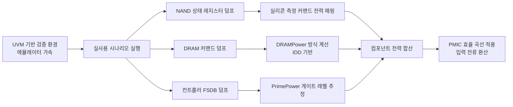

<!-- generated by yt-paper; edits will be overwritten -->

# System-Level Power Estimation of SSDs under Real Workloads using Emulation

[:material-open-in-new: 원문 보기](https://dvcon-proceedings.org/wp-content/uploads/1099-System-Level-Power-Estimation-of-SSDs-under-Real-Workloads-using-Emulation.pdf){ .md-button .md-button--primary target=_blank }

> 실리콘에서 측정한 커맨드별 전력 값과 에뮬레이터 상의 실제 워크로드 시뮬레이션을 결합해 SSD의 평균·피크 전력을 최대 8% 오차로 추정하는 시스템 레벨 방법론이다.

| 항목 | 내용 |
|---|---|
| 저자/출처 | Sangmin Kim, Kwanghyo Ahn, Changhoon Han, Hyunsik Kim, Jaewoo Im (Samsung Electronics Co., Ltd., Hwaseong-si, Korea). 발표 학회/출처는 본문에 명시되어 있지 않음 |
| 유형 | PAPER |
| 카테고리 | Emulation |
| ID | `ref-20261018-9555` |

## 핵심 인사이트

- NAND와 DRAM behavior model에 내부 status register나 condition flag를 추가해 커맨드 로그(timestamp 포함)를 덤프하고, 이를 실리콘 측정 커맨드 전력과 매핑하는 방식으로 시간 축 기반 전력 추정이 가능해진다. 단순 식 기반 평균 전력 모델과 달리 피크 전력까지 다룬다.
- 컨트롤러는 게이트 레벨 넷리스트에 FSDB 덤프를 넣고 Synopsys PrimePower로 추정하는 표준 SoC 전력 흐름을 쓰며, 메모리 부분은 에뮬레이터 모델 내부 신호를 이용한다. 하드웨어와 펌웨어를 함께 돌려 실제 워크로드를 반영한다는 점이 핵심이다.
- 피크 전력 오차(최대 8%)가 평균 전력 오차보다 큰 이유로 저자들은 실리콘 피크가 발생하는 코너 케이스가 시뮬레이션에 빠질 수 있음을 지적한다. 따라서 피크 추정 정확도는 테스트 케이스 커버리지에 직접 의존한다.
- DRAM 전력 계산에 refresh 커맨드 플래그를 끄는 것은 덤프 파일 크기 문제 때문이다. 수 ms 단위 시뮬레이션에서는 refresh 이벤트가 로그 크기를 폭증시키므로, 전력 계산은 tREFI/tRFC 기반 해석식으로 대체하는 트레이드오프를 택했다.
- PMIC 입력 전류 추정을 위해 출력 전류 대비 효율 곡선을 사용하며, 외장 PMIC 구조에서는 각 컴포넌트 전류 합으로 충분하다고 설명한다. 피크 전류가 PMIC 최대 입력 전류를 넘지 않는지 검증할 때 실용적인 접근이다.

## 상세 요약

### 배경 및 문제 정의

SSD의 성능(PCIe 5.0, 순차 읽기 최대 13,000 MB/s [1])이 높아지면서 소비 전력 추정의 중요성이 커지고 있다. SSD는 컨트롤러(SoC), NAND, DRAM 캐시로 구성되며, 컨트롤러 전력은 기존 SoC 전력 추정 방법론으로 다룰 수 있지만 NAND와 DRAM 전력은 추정이 어렵다.

기존 연구 [2]는 식 기반(equation-based) 모델로 NAND와 DRAM의 **평균 전력**을 추정했지만, 커맨드 실행 중 전력 변동을 반영하지 못해 특정 시점의 전력이나 **피크 전력**은 추정할 수 없다. 그러나 순간 전류는 PMIC의 최대 입력 전류를 넘지 않아야 하므로 피크 전력 추정이 중요하다.

또한 SSD 컨트롤러는 수천만 인스턴스 규모이고 펌웨어까지 포함해야 하므로, 피크 전력이 드문 코너 케이스에서만 나타나는 점을 고려하면 10~100 ms 수준의 긴 시뮬레이션이 필요하다. 저자들은 이를 위해 에뮬레이션 기반 HW/SW 공동 검증 환경을 사용한다.

### 핵심 아키텍처 및 방법론

전체 흐름은 다음과 같다.

**1. NAND 전력**: behavior model을 수정해 커맨드 상태를 나타내는 내부 status register를 만든다. 대상 커맨드는 Read, Program, Erase, Read DMA, Write DMA이며, SLC/TLC 모드와 multi-plane 동작 상태 비트도 포함한다. 채널별 덤프 파일에 way별 timestamp와 커맨드 상태가 기록된다. 실리콘에서 SLC/TLC 및 multi-plane 조건별로 측정한 입력 전력을 각 커맨드 발생 시점에 적용하고 채널별로 누적한다. 시뮬레이션 성능이 실측 성능과 일치하도록 AC 타이밍 파라미터도 실측 시 사용한 값으로 설정한다.

**2. DRAM 전력**: Siemens EDA의 DDR4 메모리 모델 [4]을 수정해 precharge, activate, read, write 커맨드를 condition flag로 검출한다. 암호화되어 있는 모델 대신 비암호화 모니터링 신호를 사용한다. 전력 계산은 DRAMPower [5] 방식을 따라 커맨드 로그와 측정된 IDD 전류로 수행한다. Refresh는 로그 크기 문제로 flag를 비활성화했고, 대신 JEDEC DDR4 표준 [6]의 평균 refresh 간격 tREFI, refresh 사이클 시간 tRFC, 그리고 burst refresh 전류 IDD5B로 계산한다.

**3. 컨트롤러 전력**: 표준 SoC 전력 추정 흐름을 사용한다. FSDB 덤프를 Synopsys PrimePower [7]에 입력하며, 실리콘 상관관계를 높이기 위해 공정·온도·전압 조건을 공칭 동작 조건에 가깝게 설정한다. 상태 신호를 프로빙해 피크 전력 상황의 컨트롤러 동작을 추적할 수 있고, UPF를 추가하면 power gating 상태도 점검할 수 있다고 언급하지만, 본 연구에서는 최대 성능 상황만 추정했으므로 절전 모드는 고려하지 않았다. (원문의 피크 분석 관련 문장이 중간에서 끊겨 있어 세부 절차는 확인할 수 없다.)

**4. SSD 시스템 전력**: 내장 PMIC 시스템과 외장 PMIC 시스템을 구분한다. 외장 PMIC는 각 컴포넌트 전류의 합으로 충분하다. 내장 PMIC는 출력 전류별 효율을 측정해 효율 곡선 [8] 을 만들고, 이를 이용해 PMIC 출력 전류를 입력 전류로 환산한다.

### 실험 결과 및 결론

상용 SSD에 적용해 4가지 I/O 시나리오(Sequential Read/Write, Random Read/Write)에 대해 실리콘 측정값과 비교했다. 측정값은 1.00으로 정규화되었다. 하드웨어 플랫폼은 Siemens Veloce를 사용했으며, 벤더 전용 기능을 쓰지 않아 다른 에뮬레이터에도 적용 가능하다고 설명한다. 작은 설계는 Verilog 시뮬레이션으로도 가능하다고 언급한다. 펌웨어는 측정과 시뮬레이션에서 동일 버전을 사용했다.

| 항목 | 평균 전력 (Table I) | 피크 전력 (Table II) |
|---|---|---|
| 총 전력 추정치 범위 | 0.95 ~ 1.03 | 0.92 ~ 0.96 |
| 저자 보고 오차 | 평균 3%, 최대 5% | 평균 5%, 최대 8% |

컴포넌트별로 보면 평균 전력의 최대 오차는 NAND 9%, DRAM 10%, 컨트롤러 3%로 보고되어 있다. 피크 전력에서는 DRAM 추정치가 0.78~0.91 범위로 가장 낮았다.

**결론**: 실측 커맨드 전력과 에뮬레이션 기반 커맨드 로그를 결합하면 SSD의 평균 및 피크 전력을 최대 8% 오차 내로 추정할 수 있다. 평균 전력은 주기적 파형이 시간 범위 내에 여러 번 나타나 정확도가 높았고, 피크 전력은 시뮬레이션에 포함되지 않은 코너 케이스를 놓칠 수 있어 상대적으로 오차가 컸다. 저자들은 이를 해결하기 위해 검증 엔지니어가 유사 설계를 검증하면서 피크 시나리오를 점진적으로 축적해야 한다고 제안한다.

**참고 사항**: 본문에는 측정 시간 범위가 초 단위인 반면 추정은 10~100 ms 범위에서 이루어져 직접적인 시간 축 비교가 어렵다고 명시되어 있다. 또한 초록과 결론의 "최대 8%" 는 피크 전력 결과와 일치하지만, 본문의 평균 전력 최대 오차 5%와 컴포넌트별 최대 오차 9~10%는 표의 수치와 완전히 일치하지 않아 독자가 원 표를 함께 확인하는 것이 좋다.

## 관련 영상

<iframe src="https://www.youtube-nocookie.com/embed/x32Ey9cnaMw" title="[DVCON2023] System-Level Power Estimation of SSDs under Real Workloads using Emulation" loading="lazy" allow="accelerometer; clipboard-write; encrypted-media; gyroscope; picture-in-picture; web-share" referrerpolicy="strict-origin-when-cross-origin" allowfullscreen></iframe>

**[DVCON2023] System-Level Power Estimation of SSDs under Real Workloads using Emulation** — [YouTube에서 보기](https://www.youtube.com/watch?v=x32Ey9cnaMw) · [영상 페이지](../../videos/x32Ey9cnaMw.md)
