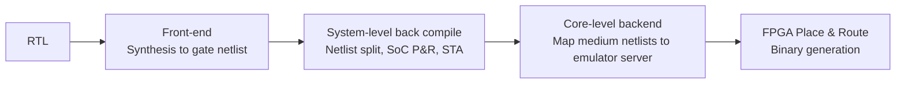

<!-- generated by yt-paper; edits will be overwritten -->

# An Accelerated System Level CPU Verification through Simulation-Emulation Co-Existence

[:material-open-in-new: 원문 보기](https://dvcon-proceedings.org/wp-content/uploads/74321.pdf){ .md-button .md-button--primary target=_blank }

> SoC 전체 레벨의 저전력(UPF)·코히런시·DVFS 장시간 시나리오를 에뮬레이터로 옮기고 PA 시뮬레이션과 에뮬레이션을 공존시켜 검증 시간을 크게 줄인 Samsung의 실무 사례 논문.

| 항목 | 내용 |
|---|---|
| 저자/출처 | Ruchi Misra, Samridh Deva, Sai Krishna Pallekonda, Alok Kumar, Garima Srivastava, Youngsik Kim, Seonil Brian Choi (Samsung Semiconductors India R&D / Samsung Electronics, DVCon Europe) |
| 유형 | PAPER |
| 카테고리 | Emulation |
| ID | `ref-20261018-98d5` |

## 핵심 인사이트

- 장시간 실행되는 시나리오(저전력 power up/down 반복, 랜덤 스트레스 트래픽, 코히런시)를 에뮬레이터로 옮기고, 디버그가 쉽거나 체커가 필요한 케이스는 시뮬레이션에서 재현하는 역할 분담이 핵심 전략이다.
- 시뮬레이션과 에뮬레이션이 동일한 synthesizable RTL과 UPF 파워 인텐트를 재사용하도록 구성하여, 두 환경 간 결과 일관성과 디버그 연속성을 확보한다. 이는 PA 에뮬레이션 도입 시 가장 실무적인 이점이다.
- UPF 적용 시 실무 장애물은 IP 간 power well bias 규칙 충돌(본 논문은 모든 IP와 SoC top에서 enable_bias를 false로 설정해 회피)과 IP별 cell library 릴리스 불일치로 인한 stale/corrupt lib 경로 문제였다.
- 논문은 최대 40x의 시간·자원 절감(Related Work 절)과 Exynos 모바일/오토모티브 SoC에서 핵심 long-pole 기능 클로저 시간 50X 절감을 주장하지만, 구체적 수치는 Figure 16/17에 있고 본문 텍스트만으로는 세부 조건을 검증할 수 없다.

## 상세 요약

### 배경 및 문제 정의

SoC 규모가 커지면서(이기종 CPU 코어, GPU, 가속기, 주변장치, DDR 등) SoC 레벨 시뮬레이션 시간이 매우 길어지고, 이로 인해 반복적인 디버그가 비효율적이 되는 것이 본 논문이 정의한 핵심 문제다. 특히 다음 영역이 긴 시뮬레이션 시간을 요구한다.

- **저전력 시나리오**: 다수의 power-up/power-down 시퀀스를 거쳐야 버그를 찾을 수 있다.
- **IO coherent 시나리오**: GPU나 멀티미디어 블록과 실제 CPU가 함께 동작하는 RTL 기반 테스트.
- **DVFS 시나리오**: 메모리 인터페이스, 코어, 코히런트 인터커넥트의 주파수/전압 조합을 모두 순회해야 한다.
- **멀티 클러스터 코히런시**: 프로세서 벤더가 멀티 클러스터 간 코히런트 연결을 제공하지 않을 수 있어, SoC 레벨에서 DVM, exclusive access, IO coherent 트랜잭션 등을 섞은 스트레스 테스트가 필요하다.

논문의 목표는 시뮬레이션과 에뮬레이션을 공존시켜 설계 완료 시점(time-to-market)과 검증 격차를 줄이는 것이다.

### 핵심 아키텍처 및 방법론

**1. 에뮬레이터 하드웨어 및 컴파일 흐름**

호스트 PC가 고속 인터커넥트 보드로 에뮬레이터 서버에 연결되고, DUT는 하나 이상의 FPGA와 메모리 칩에 매핑되며, 테스트 환경은 별도의 interface FPGA에 구현되는 Hardware Test Bench로 구성된다. 컴파일러는 4단계로 동작한다.

**2. 테스트 계획 및 우선순위**

장시간 저전력, 랜덤 스트레스 트래픽 등 핵심 시나리오를 에뮬레이션 대상으로 분류한다. 에뮬레이션의 한계(체커 부족, 디버그 난이도)로 인해 시뮬레이션에서 재현 가능해야 하는 케이스도 함께 정의한다. 테스트 우선순위는 마일스톤이 장시간 시나리오 때문에 막히지 않도록 설정한다.

**3. 시뮬레이션에서 에뮬레이션으로의 이관**

기본 sanity 테스트를 먼저 에뮬레이션에서 돌리고, 검증 엔지니어가 시나리오별 실행 환경을 지정한다. C 테스트를 컴파일해 이미지 파일을 만들고, 블록 구성에 따라 full image 또는 base image를 선택한다. 바이너리 분리, 라이선스 설정, waveform dump 시작/중지 등 이전에 수동이던 단계는 단일 입력·단일 명령 방식으로 자동화하였다.

**4. 코히런시 시나리오**

각 클러스터는 private L1, private/shared L2, shared L3를 가지며, 시스템 레벨 캐시(LLC)가 추가될 수 있다. DVM, exclusive access, IO coherent 트랜잭션을 섞고, 페이지 테이블 속성과 메모리 오더링을 변경하며, 다수의 cache-line eviction을 유발하는 스트레스 시나리오를 구성했다.

**5. DVFS 및 저전력 시나리오**

블록별로 서로 다른 전압/클록을 가지는 SoC에서 DVFS 전이를 에뮬레이터에서 실행한다. 저전력 시나리오로는 Core/Cluster clock gating, memory retention, 전체 power down 및 sleep이 포함되며, 이들은 UPF가 적용된 Power-Aware(PA) 설정에서도 실행된다.

**6. UPF 기반 PA 에뮬레이션**

- 지원 표준: UPF 1.0, UPF 2.0(IEEE 1801-2009), UPF 2.1의 제한된 명령 집합(IEEE 1801-2013), 계층적/비계층적 UPF 모두.
- 핵심 원칙: 합성 가능한 설계 컴포넌트를 PA 시뮬레이션과 PA 에뮬레이션이 동일하게 재사용한다.
- 컴파일 흐름: UPF와 RTL을 EDA 툴에 입력 → analysis, elaboration, splitting, synthesis → 벤더 중립 netlist 형식인 EDIF 생성.
- 이점: 시뮬레이션과 공통 의미론(semantics), 동일한 UPF 구문 지원, 시뮬레이터의 조기 에러 검출 활용, precedence rule 이월, PA 시뮬레이션과 PA 에뮬레이션 간 디버그 연속성.
- 에뮬레이터는 `PowerMgt` 클래스의 C++ API를 제공하여 PA 실행을 지원한다.

**7. 주요 오류와 해결**

- **Power well bias 규칙 충돌**: IP별 설정이 SoC 레벨 규칙과 충돌 → 모든 IP와 SoC top에서 `enable_bias`를 false로 설정.
- **Corrupt cell library**: IP별 라이브러리 릴리스 일정이 달라 stale/corrupt lib 경로가 발생 → 수동 업데이트. 라이브러리를 에뮬레이션 호환 형식으로 변환하는 유틸리티와 lib-to-DB 변환 스크립트를 사용.
- 빌드 전 Makefile 수정, 전원 관련 포트 에러 수정, UPF 버전/툴 옵션 이슈 해결 후 단일/멀티 코어 power down 시나리오로 의도 검증.

### 실험 결과 및 결론

- 여러 기능 시나리오와 저전력 시나리오를 **같은 설계 드롭(design drop)에서 시뮬레이션과 에뮬레이션으로 각각 실행**하여 실행 시간을 비교했다. 결과 플롯은 Figure 16(비 PA 결과, 두 플랫폼 비교)과 Figure 17(Synopsys 플랫폼의 PA 실행 결과)에 있으나, 본문 텍스트에서는 수치를 확인할 수 없다.
- 실험은 Cadence와 Synopsys 두 벤더의 에뮬레이터 플랫폼에서 수행되었다.
- 논문의 주장:
  - 관련 연구 절: UPF 가속 검증에서 **최대 40x**의 시간·자원 절감.
  - 결론 절: Exynos 모바일 및 오토모티브 SoC에서 핵심 long-pole 기능의 클로저 시간을 **최소 50X** 절감.
  - 반복(iteration) 횟수, 디버그 시간, 검증 일정이 크게 줄었다고 보고.
- 에뮬레이션은 설계 전체 coverage 달성이 아니라 **중요 버그를 조기에 찾는 용도**로 한정하여 운영한다고 명시한다.
- 두 환경 간 전환을 자동화하여 엔지니어가 쉽게 오갈 수 있도록 했다.

**결론적으로**, 본 논문은 시뮬레이션과 에뮬레이션을 대체 관계가 아닌 보완 관계로 설계하고, UPF 자산 공유와 자동화를 통해 장시간 저전력·코히런시·DVFS 검증을 에뮬레이터로 이관하는 실무 절차를 제시한다. 다만 본문에 명시된 정량 수치의 상당 부분이 그림에만 있어, 정량 결과는 원문 Figure 16/17과 함께 확인이 필요하다.

## 관련 영상

<iframe src="https://www.youtube-nocookie.com/embed/KxjDULVuMQE" title="[DVCON2022_EUROPE]An Accelerated System Level CPU Verification through Simulation-Emulation Co-Exist" loading="lazy" allow="accelerometer; clipboard-write; encrypted-media; gyroscope; picture-in-picture; web-share" referrerpolicy="strict-origin-when-cross-origin" allowfullscreen></iframe>

**[DVCON2022_EUROPE]An Accelerated System Level CPU Verification through Simulation-Emulation Co-Exist** — [YouTube에서 보기](https://www.youtube.com/watch?v=KxjDULVuMQE) · [영상 페이지](../../videos/KxjDULVuMQE.md)
