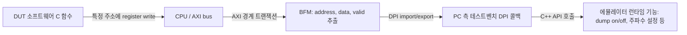

<!-- generated by yt-paper; edits will be overwritten -->

# A Novel Framework to Accelerate System Validation on Emulation

[:material-open-in-new: 원문 보기](https://dvcon-proceedings.org/wp-content/uploads/90935.pdf){ .md-button .md-button--primary target=_blank }

> 에뮬레이터의 Trigger/Dump, Force, 메모리 접근, PLL 주파수 변경 같은 런타임 기능을 DUT 내부 CPU가 AXI 레지스터 쓰기로 제어하도록 BFM과 DPI-C를 연결한 프레임워크를 제안한 논문이다.

| 항목 | 내용 |
|---|---|
| 저자/출처 | Manoj Sharma Khandelwal, Rinkesh Yadav, Sarang Kalbande, Garima Srivastav (Samsung Semiconductors R&D India), Hyundon Kim (Samsung Electronics) (DVCon Europe) |
| 유형 | PAPER |
| 카테고리 | Emulation |
| ID | `ref-20261018-ba2c` |

## 핵심 인사이트

- 테스트벤치 API나 런타임 명령에 의존하던 에뮬레이터 디버그 기능을, DUT 내부 CPU 소프트웨어가 정해진 주소에 레지스터를 쓰는 것만으로 호출할 수 있다는 점이 핵심 아이디어다. 사용자가 신호 계층이나 타임스탬프를 알 필요가 없어진다.
- 제어 경로는 CPU register write → AXI 경계 트랜잭션 → BFM이 address/data/valid 추출 → DPI import/export → C++ API 호출 순서로 구성된다. 하드웨어와 호스트 사이의 DPI 왕복이 추가되므로 지연과 성능 저하가 생긴다는 점을 설계 시 반드시 고려해야 한다.
- PLL 예제에서는 multiplier/divider 값을 DPI로 넘기고 출력 주파수를 테스트벤치(C 측)에서 계산한 뒤 하드웨어 클럭 설정 API를 호출한다. 이를 통해 실리콘처럼 레지스터로 DFS를 검증할 수 있으며, 기존에는 재실행이 필요했던 주파수 변경을 런타임에 수행할 수 있다.
- 논문은 DPI 호출로 인한 실행 지연이 지연 의존 기능의 동작에 영향을 줄 수 있다고 한계를 밝힌다. 원문은 성능 수치를 'approximately X80 improvement'로만 적고 있어 구체적인 가속 비율과 측정 조건은 본문만으로 확인할 수 없다.

## 상세 요약

### 배경 및 문제 정의

- SoC 복잡도가 커지면서 SoC 레벨 테스트 시나리오가 시뮬레이션에서 에뮬레이션으로 옮겨가고 있으며, 테스트 케이스 수도 늘고 있다.
- 시뮬레이터는 SystemVerilog task 형태로 Trigger-Dump, Force-Release, 메모리 read/write, 신호 값 읽기 등을 DUT나 테스트벤치에서 직접 호출할 수 있다. 반면 에뮬레이터의 이런 런타임 기능은 테스트벤치 쪽 명령이나 소프트웨어 함수로만 호출 가능하고, DUT 내부에서 실행되는 소프트웨어가 직접 제어할 수 없다.
- 기존 방식의 문제점은 다음과 같다.
  - 덤프 예제: 디버그 대상 함수(예: `cmd_initialize()`)의 PC나 실행 타임스탬프를 찾아 run script에 트리거를 넣고, 실행 시간만큼 돌린 뒤 덤프를 시작·정지해야 한다.
  - 포스 예제: `reset_config()` 완료 지점을 찾아 실행을 멈추고, 신호를 강제한 뒤 다시 실행해야 한다.
  - PLL 예제: 주파수는 에뮬레이션 실행 전에 할당하거나 강제해야 하며, 주파수를 바꾸려면 재실행이 필요하다. 시뮬레이션용 PLL 모델은 합성 가능하지 않아 시나리오 수가 제한된다.

### 핵심 아키텍처 및 방법론

제안 방식은 에뮬레이터의 transactor 기반 프레임워크를 활용해, CPU의 레지스터 쓰기를 런타임 제어 신호로 바꾼다.

단계별 흐름은 다음과 같다.

1. **CPU register write**: 사용자 함수에 대응하는 고유 주소와 데이터를 정해 DUT 내부 system function register에 쓴다.
2. **BFM의 AXI 추출**: 해당 레지스터 쓰기 트랜잭션의 address, data를 AXI 경계에서 추출한다.
3. **DPI 호출**: 추출한 데이터를 에뮬레이터의 표준 DPI 호출로 하드웨어에서 테스트벤치(PC 측)로 보낸다.
4. **C++ API 실행**: 테스트벤치에서 메시지를 받아 C++ API를 호출해 에뮬레이터의 해당 런타임 기능을 활성화한다.

적용 예시는 다음과 같다.

- **Dump**: `start_dump()`와 `stop_dump()`를 디버그 대상 함수 전후에 두고, 이 함수들이 위 4단계 방식으로 구현된다. `dump_time()`을 지정하는 방식도 제시된다. 사용자는 신호 계층, 실행 시간, 타임스탬프를 신경 쓰지 않아도 된다.
- **Force**: `force_signal()`을 소프트웨어에서 호출해 런타임에 임의 신호를 강제한다.
- **PLL / DFS**: PLL 모델은 `DPI-C` 인터페이스로 DFS를 지원한다. 레지스터 쓰기로 multiplier와 divider 값을 DPI 트랜잭션에 실어 보내면, 테스트벤치의 C 함수가 입력 주파수와 M/D 값으로 출력 주파수를 계산한다. 이후 필요한 분주를 거쳐 클럭 와이어에 런타임으로 공급한다. 클럭 설정 API를 호출해 실리콘과 유사하게 주파수를 바꾸며, 다양한 clock ratio와 DFS 기능을 검증할 수 있다.

논문이 제시한 런타임 기능 목록은 Trigger and Dump, Dynamic Frequency shift, Dump and Load Memory, Force and Monitor Signals, Generate System Level Events이다.

### 실험 결과 및 결론

- **실험 결과**: 동적 주파수 변경(Dynamic Frequency shift) 시나리오에서 시뮬레이션 대비 에뮬레이션 시간이 "approximately X80 improvement"라고 기술되어 있다. 원문 표기가 'X80'으로 되어 있어 정확한 가속 배수의 의미를 확정할 수 없다. 또한 결과 스니펫과 측정 조건, 워크로드 세부 정보는 본문에 포함되어 있지 않다. 그림(Figure 1–7)도 본문 텍스트 추출본에서는 확인할 수 없다.
- **한계**: DPI 호출로 인한 실행 지연이 지연에 민감한 기능에 영향을 줄 수 있고, DPI 호출이 에뮬레이터의 런타임 성능을 떨어뜨릴 수 있다고 명시한다.
- **결론**: 소프트웨어가 DUT 안에서 에뮬레이터를 제어할 수 있게 해 디버그 설정 부담을 줄이고, 레지스터 기반 PLL 제어로 더 넓은 주파수 범위를 검증할 수 있다. 메모리와 신호 접근, 소프트웨어에서의 신호 강제를 지원해 검증 턴어라운드 시간을 줄이는 것이 목표다.
- 참고 자료로 Synopsys ZeBu 사용자 가이드와 Palladium 사용자 가이드가 인용되어 있다.

## 관련 영상

<iframe src="https://www.youtube-nocookie.com/embed/CKrVtVSJQrs" title="[DVCON2023_EUROPE]A Novel Framework to Accelerate System Validation on Emulation" loading="lazy" allow="accelerometer; clipboard-write; encrypted-media; gyroscope; picture-in-picture; web-share" referrerpolicy="strict-origin-when-cross-origin" allowfullscreen></iframe>

**[DVCON2023_EUROPE]A Novel Framework to Accelerate System Validation on Emulation** — [YouTube에서 보기](https://www.youtube.com/watch?v=CKrVtVSJQrs) · [영상 페이지](../../videos/CKrVtVSJQrs.md)
