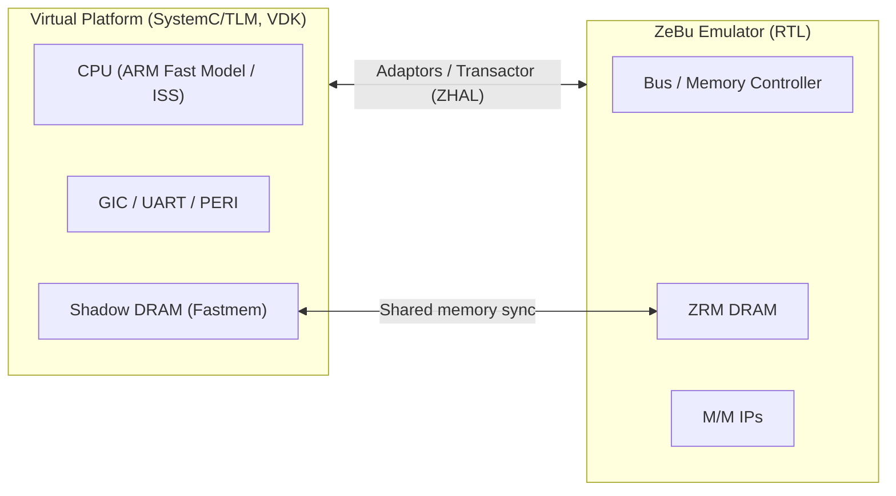

<!-- generated by yt-paper; edits will be overwritten -->

# Unveiling Advance Hybrid Emulation Methodology for Accelerated Android Home Screen Bring-up and System Level Verification

[:material-open-in-new: 원문 보기](https://dvcon-proceedings.org/wp-content/uploads/5B3-DVCon_India_2024_Final_Paper_2224.pdf){ .md-button .md-button--primary target=_blank }

> CPU와 DRAM 등 OS 부팅 병목 블록을 SystemC/TLM 가상 플랫폼으로 옮기고 나머지 RTL은 ZeBu 에뮬레이터에서 실행하는 Hybrid Emulation으로, 약 2억 게이트급 Exynos SoC에서 Android 홈 화면 부팅 시간을 pure emulation의 약 4일에서 약 72분으로 줄인 방법론 소개.

| 항목 | 내용 |
|---|---|
| 저자/출처 | Rinkesh Yadav, Sarang Kalbande, Garima Srivastava, Hyundon Kim (DVCon Europe) |
| 유형 | PAPER |
| 카테고리 | Emulation |
| ID | `ref-20261018-e0d9` |

## 핵심 인사이트

- Pure emulation은 driver clock이 낮아(문서 기준 1MHz) Linux/Android 부팅에 병목이 생기므로, 부팅 가속의 핵심은 CPU와 DRAM 간 트랜잭션이 많은 구간을 virtual side(ISS 기반 CPU 모델)로 옮기는 것이다.
- DRAM은 RTL 메모리 모델 대신 Fastmem 기반 shadow memory를 가상 측에 두고, Transactor를 통해 emulator의 ZRM DRAM과 동기화하는 shared memory 구조로 가상-에뮬레이터 트랜잭션 비용을 줄인다.
- Hybrid 환경의 제약은 가상 측 SystemC/TLM 모델이 cache coherency를 지원하지 않고 ARM Fast Model이 멀티코어 시뮬레이션을 지원하지 않는다는 점이며, 이 때문에 SMP와 cache coherency를 비활성화해야 한다.
- 가상 측 CPU가 RTL로 대체되지 않으므로 CPU 벤치마크가 불가능한 한계가 있어, 부팅 후 CPU 상태를 RTL CPU로 옮기는 'Gear shift' 방식을 향후 과제로 제시한다.
- 디버그 측면에서 가상 측 TLM 트랜잭션 디버그, T32, Transactor 로그, Verdi 파형 등을 조합할 수 있으나, 가상 측 버그는 수십억 명령 규모의 부팅에서 million-cycle 기록 윈도우 밖에 놓일 수 있어 원인 추적이 어렵다고 문서는 지적한다.

## 상세 요약

### 배경 및 문제 정의

- SoC의 소프트웨어 bring-up과 검증은 전통적으로 post-silicon 단계에서 이루어져, 출시 기간(time-to-market)과 silicon re-spin 비용에 위험을 준다.
- 문서는 검증 방식을 Simulator, Emulation, FPGA, Silicon 네 가지로 나눠 비교한다. 문서 기준으로 최신 코어에서 시뮬레이터는 약 100Hz로 OS 부팅에 부적합하고, 에뮬레이터(ZeBu Server 5)는 약 5MHz이지만 소유 비용이 크다. FPGA는 비용과 디버그 가시성 문제가 있다.
- 본 문서가 든 구체적 문제는 pure emulation에서 driver clock이 1MHz일 때 Android 홈 화면까지 약 4일이 걸린다는 점이다. 이 때문에 반복적인 소프트웨어 개발 이터레이션이 현실적이지 않다.

### 핵심 아키텍처 및 방법론

Hybrid emulation은 설계의 일부를 emulator(RTL)에서, 나머지를 virtual prototype(SystemC/TLM, Synopsys VDK 계열)에서 실행하는 방식이다. 문서는 플랫폼을 다음과 같이 나눈다.

- **Virtual Platform 측 (TLM, VDK)**: CPU, GIC, MCT, UART, PERI, Storage, DRAM
- **Emulation 측 (RTL)**: Bus, Memory Controller, 기타 M/M IP

주요 설계 요소는 다음과 같다.

1. **파티셔닝**: CPU와 DRAM 간 트랜잭션이 많은 구간이 pure emulation의 병목이므로, CPU와 관련 컴포넌트를 가상 측으로 옮긴다. 가상 CPU는 ISS로 동작하여 게이트 레벨 CPU보다 빠르다.
2. **Shared DRAM**: 에뮬레이터의 ZRM DRAM과 가상 측 shadow memory를 두고 Transactor로 동기화하여 CPU-DRAM 접근 지연을 줄인다.
3. **Adaptor/Transactor**: Virtualizer Studio에 통합된 Adaptor가 가상 컴포넌트와 하드웨어를 연결하며, ZHAL(ZeBu Hybrid Adaptor Library)이 어댑터 래퍼를 제공해 virtualizer 내부에서 TLM 모델처럼 사용된다.
4. **디버그 조합**: TLM 트랜잭션 디버그(Chart View), VP disassembly 및 T32 디버거로 SW 디버그, Transactor/Adaptor 로그 레벨로 HW-SW 트랜잭션 디버그, Verdi 파형 덤프로 RTL 디버그를 수행한다.

**제약 사항**: TLM 모델은 cache coherency를 지원하지 않으므로 cache coherency를 끄고, ARM Fast Model은 멀티코어를 지원하지 않으므로 SMP를 끈 상태로 Linux 커널과 Android 홈 화면을 개발한다.

**향후 방향**: (a) Gear shift 방식으로 Linux/Android를 가상 CPU로 부팅한 뒤 CPU 상태를 RTL CPU로 옮겨 CPU 벤치마크를 수행하는 것, (b) SMP 및 cache coherency 대체 방안, (c) 멀티다이/멀티칩 SoC 지원을 연구 중이다.

### 실험 결과 및 결론

대상은 약 20억 게이트 규모의 Samsung Exynos SoC이다. 문서의 Table 2 기준 부팅 시간은 다음과 같다.

| 플랫폼 | 소요 시간 |
|---|---|
| Simulation | 소프트웨어 개발에 비현실적 (문서 표현) |
| Pure Emulation | Android 홈 화면까지 약 4일 |
| Hybrid Emulation | Linux 커널 약 2분, Android 로고 약 12분, Android 홈 화면 약 72분 |

결론적으로 문서는 hybrid emulation이 pure emulation보다 소프트웨어 bring-up 반복 속도를 크게 높이고, RTL 대비 디버그 가시성을 유지하면서 pre-silicon 소프트웨어 개발을 가능하게 한다고 주장한다. 다만 본문에는 시뮬레이터/가상 측 세부 설정, 반복 횟수별 통계, 다른 SoC에서의 재현 결과는 제시되지 않아 일반화 근거는 제한적이다. 또한 Table 2의 pure emulation 4일 수치는 1MHz driver clock 조건을 전제로 한 문서 내 서술이므로, 이 조건과 ZeBu 5의 약 5MHz 언급을 함께 고려해 해석할 필요가 있다.

## 관련 영상

<iframe src="https://www.youtube-nocookie.com/embed/z_FazIJe56Q" title="[DVCON2024_INDIA]Unveiling Advance Hybrid Emulation for Accelerated Android Home Screen Bring-up" loading="lazy" allow="accelerometer; clipboard-write; encrypted-media; gyroscope; picture-in-picture; web-share" referrerpolicy="strict-origin-when-cross-origin" allowfullscreen></iframe>

**[DVCON2024_INDIA]Unveiling Advance Hybrid Emulation for Accelerated Android Home Screen Bring-up** — [YouTube에서 보기](https://www.youtube.com/watch?v=z_FazIJe56Q) · [영상 페이지](../../videos/z_FazIJe56Q.md)
