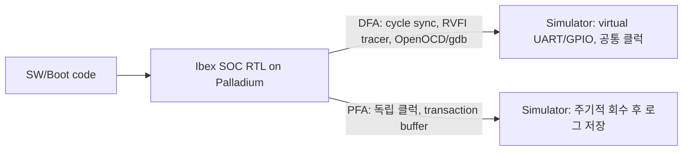

<!-- generated by yt-paper; edits will be overwritten -->

# Architectures to Tradeoff Performance vs. Debug for Software Development on Emulation Platform

[:material-open-in-new: 원문 보기](https://dvcon-proceedings.org/wp-content/uploads/TS1D-Architecture-to-tradeoff-Performance-vs-Debug-for-SW-Development-on-Emulation-Platform-paper.pdf){ .md-button .md-button--primary target=_blank }

> 같은 RTL을 공유하면서 디버그 중심(DFA)과 성능 중심(PFA) 에뮬레이션 아키텍처를 전환 가능하게 설계해, Palladium에서 CoreMark 기준 약 100배 속도 차이(26.9kHz vs 2.24MHz)를 확인한 논문.

| 항목 | 내용 |
|---|---|
| 저자/출처 | Loganath Ramachandran (Verikwest Systems Inc), Ragavender Swamisai (Belmont Computing), Makoto Ikeda (University of Tokyo) |
| 유형 | PAPER |
| 카테고리 | Emulation |
| ID | `ref-20261018-fd31` |

## 핵심 인사이트

- 에뮬레이션에서 성능과 디버그 가시성은 상충한다. 디버그는 TB와 DUT의 cycle-accurate lock-step 동기화가 필요하고, 고성능은 동기화를 최소화한 비동기 실행이 필요하다.
- DFA와 PFA가 동일 RTL과 합성 결과를 공유하므로, 한 모드에서 발견한 버그를 다른 모드에서 재현할 수 있고 유지보수 비용도 줄어든다.
- PFA는 DUT 전용 클럭, 하드웨어 transaction buffer(UART/GPIO 출력 캡처), 시뮬레이터 측 주기적 회수로 sync 횟수를 크게 줄인다. CoreMark 실행에서 tbsync가 900700회에서 29회로 감소했다.
- Virtual peripheral(UART, GPIO)로 Speedbridge 같은 물리 어댑터 없이도 로그 기반 사후 디버그가 가능하다.
- 운용 방침: 야간 regression은 PFA, 실패 분석은 DFA(RVFI tracer, OpenOCD/gdb)로 쓴다. 다만 비교는 단일 SOC와 단일 벤치마크 결과다.

## 상세 요약

### 배경 및 문제 정의
- SOC 프로젝트에서는 boot code, 보안 파라미터, 저수준 드라이버, 애플리케이션 같은 소프트웨어를 실리콘 이전에 개발해야 한다(shift-left).
- 후보 플랫폼의 특성은 다음과 같다.
  - RTL 시뮬레이션: 가시성은 완전하지만 kHz 속도다.
  - ISS(Spike 등): 빠르지만 SOC의 나머지 부분을 모른다.
  - Virtual Prototype: 빠르지만 모델 개발 비용이 크고 RTL 버그를 드러내지 못한다.
  - 에뮬레이션: RTL을 그대로 쓸 수 있고, signal-based, transaction-based, ICE 순으로 TB 상호작용이 줄어 빨라진다.
  - Hybrid(Arm fastmodel + RTL 합성): 부팅 성능은 좋아지지만 ICE 속도에는 못 미친다.
- 에뮬레이터는 최대 수 MHz까지 나오지만, 디버그가 필요하면 10~100kHz로 떨어진다. 순수 ICE는 Speedbridge 같은 어댑터가 필요하고 디버그가 어렵다.
- 목표는 필요할 때 디버그가 가능하면서도 최고 성능을 낼 수 있는, 전환 가능한(switchable) 구조다.

### 핵심 아키텍처 및 방법론
- 요구사항이 서로 반대다.
  - 디버그: DUT와 TB가 단일 클럭으로 lock-step 동기화되어야 하고, tracer와 debugger도 RTL과 동기화되어야 한다.
  - 성능: DUT가 독립적으로 실행되고 sync는 최소화해야 하며, tracer와 debugger는 불필요하다.
- 두 아키텍처는 동일한 RTL을 쓰고 코드를 최대한 공유한다. 그래서 버그 재현이 쉽고 합성 노력도 공유된다. 구현은 Cadence Palladium에서 했고, ixclkgen과 CAKE API 같은 고유 기능을 썼다.

- **DFA (Debug-Focused Architecture)**
  - SOC는 에뮬레이터에서 실행된다.
  - 시뮬레이터 측에는 virtual peripheral, gdb 연동 debugger 인터페이스, Ibex RVFI 기반 tracer(tracer.log), 클럭/리셋 생성기가 있다.
  - Signal-based acceleration을 쓰고, 파형 덤프도 가능하다.
  - Simulation control engine이 boot code 로드, signal force, end-of-test 감지를 맡는다.
- **PFA (Performance-Focused Architecture)**
  - 에뮬레이터 안에 SOC, qel 파일로 정의하는 클럭/리셋 생성 회로, UART/GPIO 출력을 캡처하는 transaction buffer가 들어간다.
  - 시뮬레이터 측에는 virtual GPIO/UART만 있고, 에뮬레이션 클럭과 별개의 독립 클럭으로 구동되며 버퍼를 주기적으로 읽는다.
- 비교 요약

| 항목 | DFA | PFA |
|---|---|---|
| 동기화 | cycle-accurate | transaction-accurate |
| 클럭 | TB와 DUT 공통 | TB와 DUT 분리 |
| 드라이버/모니터 | 소프트웨어 기반 | 하드웨어 transactor |
| 속도 | kHz | MHz |
| 디버그 | tracer, 대화형 디버그 | 사후(post-sim) 디버그 |

### 실험 결과 및 결론
- 대상은 Ibex 코어 기반 RISC-V SOC "Athos"다. SystemVerilog로 작성했고 TileLink main/peripheral 버스, UART, GPIO 등으로 구성된다.
- 소프트웨어는 HAL, runtime library, boot code, test harness, user code로 이뤄지며 모두 C로 작성했다. RISC-V toolchain으로 컴파일했고, 빌드는 사내 ProtoForge 엔진으로 했다.
- DFA는 RVFI tracer와 OpenOCD로 디버그를 구현했고, peripheral은 virtual I/O로 모델링했다.
- CoreMark 결과

| 아키텍처 | DUT 속도 | #Tbsyncs | HW Busy % |
|---|---|---|---|
| DFA | 26.92 kHz | 900700 | 1.04% |
| PFA (dumping 켬) | 2236.76 kHz | 29 | 86.82 |

- 속도 차이는 약 100배다(약 83배, 논문은 "close to 100x"로 표현). 본문은 DFA의 tbsync가 "300% 높다"고 쓰지만, 표의 값은 900700 대 29로 훨씬 큰 차이다.
- 결론: 야간 regression에는 PFA를, 실패 디버그에는 DFA를 쓰며, 두 모드는 쉽게 전환할 수 있다.
- 한계: 단일 SOC, 단일 벤치마크(CoreMark), 단일 에뮬레이터(Palladium)로만 검증했다. virtual peripheral은 성능에 영향을 주며, PFA에는 tracer가 없다.

## 관련 영상

<iframe src="https://www.youtube-nocookie.com/embed/Ge6veMYhti4" title="[DVCON2023_JPN]Architectures to Tradeoff Performance vs Debug Software Development on Emulation  " loading="lazy" allow="accelerometer; clipboard-write; encrypted-media; gyroscope; picture-in-picture; web-share" referrerpolicy="strict-origin-when-cross-origin" allowfullscreen></iframe>

**[DVCON2023_JPN]Architectures to Tradeoff Performance vs Debug Software Development on Emulation  ** — [YouTube에서 보기](https://www.youtube.com/watch?v=Ge6veMYhti4) · [영상 페이지](../../videos/Ge6veMYhti4.md)
