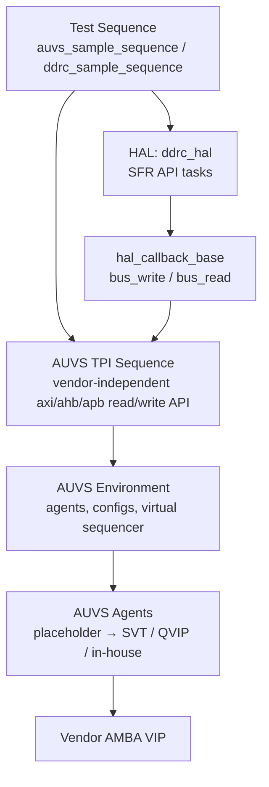

<!-- generated by yt-paper; edits will be overwritten -->

# PRACTICAL SCHEMES TO ENHANCE VERTICAL, HORIZONTAL AND PLATFORM REUSABILITY OF VERIFICATION COMPONENTS IN AMBA BASED SOC DESIGN

[:material-open-in-new: 원문 보기](https://dvcon-proceedings.org/wp-content/uploads/practical-schemes-to-enhance-vertical-horizontal-and-platform-reusability-of-verification-components-in-amba-based-soc-design.pdf){ .md-button .md-button--primary target=_blank }

> AMBA VIP을 벤더 독립적으로 감싸는 AUVS(사전 구성 UVM 플랫폼)와 HAL 콜백 기반 FLS(펌웨어형 시퀀스)를 결합해, 테스트벤치 구축 시간과 시퀀스의 platform/vertical/horizontal 재사용성을 높이는 방법을 제안한 논문.

| 항목 | 내용 |
|---|---|
| 저자/출처 | Ieryung Park, Nara Cho, Yonghee Im (SK Hynix, SoC IP&DV). 발표 학회/출처는 본문에 명시되어 있지 않음. 참고로 제공된 힌트의 저자명 "Laura Hyslop"은 본문에 나타나지 않음. |
| 유형 | PAPER |
| 카테고리 | Verification |
| ID | `ref-20261018-0299` |

## 핵심 인사이트

- AUVS는 AXI/AHB/APB 마스터·슬레이브 에이전트를 벤더 VIP별 조건부 컴파일(`ifdef)로 미리 구성하고, 인터페이스에 프로토콜 파라미터를 담아 UVM resource DB로 전달해 IP 단위 테스트벤치 구축 시간을 줄이는 구조임.
- TPI 시퀀스는 vendor-independent한 axi_write/ahb_read 같은 API 태스크를 제공해, VIP가 바뀌어도 테스트 시퀀스 코드를 수정하지 않도록 platform reusability를 확보함.
- FLS는 HAL의 API 태스크를 write_driver/read_driver(주소와 데이터만 사용)로만 작성하고, 실제 버스 동작은 uvm_callback의 bus_write/bus_read로 위임함. 그래서 SFR 포트가 AHB에서 AXI로 바뀌어도 콜백 구현만 교체하면 됨(vertical/horizontal 재사용).
- 논문은 정량적 실험 결과(시간 절감 수치, 벤치마크 비교)를 제시하지 않으며, 효과는 'dramatically reduce' 같은 정성적 주장에 머물러 있음. 실제 도입 시 효과는 별도 측정이 필요함.
- 본문 예제(Snippet 1~14)는 Synopsys SVT, Mentor QVIP, 사내 VIP를 `define으로 전환하는 구조를 보여주며, 이 방식은 컴파일 시 VIP 하나만 선택해 라이선스 낭비를 줄이는 것이 목적임.

## 상세 요약

### 배경 및 문제 정의

저자들은 검증 엔지니어링 시간 분석(문헌 [1] 인용)을 근거로 문제를 제기합니다. 테스트벤치 구축(22%)과 테스트 시나리오 코딩(23%)을 합한 준비 시간이 45%로, 디버깅(36%)보다 크다는 주장입니다. SystemVerilog와 UVM이 재사용 가능한 컴포넌트 기반을 제공하지만, 재사용성 자체를 보장하지는 않으며 엔지니어가 재사용을 염두에 두고 컴포넌트를 만들어야 한다고 지적합니다.

논문은 재사용성을 Vertical, Horizontal, Platform 세 가지로 나누고 세 가지 문제를 정의합니다.

- **Problem 1 (테스트벤치 구축):** IP 블록 수만큼 테스트벤치가 필요하며, 에이전트 생성/설정, 인터페이스 연결, 시퀀스 생성 등이 반복 작업임.
- **Problem 2 (Platform 재사용):** 라이선스, co-emulator 합성 가능성, 시뮬레이터 호환성, 사내 VIP 사용 등의 이유로 여러 벤더 AMBA VIP을 써야 하며, 이때 시퀀스를 VIP마다 다르게 작성해야 하는 문제임.
- **Problem 3 (Vertical/Horizontal 재사용):** IP 레벨에서 쓰던 AHB 드라이버 시퀀스를 AXI 기반 서브시스템 레벨에서 재사용할 수 없는 문제(vertical), 그리고 SFR 접근 포트가 AHB에서 AXI로 바뀌는 프로젝트 간 재사용 문제(horizontal)임.

### 핵심 아키텍처 및 방법론

논문은 두 가지 기법을 제안합니다. 하나는 Problem 1·2를 겨냥한 AUVS이고, 다른 하나는 Problem 3을 겨냥한 FLS입니다.

**AUVS (AMBA Unified Verification System)**
- **AUVS Interface:** 벤더 VIP 인터페이스(`svt_axi_master_if`, `mgc_axi`, 사내 `axi_vif`)를 `define으로 하나만 선택해 내장합니다. addr_width와 data_width 같은 프로토콜 파라미터는 인터페이스 안에 두고 기본값을 지정하며, 테스트벤치에서 외부 override가 가능합니다(Snippet 1, 7).
- **AUVS Harness:** `AUVS_AXI_MST_AGT_MAX` 같은 컴파일 옵션만큼 인터페이스 배열을 만들고, 각 virtual interface를 `uvm_config_db::set`으로 등록합니다(Snippet 2).
- **AUVS Environment:** build_phase에서 인터페이스를 `uvm_config_db::get`으로 가져와 에이전트와 config를 생성·설정하고, connect_phase에서 각 에이전트의 sequencer를 가상 시퀀서(`auvs_sequencer`)에 연결합니다(Snippet 5).
- **AUVS Agent:** 사용자가 고른 벤더 에이전트를 감싸는 placeholder입니다. 벤더별 `ifdef 분기로 에이전트를 생성하고 sequencer를 연결합니다(Snippet 6).
- **TPI (Test Programming Interface):** `uvm_sequence`를 상속하며 `axi_write`, `axi_read`, `ahb_write` 등의 태스크를 제공합니다. 태스크 내부에서 벤더별 sequence item을 생성·설정·발행하며, 테스트 시퀀스는 TPI API만 호출합니다. 시퀀스의 `pre_body()`에서 리소스 DB의 `auvs_seqr`를 가져와 연결하는 방식입니다(Snippet 3, 4, 8).

**FLS (Firmware-Like Sequence) with HAL**
- **hal_base:** 주소와 데이터만 받는 `write_driver()`와 `read_driver()`를 제공합니다. 두 태스크는 `uvm_do_callback`으로 콜백의 `bus_write()`/`bus_read()`를 호출합니다(Snippet 9).
- **hal_callback_base:** 버스 동작을 정의하는 virtual 태스크 집합입니다. 실제 프로토콜 구현은 파생 클래스에서 합니다(Snippet 10).
- **ddrc_hal:** DDR 컨트롤러의 API(`mr_write`, `set_address`, `set_ddrc_start`, `init` 등)를 `write_driver`/`read_driver`로만 구현하므로, 버스 프로토콜과 독립적입니다(Snippet 11).
- **ddrc_hal_callback:** AHB 기반으로 `bus_write`/`bus_read`를 구현합니다. AXI로 바꾸려면 이 콜백 태스크만 교체하면 됩니다(Snippet 12, 13). 논문은 RAL을 콜백 안에서 쓰는 방법도 언급합니다.
- **ddrc_sample_sequence:** `uvm_callbacks::add`로 콜백을 HAL 인스턴스에 연결한 뒤 `ddrc.init()`을 호출합니다(Snippet 14).

핵심 구조는 "HAL 위쪽은 프로토콜 독립, 아래쪽은 프로토콜 종속"입니다. AUVS는 VIP 교체에 대응하고, FLS는 SFR 포트 프로토콜 교체에 대응합니다. 두 기법을 함께 쓰면 세 가지 재사용성을 모두 얻을 수 있다는 것이 결론입니다.

### 실험 결과 및 결론

본문에는 정량적 실험 결과나 벤치마크 비교가 없습니다. 측정된 시간 절감률, 프로젝트 적용 사례, 공수 비교 데이터도 제시되지 않습니다. 따라서 "testbench build-up time을 dramatically 줄인다"거나 "재사용성을 모두 확보한다"는 내용은 저자의 정성적 주장이며, 검증된 수치로 볼 수 없습니다.

결론에서 저자들은 다음처럼 정리합니다.
- AUVS는 사전 구성된 AMBA 검증 플랫폼과 VIP 독립적 트랜잭션 생성 메커니즘을 제공해 Problem 1과 Problem 2를 해결합니다.
- FLS는 HAL과 콜백을 통해 SFR 포트 프로토콜이 바뀌어도 테스트 시퀀스를 재사용하게 해 Problem 3을 해결합니다.
- 두 기법을 함께 쓰면 엔지니어가 테스트 준비보다 실제 검증 작업에 더 집중할 수 있다고 봅니다.

본문에 나타난 제약도 함께 볼 필요가 있습니다. 예제 코드는 `ifdef 기반 벤더 전환과 UVM 구조를 보여주지만, QVIP와 사내 VIP의 세부 구현은 "// ..."으로 생략되어 있습니다. 또한 본문은 잘려 있지 않지만, 비교 대상 기법이나 한계에 대한 논의는 없습니다.

## 관련 영상

<iframe src="https://www.youtube-nocookie.com/embed/kdJTvnCGU0Q" title="[DVCON2017]PRACTICAL SCHEMES TO ENHANCE VERTICAL HORIZONTAL AND PLATFORM REUSABILITY OF VERIFICATION" loading="lazy" allow="accelerometer; clipboard-write; encrypted-media; gyroscope; picture-in-picture; web-share" referrerpolicy="strict-origin-when-cross-origin" allowfullscreen></iframe>

**[DVCON2017]PRACTICAL SCHEMES TO ENHANCE VERTICAL HORIZONTAL AND PLATFORM REUSABILITY OF VERIFICATION** — [YouTube에서 보기](https://www.youtube.com/watch?v=kdJTvnCGU0Q) · [영상 페이지](../../videos/kdJTvnCGU0Q.md)
