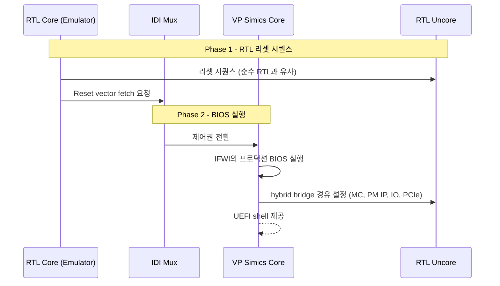

<!-- generated by yt-paper; edits will be overwritten -->

# Pre-Silicon Validation of Production BIOS, Software Use Cases and Accelerator IP Workloads using Hybrid System Level Emulation SoC Platform

[:material-open-in-new: 원문 보기](https://dvcon-proceedings.org/wp-content/uploads/Pre-Silicon-Validation-of-Production-BIOS-Software-Use-Cases-and-Accelerator-IP-Workloads-using-Hybrid-System-Level-Emulation-SoC-Platform.pdf){ .md-button .md-button--primary target=_blank }

> VP Simics 가상 플랫폼의 코어와 RTL 에뮬레이션 기반 Uncore를 IDI로 결합한 Hybrid SLE 플랫폼으로, 프로덕션 BIOS·OS·리셋·가속기 IP 워크로드를 실리콘 이전에 검증한 방법론.

| 항목 | 내용 |
|---|---|
| 저자/출처 | Neeraj Gupta, Reddaiah Yedoti, Dixit Sethi, Sarvesh Kumar Pandey (Intel Technology India Pvt Ltd, Verification and Validation) |
| 유형 | PAPER |
| 카테고리 | Verification |
| ID | `ref-20261018-05e4` |

## 핵심 인사이트

- 순수 RTL 에뮬레이션에서는 프로덕션 BIOS 부팅에 75시간 이상 걸리지만, Hybrid SLE에서는 약 45분으로 단축되었다고 보고되어 BIOS·OS 수준 검증이 현실적인 범위가 됨
- IDI Mux로 RTL 코어와 VP Simics 코어를 런타임에 전환하는 2단계 부팅 구조: Phase 1은 RTL 리셋 벡터 fetch까지, Phase 2는 VP Simics 코어가 IFWI의 프로덕션 BIOS를 실행하며 hybrid bridge를 통해 RTL Uncore(메모리 컨트롤러, PM IP, PCIe 등)에 실제 설정을 반영
- 합성(synthetic) BIOS 대신 프로덕션 BIOS와 fuse를 사용하므로 BIOS 코드 커버리지가 향상되고, SW가 유발하는 리셋·전원관리 이슈(글로벌 클록/리셋 문제)를 조기에 포착 가능
- SDK 기반 가속기 IP 워크로드(메모리 페이지 설정, DMA 구성, 결과 비교)를 통해 메모리·인터커넥트·IP 간 데이터/제어 경로를 SoC 수준에서 end-to-end로 검증
- 논문 결과로 약 15건의 버그가 발견되었고 그중 SW/BIOS 버그 9건은 순수 에뮬레이션·시뮬레이션에서 재현이 어렵다고 주장. 다만 정량 데이터는 부팅 시간 위주이며 버그 분류·재현 실험의 세부 수치는 제시되지 않음

## 상세 요약

### 배경 및 문제 정의

Pre-Silicon 검증에서 RTL 시뮬레이션/에뮬레이션은 주로 합성(synthetic) BIOS와 베어메탈 테스트에 의존한다. 합성 BIOS는 프로덕션 BIOS의 최소 버전이며, 이 환경에서는 프로덕션 BIOS, OS, 풀스택 드라이버, 5G·AI 같은 가속기 IP의 실제 워크로드 검증이 대부분 이루어지기 어렵다. 이런 SW 관련 버그가 Post-Silicon에서 발견되면 디버그 비용이 크고 실리콘 품질을 해칠 수 있으며, 재스핀(re-spin) 비용으로 이어질 수도 있다.

따라서 저자들은 SW 자산(프로덕션 BIOS, OS, FW, 드라이버, 프로덕션 fuse)과 SW 사용 시나리오(플랫폼 리셋, 전원관리, 코어·가속기 IP 워크로드)를 Pre-Si 단계에서 검증해 A0 PRQ(Production Release Qualification) 목표 달성과 Time to Market 단축을 노린다. 문서는 다음 여섯 가지 목표를 제시한다: (i) 가속 가능한 Hybrid SLE 플랫폼 구축, (ii) 프로덕션 BIOS·CentOS·fuse 검증, (iii) BIOS/OS 수준 SoC 리셋 시퀀스 검증, (iv) OS 수준 전원관리 흐름 검증, (v) SW 스택·드라이버 검증, (vi) 핵심 코어·가속기 IP 워크로드 검증.

### 핵심 아키텍처 및 방법론

Hybrid SLE 플랫폼은 두 부분을 결합한다.
- **VP Simics**: 공식 시스템 시뮬레이터로, Intel 코어 명령어 셋을 지원하며 BIOS·CentOS·SW 실행을 가속하는 역할
- **RTL Uncore (에뮬레이터 상)**: 나머지 SoC(Uncore) RTL을 에뮬레이터에 매핑

두 부분은 IDI(Intra Die Interconnect) 인터페이스에서 hybrid bridge와 IDI transactor(xtor)로 연결된다. hybrid bridge는 설정 가능한 매핑으로 VP Simics ↔ RTL 간 트랜잭션을 라우팅하고, IDI Mux는 런타임에 RTL 코어와 VP Simics 코어를 전환한다.

**부팅 흐름 (2단계)**
- Phase 1: VP Simics, hybrid bridge, IDI Mux가 테스트벤치에 의해 구성되고, RTL 코어가 활성 상태에서 순수 RTL 에뮬레이션과 유사하게 리셋을 수행한다. RTL 코어가 리셋 벡터 fetch를 시작하면 IDI Mux가 이를 감지해 Phase 2를 트리거한다.
- Phase 2: IDI Mux가 제어권을 VP Simics 코어로 넘기고, 공식 릴리스 IFWI(Integrated Firmware Image)에서 프로덕션 BIOS를 로드해 실행한다. BIOS/FW의 설정은 hybrid bridge를 통해 RTL Uncore(메모리 컨트롤러, Power Management IP, IO 포트, PCIe 장치)에 반영되므로 실리콘에서의 구성과 가깝게 재현된다. BIOS 실행이 끝나면 사용자는 UEFI shell을 통해 리셋 등 플랫폼 검증을 수행한다.

**CentOS 부팅**: BIOS 이후 VP Simics 코어가 CentOS 이미지를 부팅하고, Linux 커널 로드, 메모리 자원·네트워크·SoC에 연결된 RTL 주변장치 설정을 거쳐 Linux shell을 제공한다.

**플랫폼 리셋**: 리셋 요청이 발생하면 프로덕션 BIOS가 시스템 리셋 흐름을 수행하며, 선택에 따라 warm 또는 cold reboot가 발생한다. UEFI shell과 Linux shell 양쪽에서 검증이 완료되었다고 보고된다.

**가속기 IP 워크로드 실행 흐름** (Fig. 3):
1. CentOS 부팅 후 SDK를 활성화해 RTL의 메모리·가속기 IP를 대상으로 SW 애플리케이션을 생성·컴파일·실행
2. SW가 메모리 페이지를 구성하고 데이터를 기록
3. 가속기 IP를 DMA 전송 및 동작 모드로 설정
4. IP가 메모리에서 DMA read 수행
5. IP가 처리 후 결과를 메모리에 write
6. IP가 SW에 완료 acknowledgment 전송
7. SW가 메모리 출력과 기대값을 비교하고, 일치하면 워크로드 성공

이 흐름은 IP–메모리 간 데이터 경로와 코어–IP 간 제어 경로를 SoC 수준에서 함께 자극한다.

### 실험 결과 및 결론

**버그 발견**: Hybrid SLE 플랫폼으로 RTL, BIOS, VP Simics, 검증 환경에 걸쳐 약 15건의 버그를 발견했다고 보고한다. 이 중 SW/BIOS 버그 9건은 가속이 부족한 순수 에뮬레이션·시뮬레이션이나 제한된 기능의 합성 BIOS에서는 재현이 어렵다고 주장한다. 다만 문서에는 각 버그의 세부 분류나 재현 실험 데이터는 나타나지 않는다.

**부팅 시간 (Table I)**

| 항목 | Hybrid SLE | Pure Emulation | Pure Simulation |
|---|---|---|---|
| 프로덕션 BIOS 부팅 | 약 45분 | 75시간 이상 | 불가 |
| OS 부팅 | 약 60분 | 불가 | 불가 |

논문은 이를 근거로 "pure emulation 대비 약 100x 가속"이라고 기술한다(시간 비율로 보면 75시간 대비 45분은 100배 이상이므로, 문서 기재 그대로 인용한다).

**주요 기여 (정성적 효과)**
- Left shift: OS 부팅이 Post-Si에서 Pre-Si로 앞당겨짐
- Test coverage: BIOS 실행 시간이 줄어 SW 팀이 드라이버와 end-to-end 시나리오를 폭넓게 검증 가능
- BIOS coverage: 합성 BIOS 대비 프로덕션 BIOS 실행으로 코드 커버리지 향상
- Crucial use cases: SW 주도 리셋 흐름으로 글로벌 클록, 리셋, 전원관리 이슈 검출

**결론 및 향후 과제**: 제안 방법론은 SW 자산과 SW 사용 시나리오의 빠른 실행을 제공하며, Tape-Out 이전에 RTL·SW 버그 수정을 반영할 수 있게 한다. 향후 과제로 SPEC 벤치마크를 통한 코어 성능 검증과, SW 애플리케이션 기반 전원관리 흐름 검증이 제시되어 있다.

**한계 (문서 기준)**: 본 문서는 짧은 발표형 논문으로, 버그 수의 세부 분류, 워크로드별 성능 수치, 시뮬레이션 정확도/동기화 오버헤드에 대한 정량 데이터는 포함하지 않는다. 또한 본문 Table I의 "Pure Simulation" 열은 OS 부팅 항목 등에서 'Not feasible'로만 표기되어 있다.

## 관련 영상

<iframe src="https://www.youtube-nocookie.com/embed/cslJpCPj7GU" title="[DVCON2022]Pre-Silicon Validation of Production BIOS, Software Use Cases and Accelerator IP...Hybrid" loading="lazy" allow="accelerometer; clipboard-write; encrypted-media; gyroscope; picture-in-picture; web-share" referrerpolicy="strict-origin-when-cross-origin" allowfullscreen></iframe>

**[DVCON2022]Pre-Silicon Validation of Production BIOS, Software Use Cases and Accelerator IP...Hybrid** — [YouTube에서 보기](https://www.youtube.com/watch?v=cslJpCPj7GU) · [영상 페이지](../../videos/cslJpCPj7GU.md)
