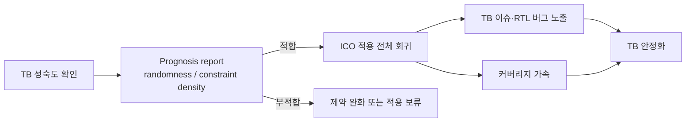

<!-- generated by yt-paper; edits will be overwritten -->

# Accelerating Functional Verification Through Stabilization of Testbench Using AI/ML

[:material-open-in-new: 원문 보기](https://dvcon-proceedings.org/wp-content/uploads/1137-Accelerating-Functional-Verification-through-Stabilization-of-Testbench-Using-AIML.pdf){ .md-button .md-button--primary target=_blank }

> Synopsys VCS의 AI/ML 기반 Intelligent Coverage Optimization(ICO)을 개발 초기에 도입해 제약 랜덤 테스트벤치의 issue를 조기에 노출시키고, 3개 GPU 프로젝트에서 회귀 횟수·수작업·grid 자원을 절감한 사례 보고.

| 항목 | 내용 |
|---|---|
| 저자/출처 | Srikanth Vadanaparthi, Pooja Ganesh, Dharmesh Mahay, Malay Ganai (Qualcomm / Synopsys) — 원문에 학회명 표기 없음 |
| 유형 | PAPER |
| 카테고리 | Verification |
| ID | `ref-20261018-0879` |

## 핵심 인사이트

- 테스트벤치 안정화(maturity)를 late stage가 아닌 early stage에 가속하는 것이 핵심 메시지이며, 제약 불일치·UVM driver 이슈·scoreboard 이슈 등 'stable'로 간주된 TB에서도 추가 문제가 드러났다고 보고함
- ICO 적용 전 prognosis report로 TB의 randomness(variable/value randomness)와 constraint density를 측정해 적합성을 판단하는 절차를 둠. 제약이 느슨할수록 AI/ML이 바이어스를 조정할 여지가 큼
- Project A(L2 Cache)에서 95% functional coverage 도달에 10회 → 6회 회귀(40% 감소), Project C(Render Block)에서 자원 10–15% 절감 등 정량 수치가 제시됨. 다만 샘플 수가 적고 비교 조건(스크립트 실행 방식 차이 등)이 완전히 통제되지 않았다는 점을 함께 고려해야 함
- Shannon entropy 기반 diversity 지표를 stimuli 품질의 proxy로 사용해 회귀 간 진행을 추적하는 방식은 재사용 가능한 관점임
- 기능 커버리지 모델을 수정하지 않고도 적용 가능하다는 점이 장점으로 제시되지만, 실제로는 제약 불일치나 TB 버그를 찾아 고치는 추가 디버깅 비용이 발생함을 고려해야 함

## 상세 요약

### 배경 및 문제 정의

제약 랜덤 테스트벤치(Constrained Random Testbench)는 기능 검증 sign-off의 핵심이지만, 자극(stimulus) 제약을 미세 조정하는 작업은 어렵고 노동집약적이며 위험이 큽니다. 본문은 테스트벤치 문제의 주요 원인으로 구현된 제약 자극 공간과 의도한 자극 공간 간의 불일치를 꼽으며, 다음과 같은 증상을 열거합니다.

- 불법(illegal) 자극, 누락된(missing) 자극, over/under bias
- 제약 과도/부족(over/under-constraining)
- 커버리지 명세 변화, 제약 분포에 대한 가시성 부족

저자들은 GPU 아키텍처의 높은 병렬성 때문에 복잡한 로직의 corner case를 찾고 code/functional coverage를 기한 내에 닫는 것이 어렵다고 설명합니다. 또한 버그를 세 가지 유형으로 분류합니다.

1. Easy-to-find 버그: 입력을 체계적으로 sweep하면 발견되는 버그
2. Corner/hard-to-hit 버그: 복잡한 로직, 긴 액션 시퀀스가 필요한 조건, 드물게 발생하는 시나리오
3. Dead 버그: RTL 깊숙이 숨어 있어 수개월의 회귀가 필요한 버그

이 문제를 해결하기 위해 팀은 (a) corner case RTL/TB/제약 이슈의 shift-left, (b) 커버리지 자동 가속, (c) 수작업 directed test 감소, (d) 기능 커버리지 모델 재작성 불필요라는 기준을 세웠습니다.

### 핵심 아키텍처 및 방법론

핵심 기술은 Synopsys VCS의 **Intelligent Coverage Optimization(ICO)**입니다. ICO는 기능 커버리지 모델을 수정하지 않고 constraint stimuli 공간 내에서 자극을 다양화하여 자극 품질을 높입니다.

적용 절차는 다음과 같이 정리할 수 있습니다.

- **적합성 판단**: prognosis report로 variable randomness, value randomness(%), constraint density(변수당 평균 제약 수)를 측정합니다. directed 성격이 강한 제약은 자유도가 낮아 바이어스 여지가 작습니다.
- **다양도 지표**: 값 다양성은 Shannon entropy [4]를 최대 가능 다양성으로 나눈 백분율로 계산하며, 제약 tightness에 의해 상한이 제한된다고 설명합니다.
- **적용 시점**: 프로젝트 초기부터 적용하여 TB 이슈를 조기에 드러내는 것을 목표로 합니다.

### 실험 결과 및 결론

**Project A (L2 Cache, graphics IP)**
- TB pass rate 98% 이상, code/functional coverage 약 95% 상태의 "안정" TB에 late stage에 ICO 적용
- 기본 대비 TB 이슈 약 30% 추가 노출: 제약 불일치, UVM driver 관련 design SVA 실패, scoreboard checker 이슈, deadlock
- 95% functional coverage 도달 회귀 횟수: 10회 → 6회 (본문 기준 40% 단축, 4회 절감)
- 고정 회귀에서 TB 에러 수 비교 (Figure 1): 기본 합계 273, AI/ML 합계 360. 제약 불일치는 89 → 0, scoreboard mismatch는 7 → 0으로 표기됨

**Project B (Modified L2 Cache, 시간 제약 프로젝트)**
- week 6에 ICO 도입. 도입 후 week 6–9에 testbench/RTL 버그를 빠르게 노출 (Table 1)
- 예: Week 6 TB 버그 18, RTL 버그 6 (AI/ML 적용); 무적용 Week 1–5는 TB 버그 7–13, RTL 버그 1–3
- 90% 초과 coverage 구간에서 functional coverage shift-left 약 30%, 6–7회 vs 10회
- Grid 자원: 기본 198K time units vs AI/ML 162K time units (약 18% 절감). 본문은 기본 회귀는 자동 스크립트, AI/ML 회귀는 여러 사용자의 ad-hoc 스크립트로 실행되어 비교 조건이 완벽히 동일하지 않음을 명시

**Project C (Render Block, 블렌딩/컬러/깊이 연산)**
- 약 350K coverage bin 규모. 기존에는 마지막 200–500 bin을 채우기 위해 제약 튜닝, directed test, delay profile 체이닝 등 1주 이상의 수작업 필요
- Table 2 기준 total bins 347,984 → 349,661 (+1,677), code line 88,064 → 89,231 (+1,167), branch +3,043, condition +2,183
- 기능 커버리지 closure 1.5주 단축. 수작업은 100 bin 미만 수준으로 감소
- 병렬 setup에서 동일 블록 기준 자원 10–15% 절감 주장 (본문 결론부에서는 15%로 표기)

**결론**
- 세 프로젝트 모두에서 "수 주(several weeks)" 수준의 shift-left를 보고하며, 약 2주 분량의 수작업 절감을 주장
- 제약 과/부족으로 인한 hard-to-hit TB 버그를 조기 발견·수정하여 회귀 크기 축소, 중복 테스트 제거, 커버리지 hole 감소 효과를 기대
- 기능 커버리지 모델 수정 없이 달성했다고 강조

**검토 시 유의점**: 실험은 3개 프로젝트 사례 보고 형식이며 반복 실험 통계, 신뢰 구간, 통제된 A/B 설정 상세가 제시되지 않았습니다. 수치 간 일부 불일치(예: 본문 15% vs 10–15% 범위, Figure 1 회귀 횟수 표기)도 있어 절대적 수치보다 경향으로 해석하는 것이 적절합니다. 또한 원문 일부 그림과 표 세부 내용은 텍스트만으로 완전히 확인되지 않습니다.

## 관련 영상

<iframe src="https://www.youtube-nocookie.com/embed/H947nXpp4No" title="[DVCON2023]Accelerating Functional Verification Through Stabilization of Testbench Using AI/ML" loading="lazy" allow="accelerometer; clipboard-write; encrypted-media; gyroscope; picture-in-picture; web-share" referrerpolicy="strict-origin-when-cross-origin" allowfullscreen></iframe>

**[DVCON2023]Accelerating Functional Verification Through Stabilization of Testbench Using AI/ML** — [YouTube에서 보기](https://www.youtube.com/watch?v=H947nXpp4No) · [영상 페이지](../../videos/H947nXpp4No.md)
