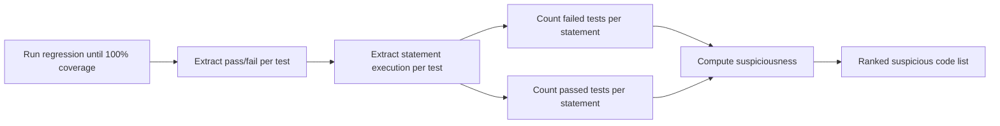

<!-- generated by yt-paper; edits will be overwritten -->

# New Trends in RTL Verification: Bug Localization, Scan-Chain-Based Methodology, GA-Based Test Generation

[:material-open-in-new: 원문 보기](https://dvcon-proceedings.org/wp-content/uploads/new-trends-in-rtl-verification-bug-localization-scan-chain-based-methodology-ga-based-test-generation.pdf){ .md-button .md-button--primary target=_blank }

> 회귀 테스트의 pass/fail 및 문장 실행 정보로 RTL 버그 후보 문장을 순위화하고, 런타임 scan-chain으로 emulation 디버그를 가속하며, GA 피드백으로 커버리지 closure를 빠르게 달성하는 세 가지 RTL 검증 기법을 제안한 논문.

| 항목 | 내용 |
|---|---|
| 저자/출처 | Khaled Salah (Mentor Graphics, Cairo, Egypt) — 원문 표기: Khaled Salah / 힌트 저자명 "Mohamed, Khaled"와 달리 문서 상 저자는 Khaled Salah. 학회명은 문서에 명시되지 않음 |
| 유형 | PAPER |
| 카테고리 | Verification |
| ID | `ref-20261018-0c62` |

## 핵심 인사이트

- 버그 위치 추정을 소프트웨어 fault localization(Tarantula, Wong 등)의 coverage 기반 휴리스틱을 RTL에 적용한 것으로, assertion 기반 formal 방법보다 대형 설계에 적용하기 쉬운 시뮬레이션 기반 접근이라는 점이 핵심 주장이다.
- 의심도 계산식이 'failed tests / successful tests' 형태로 제시되어 있으나 Table I의 수치와 일관되지 않는 부분이 있다(예: 실패 테스트 수 4를 성공 테스트 수 6으로 나눈 값이 0.67로 표기되어 있으나 Suspicious 행은 -2 등 다른 값). 재현 시 공식 정의를 명확히 확인해야 한다.
- Scan-chain 방식은 모든 reg에 mux와 glue logic을 자동 삽입해 재컴파일 없이 신호 값을 강제(forcing)할 수 있게 하지만, 논문은 면적 오버헤드가 '무시할 만하다'고만 주장하고 정량 수치는 제시하지 않는다.
- GA 기반 테스트 생성은 커버리지 리포트를 fitness로 삼아 coverage hole을 겨냥하는 피드백 루프이며, 표 III에서 random 대비 stimulus 수와 런타임 감소를 보고하나, 설계 수·시나리오 정의·비교 대상의 세부 설정이 부족해 일반화 근거는 제한적이다.
- 보고된 수치(예: 버그 위치 추정 100% 성공률, 수천 라인 설계에서 수 분 소요)는 소수의 사례 기반이며 벤치마크·재현 데이터가 명시되지 않아 실무 적용 전 독립 검증이 필요하다.

## 상세 요약

### 배경 및 문제 정의

- 복잡한 SoC의 기능 검증 비용이 급증하고 있으며, 문서는 ITRS 인용을 통해 검증이 설계 비용의 최대 70%를 차지한다고 언급한다.
- 기존 연구는 주로 gate-level 오류 위치 추정에 집중되어 있고 소규모 설계에 적용되어 왔다. 본 논문은 RTL 수준 및 대형 설계를 대상으로 한다.
- 시뮬레이션 가속 측면에서 RTL 하드웨어 가속기와 FPGA 기반 에뮬레이션이 쓰이지만, 에뮬레이터는 런타임 디버깅 기능이 부족하다.
- CRT(constraint random testing)는 커버리지 리포트를 사람이 분석해 미커버 시나리오를 찾고 제약을 수정해야 하는 수작업 병목이 있다.

세 가지 문제를 다룬다: (1) RTL 버그 위치 추정, (2) 에뮬레이션 디버깅을 위한 온라인 scan-chain 방법론, (3) 커버리지 피드백 기반 GA 테스트 생성.

### 핵심 아키텍처 및 방법론

**1. Coverage 기반 RTL 버그 위치 추정**

회귀 테스트 결과(pass/fail)와 각 테스트가 실행한 문장 정보를 입력으로 사용한다. 논문의 의심도 정의는 다음과 같이 서술된다.

$$\text{suspiciousness}(s) = \frac{\#\{\text{failed tests executing } s\}}{\#\{\text{successful tests}\}}$$

가장 큰 값부터 검사한다. 단일 버그 가정 하에 10개 테스트 예제(Table I)를 제시하지만, 문서의 Table I 수치는 위 식과 정확히 맞지 않는 항목이 보이므로 식 정의는 원문 그대로 인용해 해석해야 한다. 흐름은 회귀 실행 → 문장 실행 정보 추출 → pass/fail별 집계 → 의심도 계산 → 순위 생성의 7단계(Fig. 1)다.

**2. 온라인 RTL scan-chain 방법론**

모든 `reg` 정의에 대해 유틸리티 툴이 glue logic과 mux를 자동 삽입한다. glue logic은 입력을 출력으로 그대로 전달하는 null connection이며, `Enable_Scan` 신호로 mux를 통해 런타임 강제 값(예: `C_RUNTIME`)을 넣을 수 있다. 예시로 `out <= (A+B) * C`에서 C를 바꾸려면 기존 흐름은 전체 재컴파일이 필요하지만, 제안 방식은 재컴파일 없이 값을 변경한다. 면적 오버헤드는 무시할 만하다고 주장하나 정량 수치는 제시되지 않았다. 대신 설계 컴파일 시간이 늘어난다고 명시한다.

**3. GA 기반 테스트 생성**

GA의 표준 단계(초기화·인코딩, 적합도 평가, 선택, 교차, 돌연변이, 세대 교체, 종료)를 사용한다. 커버리지 결과를 GA에 입력하고, 적합도 함수는 다음과 같이 정의된다.

$$\text{Fitness} = \text{Functional Coverage ratio}$$

피드백 루프는 시뮬레이션 → 커버리지 수집 → GA 적합도 할당 → 다음 자극 생성의 순환이다. 파라미터는 세대 수 200, 개체군 크기 50, 다중점(multi-point) 교차로 제시된다.

### 실험 결과 및 결론

**버그 위치 추정 (Table II)**: 5,000라인 이상 복잡 설계에 삽입한 29개 버그를 대상으로, 제안 방법의 소요 시간은 대략 1~10분, 수작업 디버그는 1~3시간으로 보고된다. 성공률 100%를 주장하나, 실험 설정(테스트 품질 가정, 샘플 규모)에 대한 상세 설명은 부족하다. 저자는 "rich and correct testcases"를 전제로 한다고 명시한다.

**Scan-chain**: 면적 오버헤드는 "neglected"라고만 서술되며 정량 결과가 없다. 컴파일 시간 증가가 단점으로 남는다.

**GA 테스트 생성 (Table III)**: 12개 설계에 대해 100% 커버리지 도달까지의 stimulus 수와 런타임을 random 대비 비교한다. 예를 들어 설계 #1은 random 120 stimulus/2초 대비 GA 100 stimulus/2초 수준이며, 여러 설계에서 stimulus 수가 약 10~30% 감소한 것으로 보인다. 다만 "# Scenarios" 열의 의미와 설계 규모가 명확하지 않고, 통계적 반복 실험 정보가 없다.

**결론**: 세 기법 모두 디버그 및 커버리지 closure 시간 단축을 목표로 하며, 특히 버그 위치 추정과 GA 피드백은 실험 수치로 효과를 주장한다. 정량 근거의 범위(벤치마크 규모, 반복성, 재현 가능성)는 제한적이므로 실무 적용 전 독립 검증이 필요하다.

## 관련 영상

<iframe src="https://www.youtube-nocookie.com/embed/NCZGtajDsYc" title="[DVCON2015]New Trends in RTL Verification Bug Localization, Scan Chain Methodology, GA Test Gen" loading="lazy" allow="accelerometer; clipboard-write; encrypted-media; gyroscope; picture-in-picture; web-share" referrerpolicy="strict-origin-when-cross-origin" allowfullscreen></iframe>

**[DVCON2015]New Trends in RTL Verification Bug Localization, Scan Chain Methodology, GA Test Gen** — [YouTube에서 보기](https://www.youtube.com/watch?v=NCZGtajDsYc) · [영상 페이지](../../videos/NCZGtajDsYc.md)
