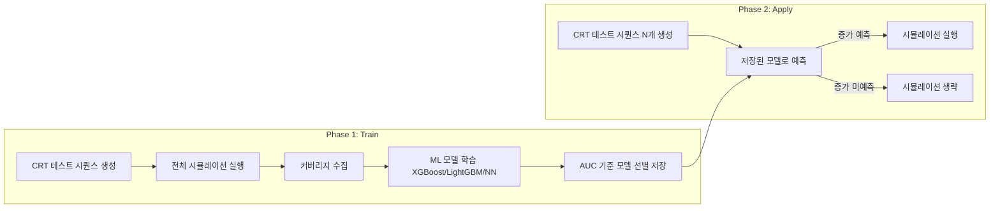

<!-- generated by yt-paper; edits will be overwritten -->

# Accelerating Pre-Silicon Verification Coverage with Transaction Sequence Modeling

[:material-open-in-new: 원문 보기](https://dvcon-proceedings.org/wp-content/uploads/1083-2.pdf){ .md-button .md-button--primary target=_blank }

> UVM 트랜잭션 시퀀스로 코드/기능 커버리지 적중 여부를 예측하는 ML 모델을 학습해, 커버리지 증가가 예상되지 않는 시뮬레이션을 생략하는 방식으로 Lock DUT에서 약 18배 가속을 보고한 논문.

| 항목 | 내용 |
|---|---|
| 저자/출처 | Jayanth Raman, Jackson Wydra, Ximin Shan, Rahul Krishnamurthy, Michael Yan, Phyllis Hsia, Vikram Narayan, Samir Mittal (Micron, Inc.) |
| 유형 | PAPER |
| 카테고리 | Verification |
| ID | `ref-20261018-133d` |

## 핵심 인사이트

- 시뮬레이션 전 단계에서 트랜잭션 시퀀스만 보고 커버리지 적중 여부를 예측해 시뮬레이션을 필터링하므로, 시뮬레이션 비용이 큰 환경에서 머신 타임을 직접 절감할 수 있다.
- 학습 데이터는 기존 CRT 실행에서 자연스럽게 얻어지므로(시퀀스 + 커버리지 라벨) 별도 데이터 생성 비용이 상대적으로 작다.
- Lock DUT(8비트, 시퀀스 길이 8) 결과는 random 대비 약 18배(366K → 20K 시뮬레이션) 가속이지만, 합성에 가까운 단순 벤치마크이며 라인 하나에 대한 결과다.
- Cache DUT에서는 라인별 AUC 분포가 넓어(0.5 근처~1.0) 모델링 가능한 항목이 일부에 불과했고, 기능 커버리지 bin은 약 28%만 높은 예측 성능을 보였다. 모든 커버리지 항목에 일반화되지 않는다는 한계가 있다.
- AUC 임계값은 시뮬레이션 절감과 희귀 커버리지 누락 사이의 트레이드오프이므로, 적용 DUT마다 임계값과 샘플 선택 전략(top-K, diversity 등)을 튜닝해야 한다.

## 상세 요약

### 배경 및 문제 정의

디지털 IC 검증에서 시뮬레이션 기반 검증(CRT, Constrained Random Testing)은 시간과 엔지니어링 자원을 많이 소모한다. 산업용 설계에서 전수 커버리지 달성은 대개 불가능하므로, 커버리지를 늘릴 가능성이 높은 테스트만 선별해 실행하는 것이 중요하다. 본 논문은 UVM 트랜잭션 시퀀스가 시뮬레이션 실행 전에 이미 생성된다는 점에 착안해, 시퀀스만으로 커버리지 증가 여부를 예측하고 가능성이 낮은 시뮬레이션을 생략하는 방법을 제안한다.

### 핵심 아키텍처 및 방법론

방법은 두 단계로 구성된다.

- **입력 표현**: 쓰기(write)와 읽기(read) 시퀀스를 타임스탬프 기준으로 병합한다. 정수 필드는 비트 단위 이진 벡터로, 범주형 필드는 indicator 변수로 변환해 수평으로 이어 붙인다. 쓰기/읽기 구분 열을 추가한 뒤 행 단위로 평탄화(1D 벡터)해 샘플 하나를 만든다. 필드 선택은 분산(variance) 임계값(예: 80%) 기준이다.
- **라벨**: 특정 라인 또는 cover bin의 적중 여부(0/1)이며, 분류(classification) 문제로 정의한다.
- **모델 선택**: XGBoost, LightGBM, 신경망 등을 학습하고 AUC 등 기준을 넘는 모델만 보존한다. 임계값은 "시뮬레이션 횟수 대 희귀 커버리지 누락 위험"의 트레이드오프로 조정된다.
- **Phase 2 적용**: 예산 K회 시뮬레이션을 가정하고 N(N ≫ K)개 시퀀스를 생성·예측한 뒤, 다음 전략 중 하나로 K개를 선택한다. (a) 예측 총 커버리지 상위 K, (b) 하위 K, (c) a와 b 조합, (d) 미커버 항목 실행 경로 포함 여부 기반, (e) Hamming distance 기반 다양성 최대화. 본문은 전략 선택이 DUT에 따라 달라진다고 설명한다.
- **모델링 대상 선정**: 10%~90% 테스트에서 커버되는 라인/빈만 모델링한다. 거의 커버되지 않는 항목은 학습 데이터가 부족하고, 대부분 커버되는 항목은 의미가 없기 때문이다.

### 실험 결과 및 결론

**Lock DUT (RTL 잠금 장치)**
- 8비트 코드, 최대 트랜잭션 8개. s3 상태는 0xaa → 0xbb → 0xcc 순서 패턴을 요구한다. 무작위 생성 시 확률은 최대 트랜잭션 3개에서 약 1/16.8M, 4개에서 약 1/5.8M으로 제시된다.
- XGBoost를 무작위 생성 10K 시퀀스(70/30 분할)로 학습해 s1 상태 라인 적중을 예측했다.
- 무작위 시뮬레이션 평균 약 366K회가 필요했으나 제안 방법은 평균 약 20K회로 **약 18배 가속**을 보고했다 (Fig. 4).

**Cache DUT (Micron 내부 Verilog RTL, 세부 비공개)**
- Table I (라인 커버리지): 모듈별로 모델을 학습했으며, 모듈 평균 최고 AUC는 0.50~1.00 범위로 분포가 넓다. 예: Module 10~14는 평균 AUC 1.00, Module 6~9는 평균 0.56~0.75이며 편차가 크다.
- Table II (기능 커버리지): 7개 covergroup의 cover bin별 모델 AUC를 평균/최소/최대로 제시한다. 일부 covergroup(예: Covergroup 3, 5)은 최대 AUC 1.00이지만, 다수는 평균 AUC가 0.5 근처다.
- 기능 커버리지 bin의 약 28%만 높은 예측 성능을 보였고, 해당 bin들만 다음 단계에 사용되었다.
- 최고 모델은 대부분 XGBoost 또는 LightGBM이었다. DummyClassifier는 AUC 약 0.5로 기준선 역할을 했다.

**결론**
- 트랜잭션 시퀀스를 입력으로 한 ML 모델이 코드/기능 커버리지를 예측할 수 있음을 보였다.
- Lock DUT에서는 시뮬레이션 선택 적용으로 약 18배 가속을 확인했다.
- Cache DUT에서는 예측 가능한 항목이 일부에 한정되었고, 본문은 Cache DUT의 정량적 가속 수치를 제시하지 않는다(초록은 "coverage acceleration for one of the DUTs"라고만 언급). 따라서 Cache DUT에서의 실제 절감 효과는 본 문서로 확인할 수 없다.
- 검증 대상 설계, 테스트 분포, 임계값에 따라 결과가 크게 달라질 수 있으므로 적용 시 DUT별 검증이 필요하다.

## 관련 영상

<iframe src="https://www.youtube-nocookie.com/embed/2on_n4tNWvg" title="[DVCON2025]Accelerating Pre-Silicon Verification Coverage with Transaction Sequence Modeling" loading="lazy" allow="accelerometer; clipboard-write; encrypted-media; gyroscope; picture-in-picture; web-share" referrerpolicy="strict-origin-when-cross-origin" allowfullscreen></iframe>

**[DVCON2025]Accelerating Pre-Silicon Verification Coverage with Transaction Sequence Modeling** — [YouTube에서 보기](https://www.youtube.com/watch?v=2on_n4tNWvg) · [영상 페이지](../../videos/2on_n4tNWvg.md)
