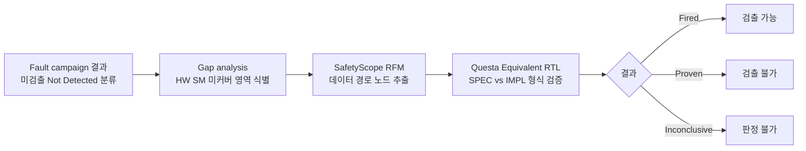

<!-- generated by yt-paper; edits will be overwritten -->

# Static Structural Analysis and Formal Verification of SoC with Software Safety Mechanisms for Functional Safety

[:material-open-in-new: 원문 보기](https://dvcon-proceedings.org/wp-content/uploads/1046.pdf){ .md-button .md-button--primary target=_blank }

> 대규모 SoC의 fault campaign에서 시뮬레이션으로 증명하기 어려운 미검출 고장을, 구조 분석(SafetyScope RFM)으로 데이터 경로를 좁히고 Questa Equivalent RTL 형식 검증으로 software SM의 커버리지를 증명해 NOC 진단 커버리지를 89.21%에서 93.62%로 끌어올린 사례 연구.

| 항목 | 내용 |
|---|---|
| 저자/출처 | Hyunsun Ahn, Euisang Yoon, Namyul Cho, Arun Gogineni, Ann Keffer, Sungjin Park, Sungyun Yoo, Bumju Kim, Junhyuk Park, Youngsik Kim, Seonil Brian Choi (Samsung Electronics / Siemens EDA). 학회명은 문서에 명시되지 않음. 제공된 힌트의 저자 'Laura Leblanc'는 본문에서 확인되지 않음. |
| 유형 | PAPER |
| 카테고리 | Verification |
| ID | `ref-20261018-1733` |

## 핵심 인사이트

- 형식 검증을 전체 설계가 아닌 구조 분석으로 축소된 데이터 경로(reduced space)에만 적용한 것이 핵심이다. 이 덕분에 소프트웨어 스택 준비 전에도 SM의 커버리지 근거를 미리 확보할 수 있다.
- fault 주입은 cut-point를 0/1로 구동하는 SPEC vs IMPL 동치성 검사로 구현된다. 결과는 Fired(검출 가능), Proven(검출 불가), Inconclusive(판정 불가)로 나뉘며, Inconclusive는 DC에 포함할 수 없으므로 해석에 주의가 필요하다.
- ADDRESS 경로 고장은 Fired가 나오기 어렵고, VALID/READY 같은 핸드셰이크 신호 고장은 Fired여도 실제 트랜잭션 차이로 검출 불가능할 수 있다는 한계를 저자가 명시했다. 제약(AXI VIP, 미사용 포트 상수 처리, CDC 클럭/리셋 설정)이 결과 정확도와 런타임에 직접 영향을 준다.
- 본 사례의 진단 커버리지 상승분(89.21%→93.62%, 약 4.41%p) 중 상당 부분은 엔지니어 판단(Judgement)에 기반한다. 형식 검증이 증명한 부분만 따로 보면 판단 결과와 구분해 보고하는 것이 감사(ISO 26262 인증) 관점에서 중요하다.
- 저자들은 static/dynamic 분석 결과와 판단 결과를 단일 데이터베이스에서 자동화하는 방향을 제시한다. 실제 적용 시 fault 분류, 판단 근거, 형식 검증 결과를 추적 가능하게 묶는 인프라가 필요하다.

## 상세 요약

### 배경 및 문제 정의

자동차용 SoC는 ISO 26262에 따라 진단 커버리지(Diagnostic Coverage, DC) 목표를 달성해야 하며, 이를 위해 하드웨어 SM과 함께 소프트웨어 SM(STL 기반)이 사용된다. 그러나 대규모 SoC에서 fault campaign은 복잡하고 시간이 많이 드는 작업이다. 특히 소프트웨어 SM을 검증하려면 입력 자극(stimulus)과 소프트웨어 스택이 필요한데, 이는 시뮬레이션 기반 fault 주입에서 큰 어려움이다.

본 논문은 이 문제를 해결하기 위해 **gap analysis → 정적 구조 분석(static structural analysis) → 형식 검증(formal verification)**을 결합한 방법론을 제시하고, Samsung 자동차 프로젝트의 NOC(Safety Island) 사례에 적용한다.

### 핵심 아키텍처 및 방법론

전체 흐름은 다음과 같다.

**1) Gap analysis.** 설계와 고장 공간을 검토해 하드웨어 SM이 덮지 못하는 영역을 찾고, 그 영역에 소프트웨어 SM을 적용한다. 예시로 AXI 크로스바(full matrix)에서 일부 master/slave 포트 조합이 기존 HW SM으로 커버되지 않는 상황을 든다.

**2) Static structural analysis (SafetyScope RFM).** River Flow Mode(RFM)는 GEN 지점(데이터 생성)부터 CHK 지점(데이터 소비)까지의 데이터 경로에 SM 커버리지를 할당하는 분석이다. 알고리즘은 다음과 같다.
- CHK에서 역방향 순회, GEN에서 순방향 순회로 로직을 표시한다.
- 두 순회의 교집합을 데이터 경로로 본다.
- `rfm_filter_width`보다 좁은 bus width의 레지스터/래치 뱅크를 제거해 데이터 경로만 남긴다.
- 다단계 경로는 보존된 레지스터/래치를 통해 반복한다.

크로스바 내부에서 USER 패킷(AXI) → NOC 패킷 변환 → 목적지 master 인터페이스 → USER 패킷 복원의 흐름이 데이터 무결성을 유지해야 분석이 성립한다고 설명한다.

**3) Formal verification on reduced space (Questa Equivalent RTL).** 정상 RTL을 SPEC, fault 주입 RTL을 IMPL로 컴파일하고 동치성을 검사한다. 절차는 다음과 같다.
1. SPEC과 IMPL을 각각 top으로 설정
2. fault 목록에서 주입 지점 선택
3. IMPL에서 해당 지점을 cut-point로 두고 0/1로 구동(stuck-at 모사)
4. detection point를 매핑하고 형식 엔진 실행
5. 전체 fault 목록에 대해 반복

detection point는 AXI 포트 출력(예: 주소 매핑에 따른 Master 포트의 WREADY&&WVALID 등)으로 정의되며, Table 1에 채널별 조건이 정리되어 있다.

**검증 제약(constraints).** 결과 정확도와 런타임을 위해 다음을 적용했다.
- QFL(Questa Formal Library)로 AXI 프로토콜 준수 가정 부여 (VALID 중 DATA/ADDRESS 불변, READY 디어서트 등)
- COI 밖 모듈은 검증된 경우에만 black box 처리
- 미사용 포트는 0/1로 고정 (미연결 시 불필요한 패킷 생성으로 오판 가능)
- CDC 비동기 브리지는 정확한 클럭/리셋 설정 필요

**한계.** ADDRESS 경로 고장은 목적 포트에 도달하지 못해 Fired가 되기 어렵고, VALID/READY 고장은 전체 트랜잭션 차이를 만들어 Fired여도 실제 검출 불가일 수 있다. 저자들은 이를 명시했다. 또한 본 실험은 영구 고장(permanent fault)만 다뤘으며, 순차적 가정(sequential assumptions)을 제약으로 주면 과도 고장(transient)으로 확장 가능하다고 제안한다.

### 실험 결과 및 결론

**Fault campaign 기준선 (6000개 랜덤 샘플 fault).** Table 2 기준으로 Alarm Detected 66.50%, Residual 11.33%, No Deviation 13.57%, Not Injected 8.60%이다. 전통적으로 No Deviation과 Not Injected는 안전으로 간주되지만, 보수적으로 Not Detected 중 33.50%에 대해 엔지니어링 판단을 수행했다.

**판단(Judgement) 결과.** Residual 중 6.76%, No Deviation 중 15.95%를 안전으로 판정했다. 대부분은 실제 사용 시나리오에서 발생하지 않는 미사용 경로 등으로 설명된다. 판단 후에도 약 11%가 보수적으로 Not Safe로 남았다. ASIL-B 목표에 대해 Margin of Error 1.06%를 고려하면 약 3%의 추가 커버리지가 필요했다.

**소프트웨어 SM 적용.** Not Safe 중 HW SM이 덮지 못한 gray area는 4.88%였다. RAW(Read After Write) SM을 STL로 구현했고, flash 메모리 영역에 있는 일부 fault 경로는 RAW SM 적용이 불가능해 제외했다. 최종적으로 SafetyScope 구조 분석으로 RAW SM의 구조적 제약 없음을 확인하고, 형식 검증으로 실제 유효한 RAW 동작이 해당 fault를 검출함을 증명했다. 그 결과 **4.41%**가 소프트웨어 SM으로 커버되었다.

**최종 결과 (Table 4, NOC in Safety Island).**

| 단계 | 누적 검출률 |
|---|---|
| Result 1: 부분 구성 HW SM fault simulation (from [4]) | 65.87% |
| Result 2: 완전 구성 HW SM fault simulation | 66.50% |
| Result 3: + 엔지니어 판단 | 89.21% |
| Result 4: + 정적/형식 분석 기반 SW SM | 93.62% |

**결론.** 저자들은 구조 분석과 형식 검증을 결합하면 시뮬레이션 없이도 SM 커버리지를 증명할 수 있으며, 이를 통해 NOC에서 93.62% 커버리지를 주장할 수 있었다고 결론짓는다. 향후 과제로는 SafetyScope 파티셔닝과 형식 검증 설정 자동 연계, 입력 자극 기반 동적 형식 분석, 그리고 ASIL-D 이중화 등 다른 접근과의 비교가 제시된다.

**참고 및 주의점.** 본 문서는 실험 설정과 수치를 비교적 상세히 제시하지만, 다음은 독자가 유의해야 한다.
- 4.41%p 상승분의 근거는 형식 검증 결과이지만, 기존 89.21%에는 엔지니어 판단이 포함되어 있어 전체 DC는 혼합된 근거다.
- 본문에 Table 3의 Judgement 수치(6.77%, 15.95%, 4.57%, 6.22%)와 본문 텍스트(6.76%) 사이에 소수점 차이가 있다.
- 다른 상용/오픈 도구로도 같은 방법론을 적용할 수 있다고 언급하지만, 실제 비교 실험은 없다.
- 벤치마크 규모, 실행 시간, 형식 검증의 Inconclusive 비율은 본문에 제시되지 않았다.

## 관련 영상

<iframe src="https://www.youtube-nocookie.com/embed/Wvc4rGGUGJg" title="[DVCON2025]Static Structural Analysis Formal Verification SoC Software Safety Mechanisms Functional" loading="lazy" allow="accelerometer; clipboard-write; encrypted-media; gyroscope; picture-in-picture; web-share" referrerpolicy="strict-origin-when-cross-origin" allowfullscreen></iframe>

**[DVCON2025]Static Structural Analysis Formal Verification SoC Software Safety Mechanisms Functional** — [YouTube에서 보기](https://www.youtube.com/watch?v=Wvc4rGGUGJg) · [영상 페이지](../../videos/Wvc4rGGUGJg.md)
