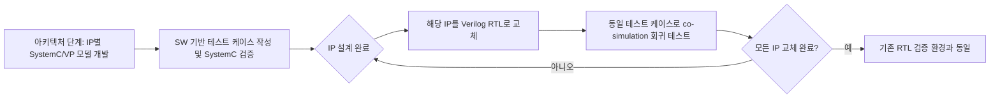

<!-- generated by yt-paper; edits will be overwritten -->

# A Study on Virtual Prototyping based Design Verification Methodology

[:material-open-in-new: 원문 보기](https://dvcon-proceedings.org/wp-content/uploads/1040-A-Study-on-Virtual-Prototyping-based-Design-Verification-Methodology.pdf){ .md-button .md-button--primary target=_blank }

> SystemC 가상 프로토타입(VP) 모델을 Verilog RTL로 점진 교체(co-simulation)하며 SW 기반 테스트 케이스를 재사용하는 검증 방법론으로, 모바일 AP SoC 적용 시 검증 기간을 약 21% 단축하고 회귀 테스트를 약 1개월 앞당겼다고 보고함.

| 항목 | 내용 |
|---|---|
| 저자/출처 | Woojoo Kim, Kunhyuk Kang, Seonil Brian Choi (Samsung Electronics, S.LSI Division, Infrastructure Design Center, Design Technology Team). 학회/저널명은 문서에 명시되어 있지 않음 |
| 유형 | PAPER |
| 카테고리 | Verification |
| ID | `ref-20261018-2416` |

## 핵심 인사이트

- 핵심 아이디어는 SystemC 모델을 IP 단위로 Verilog RTL로 순차 교체하면서 동일한 테스트 케이스를 재실행하는 것이다. 각 IP 교체 시점마다 회귀 테스트가 가능하므로, 오류 발생 시 교체된 IP를 root cause 후보로 좁힐 수 있다.
- SystemC 모델과 RTL의 동작·계층·인터페이스를 일치시키는 것이 전제 조건이다. 저자들은 SFR wrapper 생성기와 Register Information Signal Driver로 이를 지원하지만, 두 모델의 동등성을 정량 검증한 결과는 본문에 제시되지 않았다.
- TLM과 RTL 신호 레벨을 잇는 transactor(FSM 기반, READY/VALID 핸드셰이크, 0-cycle 전송 주장)가 핵심 구현 요소다. 이는 UVM의 TLM/Signal 변환과 유사한 접근이다.
- 성능 이득은 제한적이다. SystemC 단독 시뮬레이션은 RTL 대비 평균 5.22배 빨랐지만, co-simulation은 평균 1.16배에 그쳤다. 대부분의 이득은 검증 기간 단축에서 나온 것으로 해석된다.
- VP 모델이 이미 SW 개발·성능 추정에 쓰이고 있는 조직에서는 모델 개발 오버헤드가 줄어들어 적용이 현실적이다. 반면 모델이 없는 조직에서는 IP별 SystemC 모델링 비용을 먼저 고려해야 한다.

## 상세 요약

### 배경 및 문제 정의

SoC의 설계 복잡도와 크기는 빠르게 증가하는 반면 설계 기간은 오히려 줄어들고 있다. 검증 시간을 줄이면서 검증 품질을 높이는 것이 이 논문의 문제 설정이다. 저자들은 다음 두 가지 한계를 지적한다.

- **검증 단계별 중복 작업**: IP RTL, 블록, SoC, FPGA, 실리콘 단계마다 테스트 케이스를 따로 작성하고 검증 계획을 세워야 한다.
- **RTL 검증의 늦은 시작**: 회귀 테스트는 RTL이 나온 뒤에야 가능하다. 그 전까지는 설계 오류를 찾기 어렵다.

한편 자동차 SoC 등에서는 SW 개발과 아키텍처 탐색, 성능·전력 추정을 위해 VP(Virtual Prototyping)를 이미 사용하고 있다. 논문은 이 VP 자산을 검증에도 재사용하는 것을 제안한다. 관련 연구로 SystemC-RTL co-simulation(DPI, 마스터/슬레이브 모드 문제), 그리고 Accellera PSS(Portable Stimulus Standard)를 함께 다룬다. PSS와 유사한 방향이라고 저자들은 설명한다.

### 핵심 아키텍처 및 방법론

**1) 설계 흐름**

아키텍처 단계에서 SystemC 모델을 먼저 만든다. 설계가 시작되면 IP를 순차적으로 RTL로 개발해 BLK/SoC 팀에 전달하고, 해당 IP의 SystemC 모델을 Verilog 모델로 교체한 뒤 같은 테스트 케이스로 검증한다. 모든 IP가 교체되면 기존 RTL 검증 환경과 동일해진다.

**2) 모델 동등성 확보**

일반적인 VP 모델은 RTL과 기능·구조가 다를 수 있다. 이 논문은 SystemC 모델을 RTL과 동일한 동작과 구조로 작성하는 것을 원칙으로 삼는다. 단순화된 모델이지만 SFR 제어를 통해 동일한 동작을 보장한다고 주장한다. 이를 위해 다음 요소를 구현했다.

- 동작 모델을 SFR wrapper로 감싼다. 각 IP의 SFR wrapper는 SFR 데이터시트를 파싱하는 생성기로 만든다.
- Register Information Signal Driver로 Verilog 모듈과 SFR 통신을 한다.
- 계층 차이와 프로토콜 차이를 보정하는 인터페이스를 둔다.

**3) SystemC-RTL 트랜잭션 변환 (Transactor)**

- RTL은 사이클 기반 신호 레벨 인터페이스이고, SystemC는 신호 레벨 또는 TLM(Transaction Level Modeling) 인터페이스를 쓸 수 있다.
- 본 논문은 TLM 데이터를 FSM으로 AXI 채널별 신호로 분해하고, READY/VALID 핸드셰이크로 전송한다. 반대 방향도 같은 방식으로 변환한다.
- transactor는 SystemC/C++로 작성되었으며 0-cycle 전송을 한다고 기술한다.
- 성능 추정용 cycle-accurate 모델과 SW 개발용 Loosely-Timed TLM 모델을 모두 사용했으므로 두 종류의 transactor를 함께 개발했다.

**4) 테스트 케이스 재사용**

테스트 케이스는 SystemVerilog, C/C++, SystemC 등으로 기술할 수 있다. SoC 수준의 간단한 OS에서 실행하며, SFR 시퀀스 또는 디바이스 드라이버를 통한 상위 함수로 구성된다. 검증 항목은 IP 설계 단계부터 관리하고, 검증 결과는 RTL 모델과 함께 버전 관리한다. 저자들은 테스트 케이스 대부분을 수정 없이 재사용할 수 있다고 설명한다.

### 실험 결과 및 결론

**적용 대상**: 100M급 Gate/Cell 규모의 모바일 플래그십 AP SoC. 가장 중요한 두 블록에 적용했다.
- Bus 블록: SystemC 모델 12개 IP
- Memory Controller 블록: SystemC 모델 7개 IP

**시뮬레이션 속도 (Table 1, 단위 MHz)**

| 블록 | IP 수 | SystemC | Co-sim | RTL | SystemC / RTL | Co-sim / RTL |
|---|---|---|---|---|---|---|
| Bus | 12 | 4.82 | 0.84 | 0.72 | x6.69 | x1.16 |
| Memory Controller | 7 | 4.99 | 1.53 | 1.33 | x3.75 | x1.15 |
| 평균 | | | | | x5.22 | x1.16 |

Co-simulation 속도는 포함된 RTL 모델의 수와 규모에 따라 달라지므로, 평균값을 사용했다고 설명한다.

**검증 기간 (Table 2, 단위 개월)**

| 블록 | IP 수 | 기존 | 제안 | 단축률 |
|---|---|---|---|---|
| Bus | 12 | 8.1 | 6.4 | 21.0% |
| Memory Controller | 7 | 8 | 6.35 | 20.6% |

측정 기준은 IP·블록 검증 시작부터 SoC 검증 완료일까지이며, 실리콘 검증 기간은 제외했다. 같은 수의 테스트 케이스를 사용해 비교했다고 밝힌다.

**결론 및 해석**

- RTL 첫 릴리스 이전에 회귀 테스트를 시작할 수 있어 버그를 더 일찍 발견했고, 후반부 디버깅 부담이 줄어 검증 완료가 앞당겨졌다고 분석한다.
- 저자들은 검증 계획 및 테스트 케이스 개발 시간 단축은 전체 검증 기간에서는 드러나지 않았고, 인력 절감 효과가 기대된다고 밝힌다.
- 초록은 기간 단축을 20%로, 본문은 21%로 기술한다. 두 블록의 단축률은 20.6%~21.0%다.
- 사양 검증(specification verification)을 동시에 수행할 수 있다고 주장하지만, 이를 뒷받침하는 실험 결과는 본문에 없다.
- 적용 대상은 단일 SoC 프로젝트 1건이며, 모델 동등성의 정량 검증 방법과 결과, 기준선 방법론의 세부 사항은 제시되지 않았다.
- 결론적으로 SystemC 모델이 이미 존재하는 조직에서 IP 교체형 회귀 테스트로 검증 일정을 앞당기는 실용적 방법론이라고 정리할 수 있다.

## 관련 영상

<iframe src="https://www.youtube-nocookie.com/embed/RgAPcMcohTs" title="[DVCON2023]A Study on Virtual Prototyping based Design Verification Methodology" loading="lazy" allow="accelerometer; clipboard-write; encrypted-media; gyroscope; picture-in-picture; web-share" referrerpolicy="strict-origin-when-cross-origin" allowfullscreen></iframe>

**[DVCON2023]A Study on Virtual Prototyping based Design Verification Methodology** — [YouTube에서 보기](https://www.youtube.com/watch?v=RgAPcMcohTs) · [영상 페이지](../../videos/RgAPcMcohTs.md)
