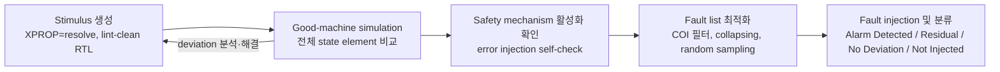

<!-- generated by yt-paper; edits will be overwritten -->

# Are My Fault Campaigns Providing Accurate Results for ISO 26262 Certification?

[:material-open-in-new: 원문 보기](https://dvcon-proceedings.org/wp-content/uploads/1068.pdf){ .md-button .md-button--primary target=_blank }

> ISO 26262 인증용 fault campaign 결과의 정확성을 확보하려면 양질의 stimulus, 올바른 setup, 전체 state element를 검사하는 good-machine simulation, 그리고 fault list 최적화가 필요하다는 것을 Samsung 사례로 보인 논문.

| 항목 | 내용 |
|---|---|
| 저자/출처 | Hyunsun Ahn, James Kim, Arun Gogineni, Ann Keffer, MyungKyoon Yim, Soobon Kim, Youngsik Kim, Seonil Brian Choi (원문에 발표 학회명 명시 없음; 소속: Samsung Electronics, Siemens EDA) |
| 유형 | PAPER |
| 카테고리 | Verification |
| ID | `ref-20261018-2473` |

## 핵심 인사이트

- Good-machine simulation은 observe point만 확인하면 dormant deviation을 놓치므로, 모든 flip-flop/latch와 메모리 내용까지 기준 시뮬레이션과 비교해야 fault 판정의 신뢰도를 확보할 수 있다.
- XPROP=resolve로 stimulus를 생성하자 good-machine deviation이 약 15%에서 4.63%로 줄었고, 남은 deviation은 force list, reset-clock race, RTL # delay, FIFO 인덱싱 등 원인별로 분류·해결되었다. 가장 큰 원인은 reset-to-clock race(27,205건)였다.
- Safety mechanism이 활성화되지 않은 stimulus로 fault campaign을 돌리면 모든 fault가 undetected로 집계되므로, error injection 기반 self-checking으로 safety mechanism 활성화를 먼저 검증해야 한다.
- Fault list 최적화(safety-mechanism-aware COI 필터링, fault collapsing, 통계적 random sampling)를 조합해 대규모 fault space를 줄이되, 샘플링 신뢰도와 제외 근거를 명확히 관리해야 한다.
- 본문의 'always accurate', 'right the first-time' 같은 표현은 특정 도구(KaleidoScope) 중심의 주장이며, 결과 테이블의 기준선과 샘플링 세부 정보가 제한적이므로 자사 환경에 적용 시 독립적인 검증이 필요하다.

## 상세 요약

### 배경 및 문제 정의

자동차 반도체가 커지고 복잡해지면서 ISO 26262 인증을 위한 safety verification에서 fault 수가 방대해졌다. 단일 기술만으로 exhaustive한 safety 검증을 수행하기 어렵고, fault campaign 결과가 실제로 정확한지 확인하는 방법이 핵심 과제가 된다. 저자들은 이전 DVCon US 2023 논문이 전체 방법론과 흐름은 다뤘지만 fault campaign을 어떻게 계획하고 검증할지는 다루지 않았다고 밝히고, 다음 질문에 답하고자 한다.

- fault campaign이 정확한 결과를 주고 있는지 어떻게 아는가?
- 실제 use case를 대표하는 campaign을 돌리고 있는가?
- RTL stimulus 결과가 최종 gate-level netlist 결과와 일치하는가?
- fault campaign을 가속하는 기법에는 무엇이 있는가?
- 모든 개발 단계와 모든 stimulus에 good-machine simulation이 필요한가?

### 핵심 아키텍처 및 방법론

논문은 Samsung의 safety flow를 실사례로 하여 다음 흐름을 제시한다.

**1) Good-quality stimulus 조건**
- **Correct design setup**: 기능 stimulus 생성과 good-machine/fault 시뮬레이션에서 file list, define, parameter, 메모리 preload를 동일하게 유지한다.
- **Forces**: testbench의 force 목록을 빠짐없이 fault engine에 전달하고, net force가 계층을 넘어 모든 fanout까지 전파되어야 한다. RTL과 gate-level 간 force 동작이 다를 수 있다.
- **RTL # delay 제거**: zero-delay 모델링을 사용해 시뮬레이션과 합성 간 불일치를 줄인다.
- **Simulation vs. synthesis mismatch**: 동기화기 누락, 잘못된 시뮬레이션 모델, 배열 out-of-index, 주소 포인터와 데이터 크기 불일치 등을 막기 위해 lint-clean RTL을 권장한다.
- **XPROP=resolve**: X-optimism 대신 X를 결정적 값으로 해석하는 방식을 사용해 silicon 동작에 더 가깝게 맞춘다.
- **Race 처리**: reset-to-clock race는 KaleidoScope에 reset 지연 기능을 추가해 active clock edge 이후에 반영하도록 했다. data-to-clock race는 inactive edge에서 데이터를 구동하거나, QuestaSim의 `-deraceclockdata` 같은 옵션을 사용한다.

**2) Good-machine simulation**
- Observe point뿐 아니라 모든 state element(flip-flop, latch)와 메모리 내용의 deviation을 검사한다.
- 이렇게 해야 dormant deviation을 잡고, 기준(golden) 시뮬레이션이 올바른지 보장할 수 있다.

**3) Fault campaign 방법론**
- **Active safety mechanism**: safety mechanism이 활성화되지 않은 stimulus에서는 모든 fault가 undetected로 집계된다. 따라서 error injection 기능을 넣어 alarm이 실제로 발생하는지 확인하고, 이후 주입을 해제한 뒤 fault 결과와 대조하는 절차를 권장한다.
- **Stimulus grading**: toggle coverage 같은 단순 지표나, fault를 다음 state element까지 전파시켜 보는 방식으로 fault 주입 수가 가장 많은 stimulus를 고른다.

**4) Fault list 최적화**
- **Safety-mechanism-aware**: safety mechanism의 COI(cone of influence) 밖 fault를 제외한다.
- **Fault collapsing**: 논리적으로 동등한 fault를 묶는다.
- **Statistical random sampling**: 지정한 신뢰수준 안에서 fault를 무작위로 추출한다.

### 실험 결과 및 결론

**Good-machine deviation 개선 (Table 2)**
- 초기 stimulus(XPROP=noXprop): 전체 state element의 약 15% deviation
- XPROP=resolve로 재생성한 stimulus: 4.63%

**잔여 deviation 원인 분석 (Table 3, 합계 37,546건)**

| 원인 | 건수 | 조치 |
|---|---|---|
| Force list 누락 및 force 동작 문제 | 600 + 170 | force list 및 force 동작 수정 |
| Reset-to-clock race | 27,205 | KaleidoScope에 reset 지연 기능 추가로 전부 해결 |
| RTL # delay | 7,722 | zero-delay 시뮬레이션으로 stimulus 생성 |
| Simulation vs. synthesis mismatch (FIFO out-of-index) | 1,845 | RTL 수정 |
| 파라미터 불일치 | 4 | 설정 업데이트로 해결 |

**Fault campaign 결과 (Table 4, 통계적 샘플링 4,598개 fault)**

| 분류 | 비율 |
|---|---|
| Alarm Detected | 65.87% |
| Residual | 9.86% |
| No Deviation | 14.98% |
| Not Injected | 9.38% |

- Residual은 safety mechanism이 보호하지 않는 영역(부분적으로 구성된 safety mechanism의 경계)에서 발생한 것으로 설명된다. 저자들은 이를 예상된 결과로 본다.
- Not Injected는 입력 stimulus가 해당 노드를 활성화하지 못해 golden 값과 fault 값이 계속 같았던 경우다.
- 네 비율의 합은 반올림으로 약 100.09%이다.

**결론 및 한계**
- Table 5(이전 결과)와 Table 6(본 논문 적용 후)을 비교하면, 본 논문은 Test 5 열의 Detected 비율이 42.81%에서 65.87%로 올라간 결과를 제시한다. 다만 다른 열은 변하지 않았고 'TBD (Future work)' 항목도 있어 개선 효과의 범위는 제한적이다.
- 저자들은 quality stimulus, 올바른 setup, good-machine simulation 정리를 적용하면 fault campaign 결과가 정확해진다고 결론짓는다.
- 논문은 Samsung 설계 한 건과 KaleidoScope 도구 중심으로 검증되었으며, 'always accurate'와 같은 표현은 일반화하기 어렵다. 실제 적용 시에는 자사 설계에서 deviation 분석과 샘플링 신뢰도를 독립적으로 검증해야 한다.

## 관련 영상

<iframe src="https://www.youtube-nocookie.com/embed/s_005FQmF7A" title="[DVCON2024]Are My Fault Campaigns Providing Accurate Results for ISO 26262 Certification?" loading="lazy" allow="accelerometer; clipboard-write; encrypted-media; gyroscope; picture-in-picture; web-share" referrerpolicy="strict-origin-when-cross-origin" allowfullscreen></iframe>

**[DVCON2024]Are My Fault Campaigns Providing Accurate Results for ISO 26262 Certification?** — [YouTube에서 보기](https://www.youtube.com/watch?v=s_005FQmF7A) · [영상 페이지](../../videos/s_005FQmF7A.md)
