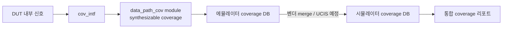

<!-- generated by yt-paper; edits will be overwritten -->

# Improve emulator test quality by applying synthesizable functional coverage

[:material-open-in-new: 원문 보기](https://dvcon-proceedings.org/wp-content/uploads/1087-Improve-emulator-test-quality-by-applying-synthesizable-functional-coverage.pdf){ .md-button .md-button--primary target=_blank }

> 시뮬레이션과 에뮬레이션에서 공통으로 쓸 수 있는 synthesizable functional coverage 코딩 가이드라인 7가지를 제시하고, 두 벤더 에뮬레이터 적용 사례로 TAT 단축과 full combination 검증 효과를 보인 논문.

| 항목 | 내용 |
|---|---|
| 저자/출처 | Hoyeon Hwang, Taeseong Kim, Sanghyun Park, Yong-Kwan Cho, Dohyung Kim, Wonil Cho, Sanggyu Park (Samsung Electronics Co., Ltd.) — 원문에 학회/발표처 명시 없음 (LPI 힌트) |
| 유형 | PAPER |
| 카테고리 | Verification |
| ID | `ref-20261018-2686` |

## 핵심 인사이트

- 에뮬레이터 coverage의 주요 비용은 bin 수(capacity)이며, 실행 시간 영향은 본문 기준 작다(coverage DB dump 1~2분 수준). 따라서 bin 용량 관리가 핵심 설계 기준이다.
- M-vendor는 coverpoint당 4,096 bin 제한이 있어 큰 값 범위를 slice로 나눈 뒤 cross로 재구성해야 한다. C-vendor에서는 cross 내부 ignore_bins 대신 coverpoint의 ignore_bins를 써야 내부 메모리를 줄일 수 있다.
- sample() 메서드, with 절, covergroup argument는 합성이 불가하므로, 입력을 래치한 뒤 이벤트 샘플링(@(posedge ...))을 쓰고, iff 가드와 module parameter로 대체하는 패턴이 공통 코드의 핵심이다.
- Coverage 모듈을 UVC scoreboard 대신 DUT wrapper에 두고 interface로 신호를 연결하면 시뮬레이션과 에뮬레이션에 같은 코드를 재사용할 수 있고, UVC가 DUT 신호를 끌어오며 생기는 성능 저하도 피할 수 있다.
- TAT 비교(2,632 bin)는 'bin당 1 test'와 시간당 가정에 기반한 추정치라 절대 수치보다 방법론의 효과로 읽어야 한다. 단일 설계와 두 벤더 사례로는 일반성을 검증하기 어렵다.

## 상세 요약

### 배경 및 문제 정의

에뮬레이션은 시뮬레이션보다 훨씬 빨라 TAT(Turn-Around Time)를 줄이고, 시뮬레이션에서 찾기 어려운 저확률 코너 케이스를 찾는 데 유리하다. 그러나 시뮬레이션에서 쓰던 functional coverage 코드를 에뮬레이션에 그대로 옮기기 어렵다. 이유는 다음과 같다.

- 에뮬레이터는 bin 수에 용량 제한이 있다. C-vendor는 내부 메모리 카운터 기반이고, M-vendor는 coverpoint당 4,096 bin 제한과 보드 용량 제한이 있다.
- 벤더마다 지원하는 coverage 문법이 다르고, 시뮬레이션용 문법 일부(`sample()`, `with`, covergroup argument 등)는 합성이 불가능하다.

저자들은 C-vendor와 M-vendor 두 에뮬레이터를 사용했다. 두 벤더 모두 자체 사용자 가이드를 제공하지만 공통 코딩 규칙은 없다고 지적한다. 이 논문의 목표는 양쪽 모두에서 적은 자원으로 동작하고, 시뮬레이션과 공유 가능한 synthesizable coverage 작성 규칙을 정리하는 것이다.

### 핵심 아키텍처 및 방법론

논문은 작성 시 고려사항을 Capacity, Speed, Syntax 세 가지로 정리한 뒤, 다음 7개 가이드라인을 제시한다.

1. **Bin 수 제한**: M-vendor에서 coverpoint당 bin을 4,096 이하로 유지한다. 13비트 신호는 상위 1비트와 하위 12비트 coverpoint로 나눈 뒤 cross로 재구성한다.
2. **cross의 ignore_bins**: C-vendor에서는 cross 내부 ignore_bins 대신 coverpoint에 ignore_bins를 준다. cross 내부 ignore는 bin 개수만 줄이고 내부 메모리는 전체를 유지한다(본문 표 기준 메모리 16 → 4).
3. **cross 분리**: 한 coverpoint가 여러 cross에 들어가면 covergroup을 나눠 cross 차원을 낮춘다. 3변수 cross 하나보다 2변수 cross 둘이 메모리 주소 공간을 줄인다고 설명한다.
4. **Sampling**: `sample()` 대신 이벤트 샘플링(`@(posedge ...)`)을 쓴다. 비동기로 동작하는 두 데이터 경로는 valid 신호로 값을 래치한 뒤 `all_scn_done` 이벤트에서 샘플링한다.
5. **Parameter로 covergroup 다중 인스턴스화**: M-vendor는 covergroup argument를 지원하지 않으므로 module parameter로 조건을 주고, 필요한 만큼 module을 인스턴스화한다.
6. **Coverpoint guard**: `with` 절 대신 `iff` 가드를 쓴 coverpoint로 bin 조건을 나눈다.
7. **set_inst_name**: 같은 covergroup을 여러 번 인스턴스화할 때 인스턴스 이름 충돌을 막기 위해, C-vendor에서는 initial 블록 안에서 `set_inst_name`을 호출한다.

추가로 시뮬레이션과 에뮬레이션 공통으로 쓸 수 있는 문법으로 `ignore_bins`, unsized array `bins[]`, `wildcard bins`, `transition bins`를 제시한다.

통합 구조로는 coverage 모듈을 UVM의 scoreboard 대신 DUT wrapper에 두고, `cov_intf` interface로 DUT 내부 신호를 연결하는 방식을 제안한다. 이렇게 하면 coverage 코드를 시뮬레이션에서 수정 없이 재사용할 수 있고, UVC가 DUT 신호를 끌어오며 생기는 성능 저하도 줄일 수 있다.

coverage 데이터 병합은 벤더 merge 도구로 같은 벤더 시뮬레이터 데이터와 합치며, 계층 구조가 시뮬레이션과 동일해야 한다. 서로 다른 벤더 간 병합은 UCIS(Unified Coverage Interoperability Standard) API를 활용하는 방향을 향후 과제로 언급한다.

### 실험 결과 및 결론

**Speed (Table I)**: C-vendor는 w/o 12분 25초, w/ 13분 13초였고, M-vendor는 w/o 26분 31초, w/ 24분 27초였다. 저자들은 실행 시간 차이가 거의 없다고 보고한다. Coverage DB dump는 C-vendor 1분 2초, M-vendor 1분 20초다. 본문은 191,797 bin에서 추가 시간이 1~2분이라고 설명한다. M-vendor의 w/ 수치가 w/o보다 짧게 나온 이유에 대한 분석은 본문에 없다.

**Case study A – 코너 케이스 헌팅 TAT (Table XI)**: 2,632 bin coverage를 사용했다. 시뮬레이션은 "bin당 1 test, test당 60시간" 가정으로 157,920시간, 에뮬레이션은 "bin당 10분" 가정으로 421.12시간으로 계산했다. 에뮬레이션으로 전체 시나리오를 2주 만에 수행했다고 보고한다. 다만 이 수치는 가정에 기반한 추정치다.

**Case study B – Full combination coverage**: 4,846 bin의 "Full Combination" coverage를 정의해 모든 조합을 검증했고, 특정 조합에서만 나타나는 실제 프로젝트 버그를 찾았다. 기존에는 조합 시나리오를 랜덤 생성해 특정 조합의 검증 여부를 알 수 없었다고 한다.

**결론**: 7가지 synthesizable coverage 가이드라인을 C-vendor, M-vendor 에뮬레이터에 적용했고, coverage 모듈 통합과 데이터 병합 방식을 논의했다. 두 사례로 TAT 단축과 full combination 검증 효과를 보였다. 다만 정량적 근거는 단일 설계, 추정 기반 TAT, 벤더명 익명 처리로 제한적이므로, 가이드라인의 일반성은 독립적인 재현 실험으로 확인이 필요하다.

## 관련 영상

<iframe src="https://www.youtube-nocookie.com/embed/-DOx49XtD4M" title="[DVCON2023] Improve emulator test quality by applying synthesizable functional coverage" loading="lazy" allow="accelerometer; clipboard-write; encrypted-media; gyroscope; picture-in-picture; web-share" referrerpolicy="strict-origin-when-cross-origin" allowfullscreen></iframe>

**[DVCON2023] Improve emulator test quality by applying synthesizable functional coverage** — [YouTube에서 보기](https://www.youtube.com/watch?v=-DOx49XtD4M) · [영상 페이지](../../videos/-DOx49XtD4M.md)
