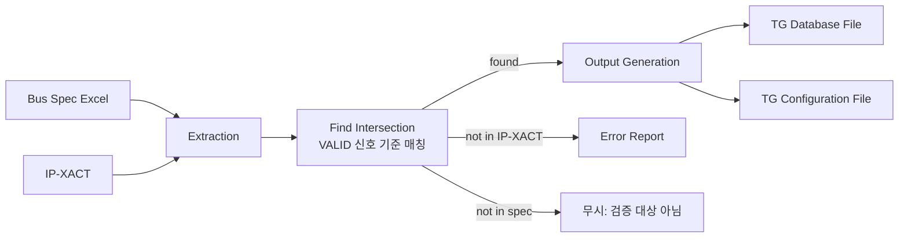

<!-- generated by yt-paper; edits will be overwritten -->

# Automation Methodology for Bus Performance Verification using IP-XACT

[:material-open-in-new: 원문 보기](https://dvcon-proceedings.org/wp-content/uploads/1055-Automation-Methodology-for-Bus-Performance-Verification-using-IP-XACT.pdf){ .md-button .md-button--primary target=_blank }

> IP-XACT 메타데이터와 버스 스펙 엑셀 파일을 결합해 TG(Traffic Generator) database/configuration 파일을 자동 생성하는 AUTO_TGMON 방법론으로, 사내 모바일 프로젝트에서 TAT를 2주에서 1분 이내로 줄였다고 보고한다.

| 항목 | 내용 |
|---|---|
| 저자/출처 | Taeyoung Jeon, Gunseo Koo, Youngsik Kim, Seonil Brian Choi (Samsung Electronics Co., Ltd.) |
| 유형 | PAPER |
| 카테고리 | Verification |
| ID | `ref-20261018-271b` |

## 핵심 인사이트

- 버스 성능 검증의 병목은 시뮬레이션 자체보다 수백 개 마스터에 대한 TG 치환 준비(신호 계층, 비트폭, 트래픽 설정 작성)에 있으며, 이 준비 작업을 메타데이터 기반으로 자동화한 것이 핵심 기여다.
- IP-XACT는 전체 RTL을 파싱하지 않고도 신호 목록을 얻을 수 있는 메타데이터 소스로 쓰여, 풀칩 규모 설계에서 RTL 직접 분석보다 효율적이다.
- 버스 스펙은 IP 이름만 기재하던 방식에서 포트 계층 전체를 기재하는 방식으로 바뀌어야 자동화 정확도가 올라간다는 점이 실무적 교훈이다. 다만 스펙은 수작업이라 RTL과 어긋날 수 있으며, 이 불일치를 교차 검증 단계에서 보고하도록 설계했다.
- 추출(extraction) → 교집합(find intersection) → 출력 생성(output generation)의 3단계 구조와 VALID 신호 기준 매칭으로, 자동화 가능 대상, 스펙 오류, 대상 외 포트를 명확히 분류한다.
- 논문은 190개 마스터 테스트와 155개 대상 적용 결과를 제시하지만, 자동화 비율(90% 이상)의 산출 근거, 오류 수의 정량 기준, 생성 파일의 실제 정확도 검증 방법은 구체적으로 제시하지 않아 수치 해석에 주의가 필요하다.

## 상세 요약

### 배경 및 문제 정의

현대 SoC는 DMA 마스터 수가 늘면서 버스 패브릭이 거대해지고, 각 마스터가 MMU, 중재기(arbitration), CDC 등 버스 컴포넌트를 거치며 받는 대역폭·지연·MO(Multiple Outstanding) 영향을 pre-silicon 단계에서 측정할 필요가 있다. 이를 위해 문서는 다음 이유로 에뮬레이션 환경과 TG(Traffic Generator)를 사용한다고 설명한다.

- 풀칩 규모 환경이 필요하고, 수 GB/s 수준의 트래픽은 사이클 기반 시뮬레이션으로 감당하기 어렵다.
- 수백 개 마스터를 실제로 bring-up하는 것은 현실적으로 불가능하므로, 마스터를 TG로 치환해 아웃고잉 트래픽만 재현한다.

문제는 TG 치환 준비 과정이다. TG는 AXI/ACE 프로토콜의 모든 신호(계층, 비트폭)를 알아야 하며, 이 정보는 TG database 파일에 기록되어 이미지 빌더로 전달된다. 예를 들어 TG 하나가 50개 신호를 쓰고 100개 TG를 쓰면 database에 5000개 신호 정보를 적어야 한다. 수작업은 시간이 많이 들고 오류가 생기기 쉬우며, 이 오류는 이미지 빌드 단계에서 잡히지 않고 테스트 실행 중 부정확한 결과로 나타난다.

기존 수작업 흐름은 (1) 버스 스펙에서 대상 선택, (2) Visio 아키텍처 다이어그램에서 master port 위치 확인, (3) RTL 코드에서 정확한 계층 탐색의 3단계였다. 문서는 스펙이 IP 이름만 제공하고, 다이어그램은 수작업으로 그려져 RTL 최신 상태를 보장하지 않는다는 점을 문제로 지적한다.

### 핵심 아키텍처 및 방법론

제안 방법론 **AUTO_TGMON**은 두 입력을 받는다.

1. **버스 스펙 (Excel)**: 대상 IP 이름, 요구 대역폭, 클럭 주파수, 포트 계층(ARVALID/AWVALID 등 대표 신호 경로), 버스트 크기·길이 등 트래픽 설정을 담는다. 엑셀을 가공 없이 읽으므로 오류 수정 후 재실행이 쉽다.
2. **IP-XACT**: 설계의 메타데이터로, 신호 목록의 원천이 된다.

처리는 세 단계로 구성된다.

- **Extraction**: 두 입력을 객체지향 클래스 인스턴스로 파싱한다. 빈 셀, NaN, 비정상 범위 값(예: 10 MHz 클럭)을 오류로 보고한다. 읽기 전용 포트처럼 사용자가 무시해도 되는 오류도 있다.
- **Find intersection**: 스펙이 VALID 신호 계층만 가지므로 VALID 신호를 기준으로 두 데이터를 비교한다. 결과는 세 경우로 분류된다.
  1. 스펙의 대상이 IP-XACT에 존재 → 자동화 가능
  2. 스펙의 대상이 IP-XACT에 없음 → IP가 IP-XACT를 쓰지 않았거나 스펙 오류 가능성. 스펙 오류는 사용자에게 보고
  3. IP-XACT에는 master port가 있으나 스펙에 없음 → 검증 대상이 아니므로 무시 (MMU, 중재기, CDC 로직 등)
- **Output generation**: TG database 파일의 신호 목록은 IP-XACT에서, TG configuration 파일의 트래픽 설정은 스펙에서 가져온다. 스펙의 VALID 계층은 IP-XACT 메타데이터로 ARADDR, ARREADY 등 전체 신호 목록으로 복원된다.

### 실험 결과 및 결론

- **개발 환경 적용**: 190개 마스터에 적용했고, 1분 이내에 출력 파일을 생성했다. 22개 오류가 보고되었으며, 추출 단계 8개(스펙 셀 오류, 수정 용이)와 교집합 단계 14개(IP-XACT 미사용 또는 스펙과 RTL 불일치)로 나뉜다. 후자는 설계팀과 협의 후 스펙을 수정해야 한다.
- **모바일 디바이스 최신 설계 적용**: 155개 검증 대상을 선택했고, TG database 및 configuration 파일을 1분 이내에 생성했다. 이전 프로젝트에서 2주 걸리던 작업이다. 이 결과 검증 초기 단계에서 테스트 결과를 얻을 수 있었고, 성능 테스트로 17개 버그를 발견했다. 워크어라운드로 스펙의 목표 성능 지표를 바꾸거나 버스트 길이·클럭 주파수를 조정했다.
- **결론**: 저자들은 TAT가 2주에서 1분 이내로 줄었고, 생성 파일이 검증 항목 특정 의존성이 없으므로 TG를 쓰는 모든 검증 항목에 적용 가능하다고 주장한다.

**요약 한계**: 초록의 "90% 이상 자동 처리"는 본문에서 산출 근거가 명확히 제시되지 않는다. 155개 중 자동 처리 비율, 생성 파일의 정확성 검증 방법(시뮬레이션 대비 확인 등), 17개 버그 중 자동화 파일 오류와 DUT 실제 버그의 구분도 본문에 없어 해석 시 주의가 필요하다.

## 관련 영상

<iframe src="https://www.youtube-nocookie.com/embed/Sxhrm6QYo_0" title="[DVCON2023]Automation Methodology for Bus Performance Verification using IP-XACT" loading="lazy" allow="accelerometer; clipboard-write; encrypted-media; gyroscope; picture-in-picture; web-share" referrerpolicy="strict-origin-when-cross-origin" allowfullscreen></iframe>

**[DVCON2023]Automation Methodology for Bus Performance Verification using IP-XACT** — [YouTube에서 보기](https://www.youtube.com/watch?v=Sxhrm6QYo_0) · [영상 페이지](../../videos/Sxhrm6QYo_0.md)
