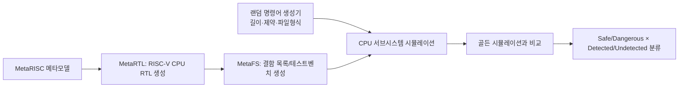

<!-- generated by yt-paper; edits will be overwritten -->

# Automated Thread Evaluation of Various RISC-V Alternatives using Random Instruction Generators

[:material-open-in-new: 원문 보기](https://dvcon-proceedings.org/wp-content/uploads/1069-Automated-Thread-Evaluation-of-Various-RISC-V-Alternatives-using-Random-Instruction-Generators.pdf){ .md-button .md-button--primary target=_blank }

> MetaRTL 기반 모델 구동 RTL 생성, MetaFS 결함 시뮬레이션, 랜덤 RISC-V 명령어 생성기를 결합해 여러 RISC-V CPU 변형의 안전성(고장 커버리지)을 저비용으로 자동 평가하는 기법을 제안한 논문.

| 항목 | 내용 |
|---|---|
| 저자/출처 | Endri Kaja, Nicolas Gerlin, Dominik Stoffel, Wolfgang Kunz, Wolfgang Ecker (Infineon Technologies AG / TU München / TU Kaiserslautern). 학회명은 본문에 명시되지 않음. |
| 유형 | PAPER |
| 카테고리 | Verification |
| ID | `ref-20261018-273b` |

## 핵심 인사이트

- MetaRTL(모델 기반 RTL 생성)과 MetaFS(모델 기반 결함 주입)를 결합해 CPU 구성 변경 시에도 테스트벤치와 결함 목록을 자동 재생성하는 흐름을 제시함
- EFI(전수 결함 주입)와 SFI(통계적 결함 주입) 캠페인을 같은 프레임워크에서 지원하며, 결함 모델은 stuck-at, SEU, Timing fault를 포함함
- 랜덤 명령어 길이(100~300)가 고장 커버리지에 영향을 주며, 이 논문에서는 Forwarding Unit 결함이 300개 명령어에서 최대 99% 커버리지에 도달함
- 전체 캠페인 수행 노력이 1 person-day로 보고되어, 정형/ATPG/BIST 대비 저오버헤드 접근으로 제시됨. 다만 정량적 비교 실험은 본문에 없음
- 분기/점프가 메모리 범위를 벗어나 Fetch stage 결함 활성화가 낮다는 한계가 확인되었고, 향후 과제로 제시됨

## 상세 요약

### 배경 및 문제 정의

- 자동차 등 안전 필수(safety-critical) 설계는 ISO 26262 요구에 따라 하드웨어 결함(방사선, 노화, 공정 결함 등)에 대한 검증이 필요하다.
- 결함 주입(fault injection)은 안전성 평가의 권장 기법이지만, 시간-to-market 압박 속에서 자동화와 낮은 수작업 비용이 요구된다.
- 기존 방식은 상용 정형 도구(Cadence JasperGold FSV, OneSpin)처럼 벤더 종속적이거나, BIST/ATPG처럼 면적·성능 오버헤드가 크다는 한계가 있다.
- 본 논문은 모델 기반 RTL 생성(MetaRTL)과 모델 기반 결함 시뮬레이션(MetaFS)을 결합하고, 랜덤 RISC-V 명령어 생성기를 입력 자극으로 사용해 여러 RISC-V CPU 구성의 고장 커버리지를 자동으로 평가하는 것을 목표로 한다.

### 핵심 아키텍처 및 방법론

전체 흐름은 다음과 같이 정리할 수 있다.

1. **MetaRTL 기반 RTL 생성 (Section I, III)**: Python API로 기술된 메타모델(Encoding Tree, Instructions, Architectural States, Exceptions)에서 다양한 RISC-V 변형(RV32IMC, Exceptions 추가, MAC 확장)을 생성한다.
2. **혼합 granularity 결함 주입기 (Section I, Fig. 1)**: 결함 주입 대상 부분만 gate-level로 유지하고 나머지는 RTL로 표현한다. Saboteur 제어선을 Primary Input으로 전파하며, 원본과의 formal equivalence check로 변환 오류를 확인한다.
3. **MetaFS 결함 시뮬레이션 (Section IV, Fig. 3, 4)**: Simulation Controller가 SFI, EFI, DFI 캠페인을 정의하고, Fault List가 신호와 결함 모델(Sa0, Sa1, BF, TimingFault)을 관리하며, Simulation Analyzer가 Strobe(functional/checker)를 지정한다. SystemVerilog와 C++ 테스트벤치를 자동 생성한다.
4. **결과 분류 (Section IV, Fig. 5)**: Safe Undetected, Safe Detected, Dangerous Undetected, Dangerous Detected의 네 범주로 결함을 분류한다.
5. **랜덤 명령어 생성 (Section V)**: 명령어 클래스 제약(예: load, csr만 생성), read-after-write 의존성 제약, 시퀀스 길이, hex/bin 파일 형식, 데이터 메모리 시작 주소를 설정 가능한 파라미터로 제공한다.

- 검증 대상 서브시스템은 CPU, 프로그램/데이터 메모리, SPI, UART, Interrupt Controller, bus fabric과 bus bridge로 구성된다. CPU만 바꿔가며 세 가지 변형을 비교한다.
- 결함은 ALU, Forwarding Unit, Prefetcher, Fetch stage에 주입된다.
- 시뮬레이션은 Cadence Xcelium에서 수행되었다.

### 실험 결과 및 결론

**EFI 캠페인 (Fig. 6–8)**

| 구성 | ALU | Fw Unit | Prefetcher | Fetch stage |
|---|---|---|---|---|
| RV32IMC (Fig. 6) | 2555 | 871 | 1873 | 4351 |
| RV32IMC-Exceptions (Fig. 7) | 2555 | 871 | 1873 | 18936 |
| RV32IMC-MAC (Fig. 8) | 2555 | 871 | 1873 | 18936 |

- 테스트 길이는 100, 150, 200, 250, 300 명령어를 사용했다.
- RV32IMC에서는 ALU 결함을 제외하고 명령어 수가 늘수록 커버리지가 꾸준히 증가했다. Forwarding Unit 결함은 300개 명령어에서 최대 99%에 도달했다.
- Prefetcher는 가장 가파르게 증가하고 250개 이후 안정화되었다.
- Fetch stage 결함은 활성화가 낮았는데, 랜덤 점프·분기가 메모리 범위를 벗어나는 것이 원인으로 제시되었다.
- Exception Unit 추가 시 Fetch stage 주입 결함 수가 4351에서 18936으로 늘었고, 나머지 구성에서는 커버리지가 약간 증가했다(Forwarding Unit은 변화 없음).
- MAC 확장은 ALU 결함에서 약간의 커버리지 증가를 가져왔다.

**SFI 캠페인 (Fig. 9)**
- 테스트 길이 300개에서 stuck-at, SEU, Timing fault를 무작위 위치·시점에 주입했다.
- EFI 대비 커버리지가 크게 낮았고, 이는 SEU와 Timing fault가 선택된 컴포넌트에 낮은 영향을 주었음을 의미한다.

**결론**
- 논문은 EFI 캠페인에서 300개 명령어 기준 40%~99% 범위의 허용 가능한 고장 커버리지를 얻었다고 보고한다.
- 전체 캠페인 수행에 1 person-day가 소요되었다고 한다.
- 향후 과제로 결함 모델 확장, 분기의 메모리 범위 내 제한, 상용·오픈소스 도구와의 비교가 제시되었다.
- 내부 정책으로 프레임워크는 당분간 오픈소스로 공개되지 않는다.

**한계 (엔지니어 관점)**
- 본문에 정량적 비교 대상(다른 도구, 기존 BIST 등)과 통계적 신뢰도(SFI 샘플 수, 신뢰구간) 정보가 없다.
- SFI 결과는 그래프로만 제시되어 수치 확인이 어렵다.
- 학회명과 발표 연도가 본문에 명시되어 있지 않다.

## 관련 영상

<iframe src="https://www.youtube-nocookie.com/embed/JD25fcnTAhA" title="[DVCON2023]Automated Thread Evaluation of Various RISC-V Alternatives Random Instruction Generators" loading="lazy" allow="accelerometer; clipboard-write; encrypted-media; gyroscope; picture-in-picture; web-share" referrerpolicy="strict-origin-when-cross-origin" allowfullscreen></iframe>

**[DVCON2023]Automated Thread Evaluation of Various RISC-V Alternatives Random Instruction Generators** — [YouTube에서 보기](https://www.youtube.com/watch?v=JD25fcnTAhA) · [영상 페이지](../../videos/JD25fcnTAhA.md)
