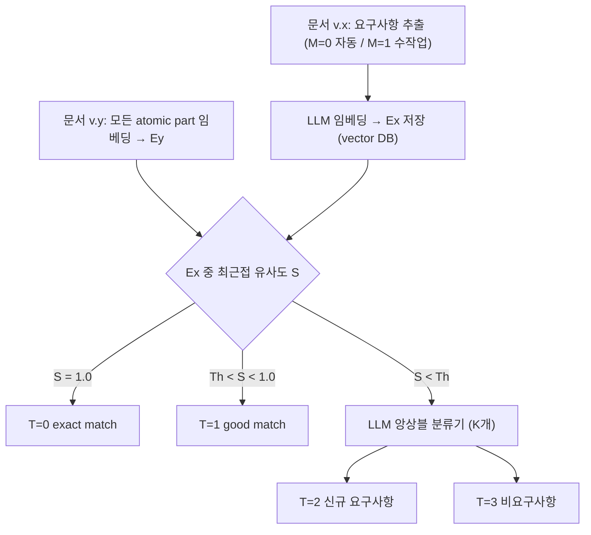

<!-- generated by yt-paper; edits will be overwritten -->

# Technical Documents Version Management System Based on Large Language Models

[:material-open-in-new: 원문 보기](https://dvcon-proceedings.org/wp-content/uploads/1027-2.pdf){ .md-button .md-button--primary target=_blank }

> 이전 버전 문서의 요구사항을 sentence embedding으로 재사용(T=0/1)하고, 나머지 신규 요구사항은 context window가 다른 LLM 분류기 앙상블로 탐지해 M-PHY 4.1→6.0 실험에서 F1 0.901(기존 0.754)을 달성한 문서 버전 관리 시스템.

| 항목 | 내용 |
|---|---|
| 저자/출처 | S. S. Zalivaka (SK hynix memory solutions Poland). 학회/출처는 본문에 명시되지 않음. 참고: 힌트로 주어진 "Laura Leblanc"는 본문에서 확인되지 않음 |
| 유형 | PAPER |
| 카테고리 | Verification |
| ID | `ref-20261018-2740` |

## 핵심 인사이트

- 이전 버전의 요구사항을 신규 버전에서 재활용하면 전체 문서를 처음부터 분류하는 것보다 효율적이며, 실험에서 상속 요구사항 100%를 복원했다. 다만 이는 M-PHY 한 쌍의 문서에서 얻은 결과이므로 일반화 근거는 제한적이다.
- 요구사항 탐지를 exact match(S=1.0), good match(Th<S<1.0), 분류기 판단의 3단계로 나누는 구조는 문서 편집 차이(diff) 정보를 함께 제공한다는 점에서 검증 엔지니어의 리뷰 작업에 실용적이다.
- 문서 분류기의 context window S를 서로 다른 값(S=2~100, 43개)으로 학습한 뒤 신경망으로 결합하는 앙상블 방식은 문장 단위 요구사항과 다문장 요구사항을 모두 다루기 위한 설계다. 다만 S가 커질수록 학습 데이터 포인트가 줄어들어 성능이 떨어진다는 한계가 있다.
- Levenshtein 거리 기반 비교는 임베딩 없이 CPU에서 1.9초 만에 끝나지만 의미 정보가 없어 47개 요구사항을 놓쳤다. 자원이 제한된 환경의 대안으로는 쓸 수 있으나 문서 규모가 커지면 성능이 더 떨어질 수 있다고 저자가 언급한다.
- 데이터가 한 문서(M-PHY 4.1) 기반 772개 요구사항뿐이라 일반화 성능이 제한적이며, 저자 스스로 수만 개 규모의 다양한 라벨 데이터가 필요하다고 결론짓는다. 또한 Th=0.9 등 임계값과 K 선택은 실험 설정에 의존한다.

## 상세 요약

### 배경 및 문제 정의

하드웨어/소프트웨어 개발과 검증은 기술 문서(specification, datasheet, test method 등)에 담긴 요구사항(requirement)에 기반한다. 문서가 새 버전으로 바뀔 때마다 엔지니어가 요구사항을 수작업으로 다시 추출해야 하므로 비용이 크다.

논문은 기존 연구의 두 가지 한계를 지적한다.
- 이전 버전 문서의 정보를 고려하지 않는다 ([4]).
- 문장이나 문단처럼 짧고 고정된 길이의 텍스트만 분석한다 ([2-3]).

또한 범용 LLM도 해당 도메인으로 학습되지 않으면 성능이 낮다는 점([3])이 문제로 제시된다. 실험 대상은 MIPI M-PHY 4.1(x)과 6.0(y) 명세다.

### 핵심 아키텍처 및 방법론

제안 방식은 두 단계로 구성된다.

1. **이전 버전 재사용 (Stage 1)**: 이전 버전 x의 요구사항(자동 분류기 M=0 또는 수작업 M=1로 추출)과 새 버전 y의 모든 원자 단위(atomic part) 문장을 같은 LLM으로 임베딩한다. 새 문장의 임베딩 Ey와 가장 가까운 Ex의 유사도 S(0~1)를 Th(실험에서 0.9)와 비교한다.
   - S = 1.0이면 exact match(T=0)
   - Th < S < 1.0이면 good match(T=1), 즉 약간 수정된 요구사항
   - S < Th이면 2단계로 넘어간다.

2. **신규 요구사항 탐지 (Stage 2)**: LLM 기반 multi-label 분류기 앙상블이 해당 문장을 요구사항(T=2) 또는 비요구사항(T=3)으로 분류한다.

**분류기 설계**
- S-문장 context window를 갖는 분류기는 N개 문장을 ceil(N/S)개의 데이터 포인트로 나눈다. 따라서 S가 커질수록 학습 데이터가 줄어든다.
- 서로 다른 S 값(S0 < S1 < ... < SK-1)을 가진 K개 분류기를 같은 데이터셋으로 학습한다. 각 분류기가 낸 N개 라벨을 입력으로 하는 신경망(K → 1024 → 512 → 256 → 128 → 1, ReLU, dropout 0.2, sigmoid)이 최종 라벨을 예측한다.
- 마지막 데이터 포인트가 S로 나누어 떨어지지 않으면 "This is not a requirement" 같은 문장으로 패딩한다.
- 기본 분류기는 Mistral v0.1을 4-bit 양자화해 사용했다. 임베딩 모델은 "SFR-Embedding-Mistral"이다.

**데이터 전처리**
- M-PHY 4.1은 pdf2docx로 docx로 변환한 뒤 Unstructured 라이브러리로 파싱하고, 수작업으로 문장 분할과 표·그림·각주 정리를 검토했다. 결과는 JSON 형식으로 라벨과 함께 저장했다.
- 219페이지, 4,629문장(요구사항 772, 비요구사항 3,857)이다.
- M-PHY 6.0은 헤더·푸터 등을 제외하는 다른 방식으로 파싱했다. 249페이지, 2,892문장(요구사항 1,246, 비요구사항 1,646)이다.

### 실험 결과 및 결론

**분류기 성능 (단일 분류기)**
- S ∈ {2, ..., 30, 35, ..., 100}의 43개 분류기를 학습했다. 70/30으로 나눈 데이터에서 30 epoch, Adam(lr 0.0001), 4-bit 양자화를 사용했다.
- F1은 S가 커질수록 전반적으로 떨어졌다. S ≤ 30을 쓰면 데이터 포인트가 100개 아래로 줄지 않는다고 저자는 설명한다.

**앙상블 구성**
- 분류기를 하나씩 추가하는 방식(S={2}, {2,3}, ..., 43개)으로 구성했다. 앙상블 학습은 30 epoch, Adam(lr 0.001)으로 1분 이내에 끝난다.
- 오류 수는 K=11일 때 8개, K=16일 때 0개였다. 실제 추론에는 K=15를 사용했다.
- 본문에 K=15 분류기의 오류 수는 명시되지 않았다.

**M-PHY 6.0 적용 결과 (Table I)**

| 항목 | Vector DB | Semantic search | Levenshtein |
|---|---|---|---|
| 상속 요구사항 인식 | 100% | 100% | 약 91% (47개 누락) |
| 최종 recognized 비율 | 90.05% | 90.05% | 86.27% |
| 임베딩 계산 시간 | 248.5 s | 167.2 s | 1.9 s |

- 임베딩 방식(vector DB, semantic search)은 2×H100에서 돌렸고, Levenshtein은 Intel i7 CPU에서 돌렸다.
- 분류기 시간은 세 방식 모두 약 923 s로 같다고 적혀 있다.
- T=0은 3개, T=1은 550개, T=2(신규 요구사항)는 569개로 탐지되었다. 나머지 1,770문장이 비요구사항으로 분류되었다.
- 본문은 1,246개 요구사항 중 553개가 상속되고 569개가 신규라고 요약한다. 이는 Table I의 T=0/T=1 합계(553)와 일치한다.

**결론 및 한계**
- 초록에서는 F1 0.901, 기존 연구 0.754라고 보고한다. 결론에서는 "90% vs 80%"로 요약한다.
- 저자는 상속 요구사항은 모두 찾지만 신규 요구사항은 약 80%만 찾는다고 설명한다.
- 한계는 다음과 같다. 데이터가 한 쌍의 문서에서 나왔으므로 일반화가 어렵다. 수작업 라벨링 비용이 크다. 임계값 Th 설정이 결과에 영향을 준다(Th < 0.3이면 오탐, Th > 0.95이면 exact match만 탐지).
- 저자는 장기 목표로 수만 개 규모의 다양한 라벨 데이터를 제시한다.
- 검증 워크플로우에서는 AI가 요구사항을 추출하고 엔지니어가 확인·거부하는 방식을 제안한다. 확인된 요구사항은 테스트벤치, checker, 모델 등과 연결된다. 저자는 이 방식이 신규 인력 온보딩 시간을 줄인다고 주장하지만 정량적 근거는 제시하지 않는다.

## 관련 영상

<iframe src="https://www.youtube-nocookie.com/embed/sW5YK1aQrZM" title="[DVCON2025]Technical Documents Version Management System Based on Large Language Models" loading="lazy" allow="accelerometer; clipboard-write; encrypted-media; gyroscope; picture-in-picture; web-share" referrerpolicy="strict-origin-when-cross-origin" allowfullscreen></iframe>

**[DVCON2025]Technical Documents Version Management System Based on Large Language Models** — [YouTube에서 보기](https://www.youtube.com/watch?v=sW5YK1aQrZM) · [영상 페이지](../../videos/sW5YK1aQrZM.md)
