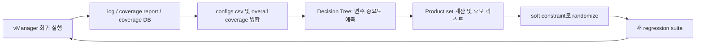

<!-- generated by yt-paper; edits will be overwritten -->

# Reaching 100% Functional Coverage Using Machine Learning: A Journey of Persistent Efforts

[:material-open-in-new: 원문 보기](https://dvcon-proceedings.org/wp-content/uploads/1022-2.pdf){ .md-button .md-button--primary target=_blank }

> Cross coverage 홀을 결정 트리로 예측한 랜덤 변수 조합으로 채우는 Python 기반 coverage agent를 제안하여, 모바일 SoC CSI IP에서 기준선이 70%를 넘지 못하는 동안 100% 기능 커버리지를 달성했다.

| 항목 | 내용 |
|---|---|
| 저자/출처 | Jaecheon Kim, Taewook Nam, Wonil Cho (Samsung Electronics Co., Ltd.) — 학회명은 문서에 명시되지 않음 (DVCon 관련 참고문헌 인용 구조로 보아 DVCon 계열 논문으로 추정되나 원문에 직접 표기되지 않음) |
| 유형 | PAPER |
| 카테고리 | Verification |
| ID | `ref-20261018-2c1c` |

## 핵심 인사이트

- Cross coverage는 개별 coverpoint보다 채우기 어려운데, 가중치가 불균일한 랜덤 변수가 섞이면 단순 반복 회귀로는 일부 bin이 영원히 생성되지 않을 수 있다 (예: 2:8 비율에서 미생성 조합 발생).
- 결정 트리를 white-box 모델로 사용해 각 랜덤 변수의 feature importance를 보고 '정확한 bin 번호 예측'보다 '상관된 변수 식별'에 초점을 둔 점이 핵심 설계 선택이다.
- 예측된 변수들의 product set을 soft constraint로 randomize()에 넣으면, 제약과 충돌하는 무효 조합은 자동으로 무시되어 안전하게 일반 랜덤 테스트로 흡수된다.
- 실패한 예측도 회귀 테스트 데이터로 축적되어 다음 예측의 학습 데이터가 되며, 후보 리스트를 예측 개수의 2배로 두어 다양한 조합을 탐색한다. 다만 잘못된 예측이 누적되어 강화될 수 있다는 한계도 저자들이 인정한다.
- 문서 결과는 134개 cross coverage, 14,616 bin 중 21개 cross에서 7,673 bin이 미충족인 IP에서 총 74,956회 테스트로 100%를 달성했고, 기준선은 100,000회 이상에서도 70% 미만이다. 단, 단일 IP 사례이며 수치 비교의 세부 조건은 원문 그림에 의존한다.

## 상세 요약

### 배경 및 문제 정의

IP RTL 복잡도가 증가하면서 constrained random verification 기반으로 기능 커버리지(functional coverage)를 닫는 일이 점점 어려워지고 있으며, 이는 검증 TAT(turn-around-time)를 늘리는 주요 요인이다. 저자들의 경험에 따르면 테스트 수가 늘어날수록 개별 coverpoint는 쉽게 채워지지만, 이들을 조합한 cross coverage는 잘 채워지지 않는다.

문서는 이를 확인하기 위해 세 가지 실험을 제시한다.

- 4개 랜덤 변수(값 개수 2, 6, 5, 7)로 구성된 cross_test_abcd(420 bin)는 균등 분포임에도 5,000회 실행에서 빈도 편차가 크다(최대 25, 최소 3).
- 한 변수의 비율을 2:8, 1:9 등으로 치우치게 하면 미생성 조합이 나타나며, 2:8에서 3개, 1:9에서 20개 조합이 생성되지 않았다.
- 따라서 단순 반복만으로는 cross bin이 잘 채워지지 않는다는 결론이다.

### 핵심 아키텍처 및 방법론

핵심 아이디어는 cross coverage가 coverpoint의 조합이고 coverpoint는 랜덤 변수로 제어되므로, 변수와 cross 간의 관계를 예측할 수 있으면 제3자(coverage agent)가 DV 엔지니어 없이 홀을 채울 수 있다는 것이다.

주요 구성 요소는 다음과 같다.

- **입력 데이터**: UVM의 uvm_field_* 매크로로 랜덤 변수를 한 줄로 로그에 출력하고(knobs.begin_elements = -1로 누락 방지), IMC 커버리지 리포트에서 cross 이름과 전체 bin 수, 구성 coverpoint 수를 얻는다.
- **예측 모델**: 결정 트리를 white-box 모델로 선택했다. 특징(feature)은 랜덤 변수, 타깃은 cross bin 번호(0은 미터치)이다. 핵심은 bin 번호 분류 정확도가 아니라 feature importance로 상관 변수를 찾는 것이다. 학습은 매 반복마다 80/20 무작위 분할로 이루어진다.
- **예측 활용**: 예측된 상위 변수들의 값 조합(product set)을 계산하여 아직 생성되지 않은 조합을 다음 회귀에 반영한다. 실패 시 무관한 조합이 들어가지만 일반 회귀와 유사하게 동작한다.
- **제약 처리**: 모든 생성 값은 soft constraint로 선언되어, 실제 제약과 충돌하는 조합은 무시되고 정상 랜덤화로 대체된다.
- **Coverage agent 워크플로**: Python으로 파일을 파싱·병합하고, 전체 커버리지가 100%인지 확인한 뒤 미달이면 분석→회귀 suite 생성→batch 실행→요약 저장을 반복한다. 요약 파일은 DV 엔지니어가 진행 상황을 점검하는 데 쓰인다.

**실패 대응 전략 (Section III-F)**

| Case | 상황 | 대응 |
|---|---|---|
| 1 | 예측 변수 수가 부족 | cross를 터치한 테스트를 무작위 선택해 회귀에 재투입 |
| 2 | 무관한 변수 조합이 우연히 전부 커버됨 | 동일하게 테스트 선택 후 회귀에 추가 |
| 3 | 잘못된 변수가 상위에 계속 등장 | product set 크기가 실제 bin 수보다 크면 오답으로 보고 후보 리스트의 다음 조합으로 넘김 |
| 4 | product set 조건을 만족해도 오답이 반복 | 후보 리스트를 예측 수의 2배로 두고, 2회 회귀 동안 커버리지가 변하지 않으면 해당 조합 제외 |
| 5 | 같은 값을 가진 다른 이름의 변수 | 후보 리스트에 하나만 남기도록 정리 |

### 실험 결과 및 결론

**예제 코드 (13개 랜덤 변수, 8 coverpoint, 2 cross)**

- cross_test_mode(720 bin)는 균등 분포임에도 약 6,000~7,000회 테스트가 필요했다.
- cross_test_xy(2,688 bin)는 불균등 분포로, 10,000회에도 미충족이었고 25,000회 연속 실행 후 99.74%(2,681/2,688)에 도달했다.
- coverage agent 적용 시 총 4,378회, 반복당 최대 1,000회, 5개 suite로 100%에 도달했다. cross_test_xy는 3회차에 57.66%→94.78%로 상승했으나 1,000회 제한 때문에 미달이었고, 5회차 예측 성공으로 100%에 도달했다. 4회차는 예측이 실패했지만 누적 테스트가 다음 예측에 도움이 되었다. cross_test_mode는 2회차에 완료되었다.

**실제 IP (CSI, mobile SoC ISP 블록)**

- 약 7,000개 랜덤 변수 중에서 cross 관련 변수를 찾아야 한다.
- 134개 cross coverage, 14,616 bin 중 첫 회귀 후 21개 cross가 미충족(미충족 bin 7,673개)이었다.
- 초기 회귀 20,290회 이후 coverage agent 적용으로 총 74,956회 만에 100%에 도달했다.
- 기준선(원래 회귀)은 100,000회 이상 실행해도 70% 미만에 머물렀다.
- 대표 사례: cross_cov_19는 첫 회귀 정보만으로 다음 회귀에서 100%, cross_cov_14는 여러 번 실패 후 점진적으로 성공, cross_cov_7은 계속 실패하다가 전략 적용으로 최종 100%에 도달했다.

**결론**: cross coverage 홀을 회귀 출력에서 학습한 예측으로 채우는 방식으로, DV 엔지니어의 수동 분석과 제약 수정 없이 기능 커버리지 클로저를 기준선보다 현저히 빠르게 달성했다고 저자들은 주장한다.

**검토상 참고 사항**: 본문에 일부 불일치가 보인다. Section III-A는 cross_test_xy를 2,688 bin으로, Case 3 예시는 2,668로 적고 있다. 또한 Table 4와 Table 5의 캡션이 동일하다. 단일 IP, 단일 예제 기반의 결과이므로 일반화에는 주의가 필요하다. 학회명도 원문에 명시되어 있지 않아 authors_or_venue에 추정임을 표기했다.

## 관련 영상

<iframe src="https://www.youtube-nocookie.com/embed/Xzi_4Shpd7U" title="[DVCON2025]Reaching 100% Functional Coverage Using Machine Learning: A Journey of Persistent Efforts" loading="lazy" allow="accelerometer; clipboard-write; encrypted-media; gyroscope; picture-in-picture; web-share" referrerpolicy="strict-origin-when-cross-origin" allowfullscreen></iframe>

**[DVCON2025]Reaching 100% Functional Coverage Using Machine Learning: A Journey of Persistent Efforts** — [YouTube에서 보기](https://www.youtube.com/watch?v=Xzi_4Shpd7U) · [영상 페이지](../../videos/Xzi_4Shpd7U.md)
