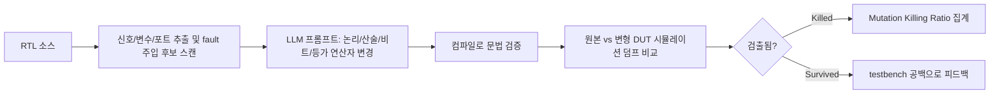
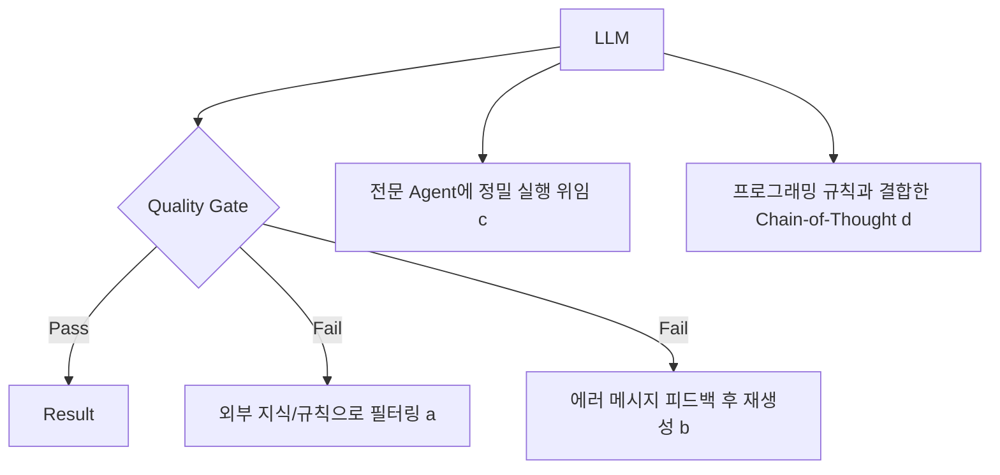

<!-- generated by yt-paper; edits will be overwritten -->

# Large Language Model for Verification: A Review and Its Application in Data Augmentation

[:material-open-in-new: 원문 보기](https://dvcon-proceedings.org/wp-content/uploads/1135.pdf){ .md-button .md-button--primary target=_blank }

> LLM을 검증(assertion 생성, 커버리지, 포멀, 디버깅, 테스트 자극 생성, RTL 생성 등)에 적용한 문헌을 리뷰하고, Code Llama 34B 기반 mutation 주입 실험으로 testbench 공백을 찾는 방식을 제시하며, LLM 출력을 그대로 쓰지 말고 quality gate·feedback·agent·CoT 같은 안전장치 패러다임을 적용해야 한다고 주장하는 논문.

| 항목 | 내용 |
|---|---|
| 저자/출처 | Dan Yu (Siemens Industry Software Inc.), Eman El Mandouh (Siemens Egypt), Waseem Raslan (Siemens Egypt), Harry Foster (Siemens Industry Software Inc), Tom Fitzpatrick (Siemens Industry Software Inc). 학회/출처는 본문에 명시되지 않음. 참고: 제공된 저자 힌트 "Laura Leblanc"는 원문 저자 표기와 일치하지 않음. |
| 유형 | PAPER |
| 카테고리 | Verification |
| ID | `ref-20261018-3545` |

## 핵심 인사이트

- LLM 출력은 예측 오류를 내포하므로 검증 작업에 raw 출력을 그대로 쓰면 안 된다는 것이 저자들의 핵심 주장이며, 이를 위해 quality gate/guardrail, self-check feedback loop, external agent, chain-of-thought(프로그램적 규칙 결합) 네 가지 패러다임을 제시한다.
- LLM 기반 mutation 주입 실험에서 LLM이 만든 변경의 75%만 컴파일되고 25%는 수동 수정이 필요했으며, testbench는 평균 50.59%의 주입 변경만 검출해 49.41%는 놓쳤다. 즉 LLM은 testbench 공백을 찾는 도구로 유용할 수 있다.
- 문헌 리뷰에 따르면 HDL은 학습 데이터에서 과소 대표되어(GitHub 기준 Verilog/SV/VHDL 약 39.5k 프로젝트 vs JavaScript 6.8M) 환각과 지시 따르기 실패가 잦다. 도메인 특화 데이터 확보와 파인튜닝이 중요하다.
- Assertion 생성 연구([3])에서는 생성된 assertion 중 정답이 9.29%에 불과했으나, 상세 프롬프트 구성 요소의 최적 조합이 정답 assertion의 80%를 기여해 프롬프트 컨텍스트의 중요성이 확인되었다.
- 본문에 정량 근거가 부족한 부분이 있다. 초록은 수동 데이터 준비 대비 생산성·품질 향상을 주장하지만 본문 실험에는 수동 baseline과의 직접 비교가 제시되지 않으며, 초록의 data augmentation 실험에 해당하는 독립 섹션도 제공된 본문에서 확인되지 않는다.

## 상세 요약

### 배경 및 문제 정의

기능 검증(functional verification)은 스펙, RTL, 테스트 플랜, 테스트벤치, 로그 등 다양한 텍스트 데이터를 다루므로 언어 모델의 활용이 핵심이라고 문서는 짚는다. GPT-3.5/4와 LLaMA 계열 등 사전학습 LLM의 등장으로 EDA와 검증 분야에 LLM을 적용하려는 연구가 최근 2년 사이 활발해졌다. 그러나 문서는 다음 세 가지 문제를 지적한다.

- **예측 오류**: Universal Approximation Theorem을 근거로, 트랜스포머 기반 LLM도 예측 오류를 피할 수 없으므로 LLM 응답을 검증 작업에 직접 적용하면 안 된다고 주장한다.
- **HDL 데이터 부족**: HDL은 학습 코퍼스에서 극히 일부만 차지해 환각과 지시 따르기 실패가 발생한다.
- **기존 방법의 한계**: CNL 기반 assertion 변환기는 새 언어 학습 부담이 있고 학습 데이터가 적어 성능이 낮다.

### 핵심 아키텍처 및 방법론

**1) 문헌 리뷰 (Section II)**

| 영역 | 주요 연구 | 문서가 보고한 결과 |
|---|---|---|
| Assertion 생성 | nl2sva[2], [3] | [3]에서 정답 assertion 9.29%, 최적 프롬프트 조합이 정답의 80% 기여 |
| Coverage closure | [4] Python 커버리지 예측 | 라인 단위 20–30%, 문장 단위 GPT-4 zero/one/multi-shot 84.47/90.71/90.5% |
| Formal verification | Baldur[5] | 700M 파라미터 소형 모델, 자동 증명 도구와 결합 시 Isabelle/HOL 정리 65.7% 증명 |
| Debugging | AutoFL[6], Libro[7] | AutoFL은 acc@1 기준 최고 고전 기법 대비 40% 많은 신규 버그 식별; Libro는 버그의 33.5% 재현 |
| 테스트 자극 생성 | LLM4DV[8] | primitive prefetcher 98.94% 커버리지, Ibex 디코더 86.19%, Ibex CPU 전체는 5.61%에 그침 |
| 보안 | DIVAS[9] | CWE 생성 성공률 40–55% (GPT-4), 최종 정책 수정 성공률은 미언급 |
| 코드 생성 | [10] 파인튜닝 Verilog LLM | 기본/중급/고급 문제 컴파일 성공 98.7/72.8/59.9%; 기능적 정답 41.9% vs code-davinci-002 35.4% |

**2) Mutation 기반 테스트 실험 (Section III-A)**

문서의 실험 파이프라인은 다음과 같다.

- 사용 모델: 온프레미스 호스팅이 가능한 오픈소스 Code Llama 34B [10] (IP 유출 우려 때문)
- 대상: 사내 설계 3개, 설계당 12개 변형, 주입 변경 수는 63/69/105

**3) 설계 생성 전략 비교 (Section III-B)**

- **Bottom-up**: 2-stage `multadd_pipeline`(8-bit 4입력, 17-bit 출력)을 작은 블록부터 점진 확장. 1차 생성 코드는 출력 포트가 wire로 잘못 선언되었으나 추가 프롬프트 1회로 수정되었고, 최종적으로 컴파일 오류·경고 없이 생성되었다.
- **Top-down**: "Flipped Interaction Pattern"[14]으로 LLM이 질문을 던져 스펙을 정한 뒤 16-bit CPU를 생성. ALU, Register File, Control Unit, Instruction/Data Memory를 만들고 상위 모듈에서 연결했으며, 하위 모듈이 빠진 동안 합성 lint 위반이 발생했으나 모든 모듈 추가 후 사라졌다.

**4) 설계 이해 및 시각화 (Section III-C)**

생성된 `control_operation` 모듈을 LLM이 FSM으로 인식해 Graphviz dot 다이어그램을 생성했다. 첫 시도는 루프백 전이와 논리 연산자에서 오류가 있었으나 추가 프롬프트 1회로 수정되었다. 다이어그램 유형을 지정하지 않으면 block diagram이 기본으로 생성되었다.

**5) 4가지 적용 패러다임 (Section IV, Figure 5)**

- (a) Quality Gate / Guardrail: LLM이 접근할 수 없는 도메인 지식이나 규칙으로 결과를 걸러냄
- (b) Self-check feedback loop: 품질 게이트의 에러 메시지를 LLM에 되돌려 만족할 때까지 반복
- (c) External agent: LLM은 이해와 오케스트레이션을, 정밀 작업은 전문 에이전트가 담당
- (d) Chain-of-Thought: 프로그래밍 규칙 집합을 LLM과 결합해 복잡 문제 해결. 저자들은 본인들의 실험이 주로 (d)를 따랐다고 밝힌다. CodeChain[15]은 전체 정확도 61.5%로 GPT-4 34.75%, GPT-4+human feedback self-repair 52.60%보다 높다고 보고된다.

### 실험 결과 및 결론

**Mutation 실험 결과 (Table 1, 원문 수치 그대로)**

| 항목 | Design_1 | Design_2 | Design_3 | 평균 |
|---|---|---|---|---|
| 생성 설계 버전 수 | 12 | 12 | 12 | 12 |
| 주입된 LLM RTL 변경 수 | 69 | 63 | 105 | 79 |
| Mutation Killing Ratio | 38.66% | 66.67% | 46.43% | 50.59% |
| 미검출 비율 (testbench 결함) | 61.34% | 33.33% | 53.57% | 49.41% |

평균 killing ratio는 세 값의 산술 평균과 일치한다. 다만 주입 변경 수의 평균 79는 (69+63+105)/3 ≈ 79로 맞다. 문서는 LLM 생성 변경의 75%가 컴파일되고 25%는 수동 수정이 필요했다고 보고한다.

**주요 결론**

- 저자들은 LLM 기반 mutation 주입이 testbench 공백 식별을 자동화하는 데 유용하다고 결론짓는다.
- 설계 생성 실험에서 검증 엔지니어의 설계 생성 단계 생산성이 크게 향상되었다고 주장한다.
- 전반적으로 LLM의 성능과 사용성은 고전적 알고리즘과 방법론의 최선에 아직 미치지 못하므로, 원시 출력 대신 위 패러다임을 적용해야 한다고 권고한다.

**제한 사항 및 확인 필요 사항**

- 초록은 data augmentation을 위해 설계 변형과 검증 코드를 자동 생성했다고 하지만, 제공된 본문에는 data augmentation 전용 실험 섹션이나 정량 결과가 없다.
- 초록의 "significant productivity and quality improvements"는 수동 데이터 준비 대비 비교 수치로 뒷받침되지 않는다.
- 제목에 담긴 리뷰 범위와 달리 본문의 mutation 실험은 3개 사내 설계에 한정되며 공개 재현 정보(데이터셋, 프롬프트 전문)가 부족하다.
- 참고문헌 [15]의 저자 표기와 [11] 등 일부 항목이 깨져 있거나 불완전하다.
- 본문 Table 2 캡션이 Table 1과 중복되어 있으나 실제 내용은 프롬프트 기록이다.

## 관련 영상

<iframe src="https://www.youtube-nocookie.com/embed/KKPVxcHXagQ" title="[DVCON2024]Large Language Model for Verification: A Review and Its Application in Data Augmentation" loading="lazy" allow="accelerometer; clipboard-write; encrypted-media; gyroscope; picture-in-picture; web-share" referrerpolicy="strict-origin-when-cross-origin" allowfullscreen></iframe>

**[DVCON2024]Large Language Model for Verification: A Review and Its Application in Data Augmentation** — [YouTube에서 보기](https://www.youtube.com/watch?v=KKPVxcHXagQ) · [영상 페이지](../../videos/KKPVxcHXagQ.md)
