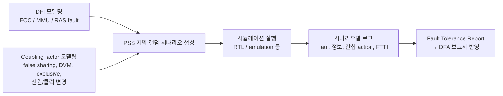

<!-- generated by yt-paper; edits will be overwritten -->

# ISO 26262 Dependent Failure Analysis using PSS

[:material-open-in-new: 원문 보기](https://dvcon-proceedings.org/wp-content/uploads/iso-26262-dependent-failure-analysis-using-pss.pdf){ .md-button .md-button--primary target=_blank }

> PSS 모델로 공유 메모리 결함(DFI)과 coherency 간섭 요소(coupling factor)를 제약 랜덤 조합으로 자동 생성해, ISO 26262 DFA에 필요한 dependent failure 시나리오와 Fault Tolerance Report를 만드는 방법을 제시한 논문.

| 항목 | 내용 |
|---|---|
| 저자/출처 | Moonki Jang, Jiwoong Kim, Dongjoo Kim (Samsung Electronics); Shai Fuss, Zeev Kirshenbaum (Cadence Design Systems). 본문에 학회/저널명은 명시되지 않음 (참고문헌 [8]은 Jang et al., DVCon 2019 논문) |
| 유형 | PAPER |
| 카테고리 | Verification |
| ID | `ref-20261018-3557` |

## 핵심 인사이트

- DFA에서 필요한 시나리오 수(DFI × coupling factor 조합)가 수백 개에 달하므로, 수작업 directed test 대신 PSS의 모델 기반 재사용 action과 constraint 기반 랜덤 생성이 현실적인 접근이라는 점이 핵심 동기다.
- DFI는 공유 메모리 영역의 fault injection(uncorrectable ECC, MMU translation fault, RAS error)으로 정의되고, coupling factor는 false sharing, DVM broadcast, exclusive access, 클러스터 전원 차단/클럭 변경 같은 coherency 트래픽으로 정의된다. 즉 'fault'와 '간섭 트래픽'을 분리해 조합하는 구조다.
- RAS 기반 fault injection은 SW 에러 처리 검증에는 유용하지만 실제 cache 셀 결함이 아닌 모델링된 가짜 에러라는 한계가 본문에서 명시되어 있어, 결과 해석 시 주의가 필요하다.
- 시뮬레이션마다 injected fault, 간섭 action, 최대 FTTI를 기록해 FTR로 집계하면, 어떤 coupling factor가 복구를 가장 크게 지연시키는지 정량적으로 식별할 수 있다. 이는 DFA 보고서의 근거 자료로 연결된다.
- 본문은 방법론과 사용 흐름 중심이며, 시나리오 규모 외의 정량적 검증 결과(커버리지 수치, 버그 건수, 실제 FTTI 값 등)는 제시되지 않았다. 효과 주장은 정성적 평가에 가깝다.

## 상세 요약

### 배경 및 문제 정의

- ISO 26262(특히 Part 11, 반도체 가이드)는 공유 자원의 한 요소 고장이 다른 요소에 영향을 주는 **dependent failure**를 분석하도록 요구한다. 이를 위해 DFA(Dependent Failure Analysis)를 수행한다.
- Dependent failure는 두 가지로 분류된다.
  - **Cascading failure**: 하나의 root cause로 한 요소가 고장나고, 그것이 다른 요소의 dependent failure를 유발
  - **Common cause failure**: 단일 사건/root cause로 둘 이상의 요소가 동시에 고장
- 자동차 SoC는 메모리, interconnect, IO를 여러 코어와 IP가 공유하므로 이러한 연쇄 고장 위험이 크다. 모바일에서는 재부팅으로 해결될 수 있는 문제도 차량에서는 치명적일 수 있다.
- DFA의 절차는 (1) DFI(Dependent Failure Initiator) 식별 → (2) DFI별 coupling factor 탐색 → (3) 안전 메커니즘과 방지/완화 대책 검증 순서다.
- 문제의 핵심은 DFI × coupling factor의 조합이 매우 많아 수백 개 시나리오가 필요하다는 점이며, 이를 수작업으로 만들고 유지하기 어렵다는 것이다.

### 핵심 아키텍처 및 방법론

전체 흐름은 다음과 같이 정리할 수 있다.

**1) DFI 정의 (공유 메모리 fault injection)**
- **Uncorrectable ECC error 주입**: backdoor로 메모리 데이터를 ECC beat와 불일치하게 변경해 읽기 시 ECC 에러를 유도. DRAM / L3 / L2 cache 등 coherency 도메인이 다른 대상에 적용.
- **MMU translation fault**: page table의 page descriptor valid 필드를 조작해 원하는 시점에 translation fault 발생.
- **RAS error injection**: ARMv8 RAS 확장의 fault injection 모델을 사용해 CPU, interrupt controller, system MMU에 에러 인터럽트 유도. 이후 코어/클러스터 리셋을 가해 복구 과정이 coherency에 미치는 영향을 검증.

**2) Coupling factor 정의 (간섭 트래픽)**
- **False sharing**: 서로 다른 coherent master가 같은 64바이트 cache line 내 서로 다른 주소에 쓰기 → 매 쓰기마다 snoop 트랜잭션이 발생. 이 cache line에 fault가 있으면 모든 참여 master가 영향을 받는다.
- **DVM broadcast**: Cluster_0의 DVM 요청을 DVM controller가 MMU 요소들에 전달하고 응답을 수집. 메모리 fault 후 주소 재매핑 과정에서 DVM이 발생하는데, 특정 요소가 다른 고장으로 리셋 상태에 들어가면 응답이 오지 않아 복구가 실패할 수 있다.
- **Exclusive access**: global exclusive monitor가 한 PE에만 region 접근을 허용하고 나머지는 lock 해제까지 대기. 해당 영역에 에러가 발생하면 대기 PE가 무기한 대기할 수 있다.
- 추가로 CPU 클러스터 전원 차단(power down)과 동적 CPU 클럭 변경도 HW coherency 프로토콜 에러의 coupling factor로 사용.

**3) PSS 시나리오 구성**
- Cadence Perspec System Verifier의 System Modeling Library(SML)를 기반으로, false sharing, true sharing, RAS 주입 등 built-in action을 활용하고 프로젝트 특화 action을 추가했다.
- 예시 시나리오: false sharing 트래픽 중 **85%는 read-increment-write**, **15%는 error injection**(RAS error, MMU fault, ECC error, CPU internal exception 중 선택). `select` 블록의 가중치 기반 랜덤 선택을 사용하고, 이를 `cdn_coherency_ops_c::false_sharing_random_operator<activity_selection>` 템플릿 형태로 library action에 삽입한다. (PSS 1.1 template type 사용)
- 복합 시나리오: false sharing + fault injection을 `parallel` 블록으로 간섭 action(클럭 변경, 코어 전원 on/off, exclusive access)과 동시에 실행. 간섭 action은 `repeat (10)` 안에서 `select`로 랜덤 선택된다.
- Library action이 자동으로 처리하는 요소: 시스템 구성 테이블 기반 core 선택, 다중 코어 간 synchronization, 메모리 할당.

**4) Self-checking과 Coverage**
- Self-checking: 메모리에 쓴 모든 데이터를 테스트 중 다시 읽어 검증하도록 PSS 모델과 library에 내장.
- Functional coverage: 에러 종류, 에러를 주입한 프로세서, 동시에 수행된 valid traffic을 cross coverage로 기록 (`proc_x_err_x_traffic`). 여러 실행 결과를 합산해 커버리지 목표를 달성.

**5) FTR(Fault Tolerance Report) 생성**
- FMEA 항목에서 DFI를 선택하고, PSS가 간섭 stimulus(coupling factor)를 골라 dependent failure 시나리오를 만든다.
- 시뮬레이션 종료 시 각 시나리오에 대해 다음을 출력한다.
  - 주입된 fault 종류와 주소, 주입 시각, 복구 완료 시각
  - 복구를 지연시키기 위해 수행된 간섭 action (다른 에러 주입도 포함 가능)
  - 최대 FTTI(Fault Tolerance Time Interval): 복구에 걸린 시간. 수백 개 조건 중 최댓값을 통해 복구에 가장 큰 영향을 준 coupling factor를 식별
  - 외부 recovery monitor 정보: 복구 실패 상황 기록
- 이를 집계한 FTR은 DFA 보고서에 반영되어 다양한 에러 조건에서의 안전성 근거로 사용된다. 리포트 집계와 커버리지 분석에는 Cadence vManager를 사용했다.

### 실험 결과 및 결론

- 실험 범위: Samsung의 자동차 SoC 프로젝트에서 **시뮬레이션 수준**으로 DFA를 수행했다. 공유 메모리 fault가 발생했을 때 coherency가 시스템에 미치는 영향을 분석했다.
- 보고된 성과는 다음과 같다.
  - 가능한 dependent failure를 체계적으로 분석하고 안전 사양(safety specification)을 준비할 수 있었다.
  - PSS 모델의 재사용성과 제약 랜덤 생성으로 안전 요구사항에 정의된 다양한 조건의 테스트를 쉽게 생성했다.
  - 특정 목표 조건을 재현하는 데 PSS가 효과적이라고 평가했으며, 일반 SoC 검증 프로세스에도 적용 가능하다고 주장한다.
- 한계 및 주의점
  - 본문에는 커버리지 달성률, 발견된 버그 건수, 실제 FTTI 수치, 시나리오 실행 시간 등 정량적 결과가 제시되지 않았다. 효과에 대한 평가는 대부분 정성적이다.
  - RAS 주입은 실제 셀 결함이 아닌 모델링된 에러이므로, 안전 주장에는 별도 근거가 필요하다.
  - "수백 개 시나리오"의 구체적 구성, 시나리오 간 중복 제거 방식, constraint 설계 방법은 자세히 다뤄지지 않았다.
- 결론: PSS의 모델 기반 재사용과 제약 랜덤 생성을 활용하면, ISO 26262 DFA에 필요한 DFI × coupling factor 조합을 자동 생성하고 FTR 형태로 근거를 남길 수 있다. 이는 safety verification 전반에 적용 가능한 방법론으로 제시된다.
- 참고: 제공된 제목 힌트의 저자명 "Laura Hyslop"은 본문에서 확인되지 않아, 저자 항목은 원문 기재 저자로 작성했다."

## 관련 영상

<iframe src="https://www.youtube-nocookie.com/embed/J8PEI2rbgXM" title="[DVCON2020] ISO 26262 Dependent Failure Analysis using PSS" loading="lazy" allow="accelerometer; clipboard-write; encrypted-media; gyroscope; picture-in-picture; web-share" referrerpolicy="strict-origin-when-cross-origin" allowfullscreen></iframe>

**[DVCON2020] ISO 26262 Dependent Failure Analysis using PSS** — [YouTube에서 보기](https://www.youtube.com/watch?v=J8PEI2rbgXM) · [영상 페이지](../../videos/J8PEI2rbgXM.md)
