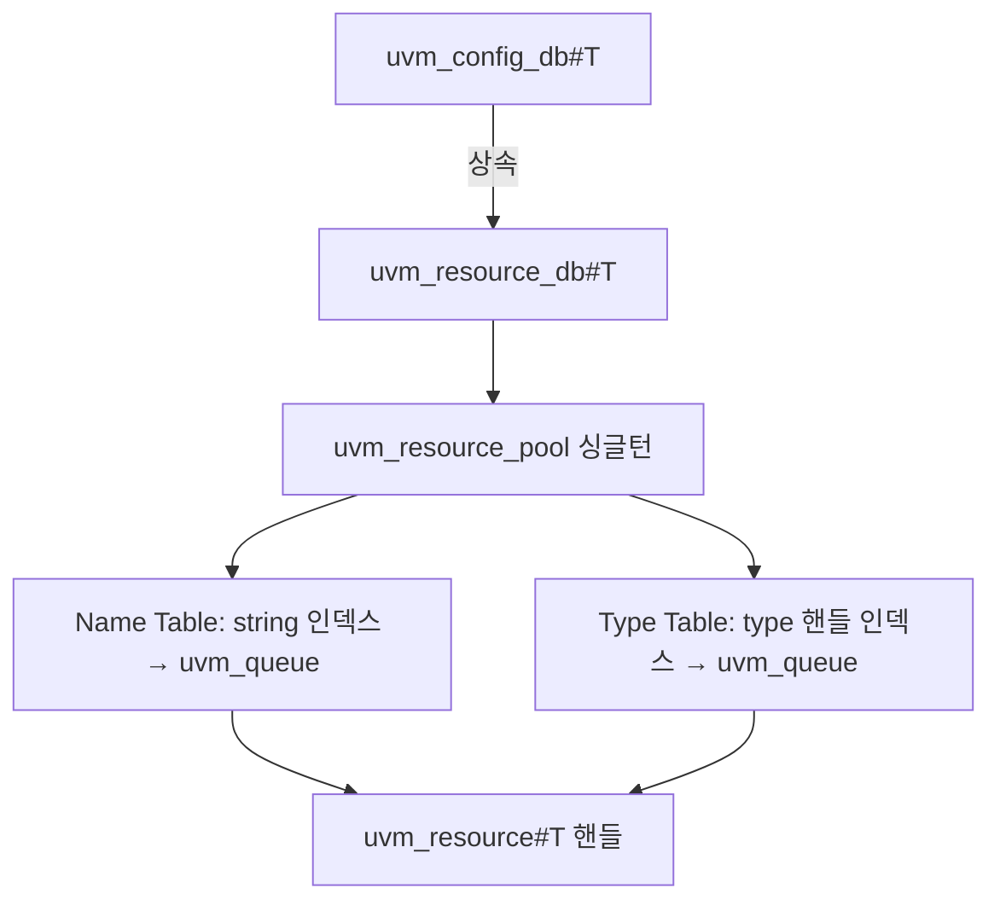

<!-- generated by yt-paper; edits will be overwritten -->

# The Untapped Power of UVM Resources and Why Engineers Should Use the uvm_resource_db API

[:material-open-in-new: 원문 보기](https://dvcon-proceedings.org/wp-content/uploads/1072-The-Untapped-Power-of-UVM-Resources-and-Why-Engineers-Should-Use-the-uvm_resource_db-API.pdf){ .md-button .md-button--primary target=_blank }

> UVM의 resource database는 하나뿐이며, uvm_resource_db API는 uvm_config_db보다 강력하고 단순하므로 컴포넌트 외부(시퀀스, 모듈)에서도 쓸 수 있는 uvm_resource_db로 전환해야 한다는 주장을 담은 논문.

| 항목 | 내용 |
|---|---|
| 저자/출처 | Clifford E. Cummings, Heath Chambers, Mark Glasser (Paradigm Works, Inc. / HMC Design Verification / Elastics.cloud). 본문에 DVCon 2023 추정치가 언급되어 있으나 발표 학회명은 명시되어 있지 않음 |
| 유형 | PAPER |
| 카테고리 | Verification |
| ID | `ref-20261018-40d8` |

## 핵심 인사이트

- UVM에는 resource database가 하나만 있으며, uvm_config_db#()는 uvm_resource_db#()를 상속한 래퍼다. 따라서 uvm_resource_db로 저장한 항목은 uvm_config_db로 읽을 수 있지만, 비컴포넌트 scope로 저장한 항목은 반대 방향이 성립하지 않는다.
- uvm_config_db::set/get은 cntxt(uvm_component)와 inst_name을 결합해 full-path 문자열 scope를 만들기 때문에 시퀀스나 모듈에서 쓸 수 없다. 이로 인해 p_sequencer와 virtual sequencer 같은 우회 구조가 계속 쓰이게 된다고 저자들은 지적한다.
- uvm_resource_db의 scope는 단순 정규식 문자열이므로 실제 컴포넌트 경로와 일치할 필요가 없다. 'LCNT::*' 같은 pseudo scope로 top module이나 sequence가 값을 주고받을 수 있으며, 이는 명명 규칙을 일관되게 정하는 것이 전제다.
- read_by_name과 read_by_type은 Name Table과 Type Table 두 인덱스로 리소스를 찾는다. 반환 상태를 if-test로 확인하고 실패 시 `uvm_fatal을 쓰면 null pointer 디버깅 시간을 줄일 수 있다는 것이 실무 권고다.
- 저자들은 DVCon 2023 시점에 UVM 엔지니어의 90% 이상이 잘못된 API(uvm_config_db)를 쓰고 있다고 추정한다. 이 수치는 저자 추정이며 근거 조사가 본문에 제시되지 않았으므로 정량적 사실로 받아들이기보다 문제 제기로 읽는 것이 적절하다.

## 상세 요약

### 배경 및 문제 정의

- OVM의 `set_config_*` API는 정수, 문자열, 객체 핸들만 저장할 수 있었고 여러 컴포넌트에 흩어져 비효율적이었다. UVM은 이를 대체하기 위해 중앙 집중식 resource database를 도입했으며, 임의 타입을 저장하고 testbench 어디서든 접근할 수 있다.
- 기존 OVM 사용자의 전환을 돕기 위해 `set_config_*`를 `uvm_config_db` 기반으로 다시 구현한 호환 계층이 추가되었다. 원래 의도는 "transition layer"였지만, 저자들은 실제로는 대부분의 엔지니어가 이를 주 인터페이스로 사용하고 있다고 주장한다.
- 저자들의 주장에 따르면 `uvm_config_db`는 UVM 컴포넌트만 set/get할 수 있다는 제약이 있고, 그 결과 p_sequencer, virtual sequencer 같은 구조가 계속 쓰인다. 초기 UVM 서적과 예제가 `uvm_config_db`를 권장한 것이 잘못된 사용의 원인이라고 설명한다.
- 리소스 DB 설계 목표는 (1) virtual interface를 일반 설정 항목처럼 다루기, (2) 저장 타입 제약 제거, (3) 컴포넌트 계층에서 분리해 비컴포넌트 객체도 접근하기, (4) 엔티티 간 범용 데이터 공유였다.

### 핵심 아키텍처 및 방법론

**1. 구조: 단일 DB, 두 개의 인터페이스**

- `uvm_resource_pool`은 테스트 시작 시 자동 생성되는 싱글턴이다. 내부의 Name Table과 Type Table은 리소스 자체가 아니라 `uvm_queue` 핸들을 담는 연관 배열이다.
- 각 리소스는 타입, scope(정규식 문자열), 값 세 가지를 가진다. `uvm_resource#(T)`는 `uvm_resource_base`의 타입 특화 파생이며, 큐에 넣을 때 upcast되고 꺼낼 때 `$cast`로 downcast된다.

**2. 저장(set) 절차**

1. Name Table에서 이름 인덱스를 찾고, 없으면 큐를 새로 만들어 등록한다.
2. 리소스 핸들을 해당 큐에 push한다.
3. Type Table에서 타입 인덱스를 찾고, 같은 방식으로 큐에 push한다.

하나의 리소스가 두 테이블에서 모두 접근 가능하다. 같은 이름이나 타입을 공유하는 리소스는 같은 큐에 쌓이며, 구분은 scope 정규식으로 한다.

**3. 조회(read_by_name / read_by_type)**

- 인덱스에 해당하는 큐를 `$cast`한 뒤, 호출자의 `get_full_name()`으로 만든 경로 문자열이 scope 정규식과 일치하는 항목을 Match_Queue에 모은다. 맨 위 항목의 값을 반환한다.
- `read_by_type`은 이름을 몰라도 타입으로 조회할 수 있으며, 이는 `uvm_config_db`에는 없는 기능이다.
- 마지막 인자 `this`는 디버그 audit trace용이다. 클래스 내부에서는 `this`를, 모듈에서는 `null`을 권장한다.
- 우선순위 가중치 같은 고급 기능도 있지만 저자들은 일반적으로 고유한 scope 설계로 매칭을 제어하는 방식을 권장한다.

**4. Pseudo scope**

- scope는 실제 컴포넌트 경로와 맞출 필요가 없는 문자열이다. Mark Glasser의 2014 DVCon-India 논문에서 제시된 규칙을 따른다: 공통 prefix와 드물게 쓰이는 구분자(`::`)를 사용한다.
- 예: `uvm_resource_db#(int)::set("LCNT::*", "LCNT", 10);`. 이 값은 sequence 등 컴포넌트가 아닌 객체가 읽을 수 있다. `uvm_config_db`로는 이 방식이 불가능하다.

**5. 두 API의 차이점**

| 항목 | uvm_resource_db | uvm_config_db |
|---|---|---|
| 저장 scope | 임의 문자열(pseudo scope 가능) | 유효한 컴포넌트 경로만 가능 |
| 호출자 | 컴포넌트, 시퀀스, 모듈 | 컴포넌트 중심 |
| 조회 방식 | read_by_name, read_by_type | get (이름 인덱스만) |
| 구현 | 기본 계층 | uvm_resource_db를 상속해 scope 처리를 추가 |

- `uvm_config_db`의 set은 cntxt와 inst_name을 합쳐 full-path를 만들고 wildcard를 포함시키므로 시뮬레이션 효율이 약간 떨어진다는 것이 저자들의 설명이다.
- 호환성 측면에서 `uvm_resource_db`로 저장한 항목 중 비컴포넌트 scope로 저장된 것은 `uvm_config_db`로 읽을 수 없다.

**6. 마이그레이션 가이드(섹션 IX)**

- top module의 `uvm_config_db::set(null, "*", ...)`는 `uvm_resource_db#(...)::set("*", ...)`로 바꾼다.
- 에이전트의 `set(this, "", "cfg", cfg)`는 `set(get_full_name(), "cfg", cfg, this)`로 바꾼다.
- 하위 컴포넌트 대상 set은 `{get_full_name(), ".drv"}` 같은 문자열 scope로 대체한다.
- 조회는 `read_by_name(get_full_name(), ...)` 또는 `read_by_type`으로 바꾼다.

**7. p_sequencer 회피(섹션 X, 본문 잘림)**

본문은 sequence가 testbench 정보를 얻기 위해 `uvm_declare_p_sequencer` 매크로로 p_sequencer 핸들을 만드는 관행을 소개하는 지점에서 끝난다. 이 섹션의 결론(uvm_resource_db로 대체하는 방법)은 본문에 포함되지 않았다.

### 실험 결과 및 결론

- 본 문서는 벤치마크나 시뮬레이션 측정 결과를 제시하지 않는다. 주장은 API 구조 분석, 소스 코드 흐름 설명, 사용 예제에 근거한다.
- 저자들의 결론은 다음과 같다. `uvm_resource_db`는 임의 타입 저장, 비컴포넌트 접근, 타입 기반 조회, pseudo scope를 지원하므로 `uvm_config_db`보다 강력하고 문법이 단순하다. 따라서 엔지니어는 `uvm_config_db` 사용을 중단하고 `uvm_resource_db`로 전환해야 한다.
- 실무적 시사점: 기존 코드에서 `uvm_config_db`를 쓰는 경우 scope 문자열 규칙을 먼저 정리하고, 리소스를 읽는 쪽에서 if-test로 누락을 검출하도록 함께 개선하는 것이 좋다. 다만 "90% 이상" 같은 사용 비율은 저자 추정이며, 전환 시 기존 `uvm_config_db` 기반 계층과의 호환성은 실제 프로젝트에서 검증이 필요하다.
- 문서가 잘려 있으므로 p_sequencer 대체 예제와 전체 결론부는 원문에서 확인해야 한다.

## 관련 영상

<iframe src="https://www.youtube-nocookie.com/embed/lPtRkWNiksg" title="[DVCON2023]The Untapped Power of UVM Resources and Why Engineers Should Use the uvm_resource_db API" loading="lazy" allow="accelerometer; clipboard-write; encrypted-media; gyroscope; picture-in-picture; web-share" referrerpolicy="strict-origin-when-cross-origin" allowfullscreen></iframe>

**[DVCON2023]The Untapped Power of UVM Resources and Why Engineers Should Use the uvm_resource_db API** — [YouTube에서 보기](https://www.youtube.com/watch?v=lPtRkWNiksg) · [영상 페이지](../../videos/lPtRkWNiksg.md)
