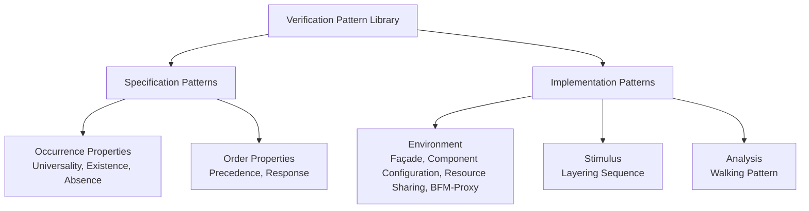

<!-- generated by yt-paper; edits will be overwritten -->

# Verification Patterns – Taking Reuse to the Next Level

[:material-open-in-new: 원문 보기](https://dvcon-proceedings.org/wp-content/uploads/verification-patterns-taking-reuse-to-the-next-level.pdf){ .md-button .md-button--primary target=_blank }

> 설계·검증 패턴을 Specification/Implementation 두 범주로 체계화하고, 템플릿과 property scope 개념으로 재사용 가능한 검증 패턴 라이브러리를 구축하는 방법론을 제시한 논문.

| 항목 | 내용 |
|---|---|
| 저자/출처 | Harry Foster, Michael Horn, Bob Oden, Pradeep Salla, Hans van der Schoot (Mentor Graphics Corporation). 문서에 학회명은 명시되어 있지 않음. |
| 유형 | PAPER |
| 카테고리 | Verification |
| ID | `ref-20261018-461f` |

## 핵심 인사이트

- 검증 패턴의 재사용성을 높이는 핵심은 문제-해결 쌍을 엔진(시뮬레이션/에뮬레이션/formal)과 무관하게 정리하는 일관된 템플릿이며, 논문은 Intent/Motivation/Applicability/Implementation/Example/Scope 등으로 구성된 문서 형식을 제안한다.
- Dwyer et al.의 property scope(global, before, after, between, after-until) 개념을 쓰면 기본 패턴 하나로 여러 유사 문제를 커버할 수 있어 Assertion-Based Design의 중복 패턴 문제를 줄인다. 다만 before/between 등은 implies 구조 때문에 툴 지원 및 성능 이슈가 있을 수 있다.
- Forbidden Sequence 패턴 예제는 공정한 2-client arbiter의 fairness를 `!gnt[i] throughout $rose(gnt[j])[->2]` 형태로 표현하고, 이를 파라미터화된 property와 generate로 n-client로 확장하는 방식을 보여준다.
- BFM-Proxy Pair 패턴은 HVL 클래스 proxy와 HDL BFM 인터페이스를 짝지어 시뮬레이션과 에뮬레이션에서 동일한 UVM 컴포넌트 구조를 재사용하게 하는 분할(split transactor) 설계 방식이다. 에뮬레이션 전환 시 testbench 재사용성을 높이는 실용적 접근이다.
- Resource Sharing 패턴(uvm_config_db의 cntxt/inst_name/field_name 활용)은 테스트 작성자가 환경 계층 구조를 몰라도 인터페이스, 설정, sequencer 자원에 접근하게 해 test 작성 부담과 수평·수직 재사용 비용을 낮춘다.

## 상세 요약

### 배경 및 문제 정의

- 디자인 패턴은 반복되는 문제에 대한 검증된 해법을 일반화한 것으로, 건축(Alexander, 1977)과 소프트웨어(GoF, 1994)에서 정립되었다.
- 검증 분야에서도 Dwyer et al.(1998)의 property specification 패턴, Foster et al.(2004)의 assertion-based design 패턴, 그리고 UVM 관련 OO 패턴 문헌 등 패턴 활용 사례는 많다.
- 그러나 이 패턴들은 여러 플랫폼·DB·형식에 흩어져 있어 검색과 재활용이 어렵고, 기존 연구는 주로 시뮬레이션 testbench 코딩 측면에 치우쳐 있었다.
- 저자들은 (1) 명세부터 구현까지 검증 전 영역을 포괄하고, (2) formal, 시뮬레이션, 에뮬레이션 등 엔진에 무관한, (3) 검색 가능한 패턴 라이브러리를 구축하기 위한 체계적 절차를 제시하는 것을 목표로 한다.

### 핵심 아키텍처 및 방법론

**1) 패턴 분류 체계**

- GoF(Creational/Structural/Behavioral), Buschmann(Architectural/Design/Idiom), Fowler(데이터·컴포넌트 배치) 분류를 검토한 뒤, 설계·검증 흐름에 맞춰 두 대범주로 단순화했다.
- Specification 패턴은 property 기반(assertion 또는 cover)을 우선 다룬다. 복합 property는 기본 occurrence/order 패턴의 조합으로 만든다.
- Implementation 패턴은 testbench 구축 문제를 다룬다. GoF 패턴(Factory, Observer, Template Method, Command 등)이 UVM의 phase, TLM, analysis port, config_db 등에 대응된다고 설명한다. Environment는 구조·설정·동기화를, Stimulus와 Analysis는 서로 독립적으로 재사용되도록 나눈다.

**2) 패턴 문서 템플릿**

Pattern Name, Intent(1~2문장의 일반 목표), Motivation(구체적 문제 시나리오, 해법 없이 서술), Applicability(일반화된 적용 범위), Structure(구현 패턴 필수), Implementation(해법), Example(Motivation의 동일 문제를 풀어서 보여줌), Scope(명세 패턴 권장), Consequences, Related Patterns, Contribution으로 구성된다.

**3) Property scope 개념**

Base property P에 enabling 조건 Q, fulfilling 조건 R을 붙여 P가 성립해야 할 실행 구간을 정의한다.

| Scope | 의미 |
|---|---|
| Global | 전체 실행 |
| Before R | R이 발생하면 R 이전 구간 |
| After Q | Q 이후 전체 구간 |
| Between Q and R | Q 이후 R 이전 구간(R이 Q 이후 발생할 때만 적용) |
| After Q until R | Q 이후 R 이전 구간(R이 끝내 없어도 적용) |

- Between과 After-until의 차이는 R이 끝내 발생하지 않을 때의 동작이다.
- 논문은 이 5가지 scope로 실무의 대부분을 커버할 수 있다고 주장하며, 드문 경우는 조건 Q/R을 코딩으로 보정하는 방식을 권장한다.
- Scope는 전체 property뿐 아니라 `sequence_expr |-> property_expr`의 하위 property에도 적용할 수 있다.

**4) 예제 패턴**

- **Forbidden Sequence Property Pattern (Specification, Occurrence, Scope=after)**: 금지된 이벤트 순서를 표현하며, Global/Before/After/Between/After-until 각 scope에 대한 SVA 형태를 표로 제시한다. Arbiter 예제에서는 `$rose(req[i]) |-> not(!gnt[i] throughout $rose(gnt[j])[->2])`로 fairness를 검사하고, 파라미터화된 `p_arbiter_fair(i,j)`를 generate문으로 n-client에 확장한다. 이 패턴은 Absence 패턴의 특수형으로 분류된다.
- **BFM-Proxy Pair Pattern (Environment)**: HVL의 UVM driver/monitor 클래스가 proxy로서 HDL의 synthesizable BFM interface와 task/function 호출로 통신한다. 모니터는 BFM에서 proxy 객체의 back-pointer를 통해 `notify_tr`을 호출한다. 시뮬레이션과 에뮬레이션을 아우르는 dual-domain testbench의 핵심 구조이며, 선행 패턴으로 Dual Domain Hierarchy 패턴이 언급된다.
- **Resource Sharing Pattern (Environment)**: uvm_config_db를 사용해 config 핸들, virtual interface, sequencer 핸들을 `cntxt`, `inst_name`, `field_name`(예: "INGRESS_DATA_PORT") 키로 공유한다. 테스트 작성자는 계층 구조를 몰라도 이 키만으로 자원에 접근한다.

**5) 라이브러리 구축 및 커뮤니티 전략**

- 사용성 목표는 발견 가능성(discoverable), 참조 가능성(referenceable), 연관성(relatable)이다.
- 저자들은 다양한 분야(ABV, formal, CRV/coverage, UVM, 에뮬레이션)의 전문성을 모은 "Gang of Five"로 시작했으며, 웹 기반으로 정해진 템플릿에 따라 기여를 받는다.
- 사용자 기반 확대를 위해 35,000명 이상의 엔지니어가 있는 Verification Academy 플랫폼에 라이브러리를 구축했다.

### 실험 결과 및 결론

이 논문은 정량적 벤치마크나 성능 실험 결과를 보고하지 않는다. 결과는 다음과 같이 정성적으로 정리된다.

- 검증 패턴의 체계적 분류(Specification/Implementation)와 확장 가능한 문서 템플릿을 제시했다.
- Property scope를 통해 Foster et al.(2004)의 16개 패턴 중 중복된 것들을 일반화할 수 있음을 논리적으로 보였다.
- 세 가지 예제(Forbidden Sequence, BFM-Proxy Pair, Resource Sharing)로 명세와 구현 양쪽에서 템플릿이 적용됨을 보였다.
- 공개 라이브러리는 Verification Academy에 구축되었다.

향후 계획으로는 (1) 기존 발표 패턴의 지속적 추가, (2) 온라인 커뮤니티 기여 개방, (3) portable stimulus 및 system-level analysis 같은 신규 영역 확장, (4) 정규표현식 기반의 추가 scope 탐색이 제시되어 있다. 본문에 포함된 범위에서 이 요약을 작성했으며, 문서 본문은 참고문헌까지 포함되어 있다.

## 관련 영상

<iframe src="https://www.youtube-nocookie.com/embed/KAjqYgvue80" title="[DVCON2016]Verification Patterns – Taking Reuse to the Next Level" loading="lazy" allow="accelerometer; clipboard-write; encrypted-media; gyroscope; picture-in-picture; web-share" referrerpolicy="strict-origin-when-cross-origin" allowfullscreen></iframe>

**[DVCON2016]Verification Patterns – Taking Reuse to the Next Level** — [YouTube에서 보기](https://www.youtube.com/watch?v=KAjqYgvue80) · [영상 페이지](../../videos/KAjqYgvue80.md)
