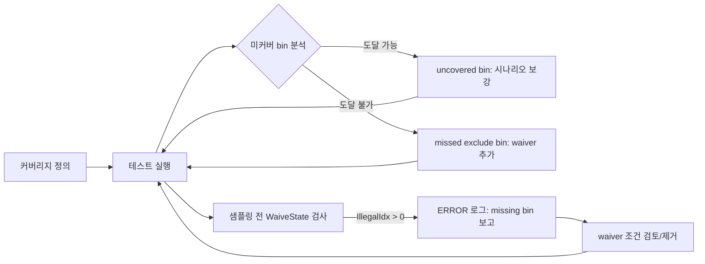

<!-- generated by yt-paper; edits will be overwritten -->

# Tackling Missing Bins: Refining Functional Coverage in SystemVerilog for Deterministic Coverage Closure

[:material-open-in-new: 원문 보기](https://dvcon-proceedings.org/wp-content/uploads/1062.pdf){ .md-button .md-button--primary target=_blank }

> SystemVerilog 기능 커버리지를 queue 기반 waiver function으로 구성해, 사람의 실수로 생긴 "missing bins"를 샘플링 전에 로그로 검출하고 커버리지 closure를 결정적으로 달성하는 방법론.

| 항목 | 내용 |
|---|---|
| 저자/출처 | Jikjoo Lee, Tony Gladvin George, Kihyun Park, Dongkun An, Wooseong Cheong, ByungChul Yoo (Samsung Electronics, Memory Division) — 출처 학회명은 문서에 명시되지 않음 |
| 유형 | PAPER |
| 카테고리 | Verification |
| ID | `ref-20261018-4d5c` |

## 핵심 인사이트

- 누락된 bin(missing bin)은 테스트로는 도달했지만 커버리지 정의에서 잘못 제외된 bin으로, 100% 커버리지가 검증 완결성을 보장하지 않는다는 문제를 드러낸다.
- waiver function을 샘플링 직전에 호출해 IllegalIdx가 0보다 크면 ERROR로 보고하는 구조는, illegal_bins처럼 시점과 규칙을 추적하기 어려운 문제를 줄이고 어느 테스트/시점에서 발생했는지 로그로 확인할 수 있게 한다.
- CrossQueueType과 createIgnoreBins로 유효 상태 queue의 보집합을 ignore_bins로 변환해, 정의 집합(Defined Set)과 waiver 조건을 단일 소스로 관리한다. 순수 SystemVerilog 문법만 쓰므로 EDA 툴 의존성이 낮다.
- 실험(Samsung 캐시 관리 IP, 10-bit state, 2048 조합 중 두 cross)에서 전체 커버리지 홀 255개 중 36개(14.1%)를 missing bin으로 찾아 600개 bin 기준 6.0% 개선을 보고했다. 다만 단일 IP 사례이며, 기존 방식 대비 성능 저하 3% 수치도 저자 주장이므로 일반화에는 주의가 필요하다.
- missing bin 여부 판단은 여전히 엔지니어의 판단에 의존하며 자동화는 future work로 남아 있다. 따라서 도입 시 waiver 조건 리뷰 프로세스를 함께 설계해야 한다.

## 상세 요약

### 배경 및 문제 정의

기능 커버리지(functional coverage)는 100%를 달성해도 버그가 남을 수 있다. 문서는 그 원인 중 하나로 커버리지 정의 과정의 사람 실수, 특히 **missing bins**를 지적한다. Missing bin은 실제로 테스트에서 도달했지만 over-exclusion 등으로 커버리지 포인트에서 빠진 bin이다. 이런 bin이 존재하면 테스트가 충분하다는 잘못된 신호를 준다.

문서는 커버리지 bin을 Universal Set(U), Ideal Set(I), Defined Set(D), Sampled Set(S)로 나누어 정의하고, 이 집합 간 정렬이 맞아야 한다고 설명한다. 기존 방식인 `illegal_bins`는 발생 시점과 규칙을 추적하기 어렵고, 발생 시 에러로 테스트를 실패시킬 수 있다는 한계가 있다. 또한 FCMS[2]는 약 30%의 성능 저하가 있다고 문서가 기술하며, 제안 방법은 3% 이내라고 주장한다.

### 핵심 아키텍처 및 방법론

방법론은 세 단계로 구성된다. 모두 SystemVerilog 표준 문법만 사용한다.

1. **Queue에 커버리지 bin 정의 (Step A)**: 10-bit 데이터를 저장하는 `StateCoverBin` queue를 만든다. `WaiveState` 함수는 10-bit 입력을 받아 `IllegalIdx`를 출력하며, 0이면 도달 가능, 0이 아니면 어떤 규칙에 의해 불가능한지 식별할 수 있다. 도달 가능한 상태만 queue에 넣어 Defined Set을 구성한다.

2. **CrossQueueType으로 ignore bin 생성 (Step B)**: `createIgnoreBins` 함수가 queue에 없는 상태들을 `CrossQueueType`으로 반환하고, 이를 cross coverage의 `ignore_bins`로 사용한다. 1-bit 커버포인트 s9~s0을 교차해 cross를 구성한다.

3. **샘플링 전 missing bin 보고 (Step C)**: 샘플링할 데이터를 `WaiveState`에 먼저 통과시킨다. `IllegalIdx > 0`이면 해당 데이터는 불가능한 상태이므로 ERROR 문으로 로그에 보고한다. 엔지니어는 이 로그를 보고 커버리지 정의나 테스트를 수정한다.

반복 절차(Figure 2)는 다음과 같다. 커버리지 정의 → 테스트 실행 → 미커버 bin 분석 → 도달 가능하면 **uncovered bin**으로 분류해 시나리오를 보강하고, 도달 불가능하면 **missed exclude bin**으로 분류해 waiver 조건에 추가한다. 이후 missing bin 보고를 검토해 도달 가능한 항목은 waiver 조건에서 제거한다. 커버리지가 100%이고 missing bin이 없을 때 종료한다.

**실험 대상**은 Cache Manager(CM) IP다. 캐시 엔트리는 10-bit 상태를 가지며(예: bit0 = Latest, bit1 = Dirty), 두 개의 deterministic FSM이 상태를 갱신한다. `StateMachine_curr`는 현재 캐시를, `StateMachine_infl`은 영향을 받는 이웃 캐시를 변경한다. 상태 전이 테이블은 command와 request state의 조합에 따라 비트 set/clear와 출력 command를 결정한다. 입력 command 순서가 비정형적이어서 처음부터 완전한 Ideal Set을 정의하기 어렵다는 점이 문서의 전제다.

### 실험 결과 및 결론

| 항목 | 문서 수치 |
|---|---|
| 교차 커버리지 전체 상태 수 | 2048 (두 cross) |
| 초기 정의 Dinit (RespState_curr / infl) | 304 / 296 bins |
| 초기 샘플 Sinit (RespState_curr / infl) | 202 / 119 → 53.5% |
| 최종 정의 Dfinal (curr / infl) | 228 / 165 bins, 100% 달성 |
| 초기 정의의 정확도 | 380 중첩 bin, 63.3% |
| 전체 커버리지 홀 | 255개 중 missing bin 36개 (14.1%) |
| 나머지 홀 | uncovered 35개, missed exclude 184개 |
| 전체 bin 대비 개선 | 600개 기준 36개 = 6.0% |

문서는 missing bin 관련 RTL 버그 7건을 발견했다고 보고한다. 결론적으로 제안 방법은 SystemVerilog 문법만으로 missing bin을 로그에 드러내고, 커버리지 정의의 정확도를 높인다. 저자들은 단순한 커버포인트에는 기존 방식으로 충분하다고 밝힌다.

**한계**: 단일 캐시 IP 사례이며, 여러 수치가 서로 다른 분모를 쓰고 있어(255 홀, 600 bin) 6.0% 개선의 정의가 다소 명확하지 않다. Missing bin 판정은 여전히 엔지니어 수동 검토에 의존하며, 자동화는 향후 과제로 남아 있다. 문서 본문에서 성능 3% 저하 수치는 실험 세부 설정이 제시되지 않아 독립 검증은 불가능하다.

## 관련 영상

<iframe src="https://www.youtube-nocookie.com/embed/k6SKMWnJP-g" title="[DVCON2024]Tackling Missing Bins Refining Functional Coverage SystemVerilog Deterministic Coverage" loading="lazy" allow="accelerometer; clipboard-write; encrypted-media; gyroscope; picture-in-picture; web-share" referrerpolicy="strict-origin-when-cross-origin" allowfullscreen></iframe>

**[DVCON2024]Tackling Missing Bins Refining Functional Coverage SystemVerilog Deterministic Coverage** — [YouTube에서 보기](https://www.youtube.com/watch?v=k6SKMWnJP-g) · [영상 페이지](../../videos/k6SKMWnJP-g.md)
