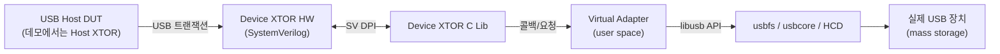

<!-- generated by yt-paper; edits will be overwritten -->

# Leverage Real USB Devices for USB Host DUT verification

[:material-open-in-new: 원문 보기](https://dvcon-proceedings.org/wp-content/uploads/1120.pdf){ .md-button .md-button--primary target=_blank }

> USB Device Transactor를 Linux usbfs/libusb 기반 Virtual Adapter로 실제 USB 장치(USB mass storage)에 연결해, 사용자 레벨 디바이스 테스트벤치 작성 없이 USB Host DUT를 시뮬레이션·에뮬레이션에서 검증하는 방법을 제안한다.

| 항목 | 내용 |
|---|---|
| 저자/출처 | Suchir Gupta, Amit Sharma (Synopsys Inc, Sunnyvale, CA, USA). 학회명은 문서에 명시되어 있지 않음 |
| 유형 | PAPER |
| 카테고리 | Verification |
| ID | `ref-20261018-5443` |

## 핵심 인사이트

- 복잡한 USB 디바이스 테스트벤치(디스크립터, 클래스 요청 응답 로직 등)를 직접 작성하는 대신, 실제 장치가 응답을 생성하게 하여 검증 엔지니어의 디바이스 측 코드 작성량을 크게 줄인다는 접근이 핵심이다.
- Virtual Adapter는 SV DPI로 HW XTOR와 연결되고 libusb(동기/비동기 API)로 실제 장치와 통신하는 구조이므로, 동일한 아키텍처를 다른 프로토콜(예: 다른 USB 클래스, 다른 BFM)에도 적용할 수 있다고 제시한다.
- HS 테스트는 시뮬레이션 5702초 대비 에뮬레이션 23초(약 248배), SS 테스트는 4815초 대비 16초(약 301배)로 보고되어, 실제 트래픽을 에뮬레이터에서 돌리는 이점이 크다는 점을 보여준다.
- 주의점: 데모에서는 Host DUT 자체 대신 Host Transactor(XTOR)를 사용했고, 지원 장치도 BBB 프로토콜 기반 mass storage 한 종류뿐이므로 실제 Host DUT 및 다양한 클래스에 대한 검증 효과는 문서상 입증되지 않았다.
- 실제 장치의 응답은 예측 가능하지 않으므로 결과 체크(scoreboard, 기대값 비교) 방식과 시뮬레이션에서의 타이머/타임아웃 조정 문제를 별도로 설계해야 한다. 문서도 시뮬레이션 성능과 타임아웃 문제를 future work로 남겼다.

## 상세 요약

### 배경 및 문제 정의

Transactor 기반 검증에서는 BFM 인터페이스를 제공하더라도, 실제 프로토콜 트래픽을 만들어내는 사용자 레벨 테스트벤치를 별도로 작성해야 한다. USB와 PCIe 같은 고급 프로토콜에서는 이 작업이 특히 복잡하다. USB Host DUT의 디바이스 드라이버를 검증하려면 주변장치의 기능을 모두 구현한 디바이스 테스트벤치가 필요하며, USB는 21개 디바이스 클래스, 각 클래스의 서브클래스, 프로토콜 조합으로 이루어져 있어 모든 사용 사례를 모델링하기 어렵다.

이 문서는 실제 USB 장치(실world stimulus)를 USB Device Transactor에 연결하여, 디바이스 측 테스트벤치를 작성하지 않고도 Host DUT를 검증하는 방법을 제안한다.

### 핵심 아키텍처 및 방법론

USB Device Transactor는 합성 가능한 SystemVerilog HW와 C/C++ SW로 구성되며, 둘은 SV DPI로 트랜잭션 단위 통신을 한다. 이 구조 덕분에 시뮬레이션과 에뮬레이션 양쪽에서 동작한다. HW는 USB 요청을 DPI 함수로 C 라이브러리에 전달하고, C 라이브러리는 등록된 사용자 콜백을 호출한다.

핵심은 Linux USB 스택을 활용한 **Virtual Adapter(VA)** 다. Linux USB 호스트 서브시스템은 HCD, usbcore, 디바이스 드라이버의 3계층이며, usbcore는 usbfs(VFS의 /dev 등)를 통해 사용자 공간에 장치 정보를 노출한다. libusb는 이 usbfs를 감싸는 크로스플랫폼 사용자 모드 라이브러리다. VA는 libusb로 실제 장치와 통신하는 사용자 공간 드라이버 역할을 한다.

VA의 동작은 네 단계로 나뉜다.

1. **Initialization**: `libusb_init()`으로 컨텍스트를 만들고, `libusb_open_device_with_vid_pid()`로 `lsusb`에서 확인한 VID/PID의 장치를 연다.
2. **Enumeration**: Host DUT가 보내는 제어 전송을 Device XTOR SW를 통해 받아, `libusb_get_device_descriptor()`, `libusb_get_bos_descriptor()` 등으로 실제 장치의 디스크립터를 가져와 응답한다. SET CONFIGURATION을 받으면 `libusb_set_configuration()`과 `libusb_claim_interface()`로 실제 장치의 구성과 인터페이스를 설정한다.
3. **Data transfers**: 비동기 API를 사용한다. 콜백 생성, `libusb_transfer` 할당, `libusb_fill_bulk_transfer()`로 채우기, `libusb_submit_transfer()`로 제출, 완료 시 콜백 호출의 5단계다. 타임아웃이 발생하면 전송을 취소하고 Host DUT에 STALL을 보낸다. OUT 전송은 데이터가 실제 장치에 저장되고, IN 전송은 실제 장치에서 데이터를 가져온다.
4. **Destruction**: `libusb_close()`로 핸들을 해제한다.

Host DUT 검증 환경에서는 에뮬레이션 시 DUT와 Device XTOR의 HW가 에뮬레이터에 올라가고, SW(호스트 측 및 VA)는 Host PC에서 실행된다. 시뮬레이션에서는 HW/SW 모두 Host PC에서 실행된다. 사용자 테스트벤치는 VA 객체 생성, `USBPlug()` 연결, 그리고 `Loop()`를 테스트 종료 시까지 반복 호출하는 것으로 최소화된다. HW가 인터럽트를 발생시키면 VA가 처리한다.

### 실험 결과 및 결론

- **HS(High Speed) mass storage**: 실제 USB 장치를 Host PC에 연결하고, BBB 프로토콜 기반의 SCSI 명령을 실행했다. Host Transactor가 장치를 열거(enumeration)하고 SCSI 명령을 수행하며 약 1800K 바이트를 송수신했다. 모든 USB 제어/벌크 응답은 실제 장치에서 왔다. 시뮬레이션 5702초, 에뮬레이션 23초로 약 248배 빨랐다.
- **SS(SuperSpeed)**: HS 장치를 SS 장치로 교체하여 검증했다. 약 3600K 바이트를 전송했고, 시뮬레이션 4815초 대비 에뮬레이션 16초로 약 301배 빨랐다.

결론: 초기 기본 기능 검증 후 이 방식을 쓰면 실제 장치 기반의 시스템 레벨 시나리오를 복잡한 테스트벤치 없이 커버할 수 있다. 다만 문서에 따르면 이 결과는 Host DUT가 아닌 Host XTOR로 얻은 것이며, 지원 장치도 mass storage(BBB)에 한정된다. 향후 과제로는 다른 21개 클래스 및 서브클래스로의 확장, 그리고 시뮬레이션 성능 저하와 타임아웃 문제를 해결하기 위한 타이머 조정이 제시되었다.

참고: 원문에는 인용 번호 불일치(BBB 프로토콜 인용이 [3] libusb로 연결됨)와 존재하지 않는 Fig. 15 참조 등 편집상의 불일치가 있다.

## 관련 영상

<iframe src="https://www.youtube-nocookie.com/embed/iFhYhIOoQYQ" title="[DVCON2025]Leverage Real USB Devices for USB Host DUT verification" loading="lazy" allow="accelerometer; clipboard-write; encrypted-media; gyroscope; picture-in-picture; web-share" referrerpolicy="strict-origin-when-cross-origin" allowfullscreen></iframe>

**[DVCON2025]Leverage Real USB Devices for USB Host DUT verification** — [YouTube에서 보기](https://www.youtube.com/watch?v=iFhYhIOoQYQ) · [영상 페이지](../../videos/iFhYhIOoQYQ.md)
