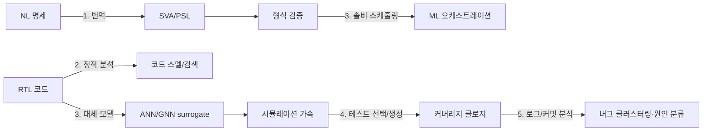

<!-- generated by yt-paper; edits will be overwritten -->

# A Survey of Machine Learning Applications in Functional Verification

[:material-open-in-new: 원문 보기](https://dvcon-proceedings.org/wp-content/uploads/1135-A-Survey-of-Machine-Learning-Applications-in-Functional-Verification.pdf){ .md-button .md-button--primary target=_blank }

> 기능 검증(FV)의 요구사항 정의, 정적 분석, 형식 검증 오케스트레이션, 시뮬레이션 테스트 생성, 버그 분석 전반에 ML이 적용된 연구를 정리하고, 학습 데이터 부족이 가장 큰 장애물이라고 지적한 서베이.

| 항목 | 내용 |
|---|---|
| 저자/출처 | Dan Yu, Harry Foster, Tom Fitzpatrick (Siemens EDA). 출처 학회/저널명은 본문에 명시되지 않음 |
| 유형 | PAPER |
| 카테고리 | Verification |
| ID | `ref-20261018-58d3` |

## 핵심 인사이트

- FV 전 영역에 걸친 ML 적용 사례를 Table I로 정리했으며, 실제로 성과가 확인된 곳은 형식 검증 솔버 스케줄링, 커버리지 클로저용 테스트 생성, 버그 클러스터링/root cause 분류 정도이고 fix 제안·코드 요약·코딩 어시스턴스는 IC 설계 분야에 아직 보고된 사례가 없다고 명시함.
- 요구사항→SVA 자동 번역의 가장 큰 병목은 알고리즘이 아니라 NL-formal 쌍 데이터셋 부족이다. 본문 기준 가장 큰 공개 데이터셋도 약 100쌍 수준이며, NL 분야의 수백만~수십억 쌍과 대비된다.
- 커버리지 클로저 연구들은 대부분 DUT를 black box로 다루어 통계적 예측에 의존하므로 미탐색 타깃을 예측하는 능력이 제한적이다. 반면 CDFG와 GNN을 사용한 white-box 접근([33])은 제어/데이터 흐름 정보를 활용하는 방향으로 제시됨.
- 데이터 부족 때문에 대부분 연구가 설계별로만 학습하고 유사 설계의 사전 지식을 활용하지 못한다. 저자들은 ImageNet식 공개 검증 데이터셋 구축과 데이터 스키마 표준화를 촉구한다.
- 산업 적용의 3대 과제로 일반화(generalization), 확장성(scalability), 데이터 거버넌스(data governance)를 제시하며, 이는 데이터 소유자·툴 개발자·툴 사용자가 서로 다른 조직일 때 특히 중요하다고 본다.

## 상세 요약

### 배경 및 문제 정의

- 기능 검증(FV)은 설계 엔지니어 시간의 약 절반을 차지하며, 기능/로직 오류가 ASIC respin의 가장 큰 원인이다(본문은 [1][2] 설문 인용, 약 50%).
- FV는 계산·데이터 집약적이므로 ML 적용 대상으로 자연스럽다는 것이 논문의 출발점이다.
- 기존 서베이([6][7][8])는 일부 주제만 다뤘고, 본 논문은 요구사항 엔지니어링부터 버그 분석까지 FV 전반을 Table I로 정리한다.

### 핵심 아키텍처 및 방법론

본 문서는 실험 논문이 아니라 **주제별 서베이**이며, 다음 구조로 정리되어 있다.

| 주제 | 주요 내용 (본문 기준) |
|---|---|
| 1. Requirement Engineering | NL 명세 → SVA/PSL 자동 번역. CNL 기반 템플릿 방식과 NLP 기반 방식이 기존 접근이며, LLM급 번역은 아직 production-ready가 아님. 명세 쌍 데이터셋 부족이 병목. 코드 요약(code summarization)과 specification mining(trace에서 패턴/이상 탐지)도 포함. |
| 2. Static Code Analysis | 코드 스멜 탐지(Fontana, Aniche 등 인용), 코딩 어시스턴스(코드 완성, 시맨틱 코드 검색). 시맨틱 검색은 CodeSearchNet에서 MRR 약 70% 수준. FV 분야 적용은 아직 보이지 않음. |
| 3. Verification Acceleration | **형식 검증**: AdaBoost 분류기로 솔버 스케줄링 시 solved 비율 95%→97%, 평균 speedup 1.85(Elmandouh & Wassal [25]). 리소스 예측 다중 선형 회귀는 평균 오차 32%. **시뮬레이션**: MLP/RNN의 보편 근사 정리를 근거로 IC 모듈 행동을 ANN으로 모델링해 시뮬레이션 가속 가능성을 제시. |
| 4. Test Generation & Coverage Closure | RL 기반 캐시 컨트롤러 테스트 생성([31]); 커버 포인트별 모델 + 3-way 분류기(시뮬레이션/폐기/재학습)로 100% 커버리지를 3~5배 적은 테스트로 달성([28] 표기 그대로 인용됨); white-box GNN + gradient search([33], IBEX v1/v2, TPU에서 coverage 예측 정확도 74%/73%/90%). |
| 5. Bug Analysis | 시뮬레이션 로그 616개 피처 기반 클러스터링(AMI 0.543~0.593), root cause 분류(Random Forest 정확도 90.7%, F1 0.913)[34]; 커밋 데이터 기반 버그 커밋 예측([35]). fix 제안은 미개척. |

**흐름 요약**

**최신 기법 관점(Section III)**: Transformer 기반 대형 언어모델과 GNN은 코드 분석·요구사항·graph 기반 FV 작업에 잠재력이 있다고 주장하지만, 본 논문은 이를 실제 FV 연구에 적용한 사례가 아직 드물다고 평가한다.

### 실험 결과 및 결론

본 논문은 자체 실험을 수행하지 않고, 인용된 연구들의 결과를 종합한다. 주요 수치는 다음과 같다.

- 솔버 스케줄링: solved 비율 95%→97%, 평균 speedup 1.85; 리소스 예측 평균 오차 32%.
- 커버리지: 100% 달성, 테스트 3~5배 감소; FSM/non-FSM 설계에서 69%, 72% 감소 (directed 대비).
- Bug 클러스터링: AMI 0.543~0.593 (이상적 1.0과 거리 있음); root cause 분류 정확도 90.7%.
- 공개 데이터: GitHub/RISC-V/OpenCores 조사(2022년 5월 기준)에서 설계·검증 데이터가 매우 적었고, 전체 코드·주석은 약 1,000만 라인 규모로 추정됨.

**결론**

- FV에 대한 ML 연구는 아직 초기 단계이며, 대부분 소규모 학습 데이터에 의존하는 원시적 기법을 쓴다.
- 가장 큰 장벽은 **고품질 검증 데이터셋 부재**이다. 저자들은 데이터 포맷 표준화와 커뮤니티 기여를 촉구하며, Siemens가 컨소시엄과 협력 중이라고 밝힌다.
- 산업 적용에는 일반화, 확장성, 데이터 거버넌스가 핵심 과제이다.
- 문서 본문이 잘려 있어 마지막 레퍼런스 이후의 내용은 확인할 수 없으며, 저널/학회 출처 정보도 본문에 명시되어 있지 않다.

## 관련 영상

<iframe src="https://www.youtube-nocookie.com/embed/SgZYDJHGSkg" title="[DVCON2023] A Survey of Machine Learning Applications in Functional Verification" loading="lazy" allow="accelerometer; clipboard-write; encrypted-media; gyroscope; picture-in-picture; web-share" referrerpolicy="strict-origin-when-cross-origin" allowfullscreen></iframe>

**[DVCON2023] A Survey of Machine Learning Applications in Functional Verification** · 📝 [이전 영상 (2024-06-27)](https://youtu.be/BdxT57DYNA8) — [YouTube에서 보기](https://www.youtube.com/watch?v=SgZYDJHGSkg) · [영상 페이지](../../videos/SgZYDJHGSkg.md)
