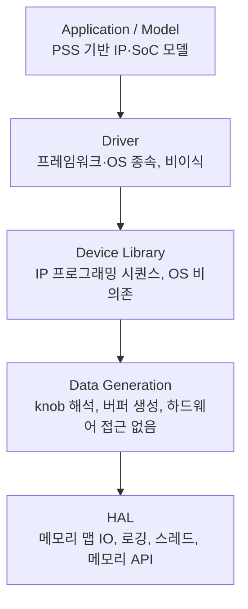

<!-- generated by yt-paper; edits will be overwritten -->

# Case Study: Successes and Challenges of Validation Content Reuse

[:material-open-in-new: 원문 보기](https://dvcon-proceedings.org/wp-content/uploads/Case-Study-Successes-and-Challenges-of-Reuse-1.pdf){ .md-button .md-button--primary target=_blank }

> Intel의 IP 검증 콘텐츠를 계층형 소프트웨어 스택과 PSS 기반 모델링으로 설계해 SoC 검증과 양산 스크리닝까지 재사용한 사례와 그 성과(RTL 버그, 인력, 비용 절감) 및 한계를 정리한 논문.

| 항목 | 내용 |
|---|---|
| 저자/출처 | Mike Chin, Jonathan Edwards, Hooi Jing Tan, Josh Pfrimmer (Intel Corporation) |
| 유형 | PAPER |
| 카테고리 | Verification |
| ID | `ref-20261018-646f` |

## 핵심 인사이트

- 재사용 가능성의 핵심은 OS/프레임워크 의존 코드를 HAL과 Driver 계층으로 격리하고, 데이터 생성(data generation)과 device library는 한 번만 작성해 포팅하는 구조에 있다. 논문은 Driver 계층이 전체 코드의 약 10-15% 수준이라고 추정한다.
- 데이터 생성 계층에서 구조체(struct)를 인터페이스 매개체로 쓰면, 새 검증 knob이 추가되어도 인터페이스와 모델링 코드를 바꾸지 않고 구조체와 구현만 수정하면 되어 변경 파급을 줄인다.
- 모델링에서 액션(content capability)의 세분도가 핵심 설계 변수다. 너무 상위 수준이면 동작이 겹치고, 너무 하위 수준이면 레지스터 프로그래밍 나열로 전락한다. 좋은 액션은 구현 코드를 다른 액션과 거의 공유하지 않는다는 점이 판단 기준으로 제시된다.
- 플랫폼 디스커버리(IP 버전·기능, 연결 장치, BIOS 설정)를 모델 입력으로 사용해 기능을 켜고 끄는 방식은 pre-silicon/post-silicon, emulation/FPGA 간 이식성 문제를 푸는 실질적 수단이다.
- 보고된 성과(약 200개 SoC RTL 버그, 전체 600여 개 이상 버그, 인력 32 HC 절감, 양산 비용 절감 약 $19.75M)는 저자들의 내부 집계이며, 비용 계산 근거와 기준선은 논문 본문에서 충분히 검증 가능한 형태로 제시되지 않는다.

## 상세 요약

### 배경 및 문제 정의

- Intel의 IP 검증팀이 만든 검증 콘텐츠를 SoC 검증, 그리고 양산(manufacturing) 스크리닝까지 재사용하려는 다년간의 노력을 다룬다.
- IP 검증은 FPGA(실제 디바이스/testcard)와 에뮬레이션(주로 transactor 사용)에서 수행되며, 플랫폼마다 endpoint가 달라 이식성이 주요 과제다.
- SoC 검증은 IP 검증과 비교해 전원 관리, sideband 접근, fuse 지원 등 플랫폼 차이가 크고, SKU 구성 필요성 때문에 설정 다양성도 크다.
- 양산 스크리닝은 post-silicon 환경의 제약과 모든 IO 인터페이스를 충분히 스크리닝해야 하는 요구 때문에 더 많은 유닛이 필요하다는 문제가 있다.
- 논문은 세 가지 질문을 제기한다: IP 검증의 깊이를 어떻게 확보할 것인가, 이 콘텐츠를 SoC와 양산으로 어떻게 확장할 것인가, 다양한 endpoint 장치를 어떻게 탐지·지원할 것인가.

### 핵심 아키텍처 및 방법론

논문이 제시하는 구조는 크게 **소프트웨어 스택**과 **모델링/플랫폼 디스커버리**의 두 축으로 나뉜다.

- **HAL(Hardware Abstraction Layer)**: 이식성의 핵심. OS 서비스(로깅, 스레드, 메모리 할당)와 메모리 맵 IO 접근을 추상화한다. 새 프레임워크에 포팅할 때 반드시 구현해야 하며, 구현 함수 집합을 최소화하는 것을 목표로 한다.
- **Data Generation**: 사용자의 knob 값을 해석해 IP 동작 파라미터와 데이터 버퍼를 준비한다. 하드웨어를 건드리지 않으므로 JIT 또는 off-target 단계로 앞당길 수 있다. 인터페이스 전달에는 struct를 사용해 인터페이스 안정성을 유지한다.
- **Device Library**: IP 프로그래밍 시퀀스(초기화, 설정, 인터럽트 처리)를 담는 비즈니스 로직 계층이다. OS 서비스를 쓰지 않으며, 한 번 구현하면 여러 타깃에 수정 없이 이식된다는 것이 논문의 주장이다.
- **Driver**: 사용자 의도와 프레임워크/OS가 허용하는 범위를 맞추는 계층이다. 프레임워크 간 이식은 불가능하다고 가정하며, 논문은 이 계층이 전체 코드의 약 10-15%라고 추정한다.

**모델링**: 모델링에는 Cadence Perspec과 SLN 문법(PSS에 선행하고 영향을 준 문법)을 사용하며, 궁극적으로 PSS로 완전 이전하는 것이 목표다. 각 IP 모델은 검증 테스트 플랜과 같은 수준의 세분도로 동작 단위(content capability)를 정의하고, 이를 조합해 IP 수준 테스트를 만든다. SoC는 각 IP를 독립 서브컴포넌트로 취급해 IP 모델과 realization 계층을 수정 없이 재사용하고, 크로스-IP 및 시스템 플로우만 SoC 모델에 추가한다.

**플랫폼 디스커버리**: IP 버전과 하드웨어 기능, 연결된 장치 유형, BIOS 설정을 수집해 모델의 기능을 활성/비활성화하고, 플랫폼에 맞는 콘텐츠를 생성한다. 잘못된 설정은 mis-execution과 사이클 낭비로 이어지므로 이 과정을 확장성의 핵심으로 본다.

### 실험 결과 및 결론

논문은 주로 산업 적용 결과를 정량 지표로 보고하며, 독립적인 통제 실험은 아니다.

- **RTL 버그 발견**: IP 전 세대에 걸쳐 재사용 콘텐츠가 여러 IP 도메인에서 버그를 찾았고, 프로젝트가 거듭될수록 발견 수가 증가했다고 보고한다(Figure 5, 6, 수치는 그림에 있어 본문에서 세부 값 확인 불가).
- **SoC 버그**: 4개 연속 프로젝트에서 약 200개의 SoC RTL 버그를 발견했으며, IP 콘텐츠 재사용으로 찾은 비율은 Table 1 이미지 기준 Tigerlake 77%, Emmitsburg 83%, Alderlake 63%, Meteorlake 71%로 표시된다(표의 항목 배치가 텍스트 추출에서 흐트러져 있어 프로젝트-비율 대응은 원문 확인이 필요하다).
- **양산 비용 절감(Table 1)**: System-to-Tester $10M, TTR $4.8M(= $0.02 × 240M), Screening Unit Elimination $4.95M(= $450K × 11), 총 $19.75M(누적).
- **인력 절감(Table 2)**: 남부 complex pre-si 4, 북부 complex pre-si 4, cross-die pre-si 4, post-si client/devices 14, manufacturing 6, 합계 32 HC. 개발팀은 약 15명 규모다.
- **안정성(Figure 8)**: 새 콘텐츠는 enabling 과정에서 노이즈를 추가하지만, 기존 콘텐츠 기반은 안정적으로 유지되며 전체 노이즈는 감소 추세라고 보고한다.
- **결론**: 검증 콘텐츠를 이식성 있게 설계해 FPGA, 에뮬레이션, post-silicon에서 실행했으며, 전 세대에 걸쳐 IP와 SoC 합산 600여 개 이상의 RTL 버그를 찾았다고 결론짓는다.

**한계 및 향후 과제**
- PSS 표준은 모델링 문제의 약 70%에 적용 가능하다는 예비 판단이며, 나머지 문제는 업계 협력이 필요하다.
- 크로스-IP 및 서브시스템 모델링의 캡슐화가 아직 과제다.
- 3rd party IP 통합 시 표준화된 추상화 계층(HAL) 필요성을 제기한다.
- 비x86 ISA(foundry 확장 포함)로의 이식성은 아직 해결되지 않았다.
- Headless 플랫폼, 생산 소프트웨어와 synthetic 콘텐츠의 공동 검증(co-validation) 등으로 활용 범위를 넓히는 것을 과제로 제시한다.

*참고: 본 요약은 본문 텍스트 기준이며, 그림과 표의 세부 수치는 텍스트 추출 과정에서 정확히 확인되지 않은 부분이 있다.*

## 관련 영상

<iframe src="https://www.youtube-nocookie.com/embed/o-x0DYNRIt0" title="[DVCON2022]Case Study: Successes and Challenges of Validation Content Reuse " loading="lazy" allow="accelerometer; clipboard-write; encrypted-media; gyroscope; picture-in-picture; web-share" referrerpolicy="strict-origin-when-cross-origin" allowfullscreen></iframe>

**[DVCON2022]Case Study: Successes and Challenges of Validation Content Reuse ** — [YouTube에서 보기](https://www.youtube.com/watch?v=o-x0DYNRIt0) · [영상 페이지](../../videos/o-x0DYNRIt0.md)
