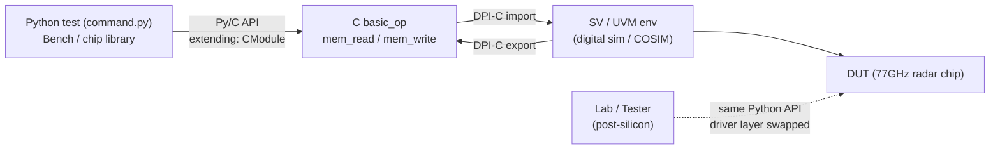

<!-- generated by yt-paper; edits will be overwritten -->

# Unified Test Writing Framework for Pre and Post Silicon Verification

[:material-open-in-new: 원문 보기](https://dvcon-proceedings.org/wp-content/uploads/unified-test-writing-framework-for-pre-and-post-silicon-verification-paper.pdf){ .md-button .md-button--primary target=_blank }

> UVM 기반 디지털 검증 환경과 C/Python 테스트 프레임워크를 DPI 및 Py/C API 브리지로 연결해, 시뮬레이션(프리실리콘)과 랩 보드(포스트실리콘)에서 동일한 고수준 테스트를 재사용하도록 한 사례 보고서.

| 항목 | 내용 |
|---|---|
| 저자/출처 | Rahulkumar Patel, Pablo Cholbi, Sivasubrahmanya Evani, Raman K (Analog Devices Inc.) (DVCon Europe) |
| 유형 | PAPER |
| 카테고리 | Verification |
| ID | `ref-20261018-678e` |

## 핵심 인사이트

- 시스템 레벨에서 DUT와의 상호작용(SPI/I2C/JTAG/GPIO 등 인터페이스와 read/write, wait, drive, delay 같은 고수준 액션)은 시뮬레이션과 실리콘에서 거의 같으므로, 하위 드라이버/모니터 계층만 분리하면 테스트 라이브러리를 공통으로 쓸 수 있다는 설계 관점이 핵심이다.
- C 기반 프론트엔드는 IP-XACT에서 자동 생성된 레지스터 맵 C 모델과 bit-field 접근 추상화를 제공하며, 이를 통해 설계/검증 엔지니어가 UVM 복잡도 없이 테스트를 작성할 수 있게 했다.
- 기존 C 테스트 자산을 마이그레이션하지 않고 DPI(SV↔C)와 Py/C API 브리지로 Python에서 시뮬레이터를 호출하는 중간 계층을 두어, 기존 테스트를 무수정 실행한 점이 도입 비용을 낮춘 실용적 방법이다.
- 프리실리콘에서 검증한 설정 라이브러리를 랩/평가/응용 팀과 공유하고, 벤치에서 문제 된 구성을 시뮬레이션으로 되돌려 디버그하는 양방향 루프가 실리콘 bring-up 및 디버그 시간을 줄이는 핵심 효과로 보고된다.
- 논문은 정량 지표(테스트 시간 단축율, 커버리지 수치 등)를 제시하지 않고 정성적 효과만 보고하므로, 효과 크기는 원문에서 확인할 수 없다. 77GHz radar sensor(28nm RF-CMOS)라는 단일 제품 사례라는 점도 일반화 시 주의가 필요하다.

## 상세 요약

### 배경 및 문제 정의

- 디지털 검증은 UVM이 표준이지만, 아날로그/디지털 설계자에게 UVM 인프라는 진입 장벽이 높아 테스트 작성이 어렵다.
- 실리콘이 랩에 들어온 뒤에는 평가 보드 bring-up과 설계↔평가 간 디버그 왕복 지연이 큰 문제가 된다.
- 저자들은 프리실리콘(시뮬레이션)과 포스트실리콘(테스터/평가/응용 보드)에서 **같은 고수준 테스트 언어와 인프라를 공유**하는 것을 목표로 한다.
- 근거: 시스템 레벨에서 칩의 외부 인터페이스(SPI, I2C, JTAG, GPIO 등)와 그 위의 액션(read/write frame, wait on output event, drive input, 시간 대기)은 수가 제한적이며, 시뮬레이션에서는 UVC가, 실리콘에서는 실제 하드웨어가 DUT와 상호작용할 뿐이다.

### 핵심 아키텍처 및 방법론

프레임워크는 크게 두 단계로 구성된다.

**1단계: C 기반 프리실리콘 인프라**

- *C 프론트엔드*: IP-XACT에서 자동 생성된 레지스터 맵 C 모델, MMR/메모리 read/write, 아날로그 노드 전압 프로빙, 디지털/아날로그 노드 force/release, 노드 값 대기, delay, 난수 생성 등 저수준 명령을 제공한다. bit-field를 C 데이터 타입처럼 다루게 해 주소·오프셋 세부사항을 숨긴다.
- *COSIM(아날로그-디지털 co-simulation)*: 디지털 검증의 UVM 셋업과 에이전트를 재사용하고, SystemVerilog Real Number 모델이 아닌 아날로그 모델도 실행한다.

**2단계: Python 기반 포스트실리콘 확장**

- C는 시뮬레이터와 통신하기에는 적합하지만 랩 장비 드라이버를 처음부터 개발해야 하므로, 생태계가 풍부한 Python으로 확장한다.
- 핵심 과제는 (a) Python과 SV 시뮬레이터 간 양방향 통신, (b) 기존 C 테스트 자산의 마이그레이션 비용이다.
- 이를 해결하기 위해 **중간 브리지**를 둔다. 이 브리지는 사용자에게 투명하며, SV↔C 간 DPI import/export와 Python/C API(embedding/extending)로 구성된다. 이 브리지 덕분에 기존 테스트 스위트를 **무수정**으로 실행할 수 있었다.
- 장기적으로는 모든 C 테스트를 Python으로 완전 이관해 C/Py 이중 인프라 유지보수를 줄일 계획이다.

- 예제(Fig. 9)에서는 Python 스크립트가 PLL 초기화, 레지스터 쓰기, 메모리 read/write, 신호 force/release, 신호 대기, 난수 생성, 여러 RX/AFE 인스턴스에 대한 동일 함수 재사용을 수행한다. 파이썬 기초 지식만으로 테스트를 작성할 수 있다고 주장한다.
- 넷리스트 명명 규칙을 엄격히 지켜 digital/cosim 양쪽에서 같은 경로로 노드에 접근하도록 했다.

### 실험 결과 및 결론

본 논문은 정량 실험 결과 대신 **도입 사례와 정성적 효과**를 보고한다. 대상은 28nm RF-CMOS 기반 77GHz radar sensor chip이다.

**프리실리콘 단계 (C/Py 인프라)**
- SPI에서 디지털 레지스터 비트까지의 연결성을 자동 덤프 테스트로 확인하고, 같은 방식을 cosim에서 깊은 아날로그 노드의 전압 레벨 점검으로 확장했다.
- 디지털/COSIM 간 함수 재사용을 달성했다.
- numpy 등 Python 패키지로 FFT 등 복잡한 데이터패스 검증 인프라를 구성했다.
- 최소 노력으로 시스템 부팅 인프라를 구축했고, 설계자가 테스트 개발에 참여하게 되었다.

**포스트실리콘 단계 (Py 기반 인프라)**
- 설계팀이 칩 설정 라이브러리를 평가·응용팀과 공유해 디버그, 평가, 데모 제작을 가속했다.
- 평가/응용팀에서 문제가 된 설정을 DV 시뮬레이션 환경으로 읽어 들여 디버그할 수 있었다.
- Ultra-Flex 테스터의 Visual Basic 프론트엔드에도 Py/C로 작성된 설정 코드를 최소 노력으로 VB 코드로 변환했다.

**결론**
- 프리실리콘 테스트를 벤치에서 재사용해 평가 일정이 단축되었고, 벤치의 문제 구성을 시뮬레이션으로 신속하게 되돌려 관찰성을 높였다.
- 저자들은 전체 검증 기간 단축과 time-to-market 앞당김에 기여했다고 주장하며, 실리콘 품질 향상 가능성도 언급한다.
- 다만 테스트 시간 절감률, 커버리지 기여, 버그 검출 수 등 정량 지표는 원문에 없으므로 효과 크기는 확인할 수 없다. 단일 제품·단일 사내 사례라는 점도 일반화 시 고려해야 한다.
- 키워드에 "Portable Stimulus"가 있으나 본문에서 PSS와의 직접적 비교나 적용은 다루지 않는다.

## 관련 영상

<iframe src="https://www.youtube-nocookie.com/embed/W_odEND1SD8" title="[DVCON2019_INDIA]Unified Test Writing Framework for Pre and Post Silicon Verification" loading="lazy" allow="accelerometer; clipboard-write; encrypted-media; gyroscope; picture-in-picture; web-share" referrerpolicy="strict-origin-when-cross-origin" allowfullscreen></iframe>

**[DVCON2019_INDIA]Unified Test Writing Framework for Pre and Post Silicon Verification** — [YouTube에서 보기](https://www.youtube.com/watch?v=W_odEND1SD8) · [영상 페이지](../../videos/W_odEND1SD8.md)
