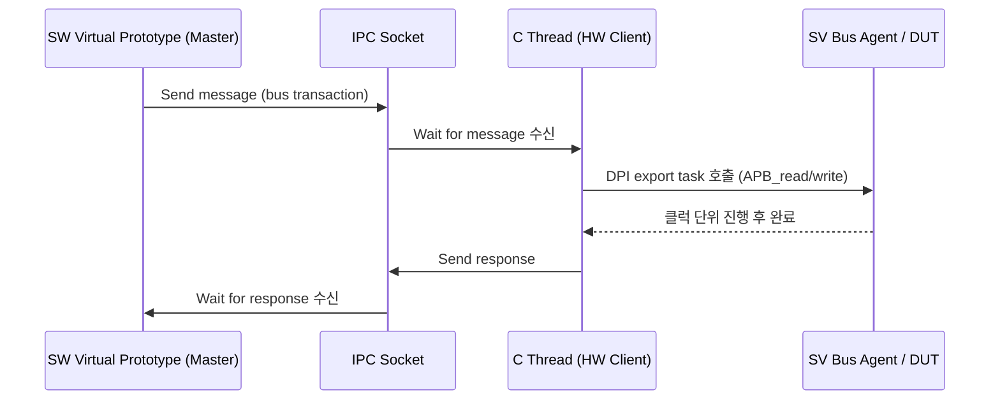

<!-- generated by yt-paper; edits will be overwritten -->

# Easy Steps Towards Virtual Prototyping using the SystemVerilog DPI

[:material-open-in-new: 원문 보기](https://dvcon-proceedings.org/wp-content/uploads/easy-steps-towards-virtual-prototyping-using-the-systemverilog-dpi.pdf){ .md-button .md-button--primary target=_blank }

> SystemVerilog DPI-C를 이용해 C 기반 소프트웨어 가상 프로토타입과 UVM 기반 하드웨어 검증 환경을 절차적 호출(transaction) 수준에서 연결해, 성능과 정확도 사이의 균형을 맞추는 HW/SW 공동 검증 방법을 제시한 논문.

| 항목 | 내용 |
|---|---|
| 저자/출처 | Dave Rich (Mentor Graphics, Inc.) — IEEE 게재 논문 (원문에 학회명 명시 없음, 참고문헌 기준 2013년경 작성으로 추정) |
| 유형 | PAPER |
| 카테고리 | Verification |
| ID | `ref-20261018-6a03` |

## 핵심 인사이트

- DPI는 pin-level 통신이 중심인 PLI와 달리 절차적 함수/태스크 호출 수준에서 HW와 SW를 연결하므로, 가상 플랫폼은 높은 추상화 수준에서 동작하고 HW 검증 환경은 cycle-accurate 수준을 유지하는 혼합 구조가 가능하다.
- 시뮬레이션 시간은 활성 bus cycle에서만 전진시키고, 유휴 사이클은 APB_idle 같은 태스크나 명령어 수 기반 랜덤 사이클로 근사하면 성능을 크게 높이면서도 타이밍 정확도를 일부 확보할 수 있다.
- DPI 인자는 크기가 고정된 호환 타입만 값 복사로 전달할 수 있으므로, 가변 길이 payload는 고정 최대 크기 할당, 블록 단위 분할 전송, 또는 길이 할당과 데이터 전송의 2단계 호출 중 하나로 처리해야 한다.
- SW 프로세스가 master가 되고 HW 시뮬레이터는 IPC 소켓을 통해 slave로 연결하는 구조는 하드웨어 시뮬레이터의 스레드 모델이 소프트웨어와 다른 문제를 우회하는 실용적 방법이다.
- UVM 시퀀스와 레지스터 추상화 계층을 재사용하면 C 측 트랜잭션을 레지스터 read/write로 변환해 하드웨어 검증 환경을 가상 플랫폼과 함께 재사용할 수 있다.

## 상세 요약

### 배경 및 문제 정의

SoC 검증은 보통 HW와 SW를 각각 나누어 검증한 뒤, 실제 플랫폼이나 FPGA/에뮬레이션 프로토타입에서 시스템 수준 검증을 시작한다. 그러나 전체 시스템이 준비되는 시점은 프로젝트 후반이므로 충분한 검증 시간을 확보하기 어렵다. 가상 프로토타이핑(Virtual Prototyping)은 소프트웨어 및 시뮬레이션 기법으로 이른 시점에 전체 시스템 접근을 제공하여 이 문제를 해결하려는 방법론이다.

문제의 핵심은 다음과 같다.

- HW와 SW 엔지니어 간 전문 지식과 모델링 언어가 달라 의사소통이 어렵다.
- 소프트웨어를 HW 모델 위에서 실행하면 실제 타깃보다 수많은 자릿수로 느릴 수 있어, 성능과 정확도의 균형을 맞추기 위해 추상화 수준을 분할해야 한다.
- 전통적으로 ISS(instruction set simulator)로 HW 모델을 구동하면 bus 신호를 pin/cycle 수준으로 처리하는 부담이 크다.

논문은 이 문제를 해결하기 위해 SystemVerilog DPI-C를 이용해 C 소프트웨어 세계와 Verilog HDL 세계를 잇는 방법을 시연한다. 또한 UVM 테스트벤치를 이용한 transaction 수준 HW/SW 통신 메커니즘을 설명한다.

### 핵심 아키텍처 및 방법론

**1. 추상화 수준 (TLM 2.0 용어 기준)**

| 수준 | 설명 |
|---|---|
| UT (Untimed) | 연산 순서만 중요, 시간 추적 없음 |
| LT (Loosely-timed) | 명령어 실행 단위 등 quantum 단위로 시간 추적 |
| AT (Approximately-timed) | quantum을 phase로 나누어 상대 성능 통계 수집 |
| CC (Cycle-accurate) | 클럭/bus cycle 단위로 HW와 lock-step 동작 |

SW 측은 native 실행(시간 불필요)부터 ISS 기반 LT, 파이프라인 모델링을 위한 AT까지 선택 가능하다. HW 측은 합성 가능한 설계 대부분이 CC 이하의 추상화를 요구하지만, 테스트벤치는 훨씬 높은 수준으로 모델링할 수 있다.

**2. DPI 기반 동기화**

- SV 함수/태스크는 C에서 일반 루틴처럼 보이고, C 루틴은 SV에서 task/function으로 보인다.
- C 루틴은 `APB_read`, `APB_write` 같은 DPI exported task가 완료될 때까지 블록되며, 이 동안 SV 측 시뮬레이션 시간이 클럭 단위로 전진한다.
- 활성 bus cycle만 시뮬레이션하여 수천 개의 유휴 사이클을 건너뛸 수 있다(Compressed Hardware Simulation Timing).
- 유휴 시간은 `APB_idle(cycles)` 태스크로 주입하거나, 명령어 수에 비례한 제약 랜덤 사이클로 근사할 수 있다.
- 인터럽트는 idle/bus task에서 IRQ를 감시하는 `fork ... join_any` 구조로 보고하며, 완료 모델은 (a) 인터럽트를 보고만 하고 완료 대기, (b) 완료 또는 중단 후 즉시 반환 중 선택할 수 있다.

**3. Transaction 설계**

가변 길이 데이터와 시간 정보를 포함하는 구조체로 표준 transaction을 정의한다. 주요 필드는 다음과 같다.

- Operation (read/write/idle/burst), Address(32-bit)
- ReqStart, ReqDuration, TrStart, TrEnd (시간 정보)
- InterruptMode (Ignore/Complete/Abort), InterruptReq, InterruptTime
- Length, Payload(nBytes)

transaction은 바이트 배열로 pack/unpack하여 언어 경계를 넘긴다. 메모리 소유권은 각 언어 측이 관리해야 하며, 가변 길이 payload는 (a) 최대 크기 고정 후 Length로 자르기, (b) 블록 단위 분할 전송, (c) 길이 할당/데이터 전송 2단계 호출 중 하나로 처리한다.

**4. 마스터/슬라이브 구조**

- 단순 구조에서는 SV의 `initial`이 DPI import task `c_code()`를 호출하여 C 스레드를 시작하고, C는 `v_code`(exported task)를 호출해 시간을 소비한다.
- 실제 가상 프로토타입 시스템은 자체 스레드를 master로 두고, HW 시뮬레이터 클라이언트가 IPC 소켓에 연결하는 방식을 사용한다. 두 프로세스는 메시지 송수신으로 동기화된다.

**5. UVM 통합**

C 코드는 DPI를 통해 UVM 시퀀스를 시작할 수 있고, 시퀀스는 pin 수준 wiggle로 변환된다. UVM register 패키지(레지스터 모델)는 주소를 적절한 인터페이스로 매핑한다. 결과적으로 pure UVM test, 가상 프로토타입 프로세스, 또는 둘의 조합이 시퀀스를 생성할 수 있다. 즉, 하드웨어 전용 검증 환경을 가상 플랫폼 환경에서 재사용할 수 있다.

### 실험 결과 및 결론

원문에는 정량적 성능 수치(예: 속도 향상 배수, 사이클 수 비교)나 벤치마크 결과 표가 제시되어 있지 않다. 논문은 다음을 정성적으로 주장한다.

- 기법은 Mentor Graphics 내부 플랫폼, 오픈소스 Python 기반 stimulus 생성기, Wind River Simics 등 여러 프로젝트에서 적용되었다.
- 가상 플랫폼의 성능은 실제 시스템과 1~2 자릿수 이내일 수 있으며, HW 수준 모델을 추가하면 성능이 크게 떨어지므로 시뮬레이션 대상을 OS 일부나 축약된 코드로 제한하게 된다.
- 다중 인터페이스 스레드 처리, IPC 소켓으로 연결된 두 프로세스의 대화형 디버깅 등은 지면상 다루지 못했다고 명시한다.

**결론**: HW/SW 공동 검증의 목표는 전체 설계를 검증하는 것이 아니라 SW와 HW 간 통신을 검증하는 것이다. DPI를 procedural call 수준의 인터페이스로 사용하면 가상 플랫폼은 높은 추상화에서, HW 검증 환경은 정확한 타이밍에서 동작하는 혼합 구조를 만들 수 있으며, UVM 재사용을 통해 두 환경의 자산을 공유할 수 있다.

## 관련 영상

<iframe src="https://www.youtube-nocookie.com/embed/AoUFwMf9jEI" title="[DVCON2013]Easy Steps Towards Virtual Prototyping using the SystemVerilog DPI" loading="lazy" allow="accelerometer; clipboard-write; encrypted-media; gyroscope; picture-in-picture; web-share" referrerpolicy="strict-origin-when-cross-origin" allowfullscreen></iframe>

**[DVCON2013]Easy Steps Towards Virtual Prototyping using the SystemVerilog DPI** — [YouTube에서 보기](https://www.youtube.com/watch?v=AoUFwMf9jEI) · [영상 페이지](../../videos/AoUFwMf9jEI.md)
