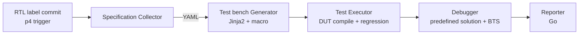

<!-- generated by yt-paper; edits will be overwritten -->

# Test bench Framework for Fully Automated Register Tests of Numerous IPs in SoC

[:material-open-in-new: 원문 보기](https://dvcon-proceedings.org/wp-content/uploads/1088-2.pdf){ .md-button .md-button--primary target=_blank }

> IP-XACT, SoC 주소맵, UVM 레지스터 모델, 보안 테이블을 파싱해 IP별 레지스터 접근 테스트벤치를 Jinja2로 자동 생성하고, Perforce RTL 라벨 이벤트에 맞춰 시뮬레이션·디버깅·리포팅까지 자동화하는 프레임워크로, 5개 SoC 프로젝트에서 전체 테스트의 약 35%를 커버한다고 보고한다.

| 항목 | 내용 |
|---|---|
| 저자/출처 | Wonyeong So, Minje Kim, Jihye Lim, Sunil Roe, Youngsik Kim, Sunil Brain Choi (Samsung Electronics Co. Ltd., Seoul, Korea) / 학회명은 본문에 명시되지 않음 |
| 유형 | PAPER |
| 카테고리 | Verification |
| ID | `ref-20261018-7575` |

## 핵심 인사이트

- 명세 간 교차 검증이 핵심 가치다: IP-XACT, 주소맵(Excel), UVM 레지스터 모델 세 소스의 IP 목록과 base address를 비교해 불일치를 specification bug로 로그에 남기므로, 생성 자동화와 함께 명세 자체의 무결성 점검 효과도 얻는다.
- Jinja2 템플릿 기반 생성은 레지스터 테스트처럼 시퀀스 구조가 단순하고 반복적인 경우에 적합하다. 템플릿이 자주 바뀌는 테스트에는 맞지 않는다는 한계도 저자가 인정한다.
- 디버깅 자동화는 두 층으로 나뉜다. 사전 정의된 UVM_ERROR 태그에는 해결 가이드를 출력하고, 예측 불가능한 bus hang이나 error response는 VIP callback으로 트리거되는 BTS(Bus Trace System) 디버거가 원인 지점을 찾는다.
- RTL 라벨 커밋을 p4 trigger 이벤트로 연결해 라벨마다 테스트벤치 생성과 회귀 실행을 자동 수행한다. 명세가 바뀌었는데 엔지니어가 놓친 IP의 verification hole을 조기에 잡는 sanity check로 활용할 수 있다.
- 정량 근거에는 한계가 있다: 커버리지 비율(약 35%, 프로젝트별 0.33~0.39)과 IP 수 대비 테스트벤치 수 일치는 제시되지만, TAT 단축 시간이나 Go/Python 성능 차이에 대한 벤치마크 수치는 본문에 없다.

## 상세 요약

### 배경 및 문제 정의

SoC 집적 IP 수가 늘어나면서 IP마다 만들고 유지보수해야 하는 레지스터 접근(read/write) 테스트벤치 수도 함께 증가한다. 이 작업은 시간이 많이 들고, 명세가 자연어·Excel·이메일 등 여러 형태로 흩어져 있어 해석 오류나 최신 변경 누락에 따른 verification hole이 생기기 쉽다. 저자들은 레지스터 테스트를 자동화 대상으로 고른 이유를 다음과 같이 설명한다.

- 테스트 대상 IP 목록이 미리 정해져 있고 테스트벤치 수가 많다.
- 시나리오가 단순(주로 read/write 반복)해서 템플릿화가 쉽다.
- 모든 SoC 검증의 전제(내부 레지스터 접근성 확인)라 중요도가 높다.

### 핵심 아키텍처 및 방법론

프레임워크는 Python 기반 4개 컴포넌트와 Go 기반 Reporter로 구성된다.

1. **Specification Collector**: IP-XACT XML(IP 목록), SoC 주소맵 Excel(블록별 IP와 base address), UVM 레지스터 모델(클래스 핸들러와 base address), TZPC 등 보안 명세를 수집한다. 세 소스를 비교해 불일치하면 명세 버그로 로그를 남기고, 결과를 YAML 파일로 내보낸다.
2. **Test bench Generator**: YAML을 입력으로 Jinja2 템플릿을 렌더링한다. 템플릿 macro(REGISTER_LOOP)가 IP마다 변수(register_class, register_inst, security 정보 등)를 바꿔 주며 `register_access_with_security_seq`를 호출하는 UVM vseq 클래스를 생성한다. 보안 테스트는 non-secure master가 secure IP에 접근할 때 차단되는지를 확인한다.
3. **Test Executor**: 생성된 테스트벤치로 DUT 컴파일과 레지스터 테스트 회귀를 자동 실행한다.
4. **Debugger**: UVM_ERROR에 붙은 태그에 대응하는 해결책을 출력한다(예: `[SFRSEC][NOSECUREG]` 에 대해 security_reg_num 설정 방법 안내). 태그가 없는 unexpected error는 BTS 모니터가 VIP callback으로 처리한다. timeout callback은 bus hang, end response의 error 응답은 error response로 판단해 BTS 디버거를 호출하고, 원인 지점을 로그에 출력한다.
5. **Reporter(Go)**: 전체 회귀 목록, 블록별 pass/fail과 pass rate, 블록 내 IP별 실패 유형을 보여준다. 저자들은 기존 EDA 리뷰 툴이 레지스터 테스트에는 과하다고 판단했다고 설명한다.

자동화 트리거는 Perforce의 `p4 trigger`를 사용한다. 이 방식에는 전제가 있다. RTL 라벨 파일이 정해진 경로에 정해진 네이밍 규칙으로 생성되어야 하며, 경로가 너무 넓으면 의도치 않게 실행될 수 있다. Git을 쓰는 프로젝트는 Git Actions로 대체할 수 있다고 언급한다. 라벨이 커밋되면 테스트벤치를 생성하고 변경 리스트(change list)를 만든 뒤 시뮬레이션과 디버깅까지 사람의 개입 없이 수행한다.

### 실험 결과 및 결론

이 논문은 정량 실험보다는 사내 5개 SoC 프로젝트(A~E)의 테스트 구성 통계를 보고한다.

| 프로젝트 | IP 수 | IP 레지스터 테스트 | 전체 테스트 | 비율 |
|---|---|---|---|---|
| A | 1,845 | 5,418 | 13,894 | 0.39 |
| B | 1,632 | 4,804 | 13,687 | 0.351 |
| C | 1,279 | 3,798 | 10,501 | 0.3617 |
| D | 1,184 | 2,839 | 8,570 | 0.3313 |
| E | 1,756 | 6,595 | 18,127 | 0.3638 |

- 전체 테스트 중 IP 레지스터 접근 테스트의 비중은 약 35%(0.33~0.39)다. 테스트 수가 IP 수보다 많은 이유는 보안 관련 테스트가 추가되기 때문이다.
- 저자들은 생성 대상 IP 수와 테스트벤치 수가 일치한다고 밝힌다.
- 결론적으로 프로젝트 테스트의 약 35%를 자동 생성·실행하고, 테스트벤치 유지보수 공수를 없앤다고 주장한다. 또한 명세 변경을 인지하지 못한 IP 버그를 조기에 찾는 sanity test 역할을 강조한다.

한계로는 TAT 단축 시간, 디버깅 시간 절감량, Go 선택에 따른 성능 이득에 대한 정량 수치가 본문에 없다. Jinja2 템플릿이 변경에 취약하다는 점도 저자가 인정하고 있다. 본문이 일부 잘린 부분(Figure 3~5 상세 등)은 있는 내용 범위에서만 요약했다.

## 관련 영상

<iframe src="https://www.youtube-nocookie.com/embed/VN30Q60D1X4" title="[DVCON2025]Test bench Framework for Fully Automated Register Tests of Numerous IPs in SoC" loading="lazy" allow="accelerometer; clipboard-write; encrypted-media; gyroscope; picture-in-picture; web-share" referrerpolicy="strict-origin-when-cross-origin" allowfullscreen></iframe>

**[DVCON2025]Test bench Framework for Fully Automated Register Tests of Numerous IPs in SoC** — [YouTube에서 보기](https://www.youtube.com/watch?v=VN30Q60D1X4) · [영상 페이지](../../videos/VN30Q60D1X4.md)
