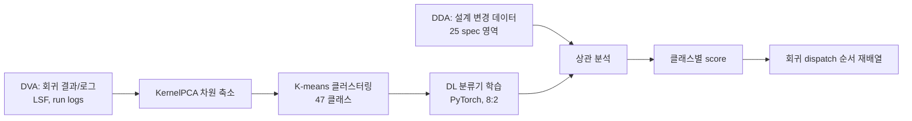

<!-- generated by yt-paper; edits will be overwritten -->

# Machine Learning Based Verification Planning Methodology Using Design and Verification Data

[:material-open-in-new: 원문 보기](https://dvcon-proceedings.org/wp-content/uploads/Machine-Learning-Based-Verification-Planning-Methodology-Using-Design-and-Verification-Data-1.pdf){ .md-button .md-button--primary target=_blank }

> 설계 변경 데이터와 과거 회귀 결과를 K-means 클러스터링과 딥러닝 분류로 학습해 SoC 회귀 테스트 실행 순서를 재배열함으로써, 실패 테스트를 회귀 초반에 발견하고 전체 회귀 기간을 단축하는 방법론이다.

| 항목 | 내용 |
|---|---|
| 저자/출처 | Hanna Jang, Seonghee Yim, Sunchang Choi, Seonil Brian Choi (Samsung Electronics). 학회명은 본문에 명시되어 있지 않으며, 출처는 힌트 기준 LPI |
| 유형 | PAPER |
| 카테고리 | Verification |
| ID | `ref-20261018-7aa6` |

## 핵심 인사이트

- 회귀 테스트 자체를 줄이지 않고 실행 순서만 바꾸는 접근이므로 기존 regression 인프라(DVA 등)에 비교적 낮은 비용으로 얹을 수 있다. 핵심 효과는 실패를 일찍 드러내 디버그 시간을 확보하는 데 있다.
- 라벨이 없는 대규모 검증 시나리오를 K-means로 pseudo-label을 만든 뒤 분류기를 학습하는 2단계 구조다. K 선택은 Elbow와 Silhouette를 병행했고, 본문에서는 60개 초과 클래스에서 성능이 떨어졌다고 보고한다.
- 설계 도메인(Spec)별 변경량과 클래스별 실패율의 상관을 표로 정리하면 어떤 변경이 실패를 늘리거나 줄이는지 예측하는 근거가 된다. 다만 이는 상관이며 인과관계를 입증한 것은 아니다.
- 평가의 한계가 뚜렷하다. 단일 기업의 사내 데이터에 기반하고, 93% 정확도의 지표 정의와 베이스라인 세부가 불명확하며, 일부 수치(예: 21.5%, '14 days')의 해석이 모호하다. 재현과 일반화에는 추가 검증이 필요하다.
- 본문 배경 절은 PCA를 설명하지만 실험 절은 KernelPCA를 사용했다고 밝혀 두 설명이 서로 맞지 않는다. 재현 시 어느 기법을 썼는지 확인이 필요하다.

## 상세 요약

### 배경 및 문제 정의

- SoC의 복잡도와 집적도가 높아지면서 full-chip 수준 회귀(regression) 실행 시간이 프로젝트 일정의 critical path가 되고 있다.
- 회귀 테스트는 우선순위 없이 무작위 순서로 실행된다. 원문 Figure 1에 따르면 약 35일의 회귀 기간 동안 거의 매일 새로운 실패가 발생했다. 실패가 검증 목표일 직전에 몰리면 디버그 시간이 부족해 검증 품질도 떨어진다.
- 따라서 실패 가능성이 높은 테스트를 검증 초반에 배치하는 것이 핵심 과제이다.
- 설계 변경(RTL 변경)이 검증 시나리오에 영향을 줄 것이라는 직관은 있지만, 설계팀과 검증팀이 분리되어 있어 두 데이터의 상관을 분석하는 일은 일반적이지 않다. 본 논문은 이 상관을 데이터로 분석한다.

### 핵심 아키텍처 및 방법론

**검증 단계 정의**: 원문은 개발 단계를 VL1~VL4로 나눈다. VL3와 VL4에서 주로 블록/SoC 검증과 회귀가 수행되며, 회귀는 VL3부터 시작되는 것으로 설명된다.

**데이터 수집 (DDA / DVA)**
- DDA(Design Data Analytics): 설계 변경 데이터를 수집·분석한다. 설계 데이터는 IP-XACT 등 메타데이터와 RTL 변경을 포함하며, 25개 specification 영역으로 분류한다.
- DVA(Design Verification Automation): regression manager를 통해 LSF 정보, 실행 결과, 로그, 환경 정보를 수집한다. 여기에 ML 기반 클러스터링/분류 모델을 기반으로 한 검증 시나리오 플래너를 추가했다.
- 사용 데이터는 시뮬레이션 결과 170만 건과 설계 파일 420만 개이다.

**시나리오 클러스터링 및 분류**
1. 검증 시나리오(옵션, 시퀀스, 레지스터 설정 정보 포함)는 수가 많아 사람이 라벨링할 수 없으므로 K-means로 pseudo-label을 만든다.
2. 차원 축소: sklearn의 KernelPCA를 사용해 누적 기여율 기준으로 feature 수를 수백 개 수준으로 줄인다.
3. K 선택: Elbow와 Silhouette를 병행한다. Elbow 결과 클래스가 많을수록 SSE가 줄지만, 60개 초과에서 모델 성능이 나빠져 40~60 범위로 제한했다. 최종 클러스터 수는 47개이며, 프로젝트 A와 B에서는 44개만 유효했다.
4. 분류기: PyTorch 기반 딥러닝 모델을 사용하며, train:test는 8:2이고 정확도 93%를 보고한다.

**상관 분석**
- 클래스별·VL 단계별 실패율을 계산한다(Figure 5). 예를 들어 VL2에서는 class 2, 43, 44, VL3에서는 class 1, 38, 41, VL4에서는 class 19, 21, 29에서 실패가 많았다.
- Spec별 RTL 변경량 추이를 분석한다(Figure 6).
- 두 축의 상관을 계산한다(Figure 7). Spec 9, 19, 21(component instance, register 등)의 변경은 거의 모든 클래스에서 실패를 늘렸다. Spec 4, 6, 16(bus, port 등)의 변경은 실패와 역상관을 보여 RTL 안정화 방향으로 작용한 것으로 해석된다.

**스케줄링**
클래스별 실패 가능성과 설계 변경 영향을 합산한 score로 클래스를 정렬하고, 이를 회귀 dispatch 순서로 사용한다.

### 실험 결과 및 결론

**클러스터링 신뢰성**: 프로젝트 A와 B에 같은 회귀를 적용해 VL3 결과를 비교했으며, 클래스별 경향이 유사하다는 점을 신뢰성 근거로 제시한다. 이후 분석은 VL 전 단계 데이터가 모두 있는 프로젝트 A 기준으로 수행되었다.

**스케줄 최적화 효과 (Figure 9, 원문 수치 그대로)**

| 실패율 도달 지점 | 최적화 순서 | 기존 순서 |
|---|---|---|
| 70% | 6일 | 10일 |
| 80% | 8일 | 11일 |
| 90% | 10일 | 12일 |

원문은 VL3 단계 전체 기간 13~15일 안에서 조기 디버그 시간을 확보하고, VL3 기간의 64% 시점에 80%까지 도달하는 효과를 언급한다. 또한 기능 pass rate 진행률이 21.5% 향상되었다고 기술한다. 다만 이 수치들의 산출 방식과 기준선은 본문에서 명확히 설명되지 않는다.

**디버그 시간**: 실패에서 pass로 전환되는 디버그 기간은 VL3에서 중앙값 1.3일, 평균 1.9일로 보고된다. 원문의 "14 days for each debugging period" 표현은 의미가 명확하지 않다.

**결론**
- 설계 변경과 검증 시나리오의 상관을 ML로 분석하고, 이를 이용해 회귀 순서를 재배열하여 실패 시나리오를 먼저 실행하는 방법을 제시했다.
- 설계 도메인별 실패 패턴이 프로젝트 간에 유사하다는 관찰은, 설계 변경이 예정된 경우 검증 계획을 미리 세우는 근거가 될 수 있다고 주장한다.
- 한계로 본문은 code/functional coverage 정보가 빠져 있어 근본 원인 분석이 제한되며, 더 많은 개발 단계의 데이터 축적이 필요하다고 밝힌다.
- 참고 관점: 사내 독점 데이터 기반이며 통계적 유의성 검정이나 공개 벤치마크 비교가 없어, 방법론의 일반화 가능성은 제한적으로 평가해야 한다.

## 관련 영상

<iframe src="https://www.youtube-nocookie.com/embed/8Zp0xkU97Fs" title="[DVCON2022] Machine Learning Based Verification Planning Methodology Using Design and Verification" loading="lazy" allow="accelerometer; clipboard-write; encrypted-media; gyroscope; picture-in-picture; web-share" referrerpolicy="strict-origin-when-cross-origin" allowfullscreen></iframe>

**[DVCON2022] Machine Learning Based Verification Planning Methodology Using Design and Verification** — [YouTube에서 보기](https://www.youtube.com/watch?v=8Zp0xkU97Fs) · [영상 페이지](../../videos/8Zp0xkU97Fs.md)
